# AWJ Design Lab — تقرير المرحلة 0 (الاكتشاف والاتجاهات)

**الحالة:** مكتملة — **متوقفة عند بوابة الاعتماد**. لم يبدأ بناء النموذج الكامل.
**الفرع:** `claude/awj-erp-design-lab-rbzrs0` · **Base SHA:** `49d9e4d03c42e18ad2ca1232f0fe1cedb8070af0` · **Head SHA/PR:** في رسالة التسليم.

## 1. ما تم إنجازه

| المخرج | الموضع | الحالة |
|---|---|---|
| تدقيق UX/UI مختصر | [`01-UX-AUDIT.md`](./01-UX-AUDIT.md) | ✅ 9 مشكلات مرتبة بالأثر + الأصول التي تُحفظ |
| ثلاثة اتجاهات قابلة للمقارنة | [`02-DESIGN-DIRECTIONS.md`](./02-DESIGN-DIRECTIONS.md) | ✅ قلم · ميزان · فجر |
| أمثلة ملموسة لكل اتجاه | [`../directions/index.html`](../directions/index.html) | ✅ لوحة تحكم · جدول مالي كثيف · إدخال فاتورة · شاشة جوال (+ وردية محطة) |
| توصية واضحة | `02-DESIGN-DIRECTIONS.md` §التوصية | ✅ ميزان + علامات قلم + انتباه فجر |
| فحوص وصولية وتخطيط وأداء | `../directions/checks.json` · `../directions/perf.json` | ✅ |
| نظام التصميم الموثّق · النموذج الكامل · خارطة الترحيل المفصّلة | — | ⏸ المرحلة 1 بعد الاعتماد |

### ما يعمل فعلياً في المستكشف (ليس صوراً)

- **الجدول:** بحث فوري (يقبل الأرقام العربية)، 6 فلاتر حالة بعدّادات، فرز بـ `aria-sort`، تحديد متعدد مع شريط إجراءات جماعية، ترقيم صفحات، تفاصيل (لوحة مقسومة/لوح منزلق/نافذة حسب الاتجاه)، `J/K`·`↑↓`·`Enter`·`/`، وحالات تحميل/فارغ/خطأ مع «إعادة المحاولة».
- **الفاتورة:** بحث عملاء بلوحة المفاتيح، شريط حد ائتمان، بنود قابلة للتحرير بإجماليات حيّة بأعداد صحيحة (هللات/أجزاء من ألف للكمية)، `Enter` يضيف بنداً، تحقق مضمّن (عميل/بنود)، حوار ترحيل يعرض قيداً متوازناً (معاينة توضيحية)، وإشعار نجاح.
- **الوردية:** إدخال قراءات الإغلاق، حجب القراءة الأقل من الافتتاح، لترات بـ mL صحيحة، مبيعات تقديرية، «الخطوة التالية».
- **عام:** لوحة أوامر `Ctrl K` (تنقّل/إجراءات/عملاء/تفضيلات)، فاتح/داكن، عربي/إنجليزي، 3 كثافات، 4 أجهزة عبر Container Queries، احترام `prefers-reduced-motion` و`forced-colors`.

## 2. الملفات المتغيّرة

كلها جديدة تحت `design-lab/` — **لا تعديل على أي ملف قائم**.

```
design-lab/README.md
design-lab/docs/01-UX-AUDIT.md
design-lab/docs/02-DESIGN-DIRECTIONS.md
design-lab/docs/PHASE-0-REPORT.md
design-lab/directions/index.html          (ملف واحد ~155KB، بلا بناء، خط الريال مضمّن)
design-lab/directions/checks.json
design-lab/directions/perf.json
design-lab/directions/screens/*.webp
design-lab/scripts/capture.mjs
design-lab/scripts/interactions.mjs
```

## 3. الاختبارات ونتائجها

| الفحص | النطاق | النتيجة |
|---|---|---|
| أخطاء الصفحة/الكونسول | 84 تهيئة (3 اتجاهات × 4 شاشات × 3 أجهزة × فاتح/داكن + LTR + حالات 320px) | **0** |
| تمرير أفقي غير مقصود (الصفحة + إطار التطبيق) | نفس الـ84 (390 · 900 · 1440 · 320px) | **0** |
| axe-core 4.x (`wcag2a/aa`, `wcag21aa`, `wcag22aa`) | نفس الـ84 | **0 مخالفات** (بعد إصلاح 5 أنواع ظهرت في الجولة الأولى: تباين الكسور، تسميات القراءات، منطقة تمرير غير قابلة للتركيز، `aria-label` على عنصر بلا دور، تباين عدّاد الفلتر) |
| اختبارات تفاعل حقيقية (Playwright) | 43 اختباراً: بحث، فرز، فلترة، تحديد جماعي، تفاصيل + Esc، لوحة أوامر بلوحة المفاتيح، دقة الإجماليات (`3 × 0.10 + 15%` = `0.35` لا `0.345000…`)، تحقق الترحيل وتوازن القيد، منع الترحيل مع سعر/خصم غير صالح مع بقاء النص المُدخل، بقاء تعديلات رأس الفاتورة، تفعيل حفظ القراءات فقط عند اكتمالها وصحتها، بقاء التركيز عند Tab أثناء الإدخال، حبس التركيز داخل لوحة الأوامر، حجب قراءة العداد، تنقّل الجوال، أهداف لمس ≥44px، LTR | **43/43** |
| أداء | تحميل الملف محلياً: DCL 408ms · load 754ms (يشمل خطوط Google) · إعادة رسم كاملة 3–9ms لكل شاشة · تحديث الإجماليات لكل ضغطة 0.05ms | ✅ |

**لم يُختبر بعد (حدود معلنة):** أجهزة iPhone/Android حقيقية (محاكاة متصفح فقط)، قارئ شاشة حقيقي، تكبير النص 200% بإعداد المتصفح (التدفق عند 320px مُثبت ويغطي متطلب 400%)، الأجهزة القابلة للطي، الشاشات ≥2560px.

## 4. Build / CI

- لا يدخل `design-lab/` أي workflow: `web-ci.yml` مقيّد بـ `web/**`، و`ci.yml` (PHP) لا يقرأ المجلد. **لم يُعدَّل أي workflow.**
- لا `package.json` جديد ولا تبعيات: السكربتات تستعمل Playwright المثبّت مسبقاً وaxe-core الموجود في `web/node_modules`.
- `php artisan test` غير مطلوب لهذا التغيير (لا كود backend)؛ لم يُلمس أي ملف PHP أو هجرة.
- **لا عملية مالية جديدة ولا قيد محاسبي حقيقي**: القيد في حوار الترحيل عرض توضيحي لبيانات تجريبية داخل الملف (مدين 1130 / دائن 4110 + 2120 — يطابق قيد الفاتورة الآجلة القائم في `InvoiceService`).

## 5. المخاطر والمتبقي

| الخطر | التخفيف |
|---|---|
| لهجة بصرية خامسة إن بُني النموذج خارج رموز v3 | المرحلة 1 تبني الاتجاه المعتمد كسمة/وضع فوق طبقات v3 لا بديلاً عنها |
| JetBrains Mono يغيّر مظهر المطبوعات والإيصالات الحرارية | اختباره على قوالب `print-templates` والطباعة الحرارية قبل التعميم (D4) |
| الاختصارات تتعارض مع اختصارات المتصفح/قارئ الشاشة | كل اختصار له بديل نقر؛ `Ctrl K` قياسي؛ لا اختصارات بحرف واحد داخل الحقول |
| شريط الحالة يعرض «سلسلة ZATCA سليمة» | في الإنتاج يجب أن يقرأ من مصدر حقيقي (`ZatcaIssuedDocumentIntegrity`) أو لا يظهر — لا مؤشر زائف |
| «الملاحظة الذكية» في فجر | غير مدعومة في الخادم؛ موسومة `تجريبي` ولا تدخل النطاق دون قرار |

## 6. الخطوة التالية — بعد اعتمادك

**المرحلة 1 (بناء AWJ Design Lab الكامل):** تطبيق مستقل معزول يغطي الوحدات العشر (لوحة التحكم، المحاسبة والمالية، المبيعات، المشتريات، المخزون والمستودعات، العملاء والموظفين، POS والمتجر، محطات الوقود، التقارير، الإعدادات والصلاحيات) بالاتجاه المعتمد، مع:
- توثيق نظام التصميم (رموز دلالية، طباعة، كثافة، شبكة، تنقّل، جداول، نماذج، حوارات، حالات، حركة، فاتح/داكن، RTL/LTR، WCAG 2.2 AA).
- مصفوفة اختبار: 320 · 375 · 390 · 430 · 768 · 834 · 1024 · 1280 · 1440 · 1920 · 2560، عمودي/أفقي، تكبير 200%، Reduced Motion.
- خارطة ترحيل مقسّمة إلى مهام مستقلة عبر آفاق v3 (لا Big Bang).

**أحتاج منك:** الرد على D1–D5 في `02-DESIGN-DIRECTIONS.md` (أو «اعتمد التوصية كما هي»)، وتحديد ما إذا كان النموذج الكامل يُبنى كتطبيق Next.js مستقل داخل `design-lab/` (موصى به: يعيد استعمال الستاك نفسه ليسهل الترحيل) أم كملفات ثابتة.

## 7. معاينات

**المستكشف التفاعلي المنشور (خاص بحسابك):** https://claude.ai/artifact/9Ts6hBJ3AEo6YGiTSDGHQ4 — أو افتح `design-lab/directions/index.html` محلياً.

### سطح المكتب (1280) — لوحة التحكم

| قلم | ميزان (موصى به) | فجر |
|---|---|---|
| 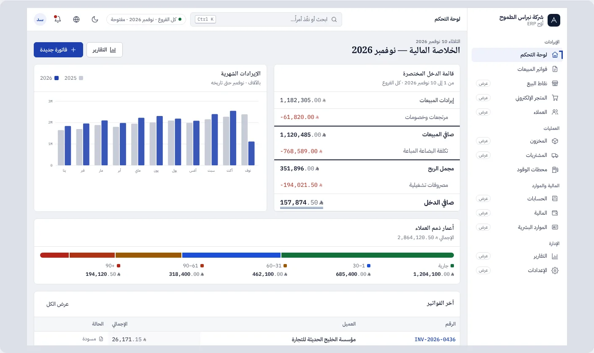 | 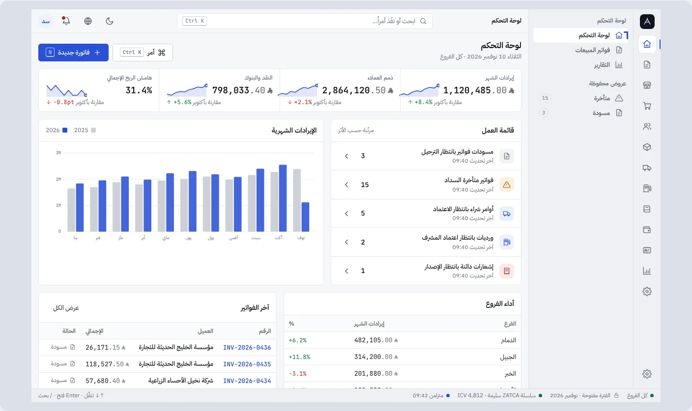 | 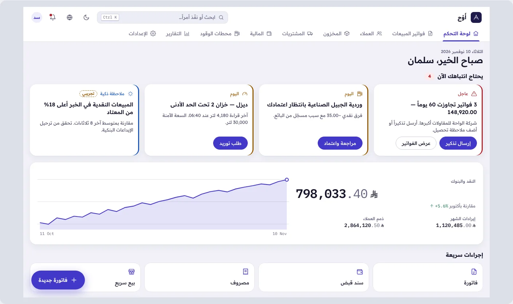 |

### الجدول المالي الكثيف وإدخال الفاتورة (1280)

| قلم | ميزان | فجر |
|---|---|---|
| 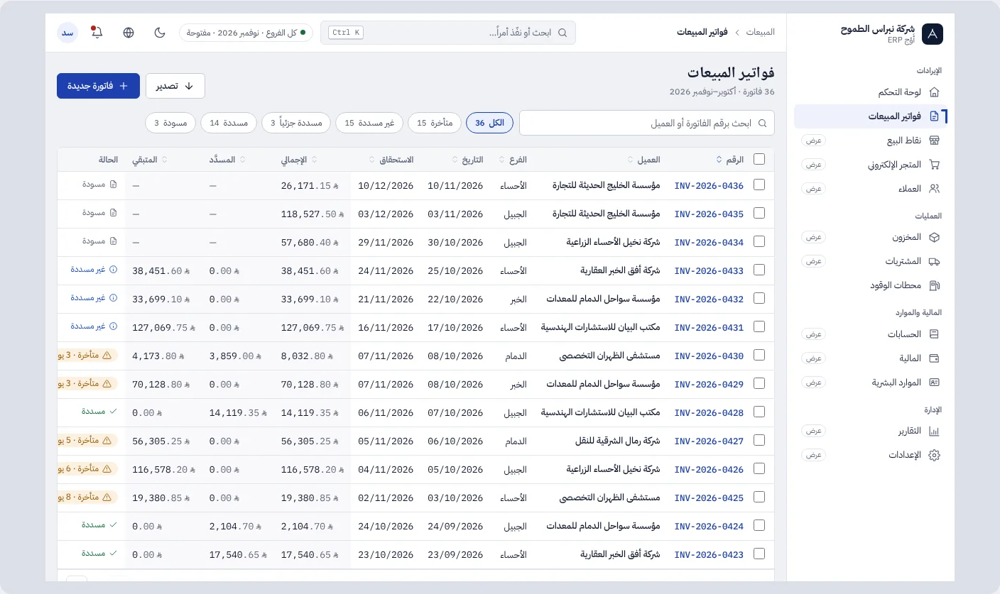 | 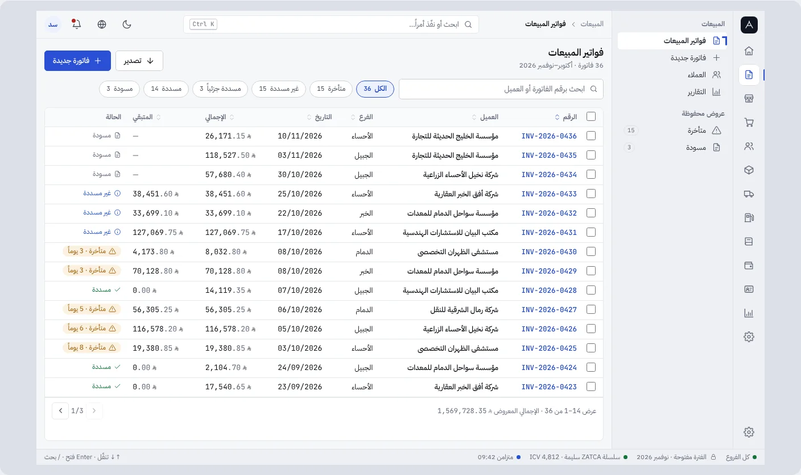 | 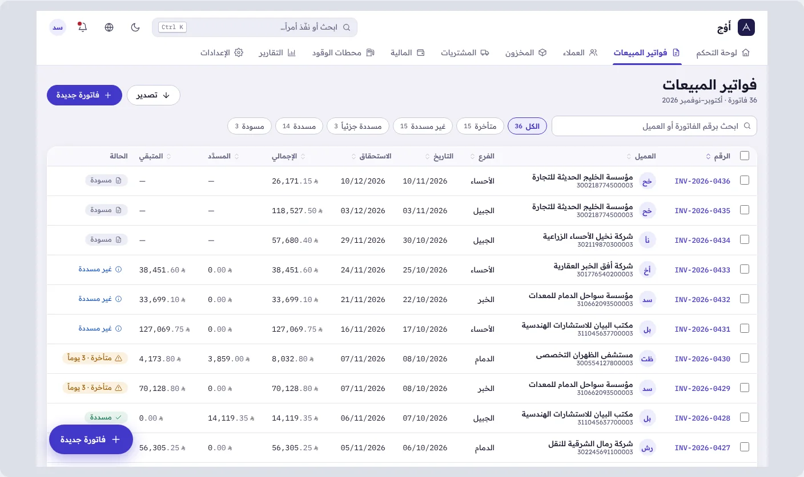 |
| 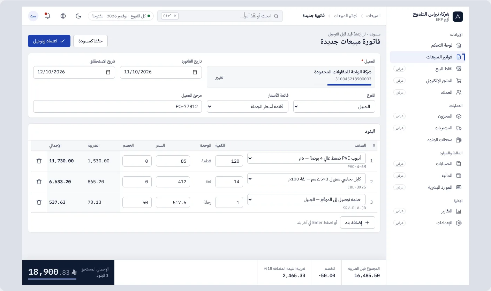 | 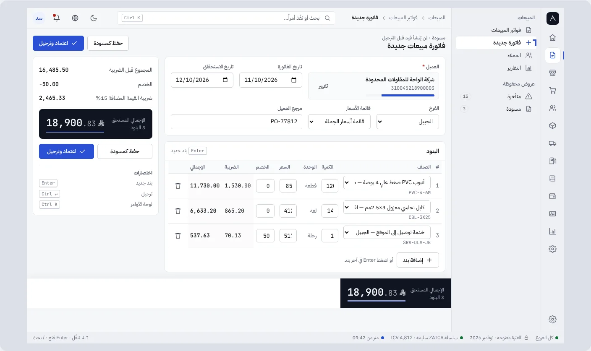 | 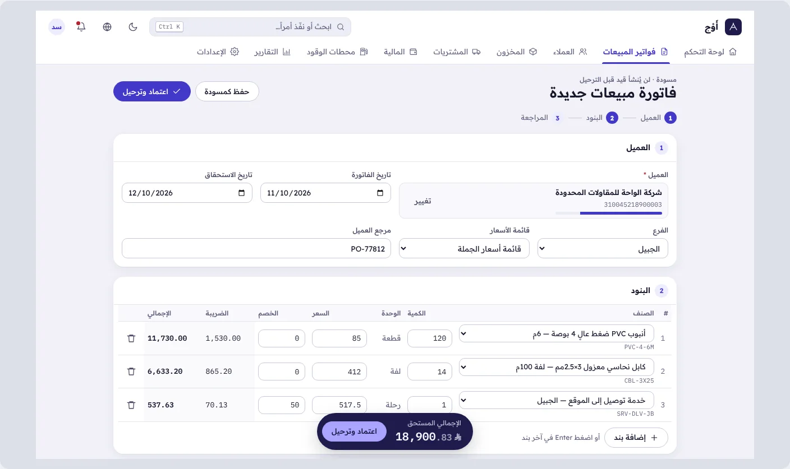 |

### الجوال (390) — قلم · ميزان · فجر

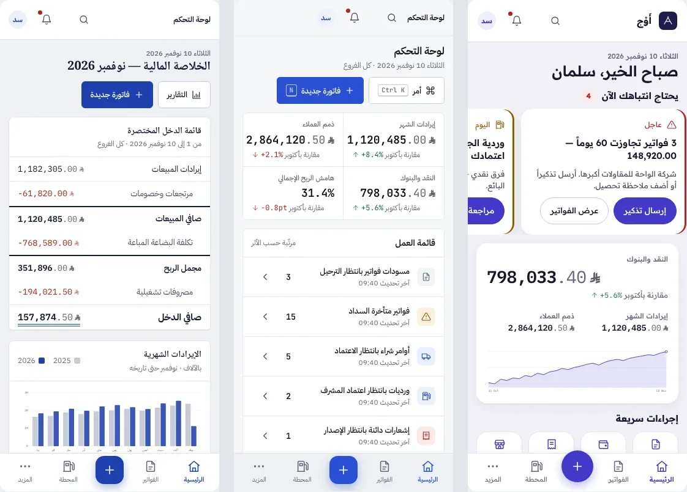
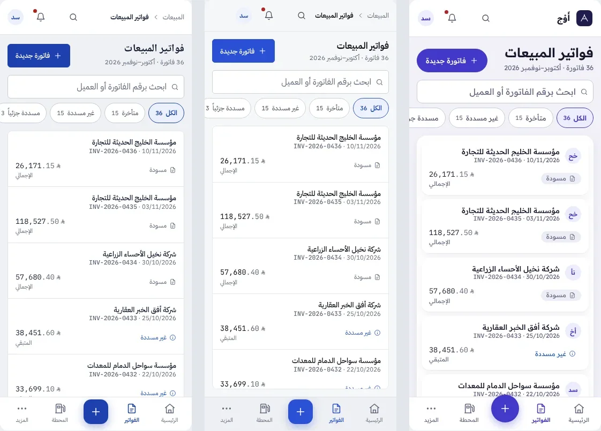
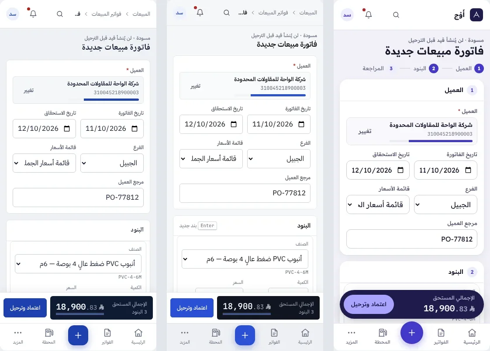
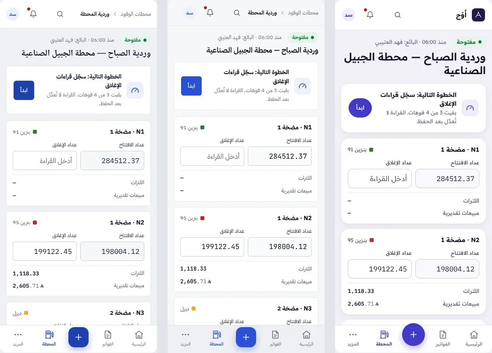

### الحالات عند 320px (ميزان) — تحميل · فارغ · خطأ

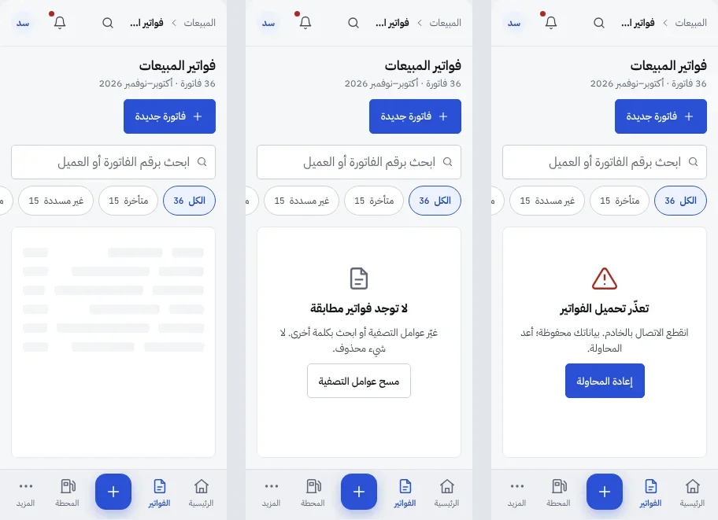

### الداكن والإنجليزية (LTR)

| ميزان داكن | ميزان English |
|---|---|
| 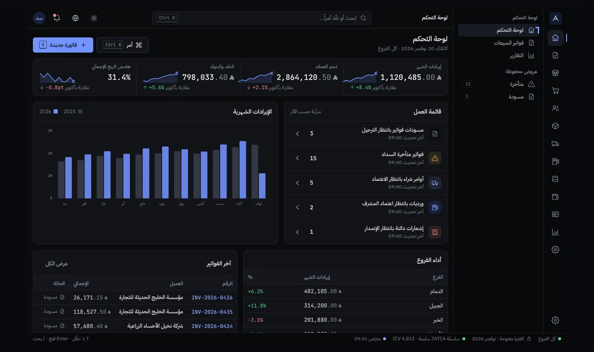 | 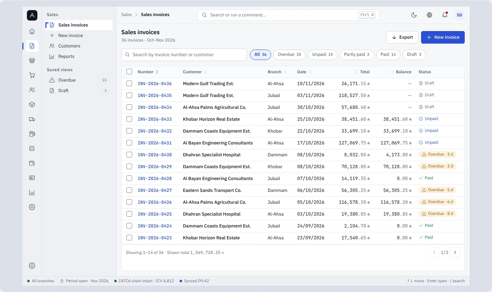 |

اللقطات الكاملة (لوحي 834 لكل شاشة، وداكن/إنجليزي لكل اتجاه) في `design-lab/directions/screens/`.
