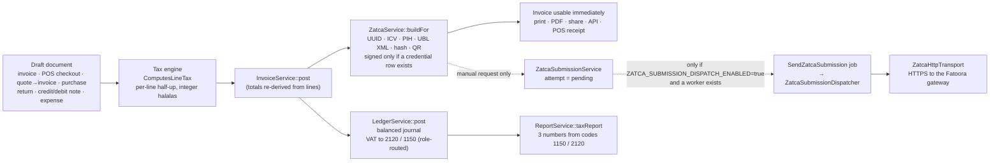

# AWJ-TAX-ZATCA-AUDIT-1 — VAT, E-Invoicing and ZATCA Integration Audit

**Deliverable A — Audit report** · audit-only · evidence-based · no certification or official approval is claimed

| | |
|---|---|
| Audit | AWJ-TAX-ZATCA-AUDIT-1 |
| Subject | أَوْج / AWJ ERP — VAT engine, accounting integration, e-invoicing, ZATCA Phase 1 and Phase 2, production readiness, security and multi-tenancy |
| Repository | `safwan5001-source/Nebrax` |
| Audited commit | `0534ef16543b01c69b416b58897337e012a9d1ab` — origin/main when the audit started on 2026-10-10 ("CUST-HV V6c-4: hero overlap preset … (#1285)"). origin/main has since advanced. The audit branch is based on `b3ff6654911b1fdda2ad4c938266271538a87122` (two commits, #1286 and #1288, storefront hero/banner call-to-action presentation and its tests — `git diff --name-only` lists 43 files); during the review round main moved again to `301eaf2195bd25d569cce9600dfdd484c83f05c7` (#1289, hero/banner layout variants — 25 files, the only PHP file being `app/Support/Commerce/StorefrontSectionDesignNormalizer.php`). No file of these commits is in the tax, accounting, e-invoicing/ZATCA, database or deployment code, and every finding was verified at `0534ef1…` |
| Audit branch | `audit/awj-tax-zatca-audit-1` — Markdown documents only |
| Audit date | 2026-10-10 |
| Mode | **AUDIT ONLY** — no application code, accounting behaviour, schema, test, configuration or credential was changed; no production migration; no real customer data; no live ZATCA submission; nothing merged, deployed or released |
| Companion deliverables | **B** `AWJ-TAX-ZATCA-GAP-MATRIX.md` (requirement-by-requirement) · **C** `AWJ-TAX-ZATCA-REMEDIATION-PLAN.md` · evidence folder `AWJ-TAX-ZATCA-AUDIT-1-evidence/` |
| Decision | **NOT READY** |

## Contents

- [1. Executive summary](#1-executive-summary)
- [التقرير التنفيذي (بالعربية)](#التقرير-التنفيذي-بالعربية)
- [2. Scope, method and evidence discipline](#2-scope-method-and-evidence-discipline)
- [3. How tax and e-invoicing work in AWJ today (system map)](#3-how-tax-and-e-invoicing-work-in-awj-today-system-map)
- [4. Results overview](#4-results-overview)
- [5. Critical and high findings at a glance](#5-critical-and-high-findings-at-a-glance)
- [6. Detailed findings](#6-detailed-findings)
- [7. Positive controls (verified implemented)](#7-positive-controls-verified-implemented)
- [8. Experiments: numerical, SDK and concurrency](#8-experiments-numerical-sdk-and-concurrency)
- [9. Test evidence](#9-test-evidence)
- [10. Official-source traceability](#10-official-source-traceability)
- [11. Production readiness](#11-production-readiness)
- [12. NOT VERIFIED register](#12-not-verified-register)
- [13. Decision and conditions](#13-decision-and-conditions)
- [Appendix A — Repository files cited as evidence](#appendix-a--repository-files-cited-as-evidence)
- [Appendix B — Findings index](#appendix-b--findings-index)
- [Appendix C — Changes made by the audit](#appendix-c--changes-made-by-the-audit)
- [Appendix D — Glossary](#appendix-d--glossary)

## 1. Executive summary

> ### Decision: **NOT READY**
> AWJ must not be relied on today as a ZATCA Phase 2 e-invoicing solution, nor as a complete Saudi VAT-compliance system. The accounting and VAT-arithmetic core is strong and the multi-tenant isolation is well built, but: (i) the generic return and credit-note path posts the wrong VAT for tax-inclusive and discounted sales; (ii) every e-invoice AWJ generates is rejected by ZATCA's own offline validator — XSD, EN 16931 and KSA rules, and for simplified invoices also QR and signature; (iii) credit and debit notes are not e-invoiced at all; (iv) nothing is transmitted automatically, outcome handling is incomplete (no in-doubt state; non-rejection statuses are recorded as rejections), and standard invoices are released before Clearance; (v) production configuration cannot be evidenced, and the repository's own deployment blueprint contradicts the operational requirements (no worker, synchronous queue, local disk) and leaves the records-location question open (Frankfurt region).
>
> This is a statement about the code at the audited commit and about the evidence available to an audit that had **no production access and sent nothing to ZATCA**. It is not a certification, an approval, or legal advice. A passing test suite alone does not establish regulatory compliance — and here the suite itself encodes some of the deviations (PH2-14).

Under the owner-approved Pre-Production Data Policy (`docs/audits/AWJ_PRE_PRODUCTION_DATA_POLICY.md`, 2026-09-06) every current tenant and document is treated as test data, so the findings below are **pre-go-live defects**. Whether any real taxpayer data already exists in production is NOT VERIFIED (REM-00A).

**Why it matters now.** According to the ZATCA wave announcements catalogued in register R1 §4, the integration deadlines of Waves 1–24 have passed and Wave 25 (VAT-taxable revenue above SAR 187,500 in 2022–2025) must be integrated by 1 February 2027 — essentially every established VAT-registered tenant is in, or about to enter, Phase 2. "Phase 1 only" is therefore not a durable position for AWJ.

### 1.1 Numbers

| | |
|---|---|
| Findings (defects and gaps) | **105** — P0 **8** · P1 **25** · P2 **49** · P3 **23** |
| Observations (verified-implemented design notes, not counted above) | 4 |
| Root-cause groups | 24 |
| Requirements traced (Gap Matrix) | 295 register rows — R1 229 + R2 66: 10 verified implemented, 28 verified defect, 126 partially implemented, 79 not implemented, 4 not verified, 48 not applicable |
| Existing tests executed | **CI reference at the audited commit (green):** PHP SQLite 5 872 passed · 58 skipped, PostgreSQL 16 5 929 passed · 1 skipped; Web CI: Vitest 445 files / 4 117 tests, then the production build. **Sandbox:** targeted 119 classes × 2 databases (7 failures, all `FuelSaleServiceTest`); full PHP suite on SQLite — first run 124 failures, reproduced identically and attributed to three missing harness dependencies by adding and removing them one at a time (`bcmath` 26 · mail classes 12 · AWS SDK 86), repaired run 5 872 passed · 58 skipped · 0 failed, identical to CI; Vitest 445 files / 4 117 tests passed; Playwright 216 tests from 17 of the 66 specs (194 passed · 15 failed, i.e. 10 distinct tests on the desktop and mobile projects · 7 skipped on the first run; each failing test was re-run alone and 14 of the 15 failures reproduced; cause evidenced for 8 of the 10 tests, none concerns tax or ZATCA) (§9) |
| Purpose-written probes | 26 probe classes and 9 helper scripts on production code paths with synthetic data (SQLite and PostgreSQL), plus offline runs of the official ZATCA SDK 238-R3.4.8 |
| Changes made to the repository | **None** to code, schema, tests or configuration — Markdown audit documents only |

### 1.2 The audit's key questions, answered

| # | Question | Answer | Basis |
|---|---|---|---|
| 1 | Is VAT computed correctly? | **Yes for invoices, POS and purchases** (integer halalas, half-up per line, exact tax-inclusive extraction, totals re-derived from lines — 18 numerical scenarios identical on SQLite and PostgreSQL). **No for API/web returns and credit notes**: they recompute VAT from the gross price. | PC-A1…A16, VAT-01, VAT-02 |
| 2 | Are zero-rated, exempt and out-of-scope supplies distinguished? | **No.** There is only `tax_rate = 0`; no category (S/Z/E/O), no exemption reason, no effective-dated rate. | VAT-03, VAT-11 |
| 3 | Does the ledger carry VAT correctly? | **Yes by default** (balanced double entry, one engine, 2120/1150; reconciles to document totals on both databases) — **but** VAT roles can be re-mapped into the wrong account class, and notes/returns/expenses/assets bypass the role routing. | PC-B1…B14, ACC-01, ACC-02 |
| 4 | Can a Saudi VAT return be produced? | **No.** The "tax report" is three numbers from two account codes; no boxes, no categories, no period freeze. | ACC-03, ACC-04 |
| 5 | Phase 1: is a valid QR produced? | A TLV QR with tags 1–5 is produced and stored at posting, when the e-invoicing application is enabled. The timestamp is the **draft-creation** time, the seller VAT number is not validated, notes carry no QR, and fresh tenants do not get the QR at all until they enable the application. | PH1-01…PH1-06 |
| 6 | Phase 2: would ZATCA accept AWJ's documents? | **No.** The official SDK (offline) fails every AWJ document at XSD, EN 16931 and KSA stages; signed simplified invoices also fail QR and SIGNATURE. AWJ's invoice **hash** is byte-identical to the SDK's. | PH2-01…PH2-05, PC-D1 |
| 7 | Does AWJ submit invoices to ZATCA? | **Only manually**, only if `ZATCA_SUBMISSION_DISPATCH_ENABLED=true` (default `false`), and only with a queue worker that the production blueprint does not define. No automatic mode, no scheduler, no UI, no 24-hour clock. | SUB-05, OPS-01 |
| 8 | Is "accepted" trustworthy? | **Partly.** The documented API semantics make the HTTP status the outcome signal (200 accepted, 202 accepted with warnings, 400 rejected) and AWJ follows them — but 401/403/404/409/413/422/303 are recorded as `rejected`, redirects are followed, a non-JSON 200 is accepted, and there is no in-doubt state after a timeout. "Queued" is never treated as "accepted". | SUB-11, SUB-02, SUB-06 |
| 9 | Are standard (B2B) invoices held until Clearance? | **No** — printed, PDF'd, shared, returned by the API and shown on POS receipts straight after posting. | SUB-01 |
| 10 | Is tenant data isolated and are secrets protected? | **Yes, strongly** — cross-tenant probes of the invoice, e-invoicing, credential, settings, revisions and Public API routes found no cross-tenant read or write on either database; credentials are encrypted and never echoed. Gaps: branch authorisation on invoice mutations, PostgreSQL deadlocks, deactivated users, fail-closed signing without recovery. | PC-F1…F17, SEC-01…SEC-04 |
| 11 | Is production configured for any of this? | **NOT VERIFIED.** The repository blueprint pins `QUEUE_CONNECTION=sync`, runs no worker or scheduler, targets Frankfurt, and stores documents on local disk. | OPS-01, CON-01, PH1-16 |

### 1.3 Verdict by scope

| Scope | Verdict | Why |
|---|---|---|
| VAT engine — invoices, POS, purchases | **READY WITH CONDITIONS** | Arithmetic verified; conditions: overflow guards (REM-09), rounding/shipping/inclusive-flag consistency (REM-10), category model (REM-12) |
| VAT engine — returns and credit notes | **NOT READY** | VAT-01 (P0), VAT-02 (P1), ACC-06 |
| Accounting integration (ledger, posting, locks) | **READY WITH CONDITIONS** | Strict, balanced, concurrency-safe on PostgreSQL; conditions: ACC-01/02 routing, immutability at model level (ACC-05) |
| VAT reporting (return, period freeze) | **NOT READY** | ACC-03, ACC-04 |
| ZATCA Phase 1 (generation) | **NOT READY** | PH1-01…PH1-06 (issue time, party snapshots, seller VAT validation, optional application, advisory classification, notes without QR) — operational workarounds in the Remediation Plan §4 reduce but do not remove the exposure |
| ZATCA Phase 2 — generation, stamp, QR | **NOT READY** | PH2-01…PH2-05 (P0), PH2-07…PH2-09 (P1) |
| ZATCA Phase 2 — submission, clearance, reporting | **NOT READY** | SUB-01, SUB-05 (P0); SUB-03/04/07, OPS-01/02 (P1) |
| Production operations | **INSUFFICIENT EVIDENCE** | No production access; blueprint contradicts requirements (OPS-01, CON-01) |
| Security and multi-tenancy | **READY WITH CONDITIONS** | Isolation strong; fix SEC-01, SEC-02, SEC-03, SEC-04 first |
| **Overall** | **NOT READY** | Seven of the eight P0 findings sit in the ZATCA pipeline and can only be closed by code (REM-16, 17, 18, 23, 24) |

### 1.4 What is solid (verified)

* **Money and tax arithmetic** — integer halalas end to end, no float in tax formulas; half-up per-line rounding; exact inclusive extraction (100.00 → 86.96 + 13.04); server-recomputed totals that header tampering cannot reach; POS and `InvoiceService` produce byte-identical results; identical on SQLite and PostgreSQL.
* **Double-entry engine** — one writer for journals, balanced and immutable by service convention; 3 racing processes posting the same invoice produce exactly one journal; period locks hold under real concurrency; VAT postings reconcile to document totals on both databases.
* **ZATCA hash and chain mechanics** — AWJ's invoice hash equals the SDK's on 19 of 19 official samples, on 10 of 10 mutations, and on AWJ's own two generated documents; ICV allocation is gap-free and unique under concurrent PostgreSQL posting; the PIH chain verifies link by link.
* **Submission safety nets** — endpoint pinning, per-environment credential resolution without fallback, idempotent attempt creation, single terminal transition, one HTTP send under concurrent dispatchers, sanitised response payloads, no secret egress.
* **Tenant isolation and RBAC** — no cross-tenant read or write in any probe; platform plane separated; job payloads carry ids only.

### 1.5 What is not (the 8 P0 findings)

* **VAT-01** — Returns recompute VAT from the gross unit price: tax-inclusive and header-discounted sales are reversed at the wrong VAT (REM-01).
* **PH2-01** — ECDSA signature computed over the wrong bytes and in the wrong form — SDK: "wrong signature Value" (REM-17).
* **PH2-02** — XAdES SignedProperties use the wrong element set and digest encodings — SDK: XSD and SIGNATURE failures (REM-17).
* **PH2-03** — Phase 2 QR tags 3, 6, 7, 8 use the wrong encodings — SDK: QR FAILED (REM-17).
* **PH2-04** — UBL body is a skeleton: XSD, EN 16931 and BR-KSA failures on every invoice (REM-16).
* **PH2-05** — Credit and debit notes are not e-invoiced at all — no XML, QR, hash, ICV/PIH, signature or submission (REM-18).
* **SUB-01** — Standard (B2B) invoices are issued, printed and shared before — and independently of — Clearance (REM-24).
* **SUB-05** — No automatic submission, no UI, no 24-hour tracking; simplified invoices are never reported (REM-23).

### 1.6 Top-5 remediation priorities

| # | Priority | Tasks (Remediation Plan) | Why first |
|---|---|---|---|
| 1 | Stop posting wrong VAT on returns and credit notes | REM-01, REM-02 | Financial misstatement for any tenant on inclusive pricing, independent of ZATCA |
| 2 | Build the oracle, then make documents valid | REM-11 (SDK harness), REM-12 (categories), REM-13/14 (issue time, parties), REM-16 (UBL), REM-17 (stamp/QR) | Nothing in ZATCA integration can be accepted until the official validator passes |
| 3 | E-invoice credit/debit notes and complete the Phase 1 hygiene | REM-18, REM-15, REM-20 | Notes are mandatory e-documents; Phase 1 gaps are cheap and visible |
| 4 | Make submission trustworthy | REM-21 → REM-24, REM-25 | Correct outcome handling, in-doubt state, worker/scheduler, 24-hour clock, clearance release gate, environment-scoped chain |
| 5 | Close security and routing gaps and collect production evidence | REM-03…REM-08, REM-00A | Cheap, independent, and the residency/topology question can invalidate the hosting plan |

**Recommended next task:** run **REM-01 (+ REM-02)** — the P0 financial defect with a known fix and a ready reference implementation (`PosReturnService`) — in parallel with **REM-11** (the SDK conformance harness) and **REM-00A** (production evidence pack). The three are independent, small, and unblock everything else.

### 1.7 Interim controls (no code)

While the tasks above are built: keep `ZATCA_SUBMISSION_DISPATCH_ENABLED=false`; do not describe AWJ output as cleared or reported; route returns of tax-inclusive or discounted sales through the POS return flow or hold them for review; post simplified invoices on the day they are created; verify each tenant's VAT number before first issuance. The full list is in the Remediation Plan §4.

## التقرير التنفيذي (بالعربية)

> ### القرار: **غير جاهز (NOT READY)**
> أَوْج بوضعه الحالي لا يصلح للاعتماد عليه كحلّ فوترة إلكترونية متوافق مع المرحلة الثانية (التكامل) لهيئة الزكاة والضريبة والجمارك، ولا كنظام امتثال كامل لضريبة القيمة المضافة السعودية. هذا حكم على الكود المُدقَّق وعلى الأدلة المتاحة لتدقيق **بلا وصول إلى الإنتاج وبلا أي إرسال حيّ إلى هيئة الزكاة**؛ وليس شهادة اعتماد ولا موافقة رسمية ولا استشارة قانونية.

### 1) التقييم العام

النواة المحاسبية وحساب الضريبة للفواتير ونقاط البيع والمشتريات **سليمة ومُثبتة بالتجارب**، وعزل المستأجرين **قوي**. لكن خمسة أمور تمنع الجاهزية:

1. **المرتجعات وإشعارات الدائن** عبر الـAPI والواجهة تعيد حساب الضريبة من السعر الإجمالي، فتُسجَّل ضريبة خاطئة للمبيعات الشاملة للضريبة أو ذات الخصم الإجمالي (P0 — VAT-01، وP1 — VAT-02).
2. **كل فاتورة إلكترونية** يولّدها أَوْج **تفشل** في المدقق الرسمي لهيئة الزكاة (SDK 238-R3.4.8، تشغيل محلي): مراحل XSD وEN 16931 وقواعد KSA، والفواتير المبسطة تفشل كذلك في QR والتوقيع (PH2-01…PH2-04).
3. **إشعارات الدائن والمدين لا تُصدَر كفواتير إلكترونية إطلاقًا** (بلا XML ولا QR ولا ICV/PIH ولا توقيع ولا إرسال — PH2-05).
4. **لا إرسال تلقائي ومعالجة النتائج ناقصة**: لا توجد حالة «غير مؤكَّد» بعد انقطاع الاتصال، وحالات 401/403/404/409/413/422/303 تُسجَّل «مرفوضة»، والفواتير القياسية (B2B) تُطبع وتُشارَك قبل المصادقة (Clearance)، ولا يوجد عدّاد 24 ساعة للفواتير المبسطة (SUB-01، SUB-05، SUB-11، SUB-06).
5. **الإنتاج غير قابل للإثبات**: ملف النشر في المستودع يثبّت `QUEUE_CONNECTION=sync` بلا عامل طوابير ولا مجدوِل، ويستهدف منطقة فرانكفورت وتخزينًا محليًا، وهذا يتعارض مع متطلبات الاستمرارية ويُبقي مسألة مكان حفظ السجلات (داخل المملكة) مفتوحة (OPS-01، CON-01).

وبحسب سياسة بيانات ما قبل الإنتاج المعتمدة من المالك (2026-09-06) تُعدّ بيانات المستأجرين الحاليين بيانات تجريبية؛ لذا هذه **عيوب ما قبل الإطلاق**. وجود بيانات حقيقية في الإنتاج اليوم **غير مُتحقَّق منه**.

### 2) ما هو مكتمل (مُتحقَّق منه)

- **الحساب النقدي والضريبي**: وحدات صغرى صحيحة (هللات)، تقريب نصف-للأعلى لكل سطر، استخراج دقيق للضريبة من السعر الشامل (100.00 ← 86.96 + 13.04)، إجماليات تُعاد من السطور ولا تتأثر بالتلاعب بالرأس؛ النتائج متطابقة على SQLite وPostgreSQL في 18 سيناريو رقمي.
- **القيد المزدوج**: كاتب واحد للقيود، متوازنة، ثلاث عمليات متزامنة لترحيل الفاتورة نفسها تنتج قيدًا واحدًا، وأقفال الفترات تعمل تحت التزامن الحقيقي؛ ضريبة القيمة المضافة في الدفتر تتطابق مع إجماليات المستندات.
- **آليات الهاش والسلسلة**: هاش الفاتورة مطابق **بايت-ببايت** لأداة الهيئة (SDK) على 19 من 19 عيّنة رسمية و10 من 10 تحويرات وعلى مستندين ولّدهما أَوْج؛ ترقيم ICV بلا فجوات تحت التزامن على PostgreSQL وسلسلة PIH سليمة.
- **سلامة الإرسال**: تثبيت نقاط النهاية، حلّ الاعتماد لكل بيئة بلا بديل، مفاتيح idempotency، انتقال نهائي واحد للمحاولة، إرسال HTTP واحد فقط تحت المرسِلين المتزامنين، وتنقية الاستجابات بلا تسرّب أسرار.
- **العزل والأمان**: لا قراءة ولا كتابة عابرة للمستأجرين في أي تجربة (مسارات الفواتير والفوترة الإلكترونية والاعتمادات والإعدادات والمراجعات وواجهة Public API)؛ الاعتمادات مشفّرة ولا تُعاد في أي استجابة.

### 3) ما هو غير مكتمل

- لا نموذج لفئات الضريبة (قياسي/صفري/معفى/خارج النطاق) — `tax_rate=0` فقط (VAT-03).
- لا إقرار ضريبة قيمة مضافة ولا قفل لفترة الإقرار (ACC-03، ACC-04).
- المرحلة الأولى: وقت QR هو وقت إنشاء المسودة، رقم الضريبة للبائع بلا تحقق، بيانات الأطراف تُقرأ حيّة عند إعادة الطباعة، التطبيق اختياري للمستأجرين الجدد، تصنيف قياسي/مبسط استشاري، وإشعارات بلا QR (PH1-01…PH1-06).
- المرحلة الثانية: لا دورة تسجيل (CSR/CSID)، توقيع XAdES وترميز حقول QR خاطئان، سلسلة ICV/PIH واحدة تعبر بيئات التطوير والمحاكاة والإنتاج، وقيمة PIH الابتدائية (genesis) تختلف عن الرسمية (PH2-06…PH2-11).
- بنية الإرسال: لا مراقبة تشغيلية، لا استرداد بعد الأعطال، فشل مغلق يوقف الفوترة كاملةً عند انتهاء الشهادة (OPS-02، OPS-04، SEC-03).
- إدارة الجلسات وسجل النشاط (إرشادات الهيئة التفصيلية §5.6): لا سجل لعمليات الدخول والدخول الفاشل، لا إلزام بتغيير كلمة المرور عند أول استخدام لمستخدم أنشأه مدير بكلمة مرور، حذف المسودات والطباعة/التصدير غير مسجَّلين، وسجل تغييرات المستندات قابل للحذف بعد سنتين (CON-13، ACC-10).

### 4) النتائج الحرجة (P0 — 8 نتائج)

- **VAT-01** — المرتجعات تعيد حساب الضريبة من السعر الإجمالي: المبيعات الشاملة للضريبة أو ذات الخصم الإجمالي تُعكَس بضريبة خاطئة (REM-01).
- **PH2-01** — توقيع ECDSA محسوب على بايتات خاطئة وبصيغة خاطئة — SDK: «wrong signature Value» (REM-17).
- **PH2-02** — عناصر XAdES SignedProperties وترميز الهاشات خاطئة — SDK: فشل XSD والتوقيع (REM-17).
- **PH2-03** — ترميز حقول QR للمرحلة الثانية (3 و6 و7 و8) خاطئ — SDK: فشل QR (REM-17).
- **PH2-04** — جسم UBL هيكل ناقص: إخفاقات XSD وEN 16931 وقواعد KSA في كل فاتورة (REM-16).
- **PH2-05** — إشعارات الدائن والمدين لا تُصدَر إلكترونيًا إطلاقًا — بلا XML ولا QR ولا هاش ولا ICV/PIH ولا توقيع ولا إرسال (REM-18).
- **SUB-01** — الفواتير القياسية (B2B) تُصدَر وتُطبَع وتُشارَك قبل المصادقة (Clearance) ومستقلةً عنها (REM-24).
- **SUB-05** — لا إرسال تلقائي ولا واجهة ولا تتبّع لمهلة 24 ساعة؛ الفواتير المبسطة لا يُبلَّغ عنها أبدًا (REM-23).

### 5) مخاطر ضريبة القيمة المضافة والمحاسبة

- ضريبة مخرجات مُعكوسة أكثر مما حُصِّل ومبالغ مستردة للعملاء أعلى مما دفعوا (VAT-01، VAT-02).
- أدوار حسابات الضريبة قابلة للتحويل إلى حسابات خاطئة فيختفي الـVAT من التقرير، والإشعارات والمرتجعات والمصروفات والأصول تتجاوز التوجيه الدلالي (ACC-01، ACC-02).
- لا قفل لفترة الإقرار فتتغير الأرقام المُقدَّمة بمستندات بأثر رجعي (ACC-04)، ولا ضبط لمهلة إصدار الإشعارات (15 من الشهر التالي — CON-02).
- فيض أعداد صحيحة 64-بت عند مبالغ كبيرة (≈ 30–78 مليون ريال) (VAT-05، PH1-08)، وفروق بهللة واحدة في ضريبة خصم الرأس والشحن (VAT-07، VAT-08).
- لا دعم للدفعات المقدَّمة والعكس الضريبي والاستيراد وخصم المدخلات المقيَّد (CON-03، CON-04).
- حقل «التسوية» (adjustment) في الفاتورة غير مقيَّد (حتى ±مليار ريال عبر الـAPI) وغير خاضع للضريبة ويُقيَّد في حساب مصروفات (5170)، فالمبلغ الموجب فيه يُحصَّل من العميل بلا ضريبة مخرجات ولا إيراد، ولا يمكن تمثيله في XML المرحلة الثانية (CON-12، VAT-06).

### 6) مخاطر ZATCA

- رفض مؤكَّد بحسب المدقق الرسمي لكل المستندات المُولَّدة (XSD/EN/KSA) ولكل فاتورة مبسطة موقَّعة (QR/SIGNATURE).
- إشعارات الدائن/المدين خارج السلسلة والإرسال.
- نشر الفواتير القياسية قبل المصادقة، وغياب الإبلاغ خلال 24 ساعة للمبسطة.
- معالجة نتائج الإرسال ناقصة (تصنيف الحالات، غياب حالة «غير مؤكَّد»)، وإعادة إرسال المستند المرفوض نفسه دون مسار تصحيح.
- سلسلة واحدة عبر البيئات، وتعطّل الفوترة بالكامل عند سوء ضبط البيئة أو انتهاء الشهادة.

### 7) جاهزية الإنتاج

**أدلة غير كافية (INSUFFICIENT EVIDENCE)** للخدمة الحيّة؛ وملف النشر في المستودع **لا يلبّي** متطلبات التشغيل (لا عامل ولا مجدوِل، queue=sync، قرص محلي، مدة احتفاظ 365 يومًا) ويستهدف منطقة فرانكفورت دون حسم مسألة مكان حفظ السجلات. علمًا بأن `ZATCA_SUBMISSION_DISPATCH_ENABLED` افتراضيه `false` ولا يُرسل شيء إلا يدويًا وبعد تفعيله؛ وهذا الوضع الآمن مؤقتًا يعني أنه لا مصادقة ولا إبلاغ يحدثان إطلاقًا. «في الطابور» لا يعني «مقبول لدى الهيئة».

### 8) نتائج الاختبارات

- **مرجع CI عند الالتزام المُدقَّق (أخضر)**: SQLite: 5872 نجح / 58 تخطّي؛ PostgreSQL 16: 5929 نجح / 1 تخطّي؛ Web CI: Vitest ‏445 ملفًا / 4 117 اختبارًا ثم بناء الإنتاج.
- **اختبارات المستودع الحالية (مستهدفة في بيئة التدقيق)**: 119 صنفًا، 1363 اختبارًا لكل قاعدة بيانات. SQLite: 1346 نجح / 7 فشل / 10 تخطّي. PostgreSQL 16: 1356 نجح / 7 فشل / 0 تخطّي. الإخفاقات السبعة كلها في `FuelSaleServiceTest` لغياب امتداد `bcmath` في بيئة التدقيق، وقد ثبت ذلك بالتجربة (البند التالي) ويمرّر CI هذه الاختبارات بالامتداد الحقيقي. التخطّيات العشرة اختبارات PostgreSQL-فقط ونجحت على PostgreSQL.
- **المجموعة الكاملة في بيئة التدقيق (SQLite فقط)**: التشغيل الأول 5 930 اختبارًا: 5 748 نجح / 124 فشل / 58 تخطّي. أُعيد بناء الحالة نفسها فتكرّر الإخفاق نفسه بالتطابق (124 اختبارًا بالمعرّفات ذاتها)، ثم أُضيفت التبعيات الثلاث الناقصة في بيئة الاختبار وأُزيلت واحدةً واحدة — `bcmath` ← 26 اختبارًا، صنف `app/Mail` وقوالبه ← 12، حزمة AWS SDK ← 86 — فاختفى كل إخفاق بإضافة تبعية واحدة بعينها وعاد بإزالتها (124 = 26 + 12 + 86، بلا باقٍ غير مُفسَّر؛ وثلاثة اختبارات `database is locked` لا تظهر إلا في تشغيل المجموعة كاملة فنُسبت إلى الحزمة بتشغيل كامل دونها). بعد الإصلاح: 5 872 نجح / 0 فشل / 58 تخطّي، مطابقًا لنتيجة CI على SQLite. لم تُشغَّل المجموعة الكاملة على PostgreSQL في بيئة التدقيق (شغّلها CI).
- **اختبارات الواجهة (`web/`)**: **توجد** مجموعة اختبارات آلية — Vitest: 445 ملفًا / 4 117 اختبارًا نجحت كلها (في CI وفي بيئة التدقيق)؛ وPlaywright: 216 اختبارًا من 17 مواصفة (الفواتير والمشتريات ومساحة عمل الفاتورة ومراجعة المستندات ونقطة البيع والتقارير): 194 نجح / 15 إخفاقًا (موزّعة على 10 من الاختبارات المختلفة بين مشروعَي سطح المكتب والجوال) / 7 تخطّي في التشغيل الأول، وأُعيد تشغيل كل اختبار فاشل منفردًا فتكرّر 14 من هذه الإخفاقات الـ15؛ وسبب الفشل موثَّق بالأدلة في 8 من أصل 10 من هذه الاختبارات، ولا يتعلق أي منها بالضريبة أو ZATCA، وتعمل على بيانات تجريبية بلا خادم. العبارة السابقة «لا توجد اختبارات للواجهة» كانت خاطئة (استندت إلى سطر قديم في CLAUDE.md).
- **تجارب مُعدّة للتدقيق**: 26 صنف تجربة و9 سكربتات مساعدة على مسارات الإنتاج ببيانات اصطناعية، وتشغيل محلي لأداة الهيئة الرسمية.
- **تنبيه**: اجتياز الاختبارات وحده لا يُثبت الامتثال التنظيمي؛ اختبارات ZATCA الحالية تقارن أَوْج بنفسه وتُثبّت بعض الانحرافات (PH2-14)، واختبارات الواجهة تُثبّت بعضها أيضًا (مثل عقد الطباعة المتساهل CON-06 والتسميات الإنجليزية فقط PH1-15).

### 9) أهم 5 أولويات للمعالجة

1. **إيقاف الضريبة الخاطئة في المرتجعات وإشعارات الدائن** — REM-01 وREM-02.
2. **بناء «المرجع» ثم جعل المستندات صالحة** — REM-11 (حزمة اختبار SDK في CI) ثم REM-12 وREM-13 وREM-14 وREM-16 وREM-17.
3. **فوترة إلكترونية لإشعارات الدائن/المدين وإكمال نظافة المرحلة الأولى** — REM-18 وREM-15 وREM-20.
4. **جعل الإرسال موثوقًا** — REM-21 إلى REM-24 وREM-25 (تصنيف النتائج، حالة غير مؤكَّد، عامل ومجدوِل وعدّاد 24 ساعة، بوابة الإفراج للفواتير القياسية، سلسلة لكل بيئة).
5. **سدّ ثغرات الأمان والتوجيه وجمع أدلة الإنتاج** — REM-03 إلى REM-08 وREM-00A (بما فيها قرار الإقامة/الاستضافة داخل المملكة).

### 10) المهمة التالية الموصى بها

تنفيذ **REM-01 (+REM-02)** — إصلاح ضريبة المرتجعات/الإشعارات باستخدام تخصيص `PosReturnService` الصحيح مرجعًا — بالتوازي مع **REM-11** (حزمة التحقق الرسمية) و**REM-00A** (حزمة أدلة الإنتاج). الثلاث مستقلة وصغيرة وتفتح باقي الخطة.

### 11) بيانات التدقيق

| البند | القيمة |
|---|---|
| المستودع | `safwan5001-source/Nebrax` |
| فرع التدقيق | `audit/awj-tax-zatca-audit-1` (ملفات Markdown فقط) |
| الالتزام المُدقَّق | `0534ef16543b01c69b416b58897337e012a9d1ab` |
| الملفات المفحوصة | 141 مسار مرجعي من المستودع مذكور كدليل في أوراق العمل، إضافة إلى مسوح بحث على كامل `app/` (القائمة في الملحق A) |
| الاختبارات المنفَّذة | مرجع CI (PHP على قاعدتين + Vitest + البناء) · 119 صنفًا × قاعدتين (SQLite وPostgreSQL) · المجموعة الكاملة على SQLite (تشغيلان + إعادة بناء الحالة الأولى + تجارب العزل) · Vitest كاملة · Playwright مختارة · 26 تجربة + تشغيل SDK محلي |
| نتيجة الاختبارات/البناء | كما في البند (8): CI أخضر؛ إخفاقات التشغيل الأول (124) مُسندة بالتجربة إلى تبعيات ناقصة في بيئة الاختبار؛ Vitest 4 117/4 117؛ Playwright: 15 إخفاقًا من أصل 216 اختبارًا (لا علاقة لها بالضريبة)؛ بناء الإنتاج نجح في Web CI (لم يُشغَّل محليًا) |
| عدد النتائج بحسب الخطورة | P0: 8 · P1: 25 · P2: 49 · P3: 23 (المجموع 105) + 4 ملاحظات تصميم |
| ما جرى تغييره | **لا شيء** في الكود أو المخطط أو الاختبارات أو الإعدادات؛ أُضيفت مستندات Markdown فقط على فرع التدقيق |
| ما بقي غير مؤكَّد | سجل NOT VERIFIED (21 بندًا) — أبرزها: إعدادات الإنتاج، منطقة الاستضافة، قبول الواجهة الحيّة لعقد الطلب، وتطبيق الهيئة لاستمرارية PIH بين البيئات |

**القرار النهائي: غير جاهز (NOT READY).**

## 2. Scope, method and evidence discipline

### 2.1 What was audited

| Stream | Prefix | Domain | Main questions |
|---|---|---|---|
| A | `VAT-` | VAT engine | Rate, inclusive/exclusive pricing, discounts, rounding, zero-rated vs exempt vs out-of-scope, purchase VAT, mixed invoices, returns and notes arithmetic, overflow |
| B | `ACC-` | Accounting integration and VAT reporting | Sales/purchase/POS/storefront/notes/refunds/voids → ledger; output/input VAT accounts; invariants; period locks; VAT-return completeness |
| C | `PH1-` | ZATCA Phase 1 (generation) and document rendering | Seller/buyer identity, mandatory fields, QR/TLV, timestamps, numbering/sequencing, print/PDF/thermal, preservation |
| D | `PH2-` | ZATCA Phase 2 generation | Onboarding/CSID, UBL 2.1, ICV/PIH, hash/C14N/XAdES, QR, credentials |
| E | `SUB-`, `OPS-` | Submission chain and production readiness | Clearance vs reporting, transport, retries/idempotency/ambiguous outcomes, queue durability, dispatch flag, workers, alerts, recovery |
| F | `SEC-` | Security and multi-tenancy | Tenant/branch isolation, RBAC, secrets, replay, mass assignment, concurrency, platform plane |
| R1/R2 | — | Official sources | Register of regulatory requirements (R1, 229 rows) and technical requirements (R2, 66 rows) with document, section, version and date |
| Lead | `CON-` | Cross-stream verification and consolidation | Independent re-reads and re-runs of every P0/P1; SDK experiments; severity calibration; gaps found only by comparing the registers with the code |

Out of scope: non-tax modules, the storefront/mobile internals beyond their tax consequences, infrastructure penetration testing, and anything that requires production access or a live ZATCA endpoint.

### 2.2 Method

1. **Pinned, isolated baseline.** Repository `safwan5001-source/Nebrax` at commit `0534ef16543b01c69b416b58897337e012a9d1ab` (origin/main, detached, read-only). A Laravel harness assembled from the same code and the standard skeleton was used only to execute tests and probes, each run against its own SQLite file or a dedicated database in a local PostgreSQL 16 cluster. Synthetic tenants and documents only.
2. **Evidence classes.** Every conclusion cites at least one of: **E1** code read at `path:line`; **E2** a purpose-written probe executed against the production code path (SQLite and/or PostgreSQL); **E3** an offline run of the official ZATCA SDK validator on AWJ-generated or official sample documents; **E4** results of the existing test suite; **E5** an official document located by the registers (R1/R2). Code comments, test names and UI copy are claims, not evidence.
3. **Official sources first.** Requirements were taken from documents retrieved from `zatca.gov.sa` on 2026-10-10 and catalogued in the registers (document, article/section/page, version/date, Arabic precedence, verification label `VERIFIED-FROM-SOURCE` / `VERIFIED-BY-SDK` / `RECALLED-UNVERIFIED`). The technical validator of record is the ZATCA SDK **238-R3.4.8** (jar built 2025-03-11), run offline on JDK 11 with `-Dfile.encoding=UTF-8` (two pitfalls reproduced and documented: JDK 21 cannot verify secp256k1; a POSIX locale silently corrupts the hash of Arabic content).
4. **Official Requirement → AWJ Implementation → Evidence → Gap → Risk.** Each finding carries the template of §6; the requirement-by-requirement view is deliverable B.
5. **Independent verification.** The lead re-read the source and re-ran probes or the SDK for every P0 and P1 finding and for the findings whose severity depended on validator behaviour (`verification-log.md` in the evidence folder). Outcome: every P0 and P1 was confirmed at the source; VAT-04 was re-rated P1 → P3 (the SDK treats document-level rounding differences as warnings within a tolerance of 0.01 × number of lines). While mapping findings to register rows the lead then reviewed the conflicts between stream findings and the official registers and re-rated PH2-06 (P1 → P2), SUB-02 (P1 → P2), ACC-10 (P3 → P2), SUB-06 (P2 → P3) and PH1-12 (P2 → P3), corrected several citations and added calibration notes. Thirteen findings (CON-01 … CON-13) were raised by the lead from the registers and the Gap Matrix review; CON-12 (positive invoice adjustment) was also reproduced with a purpose-written probe.
6. **Consolidation.** Findings were normalised to the six status labels, grouped into root causes, and mapped to remediation tasks; raw severities as filed are kept in the findings index.

### 2.3 Safety rules observed

Audit only. **Not done:** no change to application code, accounting behaviour, schemas, configuration, existing tests or credentials; no production migration; no use of real customer financial data; **no live ZATCA submission, onboarding call, CSR/OTP/token transmission or any request to a ZATCA gateway** (only public documentation, the public SDK and Composer packages for the test harness were downloaded; transport tests used `Http::fake`); no secret rotated, printed or committed; nothing merged, deployed or released; no unrelated defect fixed; no certification or ZATCA approval claimed. The only repository change is the addition of Markdown documents on a dedicated audit branch.

### 2.4 Limitations (read before relying on any verdict)

* **No production access.** Every production-configuration question is `NOT VERIFIED` (§12). The repository's deployment artefacts show intent, not state.
* **No live ZATCA interaction.** Acceptance of AWJ's request contract, exact live response schemas, platform enforcement of PIH/ICV continuity across environments, and CSID lifecycle behaviour are unverified; where the SDK disagrees with AWJ the finding says "SDK-verified divergence", not "ZATCA rejected".
* **Test-environment dependencies (resolved and proven).** The sandbox harness first lacked three dependencies that CI installs — PHP `bcmath`, `app/Mail` with its mail views, and `league/flysystem-aws-s3-v3`. They account for all 124 first-run failures (26 + 12 + 86) and for the 7 failures of the targeted runs, shown by reproducing the failing state and adding or removing one dependency at a time (§9.3b). The repaired harness uses a pure-PHP `bcmath` polyfill; CI uses the real extension. Ten PostgreSQL-only concurrency tests skip on SQLite by design and passed on PostgreSQL; the full suite was not run on PostgreSQL in the sandbox (CI ran it).
* **Web UI: jsdom and a Demo-Mode mock, not a real browser against a backend.** The Vitest suite (445 files / 4 117 tests, all passing) renders the A4 compositions in jsdom and was mapped to the web-dependent findings (§9.3d, §9.4b). The Playwright specs (216 tests run) use an in-bundle mock API; 15 failed on the first run for reasons unrelated to tax (§9.3d). No test renders the thermal receipt, the invoice detail page or the credit-note print, so findings about printing, thermal output, QR scanning and backend-driven UI states (PH1-03, PH1-10, PH1-11, PH1-13) rest on source reading plus the jsdom evidence named in each finding.
* **English ZATCA translations are unofficial**; the Arabic text prevails. Where only the English text was read, the register row says so.
* **Not legal or tax advice.** Policy questions (back-dating, rounding policy, tax point for online sales, residency) are listed for the owner and a tax adviser, not decided here.
* **Time-bound.** ZATCA publishes frequently; the evidence reflects documents retrieved on 2026-10-10 (latest e-invoicing wave found: Wave 25, 24 Jul 2026).

### 2.5 Labels and severity

| Label | Meaning |
|---|---|
| `VERIFIED IMPLEMENTED` | Requirement met; direct evidence (code read and/or probe/test) at the audited commit |
| `VERIFIED DEFECT` | Implemented or attempted, demonstrably wrong against the requirement |
| `PARTIALLY IMPLEMENTED` | Some elements met, others missing or wrong |
| `NOT IMPLEMENTED` | Capability absent (confirmed by search) |
| `NOT VERIFIED` | Needs production evidence, a live ZATCA interaction, an official ruling, or legal interpretation |
| `NOT APPLICABLE` | Not a system-capability requirement or outside AWJ's product scope |

| Severity | Meaning |
|---|---|
| **P0** | Blocks any legitimate production use of the capability: wrong money or tax posted or reported, certain regulatory rejection or penalty exposure, cross-tenant exposure or secret leakage, silent data loss, or a control that defeats its own purpose |
| **P1** | Serious compliance gap or reliability/security risk with a realistic trigger; limited blast radius or a workaround exists |
| **P2** | Moderate correctness, robustness or observability gap; low likelihood/impact or unusual precondition |
| **P3** | Minor hygiene, documentation or UX |

### 2.6 Revision history

| Revision | Commit | What changed |
|---|---|---|
| 1 | `01d09e5` (first pull-request head) | First issue of A, B, C and the evidence folder. |
| 2 | review round on PR #1290 | **Web tests (P1).** The report no longer says that `web/` has no automated UI tests: Vitest (445 files / 4 117 tests) and Playwright (66 specs) exist. The whole Vitest suite and 216 Playwright tests from 17 specs were run (failing tests re-run alone), every web-dependent finding was mapped to the tests that touch it, four statements were corrected (CON-09 and PC-C9 on the PDF path, PH1-15 on title subtitles, PH1-03 on the settings entry point, NV-18 on password inputs), evidence was added to CON-06, PH1-10, PH1-11, PH1-13, PH1-15, SEC-03, VAT-09 and PC-C1/C5/C8/C9/C12/C13, NV-12 and NV-18 were partly closed, and REM-15, REM-24, REM-34 and REM-38 now list the existing tests that pin today's behaviour (§9.3d, §9.4b, `web-test-results.md`, `web-test-mapping.md`). **Failure attribution (P2).** The 124 first-run PHP failures are no longer ascribed to the environment because a later run passed: the failing state was reproduced, decomposed one harness dependency at a time (26 + 12 + 86) and cross-checked against CI (§9.3b, `test-results.md`). No finding changed severity or status label. Citations that pointed past the end of a file or used an abbreviated path were corrected. |

## 3. How tax and e-invoicing work in AWJ today (system map)

### 3.1 Flow

The dotted path is the only route to ZATCA. It is manual, off by default, and has no automatic trigger, scheduler or user interface. Nothing on the solid path consults ZATCA status: a posted invoice is issued to the customer first and (optionally) submitted afterwards.

### 3.2 Components

| Layer | Component (repo path) | Role | Audit view |
|---|---|---|---|
| Tax arithmetic | `app/Services/Accounting/ComputesLineTax.php` (trait, 3 services) and 8 duplicated `calcTax` copies | `addTax` half-up `intdiv(base·rate+50,100)`, `extractTax` for inclusive prices | Correct (PC-A1…); duplication VAT-12 |
| Documents | `InvoiceService` (create/post 880–1062), `PosService`, `ReturnService`, `PosReturnService`, `CreditNoteService`, `PurchaseService`, `ExpenseService` | Create, recompute totals, post | Totals derived from lines (PC-B2); returns/notes defective (VAT-01/02) |
| Ledger | `LedgerService::post` / `reverse` | Only writer of `journal_entries`/`journal_lines`; balanced; period-lock aware | Sound (PC-B1, B3, B4) |
| Role routing | `AccountRoutingService`, `AccountRoleResolver`, `AccountingRoles` | Map VAT/AR/AP roles to concrete accounts | Over-permissive and partly bypassed (ACC-01/02) |
| Reporting | `app/Services/Reporting/ReportService.php::taxReport` | Output VAT, input VAT, net — by fixed account codes | Not a VAT return (ACC-03/04) |
| E-invoice artefacts | `ZatcaService` (`buildFor`, `buildXml`, `tlv`, `qrFor`), `ZatcaInvoiceHasher`, `ZatcaXmlCanonicalizer` | UUID, ICV, PIH, UBL, C14N hash, Phase 1 QR | Hash exact (PC-D1); XML a skeleton (PH2-04) |
| Stamp | `ZatcaXadesSignatureAssembler`, `ZatcaXmlEcdsaSigner`, `ZatcaPhaseTwoQrEncoder`, `ZatcaSignedInvoiceFinalizer`, `ZatcaSignedInvoiceQrMaterialExtractor` | XAdES signature, Phase 2 QR | Generic XMLDSig sound, ZATCA profile wrong (PH2-01/02/03/06) |
| Credentials | `ZatcaCredentialService`, `ZatcaCredentialMaterialValidator`, `ZatcaSigningCredentialResolver`, `ZatcaTransportCredentialResolver`, `ZatcaCredential` (encrypted) | Store and resolve CSID/secret/private key per environment | Storage hygiene good (PC-D4, F4); no onboarding (PH2-09) |
| Submission | `ZatcaSubmissionService`, `ZatcaSubmissionQueue`, `ZatcaSubmissionDispatcher`, `ZatcaHttpTransport`, `ZatcaSubmissionEndpointResolver`, `SendZatcaSubmission`, `ZatcaSubmissionAttempt`, `ZatcaNotificationBridge`, `config/zatca.php` | Attempts, queue, HTTP, notifications | Safe against double-send (PC-E5…E7); outcome handling wrong (SUB-02/03/11) |
| Readiness | `ZatcaSigningReadiness`, `ZatcaTransportReadiness` | Blockers shown on the settings page | Shallow (OPS-03) |
| API / RBAC | `InvoiceController`, `ZatcaSubmissionController`, `ZatcaSettingsController`, `ZatcaCredentialController`, `routes/api.php` (`auth:sanctum` → `EnsureUserPrincipal` → `SetTenant` → `SetBranch`) | HTTP surface | Isolation strong; branch authz gap (SEC-01) |
| Presentation | `web/src/app/(app)/invoices/[id]/page.tsx`, print templates, POS receipt | QR from the gated `/zatca` endpoint; print/PDF/share | QR missing for tenants without the application (PH1-03); labels (PH1-10/11/13/15) |
| Deployment | `Dockerfile`, `deploy/entrypoint.sh`, `render.yaml` | Web service only; `QUEUE_CONNECTION=sync`; Frankfurt; local disk | Contradicts requirements (OPS-01, CON-01, PH1-16) |

### 3.3 What `ZATCA_SUBMISSION_DISPATCH_ENABLED` does (and does not)

Defined in `config/zatca.php:58`, default `false`. It is read by `ZatcaTransportReadiness::inspect()` (blocker `dispatch_disabled`, consumed by `ZatcaSubmissionQueue::enqueue` and the settings page) and by `ZatcaSubmissionController::store`, which decides whether a newly created attempt is enqueued at all.

* `false` — attempts are recorded as `pending`, nothing is queued, the `dispatch` endpoint answers 422.
* `true` — new attempts are enqueued **when readiness passes** (non-`sync` queue connection, credential, endpoint); the `dispatch` endpoint can re-queue.
* The flag never triggers a submission by itself, and it is never read by posting, by a scheduler or by the UI. "Queued" means a job exists; it never means ZATCA accepted anything.
* Readiness blocks `sync` and `null` queue connections, but the production blueprint pins `QUEUE_CONNECTION=sync` and starts no worker — so even with the flag set the pipeline cannot run as deployed (OPS-01).

### 3.4 Attempt state machine as implemented

`pending → accepted | rejected | failed` only; no `sending`, `unknown` or `reconciling` state; terminal states are immutable and a new attempt can only be created manually. 200/202 map to `accepted` (clearance additionally requires a parseable `clearedInvoice`); other 3xx/4xx except 408/429 map to `rejected`; 408/429/5xx, connection errors and any throwable map to `failed`. The HTTP call runs inside an open database transaction holding a row lock (up to 35 s).

## 4. Results overview

**105 defects and gaps** (8 P0 · 25 P1 · 49 P2 · 23 P3) plus 4 observations (PH1-19, PH2-15, SEC-09, SEC-10) that record verified-implemented design notes and are not counted as defects. Severities are final (after the lead's verification and Gap Matrix review); six findings were re-rated by the lead (VAT-04 P1 → P3, PH2-06 P1 → P2, SUB-02 P1 → P2, ACC-10 P3 → P2, SUB-06 P2 → P3, PH1-12 P2 → P3) — the severities as filed by the streams are kept in Appendix B.

### 4.1 Severity by domain

| Domain | Prefix | P0 | P1 | P2 | P3 | Total |
|---|---|---:|---:|---:|---:|---:|
| VAT engine | `VAT` | 1 | 3 | 5 | 8 | 17 |
| Accounting & VAT reporting | `ACC` | 0 | 4 | 5 | 3 | 12 |
| ZATCA Phase 1 | `PH1` | 0 | 6 | 9 | 3 | 18 |
| ZATCA Phase 2 generation | `PH2` | 5 | 3 | 6 | 1 | 15 |
| Submission & operations | `SUB/OPS` | 2 | 5 | 8 | 4 | 19 |
| Security & multi-tenancy | `SEC` | 0 | 3 | 4 | 4 | 11 |
| Lead (cross-cutting) | `CON` | 0 | 1 | 12 | 0 | 13 |
| **Total** | | **8** | **25** | **49** | **23** | **105** |

### 4.2 Status of the findings

| Status | Count |
|---|---:|
| VERIFIED DEFECT | 54 |
| PARTIALLY IMPLEMENTED | 27 |
| NOT IMPLEMENTED | 21 |
| NOT VERIFIED | 3 |

### 4.3 Root-cause groups

Findings cluster into a small number of root causes; fixing the cause closes the group (see the Remediation Plan).

| Group | Root cause | Findings | Worst | Tasks |
|---|---|---|---|---|
| `RC-NOTES-EDOC` | Credit/debit notes are outside the e-invoice pipeline | PH1-06, PH2-05 | P0 | REM-18 |
| `RC-ORCHESTRATION` | No automatic submission, worker, scheduler, sweep or observability | SUB-05, OPS-01, OPS-02, OPS-04, SUB-14, CON-05 | P0 | REM-23, REM-27 |
| `RC-RELEASE-GATE` | Documents are released and consumed independently of clearance; no correction path | SUB-01, SUB-04, SUB-07, CON-09 | P0 | REM-24 |
| `RC-RETURNS-VAT` | Returns and credit notes recompute VAT instead of inheriting the source document's base/VAT split | VAT-01, VAT-02, VAT-13, ACC-06 | P0 | REM-01, REM-02 |
| `RC-STAMP-QR` | Signature, SignedProperties and QR use non-ZATCA encodings; genesis PIH and TLV length guard differ | PH1-07, PH2-01, PH2-02, PH2-03, PH2-06, PH2-11, PH2-12 | P0 | REM-17 |
| `RC-UBL-BUILDER` | The UBL body is a skeleton: no tax breakdown, allowances/charges, per-category totals or unsupported-shape gating | VAT-06, PH1-17, PH2-04, PH2-13 | P0 | REM-16 |
| `RC-BRANCH-AUTHZ` | Branch authorisation missing on invoice mutations | SEC-01 | P1 | REM-03 |
| `RC-FAIL-CLOSED` | Fail-closed signing halts all invoicing without guardrails, depth or recovery | PH2-07, OPS-03, SEC-03, SEC-13, CON-10, CON-11 | P1 | REM-19, REM-26 |
| `RC-GOVERNANCE` | Hosting, residency and governance | CON-01 | P1 | REM-00A, REM-36 |
| `RC-ISSUE-TIME` | Issue date/time comes from draft creation, not from posting; timestamp format follows the server | PH1-01, PH1-14, PH2-08 | P1 | REM-13 |
| `RC-LOCK-ORDER` | Lock-order inversion with the tenant anchor | SEC-02 | P1 | REM-04 |
| `RC-MASTER-DATA` | Seller/buyer master data is unvalidated and read live on reprints | PH1-02, PH1-04, PH1-05, PH1-18, PH2-16 | P1 | REM-14, REM-15 |
| `RC-OTHER` | Individual findings without a shared root cause | ACC-07, ACC-09, PH1-03, PH1-10, PH1-11, PH1-12, PH1-13, PH1-15, PH1-16, PH2-09, PH2-14, SEC-04, SEC-07, SEC-08, SEC-11, SEC-12 | P1 | REM-08, REM-11, REM-19, REM-20, REM-33, REM-34, REM-35, REM-36, REM-37, REM-38 |
| `RC-OUTCOME-HANDLING` | Submission outcomes are misclassified; no in-doubt state; HTTP inside a transaction | SUB-02, SUB-03, SUB-06, SUB-09, SUB-11, SUB-13, SUB-15 | P1 | REM-21, REM-22 |
| `RC-ROUTING` | Semantic account routing is over-permissive and only partially adopted | ACC-01, ACC-02 | P1 | REM-05, REM-06 |
| `RC-TAX-CATEGORY` | No VAT category / exemption-reason model and no effective-dated rates | VAT-03, VAT-11, VAT-15 | P1 | REM-12 |
| `RC-VAT-RETURN` | No VAT return, period freeze or related controls | ACC-03, ACC-04, ACC-11, ACC-12, CON-02, CON-03, CON-04, CON-07, CON-08 | P1 | REM-28, REM-29, REM-31, REM-32 |
| `RC-AUDIT-TRAIL` | Audit trail is incomplete: log rows can be pruned, and logins, deletions and outputs are not recorded | ACC-10, CON-13 | P2 | REM-33 |
| `RC-COMMERCE-VAT` | Commerce orders carry no VAT and never reach invoicing | VAT-16, ACC-08 | P2 | REM-30 |
| `RC-ENV-CHAIN` | The environment is not part of the chain, attempt or invoice identity | PH2-10, SUB-08, SUB-10, SUB-12, SEC-06 | P2 | REM-25 |
| `RC-IMMUTABILITY` | Immutability of posted documents/journals is enforced by service convention only | ACC-05, PH1-09, SEC-05 | P2 | REM-07 |
| `RC-OVERFLOW` | 64-bit overflow in proportional allocation arithmetic | VAT-05, PH1-08 | P2 | REM-09 |
| `RC-PRINT-CONTENT` | Printed documents can omit or misstate fields that the regulation requires to be visible | CON-06 | P2 | REM-34 |
| `RC-VAT-ARITHMETIC` | VAT arithmetic policy inconsistencies (rounding, shipping, inclusive flag, duplicated formulas) | VAT-04, VAT-07, VAT-08, VAT-09, VAT-10, VAT-12, VAT-14, VAT-17, CON-12 | P2 | REM-10, REM-16, REM-38 |

## 5. Critical and high findings at a glance

| ID | Sev | Status | Finding | Task |
|---|---|---|---|---|
| [PH2-01](#ph2-01--ecdsa-signature-is-computed-over-the-wrong-bytes-and-encoded-in-the-wrong-form-sdk-wrong-signature-value) | **P0** | VERIFIED DEFECT | ECDSA signature computed over the wrong bytes and in the wrong form — SDK: "wrong signature Value" (REM-17). | REM-17 |
| [PH2-02](#ph2-02--xades-signedproperties-uses-the-wrong-element-set-and-digest-encodings-sdk-xsd-failure--wrong-signedpropertiescertificate-digests--missing-issuerserial) | **P0** | VERIFIED DEFECT | XAdES SignedProperties use the wrong element set and digest encodings — SDK: XSD and SIGNATURE failures (REM-17). | REM-17 |
| [PH2-03](#ph2-03--phase-2-qr-tags-3-6-7-8-use-the-wrong-encodings-sdk-qr-failed--hashedxml-digital-signature-publickey-timestamp) | **P0** | VERIFIED DEFECT | Phase 2 QR tags 3, 6, 7, 8 use the wrong encodings — SDK: QR FAILED (REM-17). | REM-17 |
| [PH2-04](#ph2-04--the-ubl-document-body-is-a-non-compliant-skeleton-xsd-en16931-and-br-ksa-failures-on-every-invoice-shape) | **P0** | VERIFIED DEFECT | UBL body is a skeleton: XSD, EN 16931 and BR-KSA failures on every invoice (REM-16). | REM-16 |
| [PH2-05](#ph2-05--credit-notes-and-debit-notes-are-not-e-invoiced-at-all-no-xml-qr-hash-icvpih-signature-submission) | **P0** | NOT IMPLEMENTED | Credit and debit notes are not e-invoiced at all — no XML, QR, hash, ICV/PIH, signature or submission (REM-18). | REM-18 |
| [SUB-01](#sub-01--standard-b2b-invoices-are-issued-printed-and-shared-before--and-independently-of--clearance-no-lifecycle-state-distinguishes-posted-from-cleared) | **P0** | VERIFIED DEFECT | Standard (B2B) invoices are issued, printed and shared before — and independently of — Clearance (REM-24). | REM-24 |
| [SUB-05](#sub-05--no-automaticscheduled-submission-no-ui-no-24-hour-deadline-tracking-simplified-b2cpos-invoices-can-only-be-reported-by-hand-crafted-api-calls-per-invoice) | **P0** | NOT IMPLEMENTED | No automatic submission, no UI, no 24-hour tracking; simplified invoices are never reported (REM-23). | REM-23 |
| [VAT-01](#vat-01--generic-sales-returns-recompute-vat-from-the-gross-unit-price-tax-inclusive-and-header-discounted-sales-are-reversed-at-the-wrong-vat-over-refund-over-reversal-of-output-tax) | **P0** | VERIFIED DEFECT | Returns recompute VAT from the gross unit price: tax-inclusive and header-discounted sales are reversed at the wrong VAT (REM-01). | REM-01 |
| [ACC-01](#acc-01--vat-roles-can-be-routed-into-any-posting-account-the-tax-report-reads-fixed-codes-so-vat-silently-vanishes-from-the-return) | **P1** | VERIFIED DEFECT | VAT roles can be routed into any posting account; the tax report reads fixed codes, so VAT silently vanishes from the return | REM-05 |
| [ACC-02](#acc-02--semantic-routing-adopted-only-partially-credit-notes-sales-returns-expenses-assets-and-pos-exchanges-still-post-to-hard-coded-vatar-codes) | **P1** | PARTIALLY IMPLEMENTED | Semantic routing adopted only partially: credit notes, sales returns, expenses, assets and POS exchanges still post to hard-coded VAT/AR codes | REM-06 |
| [ACC-03](#acc-03--no-saudi-vat-return-the-tax-report-is-three-numbers-from-two-account-codes-with-no-boxes-classification-drill-down-reconciliation-export-or-filing-state) | **P1** | NOT IMPLEMENTED | No Saudi VAT return: the "tax report" is three numbers from two account codes, with no boxes, classification, drill-down, reconciliation, export or filing state | REM-28 |
| [ACC-04](#acc-04--no-vat-period-freeze-filed-figures-drift-through-back-dated-documents-the-only-barrier-is-the-manual-company-wide-accounting-lock-future-dated-invoices-are-accepted) | **P1** | NOT IMPLEMENTED | No VAT-period freeze: filed figures drift through back-dated documents; the only barrier is the manual company-wide accounting lock; future-dated invoices are accepted | REM-28 |
| [CON-01](#con-01--records-location-ir-art-663-requires-records-kept-in-the-kingdom-terminal-access-and-tig-v3-states-residents-servers-must-be-in-ksa-repo-blueprint-targets-frankfurt-and-local-disk-no-residency-control-or-evidence) | **P1** | NOT VERIFIED | Records location: IR Art. 66(3) requires records kept in the Kingdom (terminal access) and TIG v3 states residents' servers must be in KSA; repo blueprint targets Frankfurt and local disk; no residency control or evidence | REM-00A/REM-36 |
| [OPS-01](#ops-01--production-deployment-has-no-queue-worker-or-scheduler-and-pins-queueconnectionsync-readiness-cannot-detect-an-absent-worker-so-enabling-dispatch-with-a-databaseredis-queue-strands-every-attempt-as-pending-forever) | **P1** | VERIFIED DEFECT | Production deployment has no queue worker or scheduler and pins `QUEUE_CONNECTION=sync`; readiness cannot detect an absent worker, so enabling dispatch with a `database`/`redis` queue strands every attempt as `pending` forever | REM-23 |
| [OPS-02](#ops-02--no-operator-observability-no-tenant-wide-attempt-listcounts-no-dispatchresult-logging-no-metrics-no-ui-failures-reach-operators-only-as-in-app-bell-notifications-that-open-an-invoice-page-that-shows-nothing-about-zatca-submission) | **P1** | NOT IMPLEMENTED | No operator observability: no tenant-wide attempt list/counts, no dispatch/result logging, no metrics, no UI; failures reach operators only as in-app bell notifications that open an invoice page that shows nothing about ZATCA submission | REM-27 |
| [PH1-01](#ph1-01--invoice-issue-datetime-in-qr-and-xml-is-the-draft-creation-timestamp-not-the-invoice-date-shown-to-the-customer-nor-the-posting-time) | **P1** | VERIFIED DEFECT | Invoice issue date/time in QR and XML is the draft-creation timestamp, not the invoice date shown to the customer nor the posting time | REM-13 |
| [PH1-02](#ph1-02--seller-and-buyer-identity-printed-on-issued-invoices-is-read-live-reprints-change-after-a-companypartner-edit-while-the-stored-qr-keeps-the-old-data) | **P1** | VERIFIED DEFECT | Seller and buyer identity printed on issued invoices is read live; reprints change after a company/partner edit while the stored QR keeps the old data | REM-14 |
| [PH1-03](#ph1-03--e-invoicing-is-an-optional-application-fresh-tenants-start-with-it-disabled-the-qr-endpoint-returns-403-and-a4pdf-invoices-are-rendered-without-the-qr-code) | **P1** | VERIFIED DEFECT | E-invoicing is an optional "application"; fresh tenants start with it disabled, the QR endpoint returns 403, and A4/PDF invoices are rendered without the QR code | REM-20 |
| [PH1-04](#ph1-04--seller-vat-number-is-neither-format-validated-nor-required-at-issuance-invoices-are-issued-with-an-empty-or-malformed-vat-number-in-qr-xml-and-print) | **P1** | VERIFIED DEFECT | Seller VAT number is neither format-validated nor required at issuance; invoices are issued with an empty or malformed VAT number in QR, XML and print | REM-14 |
| [PH1-05](#ph1-05--standard-vs-simplified-classification-is-advisory-only-standard-invoices-can-be-issued-without-buyer-vataddress-simplified-invoices-to-vat-registered-buyers-and-the-xmlprint-omit-mandatory-buyer-data) | **P1** | PARTIALLY IMPLEMENTED | Standard vs simplified classification is advisory only: standard invoices can be issued without buyer VAT/address, simplified invoices to VAT-registered buyers, and the XML/print omit mandatory buyer data | REM-15 |
| [PH1-06](#ph1-06--credit-notes-and-sales-returns-are-issued-without-qr-without-a-mandatory-reference-to-the-original-invoice-and-without-a-mandatory-reason) | **P1** | NOT IMPLEMENTED | Credit notes and sales returns are issued without QR, without a mandatory reference to the original invoice and without a mandatory reason | REM-18 |
| [PH2-07](#ph2-07--any-credential-row-any-environmentstage-switches-the-whole-tenant-to-fail-closed-signing-an-environment-mismatch-blocks-all-invoicing-including-pos) | **P1** | VERIFIED DEFECT | Any credential row (any environment/stage) switches the whole tenant to fail-closed signing; an environment mismatch blocks all invoicing including POS | REM-26 |
| [PH2-08](#ph2-08--issuedateissuetime-and-qr-tag-3-come-from-the-drafts-createdat-in-the-app-time-zone-not-from-the-invoices-issue-dateposting-time) | **P1** | VERIFIED DEFECT | `IssueDate`/`IssueTime` (and QR tag 3) come from the draft's `created_at` in the app time zone, not from the invoice's issue date/posting time | REM-13 |
| [PH2-09](#ph2-09--no-onboarding-lifecycle-csr-otp-compliance-csid-compliance-checks-production-csid-renewal-revocation-validator-does-not-bind-the-csid-to-the-tenantenvironment) | **P1** | NOT IMPLEMENTED | No onboarding lifecycle (CSR, OTP, compliance CSID, compliance checks, production CSID, renewal, revocation); validator does not bind the CSID to the tenant/environment | REM-19 |
| [SEC-01](#sec-01--branch-restricted-user-can-edit-delete-and-issue-post--icvqrxml-invoices-of-branches-outside-their-assignment-the-revisions-feed-hands-them-the-uuids) | **P1** | VERIFIED DEFECT | Branch-restricted user can edit, delete and **issue** (post → ICV/QR/XML) invoices of branches outside their assignment; the revisions feed hands them the UUIDs | REM-03 |
| [SEC-02](#sec-02--postgresql-deadlocks-during-concurrent-invoice-posting-lock-order-inversion-partner-row--tenant-anchor-vs-tenant-anchor--fk-on-partner) | **P1** | VERIFIED DEFECT | PostgreSQL deadlocks during concurrent invoice posting (lock-order inversion partner-row → tenant-anchor vs tenant-anchor → FK on partner) | REM-04 |
| [SEC-03](#sec-03--phase-2-fail-closed-design-halts-all-invoicing-of-the-tenant-on-csid-expiry--environment-switch--key-rotation--chain-gap-with-no-administrative-recovery-path) | **P1** | VERIFIED DEFECT | Phase-2 fail-closed design halts **all** invoicing of the tenant on CSID expiry / environment switch / key rotation / chain gap, with no administrative recovery path | REM-26 |
| [SUB-03](#sub-03--request-contract-diverges-from-the-official-sdk-generated-request-no-uuid-in-the-body-and-no-clearance-status-header-for-clearance) | **P1** | VERIFIED DEFECT | Request contract diverges from the official SDK-generated request: no `uuid` in the body and no `Clearance-Status` header for clearance | REM-21 |
| [SUB-04](#sub-04--the-zatca-returned-cleared-xml-stamp--qr-is-stored-but-never-used-customers-always-receive-the-locally-generated-qr-creditdebit-notes-have-no-zatca-artefacts-at-all) | **P1** | PARTIALLY IMPLEMENTED | The ZATCA-returned cleared XML (stamp + QR) is stored but never used: customers always receive the locally generated QR; credit/debit notes have no ZATCA artefacts at all | REM-24 |
| [SUB-07](#sub-07--a-rejected-invoice-cannot-be-corrected-resubmission-resends-the-identical-rejected-xml-no-re-issue-after-rectification-flow-exists) | **P1** | NOT IMPLEMENTED | A rejected invoice cannot be corrected: resubmission resends the identical rejected XML; no "re-issue after rectification" flow exists | REM-24 |
| [VAT-02](#vat-02--credit-notes-do-not-inherit-the-original-invoices-vat-basis-exclusive-only-hard-coded-15--no-cap-vs-the-referenced-invoice) | **P1** | VERIFIED DEFECT | Credit notes do not inherit the original invoice's VAT basis: exclusive-only, hard-coded 15 %, no cap vs the referenced invoice | REM-02 |
| [VAT-03](#vat-03--no-vat-category--exemption-reason-model-taxrate--0-conflates-zero-rated-exempt-and-out-of-scope-supplies-vat-report-is-gl-only) | **P1** | NOT IMPLEMENTED | No VAT category / exemption-reason model: `tax_rate = 0` conflates zero-rated, exempt and out-of-scope supplies; VAT report is GL-only | REM-12 |
| [VAT-06](#vat-06--zatca-xml-monetary-fields-violate-the-standards-arithmetic-rules-as-soon-as-a-discount-shipping-adjustment-or-inclusive-price-exists) | **P1** | VERIFIED DEFECT | ZATCA XML monetary fields violate the standard's arithmetic rules as soon as a discount, shipping, adjustment or inclusive price exists | REM-16 |

## 6. Detailed findings

Each finding follows the template: severity · status · business process · **official requirement** (document, section, version/date; register rows from the Gap Matrix are listed under "Official sources") · actual behaviour · expected behaviour · evidence · impact · recommendation · regression tests required · dependencies. Evidence paths of the form `<audit-workspace>/…` refer to the audit workspace (working papers, probe sources, SDK logs); the evidence folder reproduces the relevant extracts. Positive-control references use the stream letter (for example `PC-B5`). For five compact findings (VAT-15, VAT-16, VAT-17, PH2-16, SUB-15) the lead completed empty template fields from the finding's own text.

### A — VAT engine (`VAT-`)

#### VAT-01 — Generic sales returns recompute VAT from the gross unit price: tax-inclusive and header-discounted sales are reversed at the wrong VAT (over-refund, over-reversal of output tax)

| | |
|---|---|
| Severity | **P0** |
| Status | VERIFIED DEFECT |
| Root-cause group · task | `RC-RETURNS-VAT` · REM-01 |
| Official sources (register rows) | `R1-110` [IR] Art. 54(1), p.52; `R1-119` [IR] Art. 40(1), p.31; `R1-136` [IR] Art. 45(2), p.36; `R1-140` [RSG-EN]; [TIG-EN] [RSG] 4.2.2 pp.17-18 (quoting Agreement), 6.1 p.32; [TIG] …; `R1-181` [SFG] pp.4, 6, 8, 12; `R1-198` [VATL]; [WEB-PEN] [VATL] Art. 39-40, pp.12-13 (+2 more in the Gap Matrix) |

**Business process.** Sales return / credit against a posted invoice via `/api/returns` and the web "create return" dialog (every non-POS-session return). Purchase returns against tax-inclusive purchases run through the same `ReturnService::create()` lines and `ReturnableController` price feed, so the same over-reversal of **input** VAT is expected (code-read, not probed).

**Official requirement.** ZATCA Tax Invoicing & Records Guideline v3 (May 2026) §7: a credit note "reflects the supplier's adjustment to decrease the consideration related to a previously issued tax invoice" and adjusts the supplier's output tax accordingly (Art. 54 Implementing Regulations, Art. 57 GCC Agreement); VAT Retail Guideline issue 3 §4.1 (p.15): VAT in an inclusive price = price × 15/115. Internal invariant CLAUDE.md rule "الإجماليات مشتقة لا مُدخلة" and "القيود immutable… التصحيح بقيد عكسي".

**Actual behaviour.** `ReturnService::create()` always computes `line_tax = calcTax(qty×unit_price − line_discount, rate)` (`ReturnService.php:163-179`, `:830-833`); the `tax_inclusive` flag is persisted (`:133`) but never used; the source invoice's header discount is ignored (only qty and unit-price caps are enforced, `:366-388`). `ReturnableController.php:59` hands the UI the stored gross `unit_price` (the VAT-inclusive price for inclusive invoices) and the dialog adds VAT on top (`create-return-dialog.tsx:213, 255-257, 271-272`). Probe R2: invoice 1 × 115.00 inclusive (net 100.00, VAT 15.00) → return via service and via HTTP (`POST /api/returns` 201, `/post` 200) posts **subtotal 115.00, VAT 17.25, total 132.25**; ledger `4110 Dr 11500 / 2120 Dr 1725 / 1130 Cr 13225`. Probe R3: invoice 100.00 with header discount 10.00 (charged 103.50, VAT 13.50) → full return posts **115.00 / VAT 15.00**.

**Expected behaviour.** A return linked to a source line must derive base and VAT from the source line's stored split (`line_subtotal`, `line_discount`, `line_tax`, plus the line's share of the header discount) exactly as `PosReturnService::buildSourceItems()` already does (`PosReturnService.php:264-328`, probes R5/R6 exact), and must never exceed the source line's charged net/VAT cumulatively.

**Evidence.** `A-returns.log` lines "R2 …", "R3 …"; code refs above.

**Impact.** Financial/regulatory: output VAT reversed > VAT charged (VAT under-declared in the return period), AR/cash refunded above what the customer paid, customer statement wrong; triggered by the default UI flow for any tenant on inclusive pricing (the Saudi retail norm; POS defaults to the system "inclusive" tax setting). POS-session returns are unaffected.

**Recommendation.** In `ReturnService::create()`, when `source_line_id` is present, ignore client `unit_price/tax_rate` for arithmetic and allocate from the source line (reuse `PosReturnService::allocate()`), including the source invoice's header-discount share; carry `tax_inclusive` into the computation for free returns (`splitLineTax` from `ComputesLineTax`); have `ReturnableController` expose `unit_price_before_tax`/charged VAT; cap cumulative returned VAT per source line.

**Regression tests required.** return against inclusive invoice (full/partial) equals charged amounts; return against header-discounted invoice; purchase return against inclusive purchase; cumulative cap on VAT.

**Dependencies.** VAT-02 (same root cause for credit notes), ZATCA stream (credit-note document type 381 + `BillingReference`, BR-KSA-56).

**Lead calibration (Gap Matrix review).** Statutory anchor of the inclusive formula (R1-136): IR Art. 45(2) — consideration × rate ÷ (100 % + rate); RSG §4.1 only restates it.

#### VAT-02 — Credit notes do not inherit the original invoice's VAT basis: exclusive-only, hard-coded 15 %, no cap vs the referenced invoice

| | |
|---|---|
| Severity | **P1** |
| Status | VERIFIED DEFECT |
| Root-cause group · task | `RC-RETURNS-VAT` · REM-02 |
| Official sources (register rows) | `R1-110` [IR] Art. 54(1), p.52; `R1-119` [IR] Art. 40(1), p.31; `R1-123` [RSG-EN]; [TIG-EN] [RSG] 6.1 p.32; [TIG] 7.1; `R1-133` [VATL] Art. 18, p.6; `R1-136` [IR] Art. 45(2), p.36; `R1-140` [RSG-EN]; [TIG-EN] [RSG] 4.2.2 pp.17-18 (quoting Agreement), 6.1 p.32; [TIG] … (+4 more in the Gap Matrix) |

**Business process.** Credit note (`/api/credit-notes`) referencing `original_invoice_id`; debit notes (purchase side) likewise.

**Official requirement.** Invoicing & Records Guideline v3 §7 (credit note amends a specific tax invoice; must carry its serial number; output tax adjusted by the note); XML standard BR-KSA-56 (381/383 must reference the invoice) (wording confirmed in R2-022: BR-KSA-56 is only a warning in the SDK).

**Actual behaviour.** `CreditNoteService::create()` computes `calcTax(qty×unit_price, rate ?? 15)` (`CreditNoteService.php:76-85`) with no inclusive mode, no lookup of the original invoice's lines/rates/charged VAT and no quantity/amount cap. Probe R4: CN against a 115.00-inclusive invoice with qty 2 (sold 1) posts **230.00 / VAT 34.50 / 264.50** (`2120 Dr 3450`). The web form defaults the unit price to `product.sale_price` (`credit-note-form.tsx:66`), i.e. the inclusive catalog price for inclusive tenants, and adds 15 % on top.

**Expected behaviour.** A CN that references an invoice should take rate, inclusive mode and (optionally) line amounts from the referenced invoice and be capped by the invoice's remaining net/VAT; a free CN should use the tenant default rate and support inclusive entry.

**Evidence.** `A-returns.log` "R4 …"; code refs.

**Impact.** Output VAT reversed in excess of what was charged; CN totals exceeding the invoice; later rate changes (VAT-11) would silently apply the new default to old-invoice credits.

**Recommendation.** Resolve rate/mode/caps from `original_invoice_id` when present; use `Settings sales.default_tax_rate`; add `tax_inclusive` support via `ComputesLineTax`.

**Regression tests required.** CN against inclusive invoice; CN qty > invoice qty rejected; CN rate inherited after default-rate change.

**Dependencies.** VAT-01, VAT-10.

#### VAT-03 — No VAT category / exemption-reason model: `tax_rate = 0` conflates zero-rated, exempt and out-of-scope supplies; VAT report is GL-only

| | |
|---|---|
| Severity | **P1** |
| Status | NOT IMPLEMENTED |
| Root-cause group · task | `RC-TAX-CATEGORY` · REM-12 |
| Official sources (register rows) | `R1-005` [RES-EN] 2023-05-19 First(5)(A)-(E), p.1; `R1-007` [RES-EN]; [FAQ-21] [RES] First(7), p.2; [FAQ-21] p.13; `R1-012` [DG-EN] May 2023 FAQ p.62; `R1-014` [TIG-EN]; [DG-EN] [TIG] Note 4 p.15; [DG] 4.1.2 example p.16; `R1-020` [RES-EN] Annex 1 p.10; Annex 2 pp.16-35; `R1-075` [IR] Art. 53(1)(a), p.49 (as amended by Res. 21-2-7, 9 Nov 2021) (+39 more in the Gap Matrix) |

**Business process.** Invoicing of exports, exempt financial/residential-rent supplies, non-taxable supplies; ZATCA XML; VAT return preparation.

**Official requirement.** XML Implementation Standard v1.2 §9.6 (one VAT breakdown per category code + rate), BR-CO-04 (every line needs a VAT category code BT-151), BR-CO-18 (at least one VAT breakdown), R-KSA-09/R-KSA-13 (exemption reason codes at document and line level), VATEX-SA-29…36/EDU/HEA code list (standard §11); VAT return boxes separate standard-rated, zero-rated, exempt and export sales [VAT return user guide].

**Actual behaviour.** The only tax attribute on every document line is `tax_rate` (`unsignedSmallInteger`, migrations 000004:55 and siblings; `InvoiceLine.php:26`). No column, enum or setting for category (S/Z/E/O) or exemption reason exists anywhere (`grep -rn "VATEX\|tax_category\|exempt" app/` → none). `SalesConfigController::DEFAULTS['taxes']` lists "Zero Rated" and "Tax Free" both as `rate 0` (`:35-39`) — a display preference only. `ZatcaService::buildXml()` emits no `cac:TaxSubtotal`, `cac:TaxCategory`, `cac:ClassifiedTaxCategory` or `TaxExemptionReasonCode` (`ZatcaService.php:239-313`; probe S9 "TaxCategory=ABSENT"). `ReportService` "VAT report" = net of GL accounts 1150/2120 only (`ReportService.php:472-484`).

**Expected behaviour.** Line-level category + reason code (with validation: Z/E/O require a VATEX code, S requires rate > 0), persisted as a snapshot, driving XML `TaxSubtotal`/`ClassifiedTaxCategory` and VAT-return boxes (standard, zero-rated domestic, exports, exempt).

**Evidence.** probe S9; code refs.

**Impact.** Regulatory: Phase-2 XML cannot be valid (BR-CO-04/18, R-KSA-13); VAT return boxes for zero-rated/exempt/export supplies cannot be produced from the data; audit trail of why VAT was not charged is missing.

**Recommendation.** Add `tax_category` (S/Z/E/O) + `tax_exemption_reason_code` + reason text on all document lines (and header-level allowance/charge), default S/15, validated against the VATEX list; expose in UI/API; include in XML breakdown and VAT report.

**Regression tests required.** category/reason validation; XML breakdown per category; VAT report by box.

**Dependencies.** ZATCA stream (XML), reporting stream.

**Lead calibration (Gap Matrix review).** Citation correction (R1-158, R1-159, R2-026): exemption-reason codes belong to the document-level VAT breakdown (BG-23; rules BR-KSA-23/24/69/83/CL-04, all warnings); the line-level `ClassifiedTaxCategory` has no reason element, and R-KSA-09/13 are not the reason-code rules. The rating rests on BR-CO-04 and BR-CO-18 (errors that fail every AWJ output) and on return boxes 2–5, which cannot be produced. Remediation may capture the reason per line but must emit it per breakdown. Rate domain (R2-025, BR-KSA-84, an error in the SDK): category S carries 15 % or 5 % and Z/E/O carry 0 %, so the stream's "S requires rate > 0" is too weak — AWJ accepts any integer rate from 0 to 100 per line and as the sales default (`StoreInvoiceRequest.php:67`, `UpdateSalesSettingsRequest.php:17`).

#### VAT-04 — Document VAT = Σ rounded line VAT; the XML standard requires the category VAT to be rounded once at document level

| | |
|---|---|
| Severity | **P3 (filed as P1; re-rated by the lead)** |
| Status | VERIFIED DEFECT — VERIFIED DEFECT (policy choice that conflicts with the published standard) |
| Root-cause group · task | `RC-VAT-ARITHMETIC` · REM-16 |
| Official sources (register rows) | `R1-138` [TIG-EN]; [RSG-EN] [TIG] 4.2.4 p.21; [RSG] 4.1 p.15 (Example 2: 172.173 → …; `R1-139` [XML] ch.7 semantic data types p.12; ch.10 Rounding p.29; 13.2.8 (BR-DEC) p.45, …; `R1-212` [VCG] row 6, p.5; `R1-221` [VCG] row 16, p.12; `R2-029` BT-117 − round(BT-116×rate/100,2) ≤ 0.01 × (number of invoice lines). Document …; `R2-030` D1 §10 p.29; sample "Standard Invoice with Payable Rounding Adjustment.xml" |

**Business process.** Every multi-line invoice/quote/purchase/return; POS baskets with low-priced items.

**Official requirement.** XML Implementation Standard v1.2 §10 Rounding: "Rounding shall be done on the final calculation results not on any intermediate results; VAT category tax amount (BT-110) shall be rounded on document level and not as a summation of rounded Invoice line VAT amounts"; BR-CO-17 / BR-S-09 (category tax = taxable amount × rate / 100, rounded to two decimals); Invoicing & Records Guideline v3 §4.2.4 (VAT rounded to the nearest halala; the rounded figures must be the ones used in the VAT return).

*Re-rating note:* Lead re-rating: SDK 238-R3.4.8 treats BR-CO-17/BR-S-09 as warnings with a tolerance of 0.01 x #lines (CEN-EN16931-UBL.xsl:1242-1284,1501-1526; R2-029); lead experiment: both document-level (0.15) and sum-of-lines (0.20) variants of a 10x0.10@15% invoice PASS. XML Standard v1.2 s.10 still says "shall be rounded on document level" (documentary non-conformance, validator-tolerant).

**Actual behaviour.** `InvoiceService::applyItemsAndTotals()` accumulates `line_tax` per line (`:582, :610`) and `post()` sums `line_tax` (`:900`); the same in Quote/Purchase/Return/CreditNote services. Probe S2: ten lines of 0.10 @15 → stored VAT **0.20** (QR tag 5 "0.20", ledger 2120 = 20) whereas document-level rounding gives **0.15**; the identical basket entered as one line of qty 10 gives 0.15 — the tax charged depends on how the cashier splits lines.

**Expected behaviour.** Line VAT (KSA-11) may be shown per line, but BT-117/BT-110 must be `round_half_up(Σ line net of the category − allowances + charges) × rate`, and that document-level figure is what is charged, posted to 2120 and reported.

**Evidence.** `A-invoice-engine.log` "S2 …"; standard §10 text (local copy lines 1115-1126).

**Impact.** Regulatory: once `TaxSubtotal` is emitted, BR-S-09/BR-CO-17 will fail for any invoice where Σ rounded line VAT ≠ document-level VAT (common for retail baskets); VAT over/under-charged by up to 0.005 SAR per line.

**Recommendation.** Compute `tax_amount` per (category, rate) from the summed taxable base at document level; keep `line_tax` for display/KSA-11; make the ledger and QR use the document figure; apply to Purchase/Return/CreditNote services; decide (documented policy) how the per-line residual is shown.

**Regression tests required.** S2-type basket (per-line sum ≠ document) across all services; XML BR-S-09 check.

**Dependencies.** VAT-03 (category grouping), ZATCA stream.

#### VAT-05 — 64-bit overflow: invoices/purchases above ≈ 78.4 M SAR (single line) or ≈ 30–43 M SAR (multi-line, at post) crash with `TypeError`

| | |
|---|---|
| Severity | **P2** |
| Status | VERIFIED DEFECT |
| Root-cause group · task | `RC-OVERFLOW` · REM-09 |
| Official sources (register rows) | `R1-215` [VCG] row 10, p.8 |

**Business process.** Large B2B / contracting / real-estate invoices and supplier bills.

**Official requirement.** n/a — internal invariant (CLAUDE.md "النقود بالـ minor units كـ bigint").

**Actual behaviour.** `applyDiscount()` always computes `intdiv($taxGross * $net, $subtotal)` (`InvoiceService.php:1213`, called from `create()` at `:625` and `post()` at `:903`) — even with zero discount — so `0.15·S²` overflows `PHP_INT_MAX` when S > 7.84e9 halalas; `post()` also computes `intdiv($lineNet * $netSales, $subtotal)` per line (`:954`); `PurchaseService::applyHeadAdjustments()` (`:245`) and `post()` (`:449`) have the same products. PHP 8.3 turns the float product into `TypeError: intdiv(): Argument #1 must be of type int` (probe `overflow_check.php`). Probe S8: 9,999,999,999.99 @15 → TypeError at `create()`; 78,400,000.00 ok, 78,500,000.00 fails; 2 × 25,000,000.00 → draft created, **post fails**; @0% the same amount works. Purchases: 70M ok, 80M fails (probe P4).

**Expected behaviour.** Either guard the multiplication (`DocumentFinancialValidator` already has such guards, `:158-175`) and return a 422 with a clear message, or compute proportional amounts without an intermediate product (e.g., `taxGross − intdiv(taxGross*discount, subtotal)` which overflows far later, or arbitrary-precision via string arithmetic).

**Evidence.** `A-invoice-s8.log`, `A-purchase.log` "P4 …", `A-invoice-engine-pgsql.log` (same on PG). Probed limits: single line 78.4 M ok / 78.5 M fails (create); 2 × 25 M fails at post. The lower multi-line figures quoted in the title (≈ 30–43 M SAR) are **analytic** (post-time product `lineNet × netSales > 9.22e18`, i.e. from ≈ 30.4 M SAR when one non-final line dominates), not probed.

**Impact.** Operational: HTTP 500 / failed posting for legitimate large documents; drafts that can be created but never posted (multi-line case); no wrong money (fails closed).

**Recommendation.** Introduce a checked-multiply helper (as in `DeliveryNoteSalesInvoiceDraftBuilder::checkedMultiply`, `:952-960`) in `ComputesLineTax` and use it in all proportional allocations; add an explicit, documented maximum document amount with a 422.

**Regression tests required.** create+post of a 100 M SAR single line and of a 50 M SAR two-line invoice/purchase.

**Dependencies.** none.

#### VAT-06 — ZATCA XML monetary fields violate the standard's arithmetic rules as soon as a discount, shipping, adjustment or inclusive price exists

| | |
|---|---|
| Severity | **P1** |
| Status | VERIFIED DEFECT — VERIFIED DEFECT (arithmetic consistency; structural gaps belong to the ZATCA stream) |
| Root-cause group · task | `RC-UBL-BUILDER` · REM-16 |
| Official sources (register rows) | `R1-095` [RES-EN] Annex 2 7.1-7.15 pp.21-22; `R1-096` [RES-EN] Annex 2 8.1-8.9 pp.22-23 (tax invoice), pp.29-30 (simplified); `R1-106` [TIG-EN] FAQ 8-9 p.55; `R1-139` [XML] ch.7 semantic data types p.12; ch.10 Rounding p.29; 13.2.8 (BR-DEC) p.45, …; `R1-140` [RSG-EN]; [TIG-EN] [RSG] 4.2.2 pp.17-18 (quoting Agreement), 6.1 p.32; [TIG] …; `R1-221` [VCG] row 16, p.12 (+6 more in the Gap Matrix) |

**Business process.** Every posted invoice (`InvoiceService::post()` → `ZatcaService::buildFor()`), stored in `invoices.zatca_xml`, hashed into the PIH chain.

**Official requirement.** XML Implementation Standard v1.2: BT-131 line net amount = (net price ÷ base qty) × qty − line allowance (§9.5, local lines 666-690); BT-146 item net price is the price **without VAT**; BR-CO-10 (BT-106 = Σ BT-131), BR-CO-13 (TaxExclusiveAmount = Σ line net − allowances + charges), BR-CO-15 (TaxInclusiveAmount = TaxExclusiveAmount + TaxAmount), BR-CO-16 (PayableAmount = TaxInclusive − prepaid + rounding), BR-CO-11/12 (AllowanceTotalAmount/ChargeTotalAmount), BR-KSA-51/52/53 (line VAT and line amount with VAT mandatory for tax invoices).

**Actual behaviour.** `ZatcaService::buildXml()` emits `LineExtensionAmount = line_subtotal` (pre-line-discount gross in exclusive mode, `:245`), `PriceAmount = unit_price` (the VAT-inclusive price in inclusive mode, `:247`; the net `unit_price_before_tax` column exists but is unused), `TaxExclusiveAmount = subtotal` (pre-header-discount, excludes shipping, `:309`), `TaxInclusiveAmount = PayableAmount = total` (post-discount, +shipping, +non-taxable adjustment, `:310-311`), no `AllowanceCharge`, `AllowanceTotalAmount`, `ChargeTotalAmount`, `PayableRoundingAmount`, line `TaxTotal`, `TaxSubtotal` or `TaxCategory`. Probe S15 XML: `TaxExclusiveAmount 120.00 + TaxAmount 14.43 ≠ TaxInclusiveAmount 139.36`; `LineExtensionAmount 100.00` for a line whose net is 90.00; probe S3c: `PriceAmount 115.00` with `LineExtensionAmount 100.00`; probe S4: `150.00 + 13.50 ≠ 148.50`. Header, QR and ledger agree with each other; only the XML is inconsistent.

**Expected behaviour.** XML amounts derived from the same stored split: line net = `line_subtotal − line_discount` (exclusive) / stored net (inclusive), `PriceAmount = unit_price_before_tax`, header discount as `cac:AllowanceCharge` with `AllowanceTotalAmount`, shipping as a document charge or taxable line, adjustment as `PayableRoundingAmount` (the standard's reference sample "Standard Invoice with Payable Rounding Adjustment" passes), `TaxExclusiveAmount = Σ line net − allowance + charge`.

**Evidence.** `A-invoice-engine.log` "S3b XML", "S4 XML", "S15 XML"; `ZatcaService.php:234-315` (comment line 232 admits "غير مُتحقَّق مقابل XSD ZATCA").

**Impact.** Regulatory: certain rejection at Phase-2 clearance/reporting for any invoice with discounts, shipping, adjustments or inclusive pricing; the stored XML (and its hash chain) would have to be regenerated.

**Recommendation.** Rebuild the monetary section of `buildXml()` from the line snapshot with allowance/charge/rounding elements and per-category `TaxSubtotal`; validate with the ZATCA SDK (R2 samples) in CI.

**Regression tests required.** XML rule checks BR-CO-10/13/15/16, BR-KSA-51..53 on S3c/S4/S15-type invoices.

**Dependencies.** VAT-03, VAT-04; ZATCA stream owns the structural remediation.

**Lead calibration (Gap Matrix review).** Calibration (R2-023, R2-024, R2-028, R2-030; lead SDK runs `arith/P1…P7`): the line formula is XML Standard §9.3 (not §9.5, which is the prepayment calculation) and includes line charges; BR-KSA-51 is the KSA-12 = BT-131 + KSA-11 arithmetic rule (a warning), BR-KSA-52/53 are the mandatory-element errors. Of the cited arithmetic rules only BR-CO-15 is an error (BR-CO-11/12 as well once allowances or charges are emitted): a header discount, shipping or adjustment that breaks BR-CO-15 is rejected (190.00 + 27.75 ≠ 212.75; 100.00 + 16.50 ≠ 126.47), whereas inclusive prices and line-discount-only misstatements pass with warnings (runs P3, P5, P6, P7 — accepted but non-compliant, R2-058). The impact sentence "certain rejection for any invoice with discounts, shipping, adjustments or inclusive pricing" is therefore narrowed to the BR-CO-15 cases. Mapping `adjustment` to BT-114 is safe only for a rounding-sized value — see CON-12.

#### VAT-07 — Header-discount VAT is truncated (`intdiv`), not rounded half-up; `line_tax` snapshots stay pre-discount; inclusive-mode header discount semantics undefined

| | |
|---|---|
| Severity | **P2** |
| Status | VERIFIED DEFECT |
| Root-cause group · task | `RC-VAT-ARITHMETIC` · REM-10 |
| Official sources (register rows) | `R1-095` [RES-EN] Annex 2 7.1-7.15 pp.21-22; `R1-096` [RES-EN] Annex 2 8.1-8.9 pp.22-23 (tax invoice), pp.29-30 (simplified); `R1-106` [TIG-EN] FAQ 8-9 p.55; `R1-136` [IR] Art. 45(2), p.36; `R1-138` [TIG-EN]; [RSG-EN] [TIG] 4.2.4 p.21; [RSG] 4.1 p.15 (Example 2: 172.173 → …; `R1-139` [XML] ch.7 semantic data types p.12; ch.10 Rounding p.29; 13.2.8 (BR-DEC) p.45, … (+5 more in the Gap Matrix) |

**Business process.** Any invoice or purchase with a document-level discount (and purchases with shipping).

**Official requirement.** XML Implementation Standard §10 (half-up rounding on final results); Invoicing & Records Guideline §4.2.4 (nearest halala).

**Actual behaviour.** `InvoiceService::applyDiscount()` `taxNet = intdiv($taxGross*$net, $subtotal)` (`:1213`) and `PurchaseService::applyHeadAdjustments()` (`:245`) / `post()` (`:449`) truncate toward zero. Probe S15: exact 12.9375 → stored 12.93 (half-up 12.94); probe S16: 13.275 → 13.27 (half-up 13.28); probe P3: 1.3485 → 1.34 (half-up 1.35). `line_tax` is left at the pre-discount value (`:678`, S4 lines sum 1500 vs header 1350), so Σ line VAT ≠ document VAT and no line-level record of the allocated discount/VAT exists. In inclusive mode the header `discount` is subtracted from the **net** subtotal (`:1212`) while the UI lets users type a gross amount — the contract does not say which (S16).

**Expected behaviour.** Half-up rounding of the document-level VAT (consistent with VAT-04 fix); line-level allocated discount/VAT stored (needed for returns, VAT-01, and XML line amounts, VAT-06); explicit contract whether a header discount in inclusive mode is gross or net.

**Evidence.** `A-invoice-engine.log` S15/S16, `A-purchase.log` P3; web mirror also floors (`invoice-form.tsx:467`).

**Impact.** 1-halala systematic under-statement of VAT on discounted documents (always in the taxpayer's favour → exposure, cumulative over volume); inconsistency between line and document figures.

**Recommendation.** `taxNet = intdiv(2*taxGross*net + subtotal, 2*subtotal)` (half-up) — or better, recompute from the discounted base per VAT-04; persist per-line `header_discount_share`/`line_tax_net`; document the inclusive-mode discount semantics in `design-system/foundations/configurable-policies.md`.

**Regression tests required.** S15/S16/P3 values; Σ line VAT reconciliation after header discount.

**Dependencies.** VAT-04.

#### VAT-08 — Shipping VAT: hard-coded 15 % on sales (even on 0 %-only invoices, and treated as exclusive inside inclusive invoices) vs blended line rate on purchases (0 % when all lines are 0 %)

| | |
|---|---|
| Severity | **P2** |
| Status | VERIFIED DEFECT — VERIFIED DEFECT (inconsistent policy) |
| Root-cause group · task | `RC-VAT-ARITHMETIC` · REM-10 |
| Official sources (register rows) | `R1-136` [IR] Art. 45(2), p.36; `R1-144` [VATL] Art. 2(2), p.3 (as amended by Royal Order A/638); `R1-151` [IR] Art. 34(1)-(10), pp.26-28; `R1-159` [XML] BR-KSA-11/12/13 p.50; `R1-161` [DG-EN] 4.1.2 example p.16; `R1-212` [VCG] row 6, p.5 (+2 more in the Gap Matrix) |

**Business process.** Invoices/purchases with `shipping`.

**Official requirement.** Delivery charges follow the VAT treatment of the supply they relate to (the DG-3 report §4B itself says a delivery charge "is not presumed to be a service or a separate supply"); XML standard: a document-level charge carries its own VAT category/rate (BT-102/BT-103) and enters the category taxable amount (§9.6).

**Actual behaviour.** `InvoiceService::VAT_RATE = 15` (`:48`) applied to shipping in `create` (`:691`) and `post` (`:908`) regardless of `sales.default_tax_rate`, line rates or `tax_inclusive`; probe S18: zero-rated-only invoice + shipping 10.00 → VAT 1.50; the client mirrors it (`invoice-form.tsx:469`). `PurchaseService::applyHeadAdjustments()` taxes shipping at the weighted average line rate (`:244-245`): probe P2: 100@15 + 100@0 + shipping 20 → VAT 16.50 (7.5 % on shipping); 0 %-only + shipping → 0. In inclusive invoices the shipping amount is treated as net and VAT is added on top (`:690-696`).

**Expected behaviour.** One configurable policy (per `configurable-policies.md`): shipping as a taxable line/charge with an explicit rate/category (default: follow the standard rate for standard supplies), identical on sales and purchases, and honouring `tax_inclusive`.

**Evidence.** `A-invoice-engine.log` S18, `A-purchase.log` P2/P2b.

**Impact.** Wrong VAT on exports/zero-rated sales with delivery; input VAT on purchases mis-stated when lines are mixed; sales vs purchase asymmetry.

**Recommendation.** Replace the constant with an explicit shipping tax rate/category field (default from settings), compute shipping VAT with the same inclusive/exclusive mode as the document, and use the same rule in `PurchaseService`.

**Regression tests required.** shipping on 0 %-only invoice; shipping in inclusive invoice; purchase mixed-rate shipping.

**Dependencies.** VAT-03.

**Lead calibration (Gap Matrix review).** Calibration: no register row states a general composite- or ancillary-supply rule. Partial support: international transport of goods and related services is zero-rated (R1-151), a document-level charge carries its own VAT category (R1-159), and RSG §10.3 treats an online purchase as a supply of goods including their delivery. The general domestic treatment is NOT VERIFIED; the rating rests on the export case and on the sales/purchase asymmetry.

#### VAT-09 — `tax_inclusive` is client-supplied on POS checkout (and POS exchange / delivery-note drafts) while prices and rates are server-authoritative

| | |
|---|---|
| Severity | **P2** |
| Status | VERIFIED DEFECT — VERIFIED DEFECT (server-authority gap) |
| Root-cause group · task | `RC-VAT-ARITHMETIC` · REM-10 |
| Official sources (register rows) | `R1-108` [RSG-EN] Issue 3 May 2026 4.1 p.15; `R1-136` [IR] Art. 45(2), p.36; `R1-200` [VATL]; [TIG-EN] [VATL] Art. 42(1)-(2), p.13; [TIG] 11 pp.50-53; `R1-212` [VCG] row 6, p.5 |

**Business process.** POS checkout (`POST /api/pos/checkout`), POS exchange replacement, delivery-note → invoice draft.

**Official requirement.** n/a — internal invariant (PosService's own contract: "نسبة الضريبة مصدرها كتالوج المنتج الخادمي حصراً", `PosService.php:195-197`; CLAUDE.md rule 6 "السياسة تُضبط ولا تُفرَض" implies a tenant setting, not a per-request client flag).

**Actual behaviour.** `StorePosSaleRequest.php:25` accepts `tax_inclusive`; `PosService::checkout()` passes it straight to `InvoiceService` (`:248`); the web POS derives it from the `sales-config/taxes` preference (`tax.ts:10-18`, `pos/page.tsx:361-406`), which the server never enforces. Probe S12b: same product, same catalog price 3.33 → VAT 0.43 (flag true) vs 0.50 (flag false). The catalog price itself is enforced (`:614-658`) but its inclusive/exclusive meaning is not.

**Expected behaviour.** The inclusive/exclusive nature of catalog prices is a tenant (or price-list) setting resolved server-side; a client flag is at most a hint that must match it.

**Evidence.** `A-pos.log` "S12b …".

**Impact.** A buggy/malicious terminal or stale held sale (`PosHeldSaleService` snapshot carries the flag) can under-collect VAT on every sale or produce inconsistent VAT between terminals of one tenant.

**Recommendation.** Add `sales.default_tax_inclusive` (mirror of the existing `purchases.default_tax_inclusive`) and resolve it in `PosService` / `DeliveryNoteSalesInvoiceDraftBuilder`; reject a mismatching client flag.

**Regression tests required.** POS checkout ignores/validates the flag against the tenant setting.

**Dependencies.** none.

**Lead calibration (Gap Matrix review).** Web: `getSystemTaxInclusive()` swallows every error and returns `false` (`web/src/lib/tax.ts:10-18`), so a failed `/sales-config/taxes` request silently puts the POS and the forms in exclusive mode; the per-cart flag is client state that Vitest persists and restores (`use-pos-active-carts.test.ts:20`) but no test covers server authority.

#### VAT-10 — Hard-coded default rate `?? 15` in six services ignores the tenant's `default_tax_rate`

| | |
|---|---|
| Severity | **P3** |
| Status | VERIFIED DEFECT |
| Root-cause group · task | `RC-VAT-ARITHMETIC` · REM-10 |
| Official sources (register rows) | `R1-133` [VATL] Art. 18, p.6 |

**Business process.** Returns, credit notes, expenses, assets, recurring templates, delivery-note drafts created without an explicit `tax_rate`.

**Official requirement.** n/a — internal invariant (CLAUDE.md rule 6; `Settings::DEFAULTS sales/purchases.default_tax_rate`).

**Actual behaviour.** `ReturnService.php:154`, `CreditNoteService.php:78`, `ExpenseService.php:53, :94`, `AssetService.php:66`, `RecurringInvoiceService.php:60`, `DeliveryNoteSalesInvoiceDraftBuilder.php:462` use the literal 15; `SalesConfigController::DEFAULTS['taxes']` likewise. Probe R5: with `sales.default_tax_rate = 0`, a new invoice gets 0 but a return/credit note/recurring template/expense still get 15. Web forms also default to the literal '15' (`invoice-form.tsx:86`, `create-return-dialog.tsx:44`, `credit-note-form.tsx:24`).

**Expected behaviour.** All document services read the tenant default (sales or purchases group).

**Evidence.** `A-returns.log` "R5 …".

**Impact.** Policy drift when a tenant changes the default (e.g., a non-VAT-registered tenant setting 0); low because KSA standard rate is 15.

**Recommendation.** Route all defaults through `Settings::get()`; one constant source for the statutory rate.

**Regression tests required.** R5-type test per service.

**Dependencies.** VAT-11.

#### VAT-11 — No effective-dated rate table or rate history; a future rate change has no safe path for credit notes against old invoices

| | |
|---|---|
| Severity | **P3** |
| Status | NOT IMPLEMENTED |
| Root-cause group · task | `RC-TAX-CATEGORY` · REM-12 |
| Official sources (register rows) | `R1-133` [VATL] Art. 18, p.6 |

**Business process.** Rate change (5 % → 15 % on 2020-07-01 already happened; a future change would be handled by editing one default).

**Official requirement.** n/a (good-practice); credit notes must carry the original invoice's rate (Guideline §7).

**Actual behaviour.** Single `sales.default_tax_rate` / `purchases.default_tax_rate` with no effective date (`Settings.php:54, :163`); `tax-settings-card.tsx` stores a free list of {name, rate, inclusive} without dates; per-line snapshot (positive control) protects issued documents only. Documents dated before 2020-07-01 would default to 15 %. Credit notes recompute at the current default (VAT-02).

**Expected behaviour.** Rate table with effective dates resolved by document date; CN/returns inherit from the referenced document.

**Evidence.** code refs; probe S18 (snapshot works).

**Impact.** Low today; becomes P1 at the next rate change.

**Recommendation.** Effective-dated rate catalog keyed by category; resolve by `invoice_date`.

**Regression tests required.** rate resolution by date; CN inherits.

**Dependencies.** VAT-02, VAT-03.

**Lead calibration (Gap Matrix review).** Statutory basis (R1-133): VAT Law Art. 18 — the rate due is the rate applicable at the date of supply or import — so the rate should be resolved by the tax point (see CON-07), not by `invoice_date`; a credit note follows the related invoice (R1-113). Rating unchanged: the rate has been stable since 1 July 2020 and the exposure appears at the next rate change.

#### VAT-12 — Tax formulas duplicated 8× (`calcTax`) / 3× (`extractTax`) plus web mirrors; `InvoiceService` does not use the shared trait it is documented to match

| | |
|---|---|
| Severity | **P3** |
| Status | PARTIALLY IMPLEMENTED — PARTIALLY IMPLEMENTED (shared trait exists; only 3 services use it) |
| Root-cause group · task | `RC-VAT-ARITHMETIC` · REM-10 |
| Official sources (register rows) | — (internal invariant or see Gap Matrix) |

**Business process.** Maintenance of VAT arithmetic.

**Official requirement.** n/a — internal invariant (one algorithm).

**Actual behaviour.** `ComputesLineTax` (`:16-51`) is used by Quote/Purchase/Procurement only; `InvoiceService.php:1179-1196`, `ReturnService.php:830-833`, `CreditNoteService.php:179-182`, `ExpenseService.php:208-211`, `AssetService.php:199-202`, `RecurringInvoiceService.php:158-161`, `DocumentFinancialValidator.php:156-176`, migration `000067:38-40` and the web (`invoice-form.tsx:449-458`, `pos/page.tsx:1169-1174`, `money.ts extractInclusiveTax`) each carry their own copy. All verified equivalent today (probes); a future fix (VAT-04/05/07) must be applied in every copy.

**Expected behaviour.** One server-side implementation (trait or value object) used by every document service; the web mirrors documented as display-only.

**Evidence.** grep inventory §1.4.

**Impact.** Divergence risk during remediation.

**Recommendation.** Collapse into `ComputesLineTax` (with checked multiplication) and delete the copies.

**Regression tests required.** cross-service equivalence test (same basket → same VAT in Invoice/Quote/Purchase/Return/CN).

**Dependencies.** none.

#### VAT-13 — Partial API returns accumulate per-return rounding: Σ credited VAT ≠ original VAT

| | |
|---|---|
| Severity | **P2** |
| Status | VERIFIED DEFECT |
| Root-cause group · task | `RC-RETURNS-VAT` · REM-01 |
| Official sources (register rows) | `R1-110` [IR] Art. 54(1), p.52; `R1-119` [IR] Art. 40(1), p.31; `R1-138` [TIG-EN]; [RSG-EN] [TIG] 4.2.4 p.21; [RSG] 4.1 p.15 (Example 2: 172.173 → …; `R1-198` [VATL]; [WEB-PEN] [VATL] Art. 39-40, pp.12-13; `R1-200` [VATL]; [TIG-EN] [VATL] Art. 42(1)-(2), p.13; [TIG] 11 pp.50-53; `R1-212` [VCG] row 6, p.5 |

**Business process.** Several partial returns of one invoice line through `/api/returns` (non-POS path).

**Official requirement.** Guideline v3 §7 (credit notes adjust a previously issued invoice's consideration/VAT; cumulative credits cannot exceed it).

**Actual behaviour.** Each return recomputes `calcTax(qty × unit_price)` independently (`ReturnService.php:163-179`); probe R1: invoice 7 × 0.10 (VAT 0.11) → seven returns of 1 unit → Σ VAT **0.14**, Σ total **0.84** vs 0.81 charged. The POS path allocates exactly (R5).

**Expected behaviour.** Allocation from the source line with remainder on the final part (as `PosReturnService::allocate()`), cumulative cap.

**Evidence.** `A-returns.log` "R1 …".

**Impact.** Halala-level over-reversal of output VAT and AR; systematic in the taxpayer's favour.

**Recommendation.** Fold into VAT-01 remediation.

**Regression tests required.** R1 pattern.

**Dependencies.** VAT-01.

**Lead calibration (Gap Matrix review).** Calibration: the cumulative cap is supported by inference from IR Art. 54(1) and Art. 40(1) (R1-110, R1-119); no register row states it explicitly.

#### VAT-14 — Expenses and assets are exclusive-only; a VAT-inclusive receipt must be manually netted

| | |
|---|---|
| Severity | **P3** |
| Status | PARTIALLY IMPLEMENTED |
| Root-cause group · task | `RC-VAT-ARITHMETIC` · REM-10 |
| Official sources (register rows) | `R1-136` [IR] Art. 45(2), p.36; `R1-162` [IR] Art. 49(1), p.42; `R1-181` [SFG] pp.4, 6, 8, 12; `R1-182` [SFG] pp.6, 12-13; `R1-200` [VATL]; [TIG-EN] [VATL] Art. 42(1)-(2), p.13; [TIG] 11 pp.50-53 |

**Business process.** Expense / asset capture from supplier receipts (which in KSA retail are VAT-inclusive by law — Retail Guideline §4.1 (p.15)).

**Official requirement.** Retail Guideline issue 3 §4.1 (p.15) (displayed prices include VAT; VAT = price × 15/115).

**Actual behaviour.** `ExpenseService` adds VAT on top of `amount` (`:53-54`, probe E1: 115.00 entered → VAT 17.25, total 132.25); no `tax_inclusive` input (`StoreExpenseRequest.php`); `AssetService` likewise. The document-center expense draft avoids the trap by taking `subtotal_minor` from reviewed evidence (`ExpenseDocumentDraftBuilder.php:168`).

**Expected behaviour.** `tax_inclusive` (or "amount is gross") option using `extractTax`.

**Evidence.** `A-purchase.log` "E1 …".

**Impact.** Over-claimed input VAT when users type the receipt total.

**Recommendation.** Add inclusive mode to Expense/Asset services via `ComputesLineTax`.

**Regression tests required.** inclusive expense 115.00 → 100.00 / 15.00.

**Dependencies.** VAT-12.

**Lead calibration (Gap Matrix review).** Calibration (R1-136, R1-162, R1-163, R1-181): the VAT-inclusive price rule binds the seller; for purchases the relevant anchors are that only the input tax evidenced on the invoice is deductible and that entering VAT-inclusive purchases as net is a listed filing error.

#### VAT-15 — `sales-config/taxes` definitions are unvalidated free-form JSON that only drive a UI default

| | |
|---|---|
| Severity | **P3** |
| Status | PARTIALLY IMPLEMENTED |
| Root-cause group · task | `RC-TAX-CATEGORY` · REM-12 |
| Official sources (register rows) | `R1-108` [RSG-EN] Issue 3 May 2026 4.1 p.15; `R1-158` [XML] 11.2.4 pp.32-33; BR-KSA-69 p.58; `R2-025` D1 §8, §11.2.4, BR-KSA-18/84 |

**Business process.** Settings → Taxes card.

**Official requirement.** n/a.

**Actual behaviour.** `SalesConfigController::update()` validates only `data: array|max:200` for the `taxes` section (`:61-63`); rate/inclusive are normalised client-side only (`tax-settings-card.tsx:43-49`); the "inclusive" flag of the first positive-rate entry becomes the POS/invoice default (`tax.ts:10-18`) but is never read by the backend; "Zero Rated" vs "Tax Free" are indistinguishable (VAT-03).

**Expected behaviour.** Server-validated tax catalog (name, rate, category, inclusive) consumed by the engine; or remove the card to avoid implying support.

**Evidence.** code refs.

**Impact.** Misleading configuration; VAT-09 attack surface.

**Recommendation.** Merge into the VAT-03/VAT-09 settings design.

**Regression tests required.** Server-side validation of the tax-catalogue payload (rate range, category, inclusive flag); the engine consumes the catalogue; the UI default is derived from the server value.

**Dependencies.** VAT-03, VAT-09.

**Lead calibration (Gap Matrix review).** Official basis (R2-025, BR-KSA-84): the tax catalogue has an official domain to validate against — category in {S, Z, E, O}, rate 15 or 5 for S and 0 for Z/E/O.

#### VAT-16 — Commerce / storefront orders carry no VAT at all

| | |
|---|---|
| Severity | **P3** |
| Status | NOT IMPLEMENTED |
| Root-cause group · task | `RC-COMMERCE-VAT` · REM-30 |
| Official sources (register rows) | `R1-108` [RSG-EN] Issue 3 May 2026 4.1 p.15; `R1-125` Unified VAT Agreement Art. 23(1) as quoted in [TIG-EN] 4.5.1 p.26 and [RSG-EN] …; `R1-160` [IR] Art. 14(1), p.10; `R1-208` [VCG] table row 1, p.4 |

**Business process.** Storefront cart/checkout/order.

**Official requirement.** Retail Guideline §4.1 (p.15) (displayed consumer prices must include VAT) — applies once orders become invoices.

**Actual behaviour.** `CommerceCheckoutService::revalidateAndPrice()` sets `line_total = price × qty` (`:822`); no tax field on orders; storefront declares `TAX_PRESENTATION_CAPABILITY = "deferred"` (`capabilities.ts:131-141`) while `markets.ts:43` hard-codes `tax_inclusive: true` for the AWJ-SA market.

**Expected behaviour.** Per CLAUDE.md commerce contract, VAT is determined when the canonical invoice is created; the storefront should not assert inclusive pricing it cannot source.

**Evidence.** `CommerceCheckoutService::revalidateAndPrice()` line_total = price × qty (`:822`); storefront `capabilities.ts:131-141` (`TAX_PRESENTATION_CAPABILITY = "deferred"`) and `markets.ts:43` (`tax_inclusive: true`) — stream A code read.

**Impact.** None today (no invoice); consistency risk when order→invoice conversion is built.

**Recommendation.** Keep deferred; derive the storefront price mode from the future `sales.default_tax_inclusive` (VAT-09).

**Regression tests required.** With the future order→invoice conversion (REM-30): a paid order yields one posted invoice with matching VAT; idempotent on retry.

**Dependencies.** VAT-09, Commerce stream.

**Lead calibration (Gap Matrix review).** Calibration (R1-125, RSG §4.2.1 and §10.3): "applies once orders become invoices" and "impact none today" are contradicted — receipt of consideration is a tax point regardless of any invoice, and the VAT-inclusive price rule extends to prices advertised electronically. The exposure for paid orders is ACC-08's; read VAT-16 together with it.

#### VAT-17 — Fractional quantities with non-decimal denominators are accepted at draft but fail at post (fail-closed), no draft-time validation

| | |
|---|---|
| Severity | **P3** |
| Status | PARTIALLY IMPLEMENTED |
| Root-cause group · task | `RC-VAT-ARITHMETIC` · REM-38 |
| Official sources (register rows) | — (internal invariant or see Gap Matrix) |

**Business process.** Fractional quantities (fuel litres, delivery-note sums) priced through `InvoiceLinePrecision`.

**Official requirement.** n/a – internal robustness (a draft that cannot be posted). XML `InvoicedQuantity` is a decimal (R2-023).

**Actual behaviour.** `InvoiceLinePrecision::fromItem()` accepts 1/3 (`:16-57`); `ZatcaService::lineQuantity()` throws at post (`:210-215`); probe S6b. Only internal callers (fuel: ml/1000; delivery notes: gcd-reduced sums) use fractions, so impact is nil today.

**Expected behaviour.** Representability is validated when the draft is saved, with a clear 422, instead of failing at posting.

**Evidence.** Probe S6b (`A-invoice-engine` log); `InvoiceLinePrecision.php:16-57`; `ZatcaService.php:210-215`.

**Impact.** Low — only internal callers (fuel, delivery notes) use fractions today; the failure is fail-closed.

**Recommendation.** Validate representability in `InvoiceLinePrecision`.

**Regression tests required.** A draft with a 1/3 quantity is rejected at draft time; decimal-representable fractions are accepted and post.

**Dependencies.** none.

### B — Accounting integration and VAT reporting (`ACC-`)

#### ACC-01 — VAT roles can be routed into any posting account; the tax report reads fixed codes, so VAT silently vanishes from the return

| | |
|---|---|
| Severity | **P1** |
| Status | VERIFIED DEFECT |
| Root-cause group · task | `RC-ROUTING` · REM-05 |
| Official sources (register rows) | `R1-135` [IR] Art. 45(1), p.36; `R1-162` [IR] Art. 49(1), p.42; `R1-176` [IR] Art. 62(2)(a)-(j), p.57; `R1-182` [SFG] pp.6, 12-13; `R1-198` [VATL]; [WEB-PEN] [VATL] Art. 39-40, pp.12-13; `R1-200` [VATL]; [TIG-EN] [VATL] Art. 42(1)-(2), p.13; [TIG] 11 pp.50-53 |

**Business process.** Accounting Settings → Account Routing (`tax_output`, `tax_input`); sales/purchase posting; VAT report.

**Official requirement.** Output tax must be declared in the return for the period (Guideline v3 May 2026 §4.5.1 L924-930; Implementing Regulations filing/return rules). Internal invariant: CLAUDE.md rules 1–2 (balanced, derived totals) are met, but the reporting invariant "VAT report = VAT posted" is not guaranteed.

**Actual behaviour.** `AccountRoutingService::assertEligibleAccount` checks only tenant ownership, `is_active`, `!is_group` (`L180-194`); `AccountRoleResolver::resolve` likewise (`L24-51`); the catalog carries no required account class (`AccountingRoles.php:99-116`). `ReportService::taxReport` hard-codes codes `'1150'`/`'2120'` (`L475-487`) instead of resolving the roles. Probe: owner maps `tax_output`→4110 (revenue) via `PUT /api/accounting-settings/account-routing/tax_output` → **200**; the next invoice posts VAT as a second credit on 4110; tax report shows output VAT **0** (invoice says 15,000) and revenue is overstated by the VAT; mapping `tax_output`→1150 (merging input and output), `tax_input`→2120, and `tax_input`→1110 (cash) were all accepted, after which a purchase debited "input VAT" to **cash**.

**Expected behaviour.** `tax_output` restricted to active posting accounts of type `liability`, `tax_input` to type `asset`, the two never the same account; the VAT report resolves the roles (or at least warns when mapped accounts ≠ 1150/2120); a remap of a VAT role should be audited as a tax-relevant event.

**Evidence.** `app/Services/Accounting/AccountRoutingService.php:180-194`; `AccountRoleResolver.php:24-51`; `app/Support/AccountingRoles.php:99-116`; `app/Services/Reporting/ReportService.php:475-487`; probe `BRoutingVatProbeTest` output (§1.2); `SalesPaymentAccountRoutingTest::mapped_tax_output_is_used_with_unchanged_vat_amount` (L190-203) only checks that the mapped account receives the amount — no type check exists in any test.

**Impact.** regulatory (under-declared output VAT / over-declared input VAT with no error), financial (revenue misstated), audit (books look "mapped", not wrong).

**Recommendation.** add an `account_type` constraint per role in `AccountingRoles` and enforce it in `AccountRoutingService`/`AccountRoleResolver`; forbid identical accounts for `tax_input` and `tax_output`; make `taxReport` role-based; emit a warning in the routing UI for tax roles.

**Regression tests required.** mapping `tax_output` to asset/revenue/expense/equity rejected (API 422 + service); `tax_input`↔`tax_output` same-account rejected; `taxReport` equals Σ invoice VAT after a legitimate remap to another liability account; API 200 only for valid class.

**Dependencies.** ACC-02 (the hard-coded services must also follow the role, otherwise a valid remap still splits VAT).

#### ACC-02 — Semantic routing adopted only partially: credit notes, sales returns, expenses, assets and POS exchanges still post to hard-coded VAT/AR codes

| | |
|---|---|
| Severity | **P1** |
| Status | PARTIALLY IMPLEMENTED — PARTIALLY IMPLEMENTED (VERIFIED DEFECT when any tax role is remapped) |
| Root-cause group · task | `RC-ROUTING` · REM-06 |
| Official sources (register rows) | `R1-110` [IR] Art. 54(1), p.52; `R1-135` [IR] Art. 45(1), p.36; `R1-162` [IR] Art. 49(1), p.42; `R1-176` [IR] Art. 62(2)(a)-(j), p.57; `R1-184` [TIG-EN]; [RSG-EN] [TIG] 7.1.1 p.38; [RSG] p.30 (box 14); `R1-200` [VATL]; [TIG-EN] [VATL] Art. 42(1)-(2), p.13; [TIG] 11 pp.50-53 |

**Business process.** VAT adjustments (credit/debit notes, returns), expenses, asset acquisition, POS exchange surplus.

**Official requirement.** n/a – internal invariant (ACC-3/ACC-4 contracts: "preserve journal economics", one routing truth per tenant).

**Actual behaviour.** `InvoiceService`, `PurchaseService`, `PaymentService`, purchase-return side of `ReturnService` resolve roles; but `CreditNoteService` uses constants `2120/1150/4110/1130/2110/1110/5115` (`L32-38`, `L190-204`, `L229-235`), `ReturnService` sales side uses `2120/4110/1130/1110` (`L69-72`, `L456-468`), `ExpenseService` `1150/1110/1120/2110` (`L29-33`, `L153-156`), `AssetService` `1150` (`L34`, `L102-104`), `PosExchangeService` `1130/1110` (`L33-34`, `L335-342`). Probe: with `tax_output` remapped, the invoice credited VAT to the mapped account while the credit note and the sales return debited 2120 — the control account can never net to zero and the code-based report went negative (−15,000).

**Expected behaviour.** every VAT/AR/AP line resolves the same semantic role as the originating document (ACC-3 §"Invoice routing contract", ACC-4 "symmetry" comment in `PurchaseService.php:39-40`).

**Evidence.** file/line refs above; `BRoutingVatProbeTest` output lines "credit note journal lines", "sales return journal lines", "expense journal lines".

**Impact.** financial/regulatory: after any remap, output VAT and its adjustments live in different accounts; reports and the VAT control reconciliation (PC-B5) break; credit-note VAT may be reversed from an account that never received it.

**Recommendation.** route `CreditNoteService`, `ReturnService` (sales), `ExpenseService`, `AssetService`, `PosExchangeService` through `AccountRoleResolver` for `tax_output`/`tax_input`/`accounts_receivable`/`accounts_payable`; keep cash via `CashBankAccountService`.

**Regression tests required.** for each service: mapped vs unmapped state hits the same account the originating invoice/purchase used; tenant-isolation of mappings; reversal uses original concrete accounts.

**Dependencies.** ACC-01.

#### ACC-03 — No Saudi VAT return: the "tax report" is three numbers from two account codes, with no boxes, classification, drill-down, reconciliation, export or filing state

| | |
|---|---|
| Severity | **P1** |
| Status | NOT IMPLEMENTED — NOT IMPLEMENTED (reporting capability); the three numbers it shows are correct (PC-B5) |
| Root-cause group · task | `RC-VAT-RETURN` · REM-28 |
| Official sources (register rows) | `R1-120` [IR]; [TIG-EN] [IR] Art. 40(4)-(6), pp.31-32; [TIG] 7.1.1 table p.38; `R1-126` Agreement Art. 23(2) as quoted in [RSG-EN] 5.1 p.25 —; `R1-130` [IR] Art. 20(5), p.16; `R1-134` [IR]; [RSG-EN] [IR] Art. 46, pp.36-38; [RSG] 5.3 pp.27-31; `R1-135` [IR] Art. 45(1), p.36; `R1-145` [IR] Art. 29(1)-(8), pp.21-22 (+34 more in the Gap Matrix) |

**Business process.** VAT reporting / return preparation (web `/reports/general/tax-report`, API `GET /api/reports/tax-report`).

**Official requirement.** ZATCA VAT return form boxes: standard-rated sales; sales to registered customers in other GCC states; zero-rated domestic sales; exports; exempt sales; total sales; standard-rated domestic purchases; imports subject to VAT paid at customs; imports subject to reverse charge; zero-rated purchases; exempt purchases; total purchases; total VAT due; corrections from previous period; VAT credit carried forward; net VAT due/(refund). Return period monthly if annual taxable supplies > SAR 40m else quarterly (Implementing Regulations Art. 62); adjustments reported in the period of the credit/debit note (Guideline v3 §7 table L1384-1400); records retained 6 years (Implementing Regulations Art. 66).

**Actual behaviour.** `ReportService::taxReport` (`L475-487`) returns `input_vat`, `output_vat`, `net_vat`, `status` from the net movement of codes 1150/2120; controller maps to riyals (`ReportController.php:198-208`); request accepts free `from/to`, branch ids, account id (`GeneralReportRequest.php:17-23`); UI renders two rows + net and the hint "control summary… not a tax filing" (`general-advanced-reports-workspace.tsx:196-204, 520-522`; `ar.json:5236`). No report route exports (`routes/api.php:1651-1660`, no `export`). Invoice lines carry only an integer `tax_rate` 0..100 (`StoreInvoiceRequest.php:67`; `migration 000004 L55`); no tax-category/exemption-reason/export flag on invoices, lines, products or partners (grep: only `fuel_products.tax_category`); `partners.country` exists (migration 000003 L33) but is unused by any report. No reverse-charge/import mechanism, no bad-debt relief, no carry-forward, no period presets, no drill-down from the figures to documents, no document-level VAT listing, no reconciliation view (report ↔ GL ↔ documents), no freeze/snapshot of a filed period.
  Capability matrix (official box → AWJ): standard-rated sales → **derivable only as "all sales"** (no split by rate); zero-rated domestic → **missing** (0% lines are indistinguishable from exempt); exports → **missing**; exempt → **missing**; total sales → derivable from invoices but not shown; standard-rated purchases → **not shown** (only the VAT amount); imports/customs VAT → **missing**; reverse charge → **missing**; zero-rated/exempt purchases → **missing**; adjustments (credit/debit notes) → **netted invisibly** into output/input; total VAT due / net → **shown**; carry-forward → **missing** (status "recoverable" only); period selection → free dates, no monthly/quarterly; tax-point basis → document date (PC-B8), not configurable, no payment-basis; drill-down → **missing**; GL reconciliation → **missing**; rounding → halalas, no SAR rounding rule per box; reproducibility/freeze → **missing** (ACC-04).

**Expected behaviour.** a VAT return workspace that classifies every posted document line (standard/zero/exempt/export/out-of-scope, reverse charge, import), aggregates per statutory period, exposes drill-down and a GL reconciliation, supports adjustments and carry-forward, and snapshots a filed period.

**Evidence.** refs above; `BMixedScenarioProbeTest` shows a 0%-rated line and a 15% line in one invoice both land only in 4110 with no classification retained anywhere but `invoice_lines.tax_rate`.

**Impact.** regulatory/operational: the return must be prepared outside the system; zero-rated vs exempt cannot be separated; any claim of "VAT return ready" would be false (the UI is honest about this).

**Recommendation.** add a tax-category dimension (line-level, with product/partner defaults), a `VatPeriod` entity (monthly/quarterly, status open/filed/amended, snapshot of box values and document list), box mapping rules, drill-down endpoints, GL↔return reconciliation, CSV/PDF export. Keep the current card as "VAT control accounts".

**Regression tests required.** box totals from a fixture set covering each category; adjustments in period of note; period snapshot immutability; reconciliation = 0 after mixed scenario.

**Dependencies.** ACC-01/02 (report must be role-based), ACC-04.

**Lead calibration (Gap Matrix review).** Specification corrections (R1-174, R1-178–R1-180, R1-184, R1-120): the current form has boxes 1, 1.2 (supplies to government entities), 2 (State-borne VAT), 3–16 and **no intra-GCC box** — the stream's list omits two boxes and adds one; the filing frequency rule is IR Art. 58 (not Art. 62); credit-note adjustments follow three cases (before filing → the note's period in the Amount field; after filing → the later of the note and event periods in the Adjustments field; a later debit note → the period of the event). The VAT-return workspace must follow register §3 and that table. P1 unaffected.

#### ACC-04 — No VAT-period freeze: filed figures drift through back-dated documents; the only barrier is the manual company-wide accounting lock; future-dated invoices are accepted

| | |
|---|---|
| Severity | **P1** |
| Status | NOT IMPLEMENTED — NOT IMPLEMENTED (VAT period control); period lock itself VERIFIED IMPLEMENTED (PC-B4) |
| Root-cause group · task | `RC-VAT-RETURN` · REM-28 |
| Official sources (register rows) | `R1-027` [RES-EN]; [DG-EN] [RES] Annex 1 pp.14-15; [DG] 5.6 pp.27-28 (definitions, incl. …; `R1-049` [RES-EN]; [DG-EN] [RES] Annex 1 p.15; [DG] 6.5 p.35; `R1-064` [DG-EN] FAQ p.60; `R1-072` [DG-EN] 10 pp.54-55; `R1-076` [IR]; [TIG-EN] [IR] Art. 53(1)(b), p.49; [TIG] 4.5 p.25; `R1-079` [IR]; [TIG-EN] [IR] Art. 53(7)(b)-(c), p.51; [TIG] 4.5 p.25 (+13 more in the Gap Matrix) |

**Business process.** Posting after a return is filed; corrections; issue-date control.

**Official requirement.** Tax becomes due on the earliest of supply, invoice issuance, or receipt of consideration (Guideline v3 §4.5.1 L911-921, citing the VAT Law); output tax is declared in the period the invoice was issued (L924-930); a credit note issued after submission is adjusted in the period it was issued (§7 table L1384-1400). A filed period must therefore be reproducible and later corrections must land in their own period.

**Actual behaviour.** there is no VAT period entity or filing status (probe: no `VatReturn`/`TaxPeriod`/`TaxReturn` model). Any user with `invoices.manage` can post a document whose `invoice_date`/`note_date`/`return_date` is in an already-filed month (the ledger date follows the document date, PC-B8) unless an accounting lock covering that range exists; locks are optional, company-wide, created/released by `accounting_period_locks.manage` with no VAT semantics (`routes/api.php:644-647`). Probe: Jan output VAT 15,000 "filed", lock released for a correction, a credit note dated 2026-01-20 posted → January output VAT **0** — the previously filed figure is no longer reproducible. No validation that a document date is not in the future: an invoice dated 2027-06-01 posted on 2026-10-10 → recognized VAT in a future period (also a ZATCA issue-date problem — cross-stream).

**Expected behaviour.** VAT period with status; posting a VAT-relevant document into a filed period either blocked or forced to the open period with an "adjustment of prior period" marker; issue date ≤ today (configurable tolerance); amendments tracked.

**Evidence.** `BPeriodLockProbeTest` output; `AccountingPeriodLockService.php:106-137` (release has no VAT awareness); `InvoiceService::create/update` accept any `invoice_date` (`L83`, `L202`), no `today` bound; `ReportService.php:296-301`.

**Impact.** regulatory (unreproducible returns, under/over-declaration without audit trail), operational (accountants must remember to lock months manually).

**Recommendation.** implement `VatPeriod` (see ACC-03) and have `AccountingDateGuard` (or a sibling `VatPeriodGuard`) consult it for VAT-bearing sources; add issue-date validation (no future dates; back-dating only into open VAT periods); auto-create the accounting lock when a period is marked filed.

**Regression tests required.** post/CN/return into filed period rejected or redirected; future-dated invoice rejected; filed snapshot unchanged after later corrections.

**Dependencies.** ACC-03.

**Lead calibration (Gap Matrix review).** Wording correction (R1-125, R1-132): "output tax is declared in the period the invoice was issued" holds only when the invoice is issued before the supply; the general rule is the earliest of supply, invoice and receipt of consideration. The core of the finding stands (no VAT-period freeze; future-dated invoices are accepted — BR-KSA-04 rejects them in the XML). The missing tax-point derivation is carried by CON-07. The expected behaviour "issue date ≤ today (configurable tolerance)" must not admit future dates on e-invoices: BR-KSA-04 (an error) rejects an `IssueDate` later than the current date (R2-008).

#### ACC-05 — Immutability of posted documents and journals is enforced only by service convention; model and database allow edits/deletes and leave balances stale

| | |
|---|---|
| Severity | **P2** |
| Status | VERIFIED DEFECT |
| Root-cause group · task | `RC-IMMUTABILITY` · REM-07 |
| Official sources (register rows) | `R1-025` [REG]; [RES-EN] [REG] Art. 5(A)(3), p.4; [RES] Third(2)(C)(1), p.4; `R1-026` [RES-EN]; [DG-EN] [RES] Third(2)(C)(2), p.4; [DG] 5.4 p.26 ("Once invoices are …; `R1-027` [RES-EN]; [DG-EN] [RES] Annex 1 pp.14-15; [DG] 5.6 pp.27-28 (definitions, incl. …; `R1-102` [TIG-EN] 4.5 p.25; `R1-189` [IR]; [TIG-EN] [IR] Art. 66(1), p.61; [TIG] 8.3.3 p.42; `R1-192` [IR] Art. 66(3)(a)-(h), pp.61-62 (+6 more in the Gap Matrix) |

**Business process.** Data integrity of posted invoices/journals (VAT history).

**Official requirement.** n/a – internal invariant (CLAUDE.md rule 3 "القيود immutable بعد الترحيل"); record integrity for 6 years.

**Actual behaviour.** `JournalEntry`/`JournalLine` have no `updating/deleting` guards (`JournalEntry.php:1-33`, `JournalLine.php:1-40`), no DB triggers (grep migrations: none), `journal_entries.status` enum even allows `draft` (`migration 000002 L55`). Invoice money fields are fillable and unguarded (`Invoice.php:25-37`). Probe: Eloquent `update()` changed a posted invoice's `tax_amount/total/invoice_date`; a VAT journal line's credit was set to 0; a posted entry's `entry_date/status` changed; the entry was deleted with its lines while the invoice stayed `posted` and `AccountBalance` kept the old 15,000. Only detective controls exist: `RecordsRevisions` (invoice/purchase/quote/procurement/stocktake/stock-permit only — `DocumentRevision.php:38-45`, pruned after 730 days `L56`, `L66-69`) and `FinancialControlService` (orphan-journal rule, probe detected it; no rule for AccountBalance ≠ Σ lines or document VAT ≠ journal VAT).

**Expected behaviour.** model-level guards (`booted()` on `JournalEntry`/`JournalLine`, and on money/date/status fields of posted documents) mirroring `Account::booted()` (`Account.php:26-40`), plus PostgreSQL triggers/row-level rules as defence in depth; an integrity check for `AccountBalance` vs Σ lines and document VAT vs journal VAT.

**Evidence.** `BImmutabilityProbeTest` output; refs above; `JournalEntry.php:14-17` (money/status/date all fillable), `Account.php:25-40` (the only model in the core with lifecycle guards).

**Impact.** any non-HTTP writer (import job, command, future Commerce slice, a developer "fix" in tinker) can corrupt VAT history silently; blast radius limited today because HTTP paths are guarded (PC-B3) and no such writer exists in `app/Jobs/Accounting` (only `SendZatcaSubmission`).

**Recommendation.** add guards + DB-level protection; extend `FinancialControlService` with `account_balance_drift` and `document_vat_vs_journal` rules; extend `DocumentRevision::TYPES` to credit notes/returns/expenses/manual journals and align retention with statutory record keeping.

**Regression tests required.** Eloquent update/delete of posted journal rows throws; posted invoice money fields immutable at model level; integrity rules fire on injected drift.

**Dependencies.** none.

**Lead calibration (Gap Matrix review).** Official anchor (R1-025, R1-026, R1-027, R1-217): a tamper-proof mechanism, no alteration or deletion of generated e-invoices or notes; amending or deleting e-invoices after issuance is violation #12. Same anchor for PH1-09 and SEC-05.

#### ACC-06 — Credit notes are unbounded and unanchored: amount may exceed the original invoice, the "original" may be a never-issued draft, the partner may differ

| | |
|---|---|
| Severity | **P2** |
| Status | VERIFIED DEFECT |
| Root-cause group · task | `RC-RETURNS-VAT` · REM-02 |
| Official sources (register rows) | `R1-004` [REG] 2020 Art. 4(A)(1)-(4), pp.3-4; `R1-006` [RES-EN] First(6), p.2; `R1-028` [DG-EN] 5.6 p.27, 6.5 p.34, FAQ p.63; `R1-110` [IR] Art. 54(1), p.52; `R1-112` [IR]; [TIG-EN] [IR] Art. 54(3), p.52 (added 2021); [TIG] 7.1 item 5 p.37; `R1-113` [IR]; [RES-EN]; [XML] [IR] Art. 54(4)-(5), pp.52-53; [RES] Annex 2 13.1 p.33 … (+8 more in the Gap Matrix) |

**Business process.** Credit/debit notes (VAT adjustments).

**Official requirement.** A credit/debit note must correct a *previously issued* tax invoice, comply with Art. 53 and state the serial number of the invoice it amends (Guideline v3 §7 L1323-1337, Implementing Regulations Art. 54; Unified Agreement Art. 57); §7.1 lists the permitted cases "where a tax invoice has been issued" (L1338-1345).

**Actual behaviour.** `StoreCreditNoteRequest` validates only shape (`L15-36`); `CreditNoteOwnershipResolver::resolve` only checks the referenced invoice exists in the tenant (`L55 Invoice::findOrFail`) — not that it is posted, not that it belongs to the note's partner, not cumulative amounts; `CreditNoteService::post` recomputes totals from its own lines only (`L136-139`). Probe: CN of 10× the invoice → created and posted; CN against a draft invoice → posted; CN with another partner → created. Contrast: `ReturnService::assertWithinSource` enforces quantity, price and cumulative caps (`L319-390`). Also `original_invoice_id` is `nullable` with `nullOnDelete` (migration 000018 L30) — the reference can silently vanish. (A credit note also has no `tax_inclusive`/discount model, so its VAT cannot mirror the invoice it adjusts — arithmetic owned by Stream A.)

**Expected behaviour.** when `original_invoice_id` is given: invoice must be posted, same partner, cumulative (CN + returns) ≤ invoice totals per tax rate; a free-standing CN must be an explicit, audited choice.

**Evidence.** refs above; `BImmutabilityProbeTest` lines "CN 10x…", "CN against a DRAFT…", "CN whose partner ≠ …".

**Impact.** regulatory (adjustments box can exceed declared output VAT; note referencing a non-issued invoice), financial (customer balances), fraud (credit to another customer against a real invoice).

**Recommendation.** add source validation and cumulative caps analogous to `ReturnService`; make `original_invoice_id` `restrictOnDelete`; optional setting "require source for credit notes" (configurable-policy rule).

**Regression tests required.** over-credit rejected; draft original rejected; partner mismatch rejected; cumulative CN+return cap.

**Dependencies.** cross-stream A (VAT arithmetic of notes), stream for ZATCA note references.

**Lead calibration (Gap Matrix review).** Calibration (R1-117): one credit note may adjust several invoices of the same customer; caps and anchors should be designed on a note↔invoice link table (see PH1-06).

#### ACC-07 — `TenantScope` is a silent no-op without a tenant context and the report layer does not assert one: non-HTTP callers get cross-tenant or arbitrary-tenant figures

| | |
|---|---|
| Severity | **P2** |
| Status | VERIFIED DEFECT — VERIFIED DEFECT (design/defence-in-depth); no HTTP exposure found |
| Root-cause group · task | `RC-OTHER` · REM-33 |
| Official sources (register rows) | — (internal invariant or see Gap Matrix) |

**Business process.** Reports/VAT figures computed outside a request (commands, jobs, future schedulers).

**Official requirement.** n/a – internal invariant (CLAUDE.md rule 4 "العزل تلقائي").

**Actual behaviour.** `TenantScope::apply` adds the tenant filter only `if ($ctx->has())` (`TenantScope.php:18-19`); `ReportService` never checks the context (`L53-88`, `L280-326`). Probe (SQLite and PG): with the context forgotten, `taxReport` returned input VAT of tenant A and output VAT of tenant B (`keyBy(code)` collapsed the two tenants' 2120 rows), and `trialBalance` merged 15 rows from both tenants. Mitigations present: `SetTenant` middleware on HTTP; every console command sets the context per tenant (`ScanFinancialControlsCommand`, `ScanReceivablesNotificationsCommand`, …); `AccountingDateGuard`/`FiscalCloseJournals` filter explicitly. The codebase already acknowledges the hazard (`AccountingDateGuard.php:69-71`).

**Expected behaviour.** reporting/financial services require an explicit tenant (throw when `TenantContext` is empty) or `TenantScope` fails closed outside the console bootstrap.

**Evidence.** `BMixedScenarioProbeTest` lines "taxReport with NO tenant context", "trialBalance with NO tenant context rows: 15"; refs above.

**Impact.** security/financial if any future job, export, or AI/document-centre feature calls reports without setting the context; today no such caller was found (NOT VERIFIED for production schedulers/queues).

**Recommendation.** add a `requireTenant()` guard in `ReportService`, `FinancialControlService`, `FiscalCloseService` (already has `tenantId()`), and consider making `TenantScope` throw in non-console, non-platform contexts.

**Regression tests required.** `ReportService::taxReport()` without context throws; two-tenant aggregate never returned.

**Dependencies.** none.

#### ACC-08 — Storefront/commerce sales never reach VAT recognition: no order→invoice path exists, so online sales are untaxed in the ledger and absent from the VAT figures until someone manually invoices

| | |
|---|---|
| Severity | **P2** |
| Status | NOT IMPLEMENTED — NOT IMPLEMENTED (consistent with CLAUDE.md "CommerceOrder ≠ Invoice", but the VAT consequence is undocumented) |
| Root-cause group · task | `RC-COMMERCE-VAT` · REM-30 |
| Official sources (register rows) | `R1-003` [REG] 2020 Art. 3(B), p.3; `R1-005` [RES-EN] 2023-05-19 First(5)(A)-(E), p.1; `R1-125` Unified VAT Agreement Art. 23(1) as quoted in [TIG-EN] 4.5.1 p.26 and [RSG-EN] …; `R1-160` [IR] Art. 14(1), p.10; `R1-176` [IR] Art. 62(2)(a)-(j), p.57; `R1-200` [VATL]; [TIG-EN] [VATL] Art. 42(1)-(2), p.13; [TIG] 11 pp.50-53 (+2 more in the Gap Matrix) |

**Business process.** Storefront checkout → order → payment intent → fulfilment.

**Official requirement.** Tax due at the earliest of supply, invoice, or receipt of consideration (Guideline v3 §4.5.1 L911-921) — an online order paid at checkout creates a tax point at payment.

**Actual behaviour.** `CommerceOrderService`/`CommerceCheckoutService`/`CommercePaymentIntentService` explicitly do not call `InvoiceService`/`LedgerService`/`PaymentService` (`CommerceOrderService.php:25-26`; `CommercePaymentIntentService.php:25` "optional"); no service converts a `CommerceOrder` into an `Invoice` (grep `CommerceOrder` in `app/Services/Accounting`: none). Therefore a paid storefront order creates neither output VAT nor revenue until an ERP invoice is created by hand; nothing ties the eventual invoice to the order for tax-point purposes.

**Expected behaviour.** a documented, idempotent "order → tax invoice" service (ADR) that fixes the tax point at payment/delivery per policy and posts through `InvoiceService`.

**Evidence.** refs above; CLAUDE.md "عقود Commerce غير القابلة للكسر" items 1 and 9.

**Impact.** regulatory (unreported output VAT on online sales), operational (manual invoicing), ZATCA (no e-invoice for storefront sales — cross-stream).

**Recommendation.** decide the ADR (CLAUDE.md item 9 requires one) and implement the conversion with tax-point policy; until then, surface storefront paid orders without invoice in the VAT workspace as a warning.

**Regression tests required.** paid order → exactly one posted invoice with matching VAT; idempotent on retry; tax point date.

**Dependencies.** ACC-03/04; Commerce ADRs.

**Lead calibration (Gap Matrix review).** Citation correction (R1-125): the general earliest-of rule is Unified VAT Agreement Art. 23(1) as quoted in TIG 4.5.1 and RSG 5.1; IR Art. 20 covers specific cases only and Arts. 21–23 are unrelated. Support for the substance: RSG issue 3 Example 11 and §10.3 place the tax point of an online order at payment/order date.

#### ACC-09 — Reversal journals carry no `source_type/source_id`

| | |
|---|---|
| Severity | **P3** |
| Status | PARTIALLY IMPLEMENTED |
| Root-cause group · task | `RC-OTHER` · REM-33 |
| Official sources (register rows) | `R1-211` [VCG] row 4, p.5 |

**Business process.** Reversals (payments, refunds, manual journals, fiscal reopen).

**Official requirement.** n/a – internal invariant (CLAUDE.md "مربوط بمصدره عبر source_type و source_id").

**Actual behaviour.** `LedgerService::reverse` creates the reversal with only `reversal_of` (`L122-129`); probe: 1 journal without `source_type` after one manual reversal. `partnerStatementSource` returns `null` for such lines (`ReportService.php:695-699`); journal listings cannot filter reversals by document. `FiscalCloseJournals` works around it by joining on `reversal_of` (`L46-55`).

**Expected behaviour.** copy `source_type/source_id` (and `created_by`) from the original onto the reversal, keep `reversal_of`.

**Evidence.** refs above; `BMixedScenarioProbeTest` "journal entries without source_type: 1".

**Impact.** audit/operational (traceability of corrections in statements and listings).

**Recommendation.** populate source on reversals; `JournalEntryController` filter `entry_kind=reversal` already exists and can then link to the document.

**Regression tests required.** reversal entry carries original source + reversal_of.

**Dependencies.** none.

#### ACC-10 — Document change log pruned after 2 years and does not cover VAT adjustment documents

| | |
|---|---|
| Severity | **P2 (filed as P3; re-rated by the lead)** |
| Status | PARTIALLY IMPLEMENTED |
| Root-cause group · task | `RC-AUDIT-TRAIL` · REM-33 |
| Official sources (register rows) | `R1-004` [REG] 2020 Art. 4(A)(1)-(4), pp.3-4; `R1-025` [REG]; [RES-EN] [REG] Art. 5(A)(3), p.4; [RES] Third(2)(C)(1), p.4; `R1-027` [RES-EN]; [DG-EN] [RES] Annex 1 pp.14-15; [DG] 5.6 pp.27-28 (definitions, incl. …; `R1-036` [DG-EN] 5.6 pp.27-28 (session management; log modification); `R1-189` [IR]; [TIG-EN] [IR] Art. 66(1), p.61; [TIG] 8.3.3 p.42; `R1-192` [IR] Art. 66(3)(a)-(h), pp.61-62 (+5 more in the Gap Matrix) |

**Business process.** Audit trail of document edits.

**Official requirement.** Records and invoices retained for at least six years.

*Re-rating note:* Lead re-rating after the Gap Matrix review (slice GM4): the document change log (`DocumentRevision`) is `Prunable` after 730 days (`DocumentRevision.php:55-64`), while records must be kept six years from the end of the tax period and ZATCA may assess for five years from the end of the calendar year (R1-189, R1-194); log modification/deletion is among the functions prohibited in an e-invoicing solution since 4 Dec 2021, and a solution with any enabled prohibited function is deemed non-compliant (Resolution Annex 1; Detailed Guidelines §5.6 — R1-027, R1-216). Mitigation: pruning is not scheduled (`routes/console.php:49,55` schedule only `webhooks:prune` and `imports:prune`) and the scheduler is inert in the current deployment, so deletion needs a manual `php artisan model:prune`. P3 would hold only if an unscheduled, operator-only prune is not an 'enabled' function.

**Actual behaviour.** `DocumentRevision::RETENTION_DAYS = 730`, `Prunable` (`DocumentRevision.php:56`, `L66-69`, comment says the period is "closed for tax" after two years); `TYPES` covers invoice/purchase/quote/procurement/stocktake/stock_permit only (`L38-45`); credit notes, returns, expenses, payments, manual journals have no revision log. The log is the only trace of model-level edits (ACC-05).

**Expected behaviour.** retention ≥ statutory period for anything that evidences a tax figure; coverage of all VAT-bearing documents.

**Evidence.** refs above; `BImmutabilityProbeTest` "DocumentRevision rows before/after: [2,3]".

**Impact.** audit (loss of evidence after 2 years), low likelihood of regulatory impact since the documents themselves are kept.

**Recommendation.** make retention configurable with a 6-year floor for financial documents; extend `TYPES`.

**Regression tests required.** prune respects floor; revision written for credit note/return/expense edits.

**Dependencies.** ACC-05.

**Lead calibration (Gap Matrix review).** Anchors (R1-027, R1-036, R1-216, R1-189, R1-194): see the re-rating note. The rest of the audit-trail gaps (login trail, deletion logging, append-only rows, first-use password change) are CON-13.

#### ACC-11 — Manual journals can adjust VAT control accounts without any tax classification or reason code

| | |
|---|---|
| Severity | **P3** |
| Status | PARTIALLY IMPLEMENTED |
| Root-cause group · task | `RC-VAT-RETURN` · REM-28 |
| Official sources (register rows) | `R1-123` [RSG-EN]; [TIG-EN] [RSG] 6.1 p.32; [TIG] 7.1; `R1-135` [IR] Art. 45(1), p.36; `R1-176` [IR] Art. 62(2)(a)-(j), p.57; `R1-177` [IR]; [TIG-EN] [IR] Art. 63(1)-(5), pp.57-58 (amended 24-06-01); [TIG] 10.4 p.49; `R1-185` [IR] Art. 59(3)-(8), p.55; `R1-200` [VATL]; [TIG-EN] [VATL] Art. 42(1)-(2), p.13; [TIG] 11 pp.50-53 |

**Business process.** Manual tax adjustments.

**Official requirement.** Adjustments must be evidenced (credit/debit notes for supplies — Guideline v3 §7); other corrections need an audit trail.

**Actual behaviour.** `ManualJournalService::post` accepts any active posting account including 1150/2120 (`L105-148`); the only metadata is free-text description; the tax report nets such lines into "output/input VAT" indistinguishably (probe: manual VAT journal moved the report by ±1,000 until reversed). Period locks apply (PC-B4), RBAC `accounts.manage` applies (`routes/api.php:571-575`).

**Expected behaviour.** manual postings to VAT control accounts flagged as "VAT adjustment" with mandatory reason/category and visible as a separate line in the VAT workspace.

**Evidence.** refs above; `BMixedScenarioProbeTest` step 9.

**Impact.** audit/regulatory (unexplained movements in the control accounts).

**Recommendation.** add an adjustment category + reason on manual journal lines hitting tax roles; show them separately in ACC-03's workspace.

**Regression tests required.** manual VAT line requires reason; report shows it as adjustment.

**Dependencies.** ACC-03.

#### ACC-12 — Branch-filtered VAT report silently drops company-wide (null-branch) VAT lines

| | |
|---|---|
| Severity | **P3** |
| Status | PARTIALLY IMPLEMENTED |
| Root-cause group · task | `RC-VAT-RETURN` · REM-28 |
| Official sources (register rows) | `R1-188` [SFG] p.11 (common error 5) |

**Business process.** Tax report with `branch_id[]` filter; service/console postings.

**Official requirement.** n/a – internal invariant (CLAUDE.md branch rules; null-branch semantics in `LedgerService.php:47-53`).

**Actual behaviour.** VAT lines posted without a `BranchContext` (service/console/queue callers, fiscal close explicit `branch_id => null`) carry `branch_id = NULL` (probe: all VAT lines NULL at service level; all set over HTTP). `movementsByAccount` with a branch filter uses `whereIn(branch_id, …)` (`ReportService.php:289-293`) which excludes NULL rows; `incomeStatement` adds an explicit `unallocated` block for this (`L118-132`) but `taxReport` does not. A branch-restricted user (`branchIds` L827-833 forces their branches) therefore never sees company-wide VAT lines.

**Expected behaviour.** tax report (and ACC-03 workspace) report an "unallocated/company-wide" VAT bucket when filtered by branch.

**Evidence.** refs above; `BMixedScenarioProbeTest` "branch_id values on VAT lines: [NULL]"; `BPosApiProbeTest` "branch=set".

**Impact.** operational (branch managers under-see VAT), low regulatory impact (the company-wide report is complete).

**Recommendation.** mirror the income statement's `unallocated` handling in `taxReport`.

**Regression tests required.** branch-filtered tax report returns `unallocated` sums for null-branch VAT lines.

**Dependencies.** ACC-03.

**Lead calibration (Gap Matrix review).** Official basis (R1-188): all commercial registrations with taxable activity must be reflected in the return, not only the main one — a branch-filtered VAT view that drops company-wide lines works against that. The unfiltered report is complete per code and probes.

### C — ZATCA Phase 1 and document rendering (`PH1-`)

#### PH1-01 — Invoice issue date/time in QR and XML is the draft-creation timestamp, not the invoice date shown to the customer nor the posting time

| | |
|---|---|
| Severity | **P1** |
| Status | VERIFIED DEFECT |
| Root-cause group · task | `RC-ISSUE-TIME` · REM-13 |
| Official sources (register rows) | `R1-004` [REG] 2020 Art. 4(A)(1)-(4), pp.3-4; `R1-020` [RES-EN] Annex 1 p.10; Annex 2 pp.16-35; `R1-021` [RES-EN]; [SEC] v1.2 [RES] Annex 1 p.11; [SEC] Table 3 p.26 (tags 1-5 "from 4th …; `R1-027` [RES-EN]; [DG-EN] [RES] Annex 1 pp.14-15; [DG] 5.6 pp.27-28 (definitions, incl. …; `R1-049` [RES-EN]; [DG-EN] [RES] Annex 1 p.15; [DG] 6.5 p.35; `R1-064` [DG-EN] FAQ p.60 (+14 more in the Gap Matrix) |

**Business process.** Invoice issuance (sales module, Public-API drafts, recurring invoices); back-dated and late-posted invoices.

**Official requirement.** QR tag 3 = "Time stamp of the invoice (date and time)"; XML `IssueDate`/`IssueTime` = invoice issue date/time (E-Invoicing Implementation Resolution, Annex 2 Phase-1 mandatory fields; Security Features / QR specification). VAT Implementing Regulations Art. 53(5) "date of issue".

**Actual behaviour.** `ZatcaService::qrFor` uses `$invoice->created_at->toIso8601String()` (`app/Services/Accounting/ZatcaService.php:163`) and `buildXml` uses the same `created_at` for `IssueDate`/`IssueTime` (`:253,270-271`). `created_at` is set when the **draft** is created, while the printed document and the ledger use `invoice_date` (`from-invoice.ts:167`, `InvoiceService.php:1005`). Probe 1: draft created 2026-10-01 09:00, `invoice_date` 2026-09-15, posted 2026-10-05 → QR tag3 `2026-10-01T09:00:00+00:00`, XML `IssueDate 2026-10-01`, journal `2026-09-15`. Probe 3: a draft back-dated to `2020-01-01` posted today → QR `2026-10-10T12:39:52+00:00` vs printed date `2020-01-01`. The posting (issue) moment itself is recorded nowhere on the invoice.

**Expected behaviour.** One issue timestamp captured at posting (the legal issue moment), stored on the invoice, used for QR tag 3, XML `IssueDate/IssueTime`, and shown on the document; `invoice_date` must either equal it or be validated against it (back-dating policy).

**Evidence.** `ZatcaService.php:163,253,270-271`; `InvoiceService.php:83,98,111,1005`; `from-invoice.ts:165-170`; Probe 1 `qr_timestamp_is_draft_creation_time_not_invoice_date_nor_posting_time`; Probe 3 `[C-POS] back-dated…`.

**Impact.** Regulatory — QR/XML contradict the human-readable invoice; a customer scanning the QR sees a different date; Phase-2 reporting would carry a wrong issue date (XML hash/PIH chain are built on it, so it cannot be corrected later). Operational — drafts held for days produce "issued" timestamps in the past.

**Recommendation.** Add `issued_at` (UTC) set inside `post()`; derive QR tag 3, XML `IssueDate/IssueTime` and the printed issue date/time from it; decide (configurable policy per CLAUDE.md rule 6) whether `invoice_date` may differ from `issued_at`, and if so render both.

**Regression tests required.** draft created day D, posted day D+4 → QR tag3/XML date == posting time; back-dated draft rejected or rendered with both dates; POS QR == checkout time.

**Dependencies.** PH1-14 (offset format), Stream D (XML content).

**Lead calibration (Gap Matrix review).** Calibration (R1-063, DTG FAQ): the fix must keep an audited exception for contingency regeneration after a system failure and for re-issuing a rejected simplified invoice, where the document date remains the transaction date; a blanket ban on past issue dates would break the contingency procedure (see PH2-08).

#### PH1-02 — Seller and buyer identity printed on issued invoices is read live; reprints change after a company/partner edit while the stored QR keeps the old data

| | |
|---|---|
| Severity | **P1** |
| Status | VERIFIED DEFECT |
| Root-cause group · task | `RC-MASTER-DATA` · REM-14 |
| Official sources (register rows) | `R1-004` [REG] 2020 Art. 4(A)(1)-(4), pp.3-4; `R1-020` [RES-EN] Annex 1 p.10; Annex 2 pp.16-35; `R1-023` [FAQ-21]; [RES-EN] [FAQ] p.3,5; [RES] Annex 2 5.3 p.20; `R1-026` [RES-EN]; [DG-EN] [RES] Third(2)(C)(2), p.4; [DG] 5.4 p.26 ("Once invoices are …; `R1-066` [RES-EN]; [TIG-EN]; [DTG] [RES] Annex 2 4.3 p.19; [TIG] FAQ 11 p.56; [DTG] 3.4 …; `R1-083` [IR] Art. 53(5)(a)-(l), p.50 (+13 more in the Gap Matrix) |

**Business process.** Reprint / PDF / share of an issued invoice after editing the company profile or the customer record.

**Official requirement.** Tax invoice content must be preserved as issued; integrity of the invoice copy for 6 years (VAT Implementing Regulations Art. 53, Art. 66; E-Invoicing Regulation Art. 4/5 integrity & tamper-proof requirements).

**Actual behaviour.** The invoice page builds the document from `/me` (live company profile) and `/partners/{id}` (live partner) (`invoices/[id]/page.tsx:280,282,295-296`; `from-invoice.ts:146-164`). There are **no snapshot columns** for seller/buyer on `invoices` (Probe 1: `invoice seller/buyer snapshot columns: []`). Only the template revision is frozen (`docs/PRINT_TEMPLATE_PLATFORM.md:7`), not the data. After `tenant->update(['name'=>…,'vat_number'=>…])` the stored QR/XML still carry the old name/VAT (Probe 1), so a reprint shows a seller name/VAT/address that no longer matches its own QR. Buyer address is never printed at all (builder only maps `name`, `vat_number`, `city` — `from-invoice.ts:160-164`; `InvoiceController::show` loads `partner:id,name,vat_number,city` `:150`).

**Expected behaviour.** Freeze seller (legal name, VAT, CRN, national address) and buyer (name, VAT, address) on the invoice at posting; renderers must read the frozen copy; QR must be built from the same frozen copy.

**Evidence.** as above; `Tenant.php:19-23` (no legal/trade-name distinction, only `name`); `CompanyProfile.php:17-37` (address lives in `tenants.settings.company`, editable any time via `CompanyController.php:24-33`).

**Impact.** Regulatory/legal — issued-invoice content is not preserved as issued; audit trail mismatch between QR and visible content; Phase-2 cleared XML would also diverge from the print.

**Recommendation.** Add `seller_snapshot`/`buyer_snapshot` JSON (or columns) written in `post()`; expose them in `InvoiceResource`; make `from-invoice.ts` prefer the snapshot; document that profile edits do not affect issued invoices.

**Regression tests required.** post → rename tenant/partner → `GET /invoices/{id}` still returns issue-time seller/buyer; renderer unit test uses snapshot.

**Dependencies.** PH1-01.

#### PH1-03 — E-invoicing is an optional "application"; fresh tenants start with it disabled, the QR endpoint returns 403, and A4/PDF invoices are rendered without the QR code

| | |
|---|---|
| Severity | **P1** |
| Status | VERIFIED DEFECT |
| Root-cause group · task | `RC-OTHER` · REM-20 |
| Official sources (register rows) | `R1-001` [REG-AR]/[REG-EN] 2020 Art. 3(A), p.3; `R1-003` [REG] 2020 Art. 3(B), p.3; `R1-016` [IR] Apr 2025 consolidation Art. 53(10), p.52 (added by Res. 21-2-7, 9 Oct/Nov …; `R1-021` [RES-EN]; [SEC] v1.2 [RES] Annex 1 p.11; [SEC] Table 3 p.26 (tags 1-5 "from 4th …; `R1-024` [RES-EN]; [DG-EN] [RES] Annex 1 p.10; [DG] 5.4 p.26; `R1-041` [RES-EN]; [DG-EN]; [XML] [RES] Third(2)(A)(3), (C)(4) pp.4; [DG] 4.2.2(a)-(b) … (+4 more in the Gap Matrix) |

**Business process.** Any tenant registered after `2026-08-21` (enforcement cutover) that has not explicitly enabled `compliance.zatca`; standard and simplified invoices printed/exported from `/invoices/{id}`.

**Official requirement.** Phase 1 (generation) mandatory for all VAT-registered persons since 4 Dec 2021; QR code mandatory on simplified tax invoices (and their notes), recommended/required per spec on standard.

**Actual behaviour.** `ApplicationCatalog` declares `compliance.zatca` with `mandatory => false` (`app/Support/ApplicationCatalog.php:91-96`); `TenantApplicationService::ENFORCEMENT_CUTOVER_AT = '2026-08-21'` (`:51,243`) means post-cutover tenants start disabled. `GET invoices/{id}/zatca` is guarded by `$app('compliance.zatca')` (`routes/api.php:678`) → `EnsureApplicationActive` aborts 403 (`:42`). The invoice page obtains the QR **only** from that endpoint (`invoices/[id]/page.tsx:281,295`; no fallback to `invoice.zatca.qr`), so `zatca` stays `null` and `DocQr` renders an empty box (`doc-qr.tsx:43-45`). Probe 3 (`registerTenant(..., autoEnableApplications=false)` = real registration path): `nav-state compliance.zatca = false`; posted invoice **has** a stored QR in `InvoiceResource`; `GET /invoices/{id}/zatca → 403`. POS receipts are unaffected (QR comes from the checkout response, `pos/page.tsx:1430-1433`).

**Expected behaviour.** QR generation and display must not be switchable off for a KSA VAT-registered tenant; at minimum the renderer must fall back to `invoice.zatca.qr` (already in the resource) and the catalog entry should be mandatory.

**Evidence.** as cited; Probe 3 `a_tenant_that_never_enabled_the_optional_zatca_app_cannot_fetch_the_qr…`.

**Impact.** Regulatory — tax invoices issued without the mandatory QR by default for new tenants; the sidebar also hides the e-invoice settings so the tenant has no cue.

**Recommendation.** Make `compliance.zatca` mandatory (or at least default-enabled for KSA tenants); read `qr` from `InvoiceResource.zatca.qr` on the invoice page; keep the `/zatca` endpoint for XML/hash details only.

**Regression tests required.** fresh tenant (no app enablement) → invoice page data source contains QR; web test that `DocQr` renders when `invoice.zatca.qr` is present.

**Dependencies.** none.

**Lead calibration (Gap Matrix review).** Calibration (R1-021, R1-022): the QR is mandatory on simplified invoices in every phase, but optional on tax (standard) invoices in Phase 1 and required on them only from the tenant's integration date — so the exposure of a missing QR is primarily for simplified documents. For a Phase-1-only tenant the missing A4 QR is a breach only for simplified invoices printed on A4 (POS receipts are unaffected); P1 holds because simplified invoices are also printed on A4 outside POS and essentially every tenant is already in a Phase-2 wave (R1-010, R1-016). Correction to the Impact sentence "the sidebar also hides the e-invoice settings so the tenant has no cue": the entry sits in the Sales-Settings hub (`web/src/app/(app)/sales-settings/page.tsx:31`, `appKey: 'compliance.zatca'`), hidden while the capability is disabled; opened directly, the settings page says that the application is inactive and links to `/applications` (`einvoice/page.tsx:187-193`); what the tenant lacks is a cue on the invoice page, which shows a blank QR area. POS wiring: `fetchQr` is `Promise.resolve({ qr: created.data.zatca?.qr ?? null })` (`web/src/app/(pos)/pos/page.tsx:1433`) and never rejects, so the "QR unavailable" path (`onQrUnavailable`, `:1448`) cannot fire in production: a sale whose response carries no `zatca.qr` prints a receipt without QR and without a warning. No test exercises the disabled-application case (the three page tests stub `nav-state` as enabled).

#### PH1-04 — Seller VAT number is neither format-validated nor required at issuance; invoices are issued with an empty or malformed VAT number in QR, XML and print

| | |
|---|---|
| Severity | **P1** |
| Status | VERIFIED DEFECT |
| Root-cause group · task | `RC-MASTER-DATA` · REM-14 |
| Official sources (register rows) | `R1-004` [REG] 2020 Art. 4(A)(1)-(4), pp.3-4; `R1-017` [VATL]; [TIG-EN] [VATL] Art. 44, p.13; [TIG] 4.1.3 p.16; `R1-020` [RES-EN] Annex 1 p.10; Annex 2 pp.16-35; `R1-021` [RES-EN]; [SEC] v1.2 [RES] Annex 1 p.11; [SEC] Table 3 p.26 (tags 1-5 "from 4th …; `R1-023` [FAQ-21]; [RES-EN] [FAQ] p.3,5; [RES] Annex 2 5.3 p.20; `R1-066` [RES-EN]; [TIG-EN]; [DTG] [RES] Annex 2 4.3 p.19; [TIG] FAQ 11 p.56; [DTG] 3.4 … (+12 more in the Gap Matrix) |

**Business process.** Company profile editing, registration, posting.

**Official requirement.** Tax invoice must show the supplier's VAT registration number; TIN is 15 digits starting and ending with 3 (QR spec validates `^3\d{13}3$`).

**Actual behaviour.** `UpdateCompanyRequest.php:18` validates `vat_number` only as `nullable|string|max:20` (DB column is `string(15)`, migration `000001:16` → values of 16-20 chars would fail at DB level on PostgreSQL = 500, NOT VERIFIED); `RegisterRequest.php:28` only `size:15` (letters accepted); `PlatformTenantUpdateRequest` does not touch it. `ZatcaService::qrFor/buildXml` fall back to `''` (`:162,296`) and `InvoiceService::post` has no precondition on seller VAT. Probe 1: tenant with `vat_number=null` → invoice **posted**, QR tag2 = `""`, XML `CompanyID` empty. Probe 3: `PUT /company {vat_number: "12345"}` → 200; the next invoice's QR tag2 = `12345`. The Phase-2 encoder would reject this (`ZatcaPhaseTwoQrEncoder.php:32-34`), so behaviour differs between phases. Buyer VAT (`StorePartnerRequest.php:22`, `PublicStorePartnerRequest.php:30`) is `size:15` only; `ABCDEFGHIJKLMNO` is stored and silently classified "simplified" (`InvoiceService.php:446`).

**Expected behaviour.** Validate `^3\d{13}3$` on tenant and partner VAT numbers; refuse to post a tax invoice when the seller VAT is missing/invalid (configurable only for non-registered sellers, which is a different document type).

**Evidence.** cited lines; Probe 1 `seller_without_vat_number_still_posts_and_qr_tag2_is_empty`; Probe 3 `[C-POS] company vat_number accepted … 12345`.

**Impact.** Regulatory — invalid tax invoices (Art. 53) and QR codes that fail the official validator; financial — buyer cannot recover input VAT on an invoice lacking a valid supplier TIN.

**Recommendation.** Shared `SaudiVatNumber` rule applied in `UpdateCompanyRequest`, `RegisterRequest`, `StorePartnerRequest`, `PublicStorePartnerRequest`; posting precondition in `InvoiceService::post` (fail closed with a clear message).

**Regression tests required.** company update with `12345`/letters → 422; post with empty seller VAT → RuntimeException; QR tag2 matches `^3\d{13}3$`.

**Dependencies.** PH1-02 (snapshot), Stream D (Phase-2 encoder parity).

**Lead calibration (Gap Matrix review).** Anchor (R1-224, R2-015): BR-KSA-39 (presence) and BR-KSA-40 (format) are errors; BR-CUSTOM-VALIDATION-01 (seller VAT number equal to buyer VAT number, an error) has no counterpart in AWJ.

#### PH1-05 — Standard vs simplified classification is advisory only: standard invoices can be issued without buyer VAT/address, simplified invoices to VAT-registered buyers, and the XML/print omit mandatory buyer data

| | |
|---|---|
| Severity | **P1** |
| Status | PARTIALLY IMPLEMENTED |
| Root-cause group · task | `RC-MASTER-DATA` · REM-15 |
| Official sources (register rows) | `R1-004` [REG] 2020 Art. 4(A)(1)-(4), pp.3-4; `R1-008` [RES-EN] First(4), p.1; `R1-020` [RES-EN] Annex 1 p.10; Annex 2 pp.16-35; `R1-023` [FAQ-21]; [RES-EN] [FAQ] p.3,5; [RES] Annex 2 5.3 p.20; `R1-058` [DG-EN] 10 pp.53-54; `R1-068` [XML] 11.2.1 pp.30-31; BR-KSA-06/07 p.48 (+13 more in the Gap Matrix) |

**Business process.** B2B invoicing (standard tax invoice), POS sales to VAT-registered customers, manual override in the invoice form.

**Official requirement.** Standard tax invoice must carry buyer name, address and VAT number (Art. 53(5)); simplified invoices are for B2C; business buyers need a standard invoice to deduct input VAT.

**Actual behaviour.** Classification is a suggestion from the partner VAT regex, overridable by any explicit value (`InvoiceService.php:431-446`; UI selector `invoice-form.tsx:712-724`). No validation at create or post that a `standard` invoice has buyer VAT + address, nor that a `simplified` one is B2C. Probe 1: explicit `standard` for a buyer with no VAT/address → posted; buyer VAT present in DB but **absent from XML** (`buildXml` writes only `RegistrationName`, `ZatcaService.php:300-304`); `ZatcaTest::an_explicit_document_type_overrides_the_customer_suggestion` proves simplified-to-VAT-buyer is accepted. Printed A4 shows buyer VAT (live) but **never** the buyer address (PH1-02). POS auto-classifies a VAT-registered walk-in as `standard` (Probe 3) with a thermal receipt and no buyer address — a standard tax invoice rendered as a receipt.

**Expected behaviour.** Posting a `standard` invoice must require buyer name + national address + VAT number (or CRN/other ID when not VAT-registered) and render them; a `simplified` invoice to a VAT-registered buyer should at least warn/require confirmation (policy per CLAUDE.md rule 6).

**Evidence.** cited lines; Probe 1 `explicit_standard_posts_without_buyer_vat_or_address…`; Probe 3 `POS VAT-registered buyer: standard`.

**Impact.** Regulatory — invalid standard tax invoices; Phase-2 clearance of such XML would be rejected; buyer input-VAT recovery risk.

**Recommendation.** Posting preconditions by `zatca_document_type`; map buyer VAT/address into XML and into the printed parties block; POS: restrict to simplified unless buyer data is complete.

**Regression tests required.** standard without buyer VAT/address → 422; XML of standard contains `PartyTaxScheme/CompanyID` + `PostalAddress` for buyer; print snapshot includes buyer address.

**Dependencies.** PH1-02, Stream D.

**Lead calibration (Gap Matrix review).** Calibration (R1-077, R1-083(d), R1-092, R1-075): simplified invoices may be issued for IR Art. 53(1)(a) supplies below SAR 1,000; the buyer VAT number is conditional (Annex 2 5.3); a missing additional buyer ID is "accepted with warnings", so hard-blocking it is stricter than ZATCA and should be a configurable policy (rule 6). The finding stands on the missing buyer name and address (Art. 53(5)(e)). Refinement: the classifier ignores `partners.entity_type` and decides only on a 15-digit VAT number (`InvoiceService.php:444-446`), so non-taxable legal persons default to simplified although R1-075 requires a tax invoice for them.

#### PH1-06 — Credit notes and sales returns are issued without QR, without a mandatory reference to the original invoice and without a mandatory reason

| | |
|---|---|
| Severity | **P1** |
| Status | NOT IMPLEMENTED |
| Root-cause group · task | `RC-NOTES-EDOC` · REM-18 |
| Official sources (register rows) | `R1-003` [REG] 2020 Art. 3(B), p.3; `R1-004` [REG] 2020 Art. 4(A)(1)-(4), pp.3-4; `R1-006` [RES-EN] First(6), p.2; `R1-020` [RES-EN] Annex 1 p.10; Annex 2 pp.16-35; `R1-021` [RES-EN]; [SEC] v1.2 [RES] Annex 1 p.11; [SEC] Table 3 p.26 (tags 1-5 "from 4th …; `R1-025` [REG]; [RES-EN] [REG] Art. 5(A)(3), p.4; [RES] Third(2)(C)(1), p.4 (+26 more in the Gap Matrix) |

**Business process.** `CreditNote` (financial credit/debit notes), `ReturnDocument` (sales returns = credit notes with stock), POS returns/exchanges.

**Official requirement.** Credit/debit notes must reference the original invoice and state the reason; e-notes associated with simplified invoices carry a QR; notes are e-invoices under the regulation (VAT IR Art. 54; E-Invoicing Resolution Annex 2 "billing reference").

**Actual behaviour.** `credit_notes` and `return_documents` have no `zatca_*`/`qr`/`uuid` columns (Probe 1 schema listing; models `CreditNote.php:22-27`, `ReturnDocument.php:25-32`); `CreditNoteService::create/post` never calls `ZatcaService` (`:50-176`); `original_invoice_id` and `reason` are nullable (`migration 000018:29-30`, `CreditNoteService.php:67-68`) — Probe 1 posted `CN-2026-00001` with both `null`. Sales returns need a source only if `sales.require_return_source` is set, default `false` (`Settings.php:76`, `ReturnService.php` resolveSource). The printed credit note has `qr: null` and shows only `reason` as a note; no original-invoice number (`from-credit-note.ts:62,76,78`). ICV/PIH chain therefore never includes notes.

**Expected behaviour.** Notes generated through the same e-invoice pipeline (QR, UUID, ICV, XML with `BillingReference`, type code 381/383), with mandatory original-invoice reference and reason, rendered on the document.

**Evidence.** cited lines; Probe 1 `drafts_carry_a_legal_number…` output.

**Impact.** Regulatory — non-compliant credit/debit notes (Phase 1 and Phase 2); the Phase-2 hash chain is incomplete by design.

**Recommendation.** Extend `ZatcaService::buildFor` to a document-type-aware builder used by `CreditNoteService::post` and `ReturnService::post`; make `original_invoice_id`+`reason` required for sales notes (policy only for standalone commercial settlements); print reference + QR.

**Regression tests required.** posted credit note has QR/ICV/XML with `BillingReference`; note without reason/reference rejected.

**Dependencies.** PH1-01, Stream D (XML).

**Lead calibration (Gap Matrix review).** Calibration (R1-113, R1-116): the reference to the original invoice is a Phase 1 duty; the reason is mandatory from Phase 2 — for Phase-1-only tenants a missing reason is not yet a breach. One note may adjust several invoices of the same customer (R1-117), so the fix needs a note↔invoice link table rather than a single mandatory foreign key (see ACC-06).

#### PH1-07 — TLV length byte silently overflows for values > 255 bytes (seller names ≥ 128 Arabic characters), producing an unreadable QR

| | |
|---|---|
| Severity | **P2** |
| Status | VERIFIED DEFECT |
| Root-cause group · task | `RC-STAMP-QR` · REM-17 |
| Official sources (register rows) | `R1-021` [RES-EN]; [SEC] v1.2 [RES] Annex 1 p.11; [SEC] Table 3 p.26 (tags 1-5 "from 4th …; `R1-220` [VCG] row 15, p.11; `R2-012` D1 BR-KSA-27 p.53; D2 KSA-14; D4 FAQ p.59; `R2-070` D3 §4 pp.25–26; D5 §6 pp.58–63; `R2-072` D5 §6.3 p.64 |

**Business process.** Posting for tenants with long legal names (column allows 255 characters = up to 510 UTF-8 bytes).

**Official requirement.** TLV length is a single byte; values must be ≤ 255 bytes (Security Features / QR spec).

**Actual behaviour.** `ZatcaService::tlv` = `chr($tag) . chr(strlen($value)) . $value` (`:183`); PHP `chr()` wraps modulo 256 with no check. Probe 1: 130-char Arabic name (260 bytes) → length byte `4`, decoder reads tags `[1,217,133]`, VAT tag unreadable. The Phase-2 encoder does enforce 1..255 (`ZatcaPhaseTwoQrEncoder.php:95-103`), so only Phase-1 tenants are exposed.

**Expected behaviour.** Reject (or truncate per spec guidance) values > 255 bytes at posting with a clear error.

**Evidence.** cited; Probe 1 `tlv_length_byte_overflows…`.

**Impact.** Regulatory — invalid QR; silent (invoice posts normally).

**Recommendation.** Validate byte length in `tlv()` (throw) and add a company-profile validation on the UTF-8 byte length of `name`.

**Regression tests required.** name of 256 bytes → RuntimeException at post / 422 at profile save.

**Dependencies.** PH1-04.

#### PH1-08 — Posting a multi-line invoice whose subtotal exceeds ≈ 30.4 million SAR fails with a TypeError (integer overflow in revenue proration)

| | |
|---|---|
| Severity | **P2** |
| Status | VERIFIED DEFECT |
| Root-cause group · task | `RC-OVERFLOW` · REM-09 |
| Official sources (register rows) | `R1-215` [VCG] row 10, p.8 |

**Business process.** Large B2B invoices (contracting, fuel, wholesale) with ≥ 2 lines.

**Official requirement.** n/a – internal invariant (CLAUDE.md: money as int, no float).

**Actual behaviour.** `intdiv($lineNet * $netSales, $subtotal)` (`InvoiceService.php:954`) multiplies two halala amounts; when the product exceeds `PHP_INT_MAX` PHP returns a float and `intdiv` throws `TypeError`. Request validation allows `unit_price` up to 1e11 halalas (`StoreInvoiceRequest.php:66`). Probe 1: two lines of 30,000,000.00 SAR → `TypeError: intdiv(): Argument #1 must be of type int, float given`; transaction rolled back, draft remains `draft` (fail-closed, no wrong money).

**Expected behaviour.** Overflow-safe proration (e.g., `bcmul`/`gmp` or incremental allocation) or an explicit validated ceiling.

**Evidence.** Probe 1 `posting_a_multi_line_invoice_above_roughly_30m_sar_overflows_integer_proration`.

**Impact.** Operational — such invoices cannot be issued (HTTP 500 via `domain()` wrapper not shown; TypeError is not a RuntimeException); a workaround (splitting) exists.

**Recommendation.** Use `bcmath`/`gmp` for the cross-multiplication or largest-remainder on `intdiv($lineNet, …)` ordering; add a guard test. Cross-stream: the same pattern exists in `allocateHeaderDiscountToLines` (`:1240`) and `splitAllocatedAmount` (`:1084`).

**Regression tests required.** two-line 30M SAR invoice posts; sum of prorated revenue == netSales.

**Dependencies.** Stream A/B (money engine).

#### PH1-09 — Immutability of issued invoices is enforced only in `InvoiceService`/API: the model accepts direct updates and hard deletes, there is no soft delete, and the revision log ignores ZATCA fields

| | |
|---|---|
| Severity | **P2** |
| Status | PARTIALLY IMPLEMENTED |
| Root-cause group · task | `RC-IMMUTABILITY` · REM-07 |
| Official sources (register rows) | `R1-012` [DG-EN] May 2023 FAQ p.62; `R1-025` [REG]; [RES-EN] [REG] Art. 5(A)(3), p.4; [RES] Third(2)(C)(1), p.4; `R1-026` [RES-EN]; [DG-EN] [RES] Third(2)(C)(2), p.4; [DG] 5.4 p.26 ("Once invoices are …; `R1-027` [RES-EN]; [DG-EN] [RES] Annex 1 pp.14-15; [DG] 5.6 pp.27-28 (definitions, incl. …; `R1-028` [DG-EN] 5.6 p.27, 6.5 p.34, FAQ p.63; `R1-029` [RES-EN]; [DG-EN] [RES] Third(2)(C)(7) p.5; Annex 2 2.5 p.18; [DG] FAQ p.62 … (+15 more in the Gap Matrix) |

**Business process.** Any non-service write path (artisan commands, jobs, future controllers, tinker, bulk ops).

**Official requirement.** Issued e-invoices must be tamper-proof and retained unaltered (E-Invoicing Regulation Art. 5; VAT IR Art. 66).

**Actual behaviour.** `Invoice` has no `booted()` guard and no `SoftDeletes` (`app/Models/Invoice.php:18-23`). Probe 1: `Invoice::find()->update(['total'=>1,'zatca_document_type'=>'standard','zatca_qr'=>'TAMPERED','number'=>'X-1'])` succeeds; `->delete()` removes the posted invoice and its lines (cascade) while the journal entry survives orphaned. `RecordsRevisions` deliberately skips `zatca_xml`, `zatca_qr`, `zatca_previous_hash` (`app/Support/RecordsRevisions.php:28-30`), so a QR/XML change leaves no revision trace, and revisions themselves are pruned after 730 days (`DocumentRevision.php:56`). Compare `InvoiceLine::booted()` which does guard delivery-note-linked lines (`InvoiceLine.php:33-45`).

**Expected behaviour.** Model-level guard (`updating`/`deleting`) rejecting changes to money/ZATCA/number fields once `status='posted'`; soft delete at most; revision log covering hash changes.

**Evidence.** Probe 1 `post_issue_mutation_guards_exist_in_service_only_not_in_model`.

**Impact.** Security/regulatory — defence in depth missing; silent destruction possible from any future code path.

**Recommendation.** Add a `PostedInvoiceIsImmutable` model observer; `SoftDeletes` + `restrictOnDelete` for `journal_entries`; include `zatca_hash`/`zatca_qr` in revisions.

**Regression tests required.** model update/delete on posted invoice throws.

**Dependencies.** none.

**Lead calibration (Gap Matrix review).** Official anchor (R1-025, R1-026, R1-027, R1-217): see ACC-05.

#### PH1-10 — Drafts can be printed/exported as "فاتورة ضريبية" with an allocated legal number, the ZATCA compliance footer, and no draft marking in the default template

| | |
|---|---|
| Severity | **P2** |
| Status | VERIFIED DEFECT |
| Root-cause group · task | `RC-OTHER` · REM-34 |
| Official sources (register rows) | `R1-028` [DG-EN] 5.6 p.27, 6.5 p.34, FAQ p.63; `R1-064` [DG-EN] FAQ p.60; `R1-101` [RES-EN]; [TIG-EN] [RES] Annex 2 1.1 pp.17, 25, 32, 34; [TIG] 4.2.3 p.18; `R1-102` [TIG-EN] 4.5 p.25; `R1-103` [IR]; [TIG-EN]; [DG-EN] [IR] 53(5)(b); [TIG] 4.2.1 p.17, 4.2.3 p.18; [DG] 2.14 …; `R1-208` [VCG] table row 1, p.4 |

**Business process.** Invoice drafts (sales module, Public-API drafts) printed or shared before posting.

**Official requirement.** Only issued invoices are tax invoices; documents that are not tax invoices must not be presented as such.

**Actual behaviour.** Number is allocated at draft creation (`InvoiceService.php:98`; Probe 1 `draft number INV-2026-00001, qr null`). Print/PDF/Share actions are unconditional on the invoice page (`invoices/[id]/page.tsx:610-612`). The draft/cancelled notice exists only in the five v2 compositions (`doc-header.tsx:138,202,269,351,431`); the default template is the legacy `tax-invoice-classic` (`registry/templates.ts:123`) which prints the title "فاتورة ضريبية" (`doc-header.tsx:566`) and the footer "هذه فاتورة إلكترونية صادرة وفق متطلبات هيئة الزكاة…" (`doc-footer.tsx:24-25` → `ar.json:2186`). Deleting the draft later frees/reuses its number (PH1-12), so a printed draft and a later issued invoice can share a number.

**Expected behaviour.** Drafts print with a prominent "مسودة — ليست فاتورة ضريبية" watermark in every template, without the compliance footer, or printing is restricted to posted documents.

**Evidence.** cited; Probe 1/2 outputs.

**Impact.** Regulatory/operational — pseudo-invoices in circulation; number collisions with real invoices.

**Recommendation.** Watermark in `DocumentBody` for `status!=='posted'` regardless of composition; suppress footer claim and QR note for drafts; consider allocating the number at posting (PH1-12).

**Regression tests required.** web render test: draft → watermark present in classic/erp/modern/minimal/retail; footer absent.

**Dependencies.** PH1-12, PH1-13.

**Lead calibration (Gap Matrix review).** Anchoring (register): R1-064 (draft/approval workflows must not generate the ZATCA document before finalisation) and R1-102 (a tax invoice is issued only once; reprints must not alter number or date). Partial anchor R1-028 (invoices cannot be cancelled) and Detailed Guidelines §5.6, which extends the prohibition to invoices generated by the system or outside it: a numbered draft titled "فاتورة ضريبية" that is later deleted (and its number reused) is a document presented as a tax invoice that vanishes without a credit note. Web tests: `document-modern.test.tsx:289-317` renders a `status: 'draft'` model and requires the ZATCA caption and the compliance footer, so it pins the behaviour (fixing the finding changes it); the invoice page and its print menu are exercised only by Playwright in Demo Mode (`invoice-detail-interactions.spec.ts`: posted menu 7 items, draft 8).

#### PH1-11 — POS thermal receipt is titled "فاتورة ضريبية" (standard) for simplified invoices and shows date only (no issue time)

| | |
|---|---|
| Severity | **P2** |
| Status | VERIFIED DEFECT |
| Root-cause group · task | `RC-OTHER` · REM-34 |
| Official sources (register rows) | `R1-008` [RES-EN] First(4), p.1; `R1-020` [RES-EN] Annex 1 p.10; Annex 2 pp.16-35; `R1-101` [RES-EN]; [TIG-EN] [RES] Annex 2 1.1 pp.17, 25, 32, 34; [TIG] 4.2.3 p.18; `R1-210` [VCG] row 3, p.4 |

**Business process.** POS checkout receipt and reprint.

**Official requirement.** Simplified tax invoice must be titled as such and show date and time of issue (Annex 2 Phase-1 fields).

**Actual behaviour.** `pos/page.tsx:1464-1470` and `:1722-1728` call `buildInvoiceDocumentModel` without `type`, so the model defaults to `'tax_invoice'` (`from-invoice.ts:142`) and `thermal-receipt.tsx:53` prints `dt('tax_invoice')` = "فاتورة ضريبية" although the invoice is `simplified` (Probe 3). The receipt prints `meta.date = invoice_date` only (`thermal-receipt.tsx:59`); the checkout response exposes no issue time (Probe 3: no `created_at`/`issued_at` keys).

**Expected behaviour.** Title derived from `zatca_document_type`; date **and** time of issue on the receipt.

**Evidence.** cited lines; Probe 3.

**Impact.** Regulatory — wrong document title on every B2C receipt; missing time.

**Recommendation.** Pass `type: invoiceCatalogDocumentType(created.zatca_document_type)`; add `issued_at` to `InvoiceResource` and render `HH:mm` on thermal.

**Regression tests required.** receipt builder test for simplified → "فاتورة ضريبية مبسطة"; time rendered.

**Dependencies.** PH1-01.

**Lead calibration (Gap Matrix review).** Calibration (R1-099; Annex 2 row 3.2): the issue time is mandatory in the data but "Not required" on the printout, so the "date only" part is not a defect; the wrong document title (R1-101) remains. Web tests: no test renders `ThermalReceipt`; `from-invoice.test.ts:79` asserts `model.type === 'tax_invoice'` when no `type` is passed (the POS path), and `document-output-template.test.ts:36-40` shows that the catalogue mapping for simplified invoices exists but is not used by the POS builder. The fix needs `zatca_document_type` on the POS receipt resource (`web/src/lib/pos-receipt.ts:20-30` has none) as well as a builder input.

#### PH1-12 — Invoice numbers are allocated at draft, reused/gapped by draft deletion, restarted by mid-year prefix/suffix edits and per branch, and callers may inject arbitrary numbers at service level

| | |
|---|---|
| Severity | **P3 (filed as P2; re-rated by the lead)** |
| Status | PARTIALLY IMPLEMENTED |
| Root-cause group · task | `RC-OTHER` · REM-35 |
| Official sources (register rows) | `R1-064` [DG-EN] FAQ p.60; `R1-103` [IR]; [TIG-EN]; [DG-EN] [IR] 53(5)(b); [TIG] 4.2.1 p.17, 4.2.3 p.18; [DG] 2.14 …; `R1-223` [VCG] row 18, p.13 |

**Business process.** Numbering settings, draft lifecycle, multi-branch sales.

**Official requirement.** Sequential invoice numbering without gaps per series; e-invoice counter per solution unit (E-Invoicing Implementation Resolution; Art. 53(5)(b) "sequential number").

*Re-rating note:* Lead re-rating after the Gap Matrix review (slice GM2): R1-103 accepts separate per-branch series ("clearly and distinctly defined and follows a sequence"); the no-gaps rule applies to the ICV/PIH chain, not to the invoice number (Detailed Guidelines FAQ). Residual exposure: a draft's number can be reused after deletion (see PH1-10) and mid-year prefix edits create parallel series.

**Actual behaviour.** middle draft deleted after neighbours posted → permanent gap (`00001,00003,00004`); last draft deleted → number reused; `sales.invoice_prefix` edit mid-year → new series `FAT-2026-00001` while `INV-…` continues later (`00003`); suffix `-JED` accepted (`UpdateNumberingSettingsRequest.php:23-24`); `InvoiceService::create(['number'=>'MANUAL-7'])` accepted (`InvoiceService.php:98`; stripped only at HTTP layer). Each branch keeps an independent series (`GeneratesDocumentNumbers.php:67-89`; `DocumentNumberingTest` passed) while ICV is tenant-wide. Status `cancelled` exists in the enum (`migration 000004:26`) and filters but no code path sets it (grep).

**Expected behaviour.** Legal number assigned at issuance (post), gap-free per legal series; prefix/suffix edits versioned (new series only at year start) or blocked once invoices exist; no caller-supplied numbers for sales invoices.

**Evidence.** Probe 2 outputs; `DocumentNumberingTest::deleting_the_last_document_frees_its_number` (documents the reuse as intended).

**Impact.** Regulatory — gaps/reuse must be explainable at audit; drafts printed with numbers (PH1-10) later issued to other invoices.

**Recommendation.** Allocate `number` in `post()` (keep a separate draft reference); lock prefix/suffix for a series once used in the current year (or make changes effective next year); drop `$data['number']` for invoices.

**Regression tests required.** draft has no number; two drafts posted in reverse order get ascending numbers; prefix change after first invoice rejected.

**Dependencies.** PH1-10.

**Lead calibration (Gap Matrix review).** See the re-rating note. The residual exposure is carried by PH1-10. The no-reset rule attaches to the tamper-resistant counter (ICV), not to the invoice number (Resolution Third(2)(C)(7), Detailed Guidelines §5.4, Annex 2 row 2.5).

#### PH1-13 — Compliance over-claims in product copy: landing page "متوافقة مع المرحلتين" and a ZATCA footer printed on every document

| | |
|---|---|
| Severity | **P2** |
| Status | VERIFIED DEFECT |
| Root-cause group · task | `RC-OTHER` · REM-34 |
| Official sources (register rows) | `R1-017` [VATL]; [TIG-EN] [VATL] Art. 44, p.13; [TIG] 4.1.3 p.16; `R1-035` [FAQ-21]; [RES-EN] [FAQ] p.11; [RES] Third(1) p.3; Eighth(1) p.8; `R1-054` [RES-EN]; [DG-EN] [RES] Seventh(6) p.7; [DG] 7.4 p.38; `R1-203` [VATL] Art. 44, p.13 |

**Business process.** Marketing landing page; every printed invoice/credit note footer (v1 `t('footer')`, v2 `ModernFieldLabel footer`).

**Official requirement.** n/a – truthful representation; Phase-2 compliance requires CSID onboarding, validated XML and clearance/reporting, none of which is complete (CLAUDE.md "المؤجَّل بصراحة").

**Actual behaviour.** `ar.json:2425` "فواتير ضريبية متوافقة مع المرحلتين، ورمز QR، وسلسلة هاش PIH." / `en.json:2425` "Tax invoices aligned with both phases…" (`web/src/app/page.tsx:34`). Footer `ar.json:2186` / `visual-v2.ts:94-97` "هذه فاتورة إلكترونية صادرة وفق متطلبات هيئة الزكاة والضريبة والجمارك (ZATCA)." is printed by default on drafts, on invoices without QR (PH1-03), with empty VAT (PH1-04), and on credit notes without QR (PH1-06). The XML itself is annotated "تمثيل بنيوي — غير مُتحقَّق مقابل XSD" (`ZatcaService.php:232`).

**Expected behaviour.** Claims limited to what is verified (Phase-1 QR generation); footer only on issued documents that carry a QR.

**Evidence.** cited.

**Impact.** Legal/reputational; auditors and customers misled.

**Recommendation.** Reword landing copy; make the footer conditional on `status==='posted' && qr`.

**Regression tests required.** render test: draft/no-QR document has no compliance footer.

**Dependencies.** PH1-03, PH1-10.

**Lead calibration (Gap Matrix review).** Official anchor (R1-035): no certification is required and compliance may be self-certified, but ZATCA may verify it — a public "compliant" claim therefore acts as a self-certification that this audit's evidence contradicts. Web: the compliance-footer sentence is the default footer for every document type whenever `footerText` is null — quotations and purchase orders included (`doc-footer.tsx:21-24`; `from-quote.ts:84`, `from-purchase-order.ts:92`); `document-modern.test.tsx:289-317` requires it on a draft model, so making it conditional on a posted document with a QR must update that test.

#### PH1-14 — QR timestamp offset follows the server timezone (`+00:00`/`+03:00` form) and ignores `tenants.timezone`; inconsistent with the Phase-2 encoder (`Z`)

| | |
|---|---|
| Severity | **P3** |
| Status | VERIFIED DEFECT |
| Root-cause group · task | `RC-ISSUE-TIME` · REM-13 |
| Official sources (register rows) | `R1-021` [RES-EN]; [SEC] v1.2 [RES] Annex 1 p.11; [SEC] Table 3 p.26 (tags 1-5 "from 4th …; `R1-099` [RES-EN]; [XML] [RES] Annex 2 3.2 p.19; [XML] BR-KSA-70 p.58; `R1-223` [VCG] row 18, p.13; `R2-008` D1 §7.3 rows 7,10 p.13; BR-KSA-04/70/F-01; `R2-012` D1 BR-KSA-27 p.53; D2 KSA-14; D4 FAQ p.59; `R2-071` D5 §6.2 worked example (hex) + XPath table pp.60–62; S1 samples (decoded and … |

**Business process.** QR generation.

**Official requirement.** QR tag 3 timestamp format per Security Features spec (examples use `YYYY-MM-DDThh:mm:ssZ`).

**Actual behaviour.** `toIso8601String()` (`ZatcaService.php:163`) yields `2026-10-01T09:00:00+00:00` under the harness default `APP_TIMEZONE=UTC` (`<harness>/config/app.php:68`) and `…T12:00:00+03:00` under `Asia/Riyadh` (Probe 1). `tenants.timezone` (default `Asia/Riyadh`, migration `000001:20`, exposed via `CompanyProfile`) is never consulted. The Phase-2 encoder normalises to UTC `Z` (`ZatcaPhaseTwoQrEncoder.php:56-58`). `render.yaml`/`Dockerfile` set no `APP_TIMEZONE` (production value NOT VERIFIED).

**Expected behaviour.** One canonical UTC `Z` format for both phases, derived from the issue instant (PH1-01).

**Evidence.** Probe 1 `qr_timestamp_offset_follows_app_timezone`.

**Impact.** Interop with QR validators that expect the documented format; cross-phase inconsistency.

**Recommendation.** Reuse the Phase-2 formatting for Phase-1.

**Regression tests required.** tag3 matches `^\d{4}-\d{2}-\d{2}T\d{2}:\d{2}:\d{2}Z$`.

**Dependencies.** PH1-01.

**Lead calibration (Gap Matrix review).** See the calibration on PH2-03: the single rule is "tag 3 equals XML `IssueDate` + `T` + `IssueTime`".

#### PH1-15 — Document language `en` produces an English-only tax invoice (Arabic dropped)

| | |
|---|---|
| Severity | **P2** |
| Status | VERIFIED DEFECT (code-level, and pinned by jsdom render tests of the v2 compositions; not rendered in a real browser) |
| Root-cause group · task | `RC-OTHER` · REM-34 |
| Official sources (register rows) | `R1-034` [DG-EN]; [TIG-EN] [DG] 5.7 p.28, 6.6 p.36, FAQ pp.60, 63; [TIG] 4.2.1 pp.16-17; `R1-082` [IR] Art. 53(5) chapeau, p.51; Art. 66(2), p.61; `R1-190` [IR] Art. 66(2), p.61; `R1-208` [VCG] table row 1, p.4; `R2-036` D4 FAQ p.59; D5 FAQ p.78 |

**Business process.** Invoice drafting with `language: 'en'` (per-invoice or tenant default `documents.default_language`).

**Official requirement.** Tax invoices must be issued in Arabic (other languages may be added) — VAT IR Art. 53(5) chapeau and Art. 66(2).

**Actual behaviour.** `PrintTemplateContract::DOCUMENT_LANGUAGES = ['ar','en','bilingual']` (`:47`), frozen at posting (`InvoiceService.php:379-386,1041`). In v2 compositions `mode === 'en'` renders English labels only (`modern-bilingual-label.tsx:35-36`; `use-document-label-mode.ts:16-17`); legacy compositions follow the UI locale (`doc-header.tsx:24`), so an English-UI user prints English-only labels regardless of language setting. Titles do include the alternate-language subtitle (`dtAlt`) but field labels do not.

**Expected behaviour.** `en` must still render Arabic (i.e., behave as bilingual) for tax invoices/notes.

**Evidence.** cited.

**Impact.** Regulatory — invalid invoice language.

**Recommendation.** Treat `en` as `bilingual` for `tax_invoice`/`simplified_tax_invoice`/notes; keep `en` only for commercial documents.

**Regression tests required.** web render test asserting Arabic labels present when `language='en'` for tax documents.

**Dependencies.** none.

**Lead calibration (Gap Matrix review).** Citation correction (R1-082, R1-190): the Arabic-language rule is IR Art. 53(5) chapeau and Art. 66(2); Art. 53(1) defines when a tax invoice is required. Substance and rating unchanged. Web tests (Vitest, jsdom — all passing): the v2 compositions render English-only labels when `model.language = 'en'`, and six tests pin that output for a `tax_invoice` model (`use-document-label-mode.test.tsx:38`, `document-modern.test.tsx:436`, `document-classic-v2.test.tsx:164`, `document-erp-v2.test.tsx:163`, `document-minimal-v2.test.tsx:174`, `document-retail-v2.test.tsx:178`), so the fix must update them. Correction to the sentence "titles do include the alternate-language subtitle (`dtAlt`)": it holds for the legacy compositions; in the v2 compositions the title goes through `ModernDocumentTitle` → `ModernBilingualLabel`, which prints the English string only in `en` mode (`modern-bilingual-label.tsx:36`), so the title is English-only there as well.

#### PH1-16 — Retention/preservation: 365-day governed purge of Document-Center files, local disk storage, no archive/bulk export of XML/QR, single-invoice retrieval only

| | |
|---|---|
| Severity | **P2** |
| Status | PARTIALLY IMPLEMENTED — PARTIALLY IMPLEMENTED / NOT VERIFIED (production) |
| Root-cause group · task | `RC-OTHER` · REM-36 |
| Official sources (register rows) | `R1-004` [REG] 2020 Art. 4(A)(1)-(4), pp.3-4; `R1-015` [TIG-EN]; [IEG-EN] 2nd ed. May 2026 [TIG] Note 5 p.15, 5.3 p.32; [IEG] 10.4 p.60; `R1-024` [RES-EN]; [DG-EN] [RES] Annex 1 p.10; [DG] 5.4 p.26; `R1-026` [RES-EN]; [DG-EN] [RES] Third(2)(C)(2), p.4; [DG] 5.4 p.26 ("Once invoices are …; `R1-070` [DG-EN] FAQ p.61; 6.3 p.31; `R1-163` [IR]; [TIG-EN] [IR] Art. 49(7), p.43; [TIG] 9.5 pp.46-47 (incl. non-Arabic … (+11 more in the Gap Matrix) |

**Business process.** Retention of tax records (issued e-invoices + received supplier invoices uploaded to the Document Center), ZATCA inspection requests.

**Official requirement.** Retain tax invoices, notes and related records for ≥ 6 years, electronically retrievable (VAT IR Art. 66; E-Invoicing Regulation Art. 5/6 storage & archival).

**Actual behaviour.** `DOCUMENT_RETENTION_DAYS=365` in `render.yaml:41-42` → `config/document_center.php:41`; `DocumentRetentionPolicyService::effective()` enables the policy by default (`:19`). `documents:retention-run --apply` (artisan) or the platform endpoint `POST platform/document-retention-runs` (`routes/api.php:344`) deletes `DocumentFile` objects older than the cutoff (`DocumentRetentionRunner.php:59-75,193`). The planner is deliberately narrow (`DocumentRetentionPlanner.php:26-50`): a file is eligible only when its batch is `archived`/`cancelled`/`duplicate`, has **no** `DocumentTransactionLink`, no active hold, no running processing. So received supplier invoices that were linked to a purchase/expense are protected, but uploaded tax documents that were **archived without linking** (receipts, invoices kept "for the record") become purgeable after 365 days. No scheduler entry exists in `routes/console.php` (manual/governed runs only). The purge never targets `invoices.zatca_xml/qr` (no job touches those; Probe 1 schema + grep). Storage is `local` (`render.yaml:37-40`, `config/document_center.php:9-10`; durable S3/R2 "مؤجل") on a Render free web service — durability NOT VERIFIED. XML/QR retrieval exists only per invoice (`GET /invoices/{id}/zatca`) with no bulk export, archive format, or integrity report; `DocumentRevision` audit rows are pruned after 730 days. Tenant hard deletion would cascade to invoices (`migration 000004` FK `cascadeOnDelete`); `Tenant` uses `SoftDeletes` and no platform endpoint force-deletes (`PlatformTenantUpdateRequest` only plan/trial/is_active) — residual risk only.

**Expected behaviour.** ≥ 6-year retention for tax-relevant document classes (policy by document type), durable object storage, periodic export/archive of XML+QR+PDF with hashes.

**Evidence.** cited.

**Impact.** Regulatory — records may be purged after one year; data-loss risk on ephemeral disk.

**Recommendation.** Document-type-aware retention (never < 6y for invoices/receipts), block purge of files classified as tax invoices, enable durable storage before production, add `zatca:export` command.

**Regression tests required.** retention planner refuses tax-invoice document types < 6 years.

**Dependencies.** Stream D (XML archival), ops.

**Lead calibration (Gap Matrix review).** Calibration (R1-189, R1-195, R1-026, R1-192): the general retention period runs six years **from the end of the tax period**, capital-asset records longer (up to 15 years for immovables) and real-estate records 15 years in all cases; AWJ's retention policy is clamped to 1–3 650 days (`DocumentRetentionPolicyService.php:29`), so a 15-year class cannot be expressed. The anchors are E-Invoicing Regulation Art. 4(A)(5) and 5(A)(3), Resolution Fifth and Third(2)(C)(2), and IR 66(3)(h) — not Regulation Art. 6. Correction of fact: a bulk export exists — `GET /api/account/export` (owner only) serialises every invoice row including `zatca_xml`, `zatca_qr` and `zatca_hash` (`AccountSettingsController.php`); what is missing is an archive format (XML / PDF/A-3 files — CON-09), credit notes, expenses, assets and document-centre files in the export, and an integrity report.

#### PH1-17 — Phase-1-only XML is a structural stub (no XSD validation; missing tax breakdown, seller address/CRN, buyer VAT/address, delivery date, payment means, currency as SAR hard-coded) while being hashed into the PIH chain

| | |
|---|---|
| Severity | **P2** |
| Status | PARTIALLY IMPLEMENTED |
| Root-cause group · task | `RC-UBL-BUILDER` · REM-16 |
| Official sources (register rows) | `R1-038` [RES-EN]; [DG-EN] [RES] Second(2) p.2; Third(2)(A)(1), (D)(1) pp.3,5; …; `R1-044` [RES-EN]; [DTG]; [XML] [RES] Third(2)(C)(5) pp.4-5; Annex 2 2.3; [DTG] p.48; …; `R1-069` [RES-EN] Annex 1 p.15; Annex 2 p.35; `R1-070` [DG-EN] FAQ p.61; 6.3 p.31; `R1-083` [IR] Art. 53(5)(a)-(l), p.50; `R1-085` [IR] Art. 53(9), p.51 (+24 more in the Gap Matrix) |

**Business process.** Every posting (with or without credential) stores `zatca_xml` and its hash; the PIH chain is derived from it (`ZatcaService.php:140-151`).

**Official requirement.** UBL 2.1 KSA e-invoice XML content (Annex 2 fields; XSD/EN16931-KSA rules).

**Actual behaviour.** Probe 1 inventory: no `TaxSubtotal`, no line `TaxTotal`/`ClassifiedTaxCategory`, no `PostalAddress`, no `PartyIdentification` (CRN), buyer only `RegistrationName`, no `AllowanceCharge` (discounts/shipping are not represented), no `ActualDeliveryDate`, no `PaymentMeans`, `DocumentCurrencyCode` hard-coded `SAR` (`:273`) while `tenants.currency` is editable (`CompanyProfile`), `ProfileID reporting:1.0` for standard too. The comment at `:232` acknowledges "غير مُتحقَّق مقابل XSD".

**Expected behaviour.** Valid KSA UBL built from the issue-time snapshot; validated against XSD/schematron before the hash is committed, since the chain cannot be repaired.

**Evidence.** Probe 1 `zero_tax_and_large_totals_format_and_xml_content_inventory`.

**Impact.** Regulatory — every historical XML is non-compliant yet hashed into the PIH chain; Phase-2 go-live inherits an invalid chain.

**Recommendation.** See Stream D; at minimum stop hashing a stub for Phase-1-only tenants, or version the XML and restart the chain at Phase-2 onboarding.

**Regression tests required.** XSD validation test fixture.

**Dependencies.** Stream D.

**Lead calibration (Gap Matrix review).** Calibration (R2-006, R2-020, R2-021, R1-019, R1-097): the `ProfileID` value `reporting:1.0` on standard invoices is correct — BR-KSA-EN16931-01 (an error) requires it and all 19 official samples carry it — so that item of the finding is withdrawn; `PaymentMeans` is optional in the XML standard (BT-81) but mandatory on Phase-2 tax invoices under Resolution Annex 2 row 9.1 and is the container of the mandatory reason on notes; `ActualDeliveryDate` (KSA-5) is required only on standard invoices and only as a warning (BR-KSA-15). In Phase 1 no XML format is required (R1-019): the stub XML matters because it is hashed into the chain that Phase 2 inherits. P2 stands on the other gaps — no `TaxCurrencyCode` (BR-KSA-68), no category or breakdown (BR-CO-04/18) and the XSD failure.

#### PH1-18 — Currency: QR/XML assume SAR regardless of tenant currency

| | |
|---|---|
| Severity | **P3** |
| Status | VERIFIED DEFECT |
| Root-cause group · task | `RC-MASTER-DATA` · REM-14 |
| Official sources (register rows) | `R1-020` [RES-EN] Annex 1 p.10; Annex 2 pp.16-35; `R1-021` [RES-EN]; [SEC] v1.2 [RES] Annex 1 p.11; [SEC] Table 3 p.26 (tags 1-5 "from 4th …; `R1-083` [IR] Art. 53(5)(a)-(l), p.50; `R1-096` [RES-EN] Annex 2 8.1-8.9 pp.22-23 (tax invoice), pp.29-30 (simplified); `R1-137` [IR]; [TIG-EN] [IR] Art. 53(5)(j), Art. 61 p.56; [TIG] 4.2.2 p.17 + annex …; `R1-210` [VCG] row 3, p.4 (+3 more in the Gap Matrix) |

**Business process.** Tenants whose `currency` ≠ SAR (`Tenant` fillable `currency`, UI formats by `company.currency` `from-invoice.ts:133`).

**Official requirement.** Amounts in QR/XML are SAR (`currencyID="SAR"`), with conversion rules for foreign-currency invoices.

**Actual behaviour.** No FX handling; the print shows the tenant currency while QR tags 4/5 and XML state SAR amounts numerically equal to the foreign amounts.

**Expected behaviour.** Either restrict KSA e-invoicing tenants to SAR or implement conversion (`TaxCurrencyCode`/exchange rate) and print SAR VAT totals.

**Evidence.** `ZatcaService.php:245,247,273,306-311`; `from-invoice.ts:133`.

**Impact.** Regulatory for non-SAR tenants only.

**Recommendation.** Validation in `UpdateCompanyRequest` tied to KSA tax profile.

**Regression tests required.** non-SAR tenant posting → rejected or converted.

**Dependencies.** Stream A.

**Lead calibration (Gap Matrix review).** Calibration (R1-137, R2-009): invoice values may be in any currency — only the VAT amount must be stated in SAR (converted at the SAMA daily rate on the tax-due date), `TaxCurrencyCode` = SAR is mandatory (BR-KSA-68) and every `currencyID` equals the document currency except BT-111. The defect is mislabelling tenant-currency amounts as SAR and omitting BT-6/BT-111 and the conversion; how the QR treats a non-SAR invoice is NOT VERIFIED. Rating unchanged (P3, scoped to non-SAR tenants).

#### PH1-19 — Phase-1-only tenants: what is actually produced (documentation finding)

| | |
|---|---|
| Severity | **P3 — observation** |
| Status | VERIFIED IMPLEMENTED — VERIFIED IMPLEMENTED (behaviour) / documentation gap |
| Root-cause group · task | `RC-OTHER` · REM-38 |
| Official sources (register rows) | `R1-037` [DG-EN] FAQ p.58 |

**Business process.** Tenants without any `ZatcaCredential` row.

**Official requirement.** n/a.

**Actual behaviour.** `buildFor` generates: UUID, tenant-wide ICV, PIH from the previous stored XML (genesis `base64(sha256("0"))`), the stub UBL XML (PH1-17), its C14N-1.1 SHA-256 hash, and the 5-tag Phase-1 QR embedded into the XML (`ZatcaService.php:38-108`). Once **any** credential row exists for the tenant the signed Phase-2 path is mandatory and fails closed (`:89-105`). Nothing is transmitted (`config/zatca.php:58` dispatch disabled by default). The settings UI labels this honestly (readiness blockers), but no document tells the tenant that their stored "e-invoice" is Phase-1-only and unvalidated.

**Expected behaviour.** Tenant-facing status (Phase-1 only / Phase-2 onboarded) on the invoice and settings pages.

**Evidence.** cited.

**Impact.** Operational clarity.

**Recommendation.** Expose `zatca_mode` in `InvoiceResource.zatca`.

**Regression tests required.** none.

**Dependencies.** PH1-13.

### D — ZATCA Phase 2 generation (`PH2-`)

#### PH2-01 — ECDSA signature is computed over the wrong bytes and encoded in the wrong form (SDK: "wrong signature Value")

| | |
|---|---|
| Severity | **P0** |
| Status | VERIFIED DEFECT |
| Root-cause group · task | `RC-STAMP-QR` · REM-17 |
| Official sources (register rows) | `R1-010` [RES-EN]; [WEB-ROLLOUT] [RES] First(1)(A)-(B), p.1; Annexes intro p.9; `R1-040` [RES-EN]; [DG-EN]; [DTG] [RES] Second(3)(B) p.3; [DG] 2.16 p.12, 6.4 p.32; …; `R1-041` [RES-EN]; [DG-EN]; [XML] [RES] Third(2)(A)(3), (C)(4) pp.4; [DG] 4.2.2(a)-(b) …; `R1-045` [RES-EN]; [SEC] [RES] Annex 1 pp.12-13; [SEC] 4.1 pp.25-26 (tags 6-9 "from 1st …; `R1-046` [RES-EN]; [DG-EN] [RES] Annex 1 p.13 (tag 7 note); [DG] 6.1 p.30; `R1-054` [RES-EN]; [DG-EN] [RES] Seventh(6) p.7; [DG] 7.4 p.38 (+11 more in the Gap Matrix) |

**Business process.** Phase-2 cryptographic stamp on simplified invoices (and the signature AWJ also adds to standard invoices); QR tag 7.

**Official requirement.** ZATCA Security Features Implementation Standard — digital signature = ECDSA (secp256k1, SHA-256) over the invoice hash; `ds:SignatureValue` and QR tag 7 carry the base64 of the (DER) ECDSA signature. Executable reference: SDK `DigitalSignatureServiceImpl.getDigitalSignature()` = `signECDSA(privateKey, base64decode(invoiceHash))` with `SHA256withECDSA` (DER output, base64); `SignatureValidator.doValidate()` = `ECDSAUtil.verifyECDSA(pubKey, signatureValueBase64, base64decode(computedInvoiceHash))`; official samples: `SignatureValue` = 72-byte DER (`MEYCIQ…`/`MEUCIQ…`), verified by V1 to be valid over the raw 32 hash bytes and *invalid* over C14N(SignedInfo).

**Actual behaviour.** `ZatcaXadesSignatureAssembler.php:100-101` signs `canonicalizeElementInContext($signedInfo)` (the XMLDSig standard input); `ZatcaXmlEcdsaSigner::sign()` converts OpenSSL's DER to raw `r||s` 64 bytes (`:31-35`, `derToRaw` `:72-91`) and `verify()` demands exactly 64 bytes (`:43-46`). The extractor also hard-requires 64 bytes (`ZatcaSignedInvoiceQrMaterialExtractor.php:134-136`) and the QR encoder too (`ZatcaPhaseTwoQrEncoder.php:43-45`).

**Expected behaviour.** `SignatureValue` = base64(DER(ECDSA-SHA256(rawInvoiceHashBytes))) — i.e. sign the 32-byte hash that is already in `Reference/DigestValue` — and QR tag 7 = that base64 text.

**Evidence.** V1 on `signed__simplified_basic.xml`: `SignatureValue bytes=64 … XMLDSig-standard verify: VALID … ZATCA-SDK-style verify: INVALID`; on the official sample: `bytes=72 … XMLDSig: INVALID … ZATCA-SDK-style: VALID`. S3: every simplified signed output → `[SIGNATURE] FAILED`, `CODE : signatureValue, MESSAGE : wrong signature Value`. SDK bytecode: `<audit-workspace>/work/D/sdk-javap/SignatureValidator.javap.txt` lines 116-140, `DigitalSignatureServiceImpl.javap.txt` 12-52, `ECDSAUtil.javap.txt` 43-60.

**Impact.** Regulatory — every simplified invoice would be rejected at compliance check and at reporting (signature invalid); production CSID could never be obtained. Standard invoices are not signature-checked by the SDK, but AWJ's QR for them is also wrong (PH2-03).

**Recommendation.** Replace the SignedInfo-based signing with ZATCA's: sign the decoded invoice-hash bytes with `openssl_sign(…, OPENSSL_ALGO_SHA256)` and emit the DER output base64 unchanged (no raw conversion); make the extractor/encoder accept DER (70–72 bytes, up to the 255-byte TLV limit). Keep the XMLDSig self-check only if rewritten to ZATCA semantics.

**Regression tests required.** A test that takes an official sample, re-signs it with the SDK dummy key material (synthetic, shipped by ZATCA) and asserts AWJ's `SignatureValue` verifies the way the SDK does (sign-hash semantics, DER); a golden test that the SDK `-validate` reports `[SIGNATURE] PASSED` on an AWJ output (CI job with the SDK jar + JDK 11).

**Dependencies.** PH2-02, PH2-03 (same validation stage), PH2-04 (XSD must pass first for the SDK to reach signature validation in production).

**Lead calibration (Gap Matrix review).** The Security Features standard (v1.2 §2.3.3) describes ordinary XMLDSig, in which canonicalisation is applied to `SignedInfo`; that is what AWJ implements. That the signature value is computed over the 32 invoice-hash bytes and encoded as DER is derived from the SDK (bytecode, the lead's check against the official samples) and from R2-042, and it is what the operative validator enforces — the requirement is therefore SDK/sample-derived, not quoted from the standard.

#### PH2-02 — XAdES `SignedProperties` uses the wrong element set and digest encodings (SDK: XSD failure + wrong SignedProperties/certificate digests + missing IssuerSerial)

| | |
|---|---|
| Severity | **P0** |
| Status | VERIFIED DEFECT |
| Root-cause group · task | `RC-STAMP-QR` · REM-17 |
| Official sources (register rows) | `R1-010` [RES-EN]; [WEB-ROLLOUT] [RES] First(1)(A)-(B), p.1; Annexes intro p.9; `R1-040` [RES-EN]; [DG-EN]; [DTG] [RES] Second(3)(B) p.3; [DG] 2.16 p.12, 6.4 p.32; …; `R1-041` [RES-EN]; [DG-EN]; [XML] [RES] Third(2)(A)(3), (C)(4) pp.4; [DG] 4.2.2(a)-(b) …; `R1-046` [RES-EN]; [DG-EN] [RES] Annex 1 p.13 (tag 7 note); [DG] 6.1 p.30; `R1-054` [RES-EN]; [DG-EN] [RES] Seventh(6) p.7; [DG] 7.4 p.38; `R1-069` [RES-EN] Annex 1 p.15; Annex 2 p.35 (+11 more in the Gap Matrix) |

**Business process.** Phase-2 cryptographic stamp (KSA-15).

**Official requirement.** ZATCA profile (official samples + SDK `SigningServiceImpl.populateSignedSignatureProperties`, `SignatureValidator`): `xades:SignedSignatureProperties` = `SigningTime` (`yyyy-MM-dd'T'HH:mm:ss`, no zone) + `xades:SigningCertificate/xades:Cert` with `CertDigest` **and** `IssuerSerial` (`ds:X509IssuerName`, `ds:X509SerialNumber` decimal); CertDigest DigestValue = base64(**hex**(SHA-256(base64 text of the certificate))); SignedProperties reference DigestValue = base64(**hex**(SHA-256(serialised SignedProperties node))); no `SignaturePolicyIdentifier`, no `SignedDataObjectProperties`; `QualifyingProperties/@Target="signature"`; second `ds:Reference` `Type="http://www.w3.org/2000/09/xmldsig#SignatureProperties"`; one `X509Certificate` (the CSID leaf). The SDK's XSD set (`UBL-XAdESv132-2.1.xsd`) defines only `SigningCertificate` (`:170`), **not** `SigningCertificateV2` (grep: not defined anywhere in the SDK XSDs). Data Dictionary KSA-15 (M for all six document types).

**Actual behaviour.** `ZatcaXadesSignedPropertiesBuilder.php`: `SigningCertificateV2` (`:61`), no `IssuerSerial`, CertDigest = base64(raw SHA-256(DER)) for **every** chain certificate (`:64-71`, `:158`), `SignaturePolicyIdentifier` mandatory (`:73-88`), `SignedDataObjectProperties/DataObjectFormat` (`:90-95`), `SigningTime` UTC with `Z` (`:54-59`). `ZatcaXadesSignatureAssembler.php`: SignedProperties digest = base64(raw SHA-256(C14N11(element))) (`:85-89`), `Target="#signature"` (`:71`), full chain in `KeyInfo` (`:163-168`). `ZatcaXmlDsigSignedInfoBuilder.php:77`: `Type="http://uri.etsi.org/01903#SignedProperties"`.

**Expected behaviour.** Emit exactly the ZATCA element set and encodings listed above; embed only the leaf certificate.

**Evidence.** S3 on all 9 signed outputs: `[XSD] FAILED … cvc-complex-type.2.4.a: Invalid content was found starting with element '{…v1.3.2#}SigningCertificateV2'`; `[SIGNATURE]` errors `X509IssuerName: wrong X509IssuerName`, `NumberFormatException: Zero length BigInteger` (missing `X509SerialNumber`), `xadesSignedPropertiesDigestValue`, `signingCertificateDigestValue`. V1: AWJ SignedProperties DigestValue 44 chars / CertDigest 44 chars = base64(raw); official sample 88/88 chars = base64(hex), `IssuerSerial present: yes`, `SigningCertificate(V1)`, `SignaturePolicyIdentifier present: no`, `Target=signature`. SDK bytecode `SignatureValidator.javap.txt` 174-300, `getHashedCertificate` 350-359 (`hashString(bytes)→bytesToHex→base64`).

**Impact.** Regulatory — XSD failure alone rejects every signed document before any business rule is evaluated; even with PH2-01 fixed the stamp would still fail SignedProperties/certificate-digest/IssuerSerial checks.

**Recommendation.** Rebuild `SignedProperties` to the ZATCA profile (SigningCertificate v1 + IssuerSerial; hex-then-base64 digests over the exact serialised node text/cert base64 text; drop policy and DataObjectFormat; `Target="signature"`; dsig `SignatureProperties` Type; local-time SigningTime); compute the SignedProperties digest over the same serialisation the SDK recomputes (dom4j `asXML()` of the parsed node, i.e. the literal bytes as written, with indentation chosen deliberately); embed only the leaf certificate (chain stays server-side for validation).

**Regression tests required.** Golden comparison of AWJ's signature block structure against `Simplified_Invoice.xml` (element names/order/attributes); SDK `-validate` `[XSD] PASSED` and `[SIGNATURE] PASSED` in CI.

**Dependencies.** PH2-01, PH2-06.

**Lead calibration (Gap Matrix review).** Where the Security Features standard (D3) and the SDK diverge, D3 is the legally binding text (integral to the Resolution annexes — R1-069) while the SDK is the best predictor of what the platform rejects (a means of verification, not an obligation — R1-071). The sub-claims "embed only the leaf certificate" and "SigningTime must carry no zone" are SDK-sample conventions: Security Features req 17 asks for the full chain (R2-046) and no official text fixes the SigningTime zone. The core of the finding holds against the SDK, the operative validator: the XSD has no `SigningCertificateV2`, `IssuerSerial` is missing, the digest encodings differ. Whether the platform rejects a chain in `KeyInfo` is NOT VERIFIED. Also noted: the `SignedProperties` reference carries a c14n11 `ds:Transforms` that the SDK template does not (`ZatcaXmlDsigSignedInfoBuilder.php:79-81`).

#### PH2-03 — Phase-2 QR tags 3, 6, 7, 8 use the wrong encodings (SDK: QR FAILED — hashedXml, digital signature, publicKey, timeStamp)

| | |
|---|---|
| Severity | **P0** |
| Status | VERIFIED DEFECT |
| Root-cause group · task | `RC-STAMP-QR` · REM-17 |
| Official sources (register rows) | `R1-010` [RES-EN]; [WEB-ROLLOUT] [RES] First(1)(A)-(B), p.1; Annexes intro p.9; `R1-040` [RES-EN]; [DG-EN]; [DTG] [RES] Second(3)(B) p.3; [DG] 2.16 p.12, 6.4 p.32; …; `R1-041` [RES-EN]; [DG-EN]; [XML] [RES] Third(2)(A)(3), (C)(4) pp.4; [DG] 4.2.2(a)-(b) …; `R1-045` [RES-EN]; [SEC] [RES] Annex 1 pp.12-13; [SEC] 4.1 pp.25-26 (tags 6-9 "from 1st …; `R1-054` [RES-EN]; [DG-EN] [RES] Seventh(6) p.7; [DG] 7.4 p.38; `R1-069` [RES-EN] Annex 1 p.15; Annex 2 p.35 (+11 more in the Gap Matrix) |

**Business process.** KSA-14 QR on simplified invoices (and on standard invoices AWJ signs itself).

**Official requirement.** Security Features Implementation Standard — QR TLV tags 1–9; executable reference SDK `QRCodeGeneratorServiceImpl.generateQrCode()` / `QrCodeValidator`: tag 3 = `IssueDate + "T" + IssueTime` (format `yyyy-MM-dd'T'HH:mm:ss`, no `Z`), tag 6 = the base64 **text** of the invoice hash (44 bytes), tag 7 = the bytes of the base64 **text** of `ds:SignatureValue` (96 bytes), tag 8 = `X509Certificate.getPublicKey().getEncoded()` = DER SubjectPublicKeyInfo (88 bytes for secp256k1), tag 9 = raw certificate signature. Official QR decodes (Q1): tag3 len 19 `2022-09-07T12:21:28`, tag6 len 44 text, tag7 len 96 text, tag8 len 88 binary `3056…`, tag9 len 71.

**Actual behaviour.** `ZatcaPhaseTwoQrEncoder.php`: tag 3 UTC `…Z` (`:56-58`), tag 6 raw 32 bytes (`:40-41`, `:65`), tag 7 raw 64 bytes (`:43-44`, `:66`), tag 8 raw bytes (`:46`, `:67`) fed from `ZatcaQrCertificateMaterialExtractor` as SEC1 uncompressed point `04‖X‖Y` 65 bytes (`:44-47`). Q1 decode of `signed__simplified_basic.qr.txt`: `tag 3 len 20 2026-10-10T12:40:25Z`, `tag 6 len 32 binary`, `tag 7 len 64 binary`, `tag 8 len 65 binary 04ec…`, `tag 9 len 70 binary 3044…`. Phase-1 path (no credential): tag 3 = `created_at->toIso8601String()` = `2026-10-10T12:40:24+00:00` (`ZatcaService.php:163`).

**Expected behaviour.** Tags per the SDK semantics above; tag 3 textually equal to `IssueDate`+`T`+`IssueTime` of the XML.

**Evidence.** S3: all simplified signed outputs `[QR] FAILED` with `hashedXml does not match…`, `invoice signature value … doesn't match … tag 7`, `public key of the certificate does not match…`, `[WARN] timeStamp does not match…`; unsigned outputs `QRCODE_INVALID`. SDK bytecode `QrCodeValidator.javap.txt` 407-534, `QRCodeGeneratorServiceImpl.javap.txt` 10-91, `QrGenerationService.javap.txt` 407-440 (date format constants).

**Impact.** Regulatory — QR validation is part of the KSA checks for simplified invoices; also a printed QR that scanners/ZATCA app cannot verify against the stamp.

**Recommendation.** tag 6 = `$invoice->zatca_hash` string; tag 7 = the `SignatureValue` base64 string; tag 8 = DER SPKI (`openssl_pkey_get_details()['key']` PEM body decoded); tag 3 = XML IssueDate/IssueTime joined with `T`; keep tag 9 as is. Raise the TLV-length guard to cover 96-byte tag 7 (already ≤255).

**Regression tests required.** Decode-and-compare test against the official `Simplified_Invoice.xml` QR layout (lengths/types per tag); SDK `[QR] PASSED` in CI.

**Dependencies.** PH2-01 (tag 7 value), PH2-08 (tag 3 source).

**Lead calibration (Gap Matrix review).** The Resolution's own QR table gives the example `2022-02-21T12:13:57Z` (R1-045), so a `Z` form is not wrong in itself. Neither a trailing `Z` nor its absence is mandated for tag 3 (R2-071, R2-008); the validator checks that tag 3 equals the XML `IssueDate` + `T` + `IssueTime` as text. PH2-03 and PH1-14 must be remediated together on that rule.

#### PH2-04 — The UBL document body is a non-compliant skeleton: XSD, EN16931 and BR-KSA failures on every invoice shape

| | |
|---|---|
| Severity | **P0** |
| Status | VERIFIED DEFECT |
| Root-cause group · task | `RC-UBL-BUILDER` · REM-16 |
| Official sources (register rows) | `R1-010` [RES-EN]; [WEB-ROLLOUT] [RES] First(1)(A)-(B), p.1; Annexes intro p.9; `R1-038` [RES-EN]; [DG-EN] [RES] Second(2) p.2; Third(2)(A)(1), (D)(1) pp.3,5; …; `R1-039` [RES-EN]; [DG-EN]; [DTG] [RES] Second(3)(A) pp.2-3; [DG] 2.15 p.12, 6.4 p.31; …; `R1-040` [RES-EN]; [DG-EN]; [DTG] [RES] Second(3)(B) p.3; [DG] 2.16 p.12, 6.4 p.32; …; `R1-054` [RES-EN]; [DG-EN] [RES] Seventh(6) p.7; [DG] 7.4 p.38; `R1-058` [DG-EN] 10 pp.53-54 (+65 more in the Gap Matrix) |

**Business process.** Generation of standard (clearance) and simplified (reporting) tax invoices.

**Official requirement.** ZATCA XML Implementation Standard + Data Dictionary 2023 (mandatory fields per document type); BR-KSA rules in `20210819_ZATCA_E-invoice_Validation_Rules.xsl`; EN 16931 BR-/BR-CO- rules; UBL 2.1 XSD. Specifically M for all types: BT-6 `TaxCurrencyCode`, BT-29 seller `PartyIdentification` (schemeID CRN/MOM/MLS/700/SAG/OTH), BT-35/KSA-17/KSA-3/BT-37/BT-38/BT-40 seller address, BT-31 VAT under `PartyTaxScheme/cac:TaxScheme=VAT`, BT-106 `LineExtensionAmount` total, BG-23 `TaxSubtotal` with `TaxCategory` (BT-116…121), BT-151/152 line `ClassifiedTaxCategory`, KSA-11/12 line `TaxTotal`/`RoundingAmount` (M for standard), BT-115 payable; standard-only: buyer address/VAT/other-ID (BT-46/48/50-55, BR-KSA-10/63/81), KSA-5 supply date (BR-KSA-15); document/line allowances & charges (BG-20/21/27/28); UBL XSD requires `cac:TaxScheme` inside `cac:PartyTaxScheme`.

**Actual behaviour.** `ZatcaService::buildXml()` (`ZatcaService.php:234-315`, self-described "simplified … not validated against ZATCA XSD" `:232`) emits only: ProfileID, ID, UUID, IssueDate/Time, InvoiceTypeCode (always `388`), DocumentCurrencyCode (fixed `SAR`), ICV/PIH/QR references, `cac:Signature`, seller `PartyTaxScheme/CompanyID` (no `TaxScheme`) + `RegistrationName`, buyer `RegistrationName` only, one `TaxTotal/TaxAmount`, `LegalMonetaryTotal` with TaxExclusive/TaxInclusive/Payable only, lines with ID/InvoicedQuantity (no `unitCode`)/LineExtensionAmount/Item Name/PriceAmount. Discounts, shipping (a taxable charge), rounding adjustment and tax-inclusive pricing are computed in the ledger but **not represented** in the XML.

**Expected behaviour.** A complete UBL 2.1 KSA-profile document per document type (see matrix, Appendix A).

**Evidence.** S3 (18/18 FAILED), with the SDK's own ERROR/WARN levels (my log; identical in the lead's `run-lead/awj-*.validate.log`):
  * **ERROR (stage-failing, certain SDK rejection), every file:** `[XSD]` `cvc-complex-type.2.4.b: The content of element 'cac:PartyTaxScheme' is not complete … TaxScheme`; `[EN]` `BR-CO-18` (no VAT breakdown), `BR-CO-04` (no line VAT category), `BR-CO-15`; `[KSA]` `BR-KSA-68` (TaxCurrencyCode), `BR-KSA-39` (seller VAT requires `TaxScheme=VAT`). Standard shape additionally **ERROR** `BR-KSA-52`, `BR-KSA-53` (line VAT / line gross). Unsigned simplified additionally **ERROR** `BR-KSA-28` (no stamp).
  * **WARN (reported, not stage-failing in this XSL set), every file:** `BR-08` (seller address), `BR-CO-10`, `BR-CO-13`, `BR-KSA-08` (seller CRN), `BR-KSA-37`, `BR-KSA-EN16931-08`; standard shape `BR-KSA-10`, `BR-KSA-15` (supply date), `BR-KSA-81`, `BR-KSA-F-06-C23/C25`; tax-inclusive shape `BR-KSA-EN16931-11`; unsigned `BR-KSA-29`.
  * Note on `BR-CO-15`: its test is `TaxInclusiveAmount = round(TaxExclusiveAmount + sum(cac:TaxTotal/cac:TaxSubtotal/cbc:TaxAmount))` (`R2-work/rules-en-with-tests.txt:193-196`; `CEN-EN16931-UBL.xsl:774`) — AWJ has no `TaxSubtotal`, so the VAT term is 0 and the ERROR fires even where AWJ's totals are arithmetically right; it is *also* genuinely inconsistent in the shipping/adjustment shape (below). Fixing BR-CO-18 (TaxSubtotal) is therefore the root fix. Shape-specific arithmetic: `line_and_invoice_discount` → XML `LineExtensionAmount 200.00` vs `TaxExclusiveAmount 190.00` with no `AllowanceCharge`/`AllowanceTotalAmount` (manifest: line_discount 1000, invoice discount 500 applied to tax base); `shipping_adjustment` → `TaxExclusiveAmount 100.00 + TaxAmount 16.50 ≠ TaxInclusiveAmount 126.47` (shipping 10.00 and adjustment −0.03 absent → BR-CO-15); `tax_inclusive` → `PriceAmount 115.00` (gross) with `LineExtensionAmount 100.00` → `BR-KSA-EN16931-11`; `zero_tax_mix` → no `Z` category / `VATEX-SA-*` reason (BR-KSA-69/83/CL-04 would fire once a TaxSubtotal exists). Files: `<audit-workspace>/work/D/out/*.xml`, `manifest.json`.

**Impact.** Regulatory — no document can pass compliance checks, clearance or reporting; VAT breakdown absent means the fiscal content (categories, exemption reasons, allowances) is not reported even though the ledger is right.

**Recommendation.** Implement a mapping layer from the posted invoice to the full KSA UBL profile: seller master data (CRN, national address, TaxScheme VAT), `TaxCurrencyCode`, second `TaxTotal` with `TaxSubtotal` per category (S/Z/E/O with reason codes from the tax engine), line `TaxTotal`/`RoundingAmount`, `ClassifiedTaxCategory`, net `PriceAmount` (+ `AllowanceCharge` on price or line when tax-inclusive/discounted), document-level `AllowanceCharge` for invoice discount and shipping charge (with VAT category), `PayableRoundingAmount` for `adjustment`, `PaymentMeans`, `Delivery/ActualDeliveryDate` and full buyer block for standard invoices, `InvoicedQuantity/@unitCode`. Gate posting on an internal schematron/XSD check (or the SDK in CI) so that unsupported shapes fail closed rather than produce invalid XML.

**Regression tests required.** CI job running the official SDK (`-validate`) on generated fixtures for each document type/shape (standard, simplified, discounts, charges, zero-rated/exempt/out-of-scope, tax-inclusive, fractional qty) asserting `GLOBAL VALIDATION RESULT = PASSED`; unit tests asserting the arithmetic rules BR-CO-10/13/15, BR-KSA-51, BR-KSA-EN16931-11.

**Dependencies.** Tax-engine stream (category/reason codes), seller master-data fields (national address, CRN) — cross-stream.

**Lead calibration (Gap Matrix review).** Calibration (R2-014, R2-016, R2-017, R2-020, R2-023): the mandatory list mixes error-level and warning-level elements. The P0 rests on the error-level failures — the XSD (`PartyTaxScheme` without `TaxScheme`), BR-CO-04/15/18, BR-KSA-68/39 and BR-KSA-52/53, verified on 18 of 18 outputs. BT-29, the seller address, the buyer address and identifier and KSA-5 are mandatory or conditional in the Data Dictionary but only warnings in the SDK, and KSA-12 is mandatory on every document type, simplified included. The remediation matrix must mark which element rejects and which only warns.

#### PH2-05 — Credit notes and debit notes are not e-invoiced at all (no XML, QR, hash, ICV/PIH, signature, submission)

| | |
|---|---|
| Severity | **P0** |
| Status | NOT IMPLEMENTED |
| Root-cause group · task | `RC-NOTES-EDOC` · REM-18 |
| Official sources (register rows) | `R1-003` [REG] 2020 Art. 3(B), p.3; `R1-004` [REG] 2020 Art. 4(A)(1)-(4), pp.3-4; `R1-006` [RES-EN] First(6), p.2; `R1-010` [RES-EN]; [WEB-ROLLOUT] [RES] First(1)(A)-(B), p.1; Annexes intro p.9; `R1-025` [REG]; [RES-EN] [REG] Art. 5(A)(3), p.4; [RES] Third(2)(C)(1), p.4; `R1-026` [RES-EN]; [DG-EN] [RES] Third(2)(C)(2), p.4; [DG] 5.4 p.26 ("Once invoices are … (+46 more in the Gap Matrix) |

**Business process.** Credit/debit notes against standard and simplified invoices (clearance/reporting of 381/383 documents).

**Official requirement.** E-Invoicing Regulation / Resolution on controls: electronic notes are e-invoices subject to the same generation, clearance/reporting and chain requirements; Data Dictionary: BT-25 BillingReference (M), KSA-10 InstructionNote reason (M), InvoiceTypeCode 381/383 (BR-KSA-17, BR-KSA-56); the SDK ships official credit/debit note samples for both types.

**Actual behaviour.** `CreditNoteService.php` contains no ZATCA reference (grep); `credit_notes` has none of `zatca_xml/qr/hash/icv/uuid/previous_hash/document_type` (P2 output `[credit_notes columns] {… all false}`); a posted credit note (`CN-2026-00001`, status posted) carries no zatca attributes and the tenant's max ICV is unchanged (`[credit_note] … max invoice ICV after credit note = 9`). `buildXml()` hard-codes `388` (`ZatcaService.php:272`) and has no `BillingReference`/`InstructionNote`. No `DebitNote` model exists for sales (grep lists only credit-note classes). Return documents (`ReturnDocument`) likewise have no ZATCA fields.

**Expected behaviour.** Every credit/debit note generates a 381/383 UBL document in the same ICV/PIH chain, with `BillingReference` to the original invoice and the reason, signed/QR'd for simplified, cleared for standard.

**Evidence.** P2 output lines quoted above; `app/Models/CreditNote.php` (no zatca columns); `ZatcaService.php:272`.

**Impact.** Regulatory/financial — reductions of VAT output through credit notes are invisible to ZATCA; chain integrity and sequencing rules are violated for every note; penalties exposure.

**Recommendation.** Extend the ZATCA pipeline to a document-agnostic contract (invoice/credit/debit) sharing the tenant chain; add BillingReference, InstructionNote, type codes, and submission for notes; include `ReturnDocument`-driven notes.

**Regression tests required.** Posting a credit note yields ICV n+1 with PIH of the previous document, 381 type code, BillingReference to the invoice; SDK validation of the `Simplified_Credit_Note`-like output.

**Dependencies.** PH2-04.

**Lead calibration (Gap Matrix review).** Citation correction (R2-002, R2-022, R1-113): the type-code list is governed by BR-KSA-05; BR-KSA-17 is the reason rule (KSA-10, an error) and BR-KSA-56 is the billing-reference rule (BT-25), only a warning in the SDK although the Data Dictionary marks BT-25 mandatory for notes and IR Art. 54(4)–(5) requires the reference. P0 is unaffected: no note is e-invoiced at all.

#### PH2-06 — A mandatory `SignaturePolicyIdentifier` that ZATCA's profile does not have; signing is impossible in default configuration and forces a fabricated policy

| | |
|---|---|
| Severity | **P2 (filed as P1; re-rated by the lead)** |
| Status | VERIFIED DEFECT |
| Root-cause group · task | `RC-STAMP-QR` · REM-17 |
| Official sources (register rows) | `R1-041` [RES-EN]; [DG-EN]; [XML] [RES] Third(2)(A)(3), (C)(4) pp.4; [DG] 4.2.2(a)-(b) …; `R1-069` [RES-EN] Annex 1 p.15; Annex 2 p.35; `R1-215` [VCG] row 10, p.8; `R2-013` D2 KSA-15 (stamp example); D1 BR-KSA-28/29/30/60; S1 jar `xml/ubl.xml`, …; `R2-042` D2 "Stamp example"/KSA-15; S1 jar `xml/ubl.xml` (template); all 19 samples; `R2-046` D3 §2.2.1 req 6,8,9,13,15,17 pp.11–12 |

**Business process.** Deployment configuration for Phase-2 signing; posting of any invoice once a credential exists.

**Official requirement.** ZATCA stamp profile contains no `xades:SignaturePolicyIdentifier` (official samples; SDK template; XSD allows it but the validator never reads it). ETSI XAdES: policy identifier belongs to EPES, not to the ZATCA B-B-style stamp.

*Re-rating note:* Lead re-rating after the Gap Matrix review (slice GM6): the Security Features standard v1.2 §2.3.3 lists a SignaturePolicyIdentifier (cardinality 1) whose policy is the standard itself, so an official value exists and can be pinned; the SDK template and samples omit the element and the SDK ignores it (R2-042, §9 P10). The regulatory impact is therefore weak; the operational impact — tenant-wide fail-closed posting when the variables are unset — stands.

**Actual behaviour.** `config/zatca.php:30-33` requires `ZATCA_SIGNATURE_POLICY_IDENTIFIER` (HTTPS URL) and `ZATCA_SIGNATURE_POLICY_DIGEST` (base64 SHA-256) with "deliberately no default"; `ZatcaSignaturePolicyResolver::resolve()` throws when unset (`:12-16`, `:21-31`); the builder embeds them in every signature (`ZatcaXadesSignedPropertiesBuilder.php:73-88`). Because `buildFor()` enters the signed path for any credential row (`ZatcaService.php:89`), an unset policy makes **every invoice posting fail** (`ZatcaSignedInvoicePostingTest::posting_fails_closed_when_the_signature_policy_is_missing` — passes, i.e. confirms the behaviour). There is no official value an operator could pin, so the only way to post is to invent an identifier and digest, which then ship inside every stamped invoice.

**Expected behaviour.** No policy element; no deployment secret/knob that can block invoicing.

**Evidence.** cited lines; T1; V1 shows `SignaturePolicyIdentifier present: yes` on AWJ output vs `no` on the official sample.

**Impact.** Operational (tenant-wide invoicing outage on misconfiguration) + regulatory (non-profile content in the stamp).

**Recommendation.** Remove the policy from the profile and from config; readiness blockers should not include it.

**Regression tests required.** Signed output contains no `SignaturePolicyIdentifier`; posting with a credential and no policy env succeeds.

**Dependencies.** PH2-02.

**Lead calibration (Gap Matrix review).** See the re-rating note: the standard names itself as the policy (an official value exists); the SDK template and samples omit the element and the SDK ignores it.

#### PH2-07 — Any credential row (any environment/stage) switches the whole tenant to fail-closed signing; an environment mismatch blocks all invoicing including POS

| | |
|---|---|
| Severity | **P1** |
| Status | VERIFIED DEFECT — VERIFIED DEFECT (design risk) |
| Root-cause group · task | `RC-FAIL-CLOSED` · REM-26 |
| Official sources (register rows) | `R1-037` [DG-EN] FAQ p.58; `R1-047` [DTG]; [DG-EN] [DTG] 3.1 p.12, 3.3.2 p.21 (OTP 1 hour), 3.3.4 p.30, 3.2.2 …; `R1-063` [DG-EN] 10 pp.50-52; `R1-215` [VCG] row 10, p.8; `R1-219` [VCG] row 14, p.11; `R2-053` D5 §3.2.2–3.2.3, §3.3.7–3.3.8, §4.2; D3 §2.1.2–2.1.3 (+1 more in the Gap Matrix) |

**Business process.** Onboarding sequencing (developer/simulation/production), POS and sales posting.

**Official requirement.** n/a — internal invariant: fail-closed is desirable per CLAUDE.md, but the trigger should be the *active* configuration, not the mere existence of any row.

**Actual behaviour.** `ZatcaService.php:89` `if (ZatcaCredential::query()->exists())` — tenant-scoped, environment-agnostic. The resolver then requires a `configured`, unexpired credential for `Settings zatca.active_environment` (default `developer`, `Settings.php:246`). Storing a `simulation` or `production` credential while the active environment is still `developer` (the UI default), or letting the configured certificate expire, makes every `InvoiceService::post()` throw and roll back (`ZatcaSignedInvoicePostingTest::posting_fails_closed_and_rolls_back_financial_effects…`: credential for `production`, active `developer` → RuntimeException mentioning `developer`). POS and fuel flows call the same `post()` (`InvoiceService.php:873-880`).

**Expected behaviour.** Signing requirement keyed to an explicit "Phase-2 enabled for environment X" decision; expiry handled with advance readiness alerts rather than an abrupt tenant-wide outage; a clear UI state.

**Evidence.** cited lines; T1.

**Impact.** Operational — total sales outage for a tenant from a single settings/credential ordering mistake or a CSID expiry (CSIDs are time-limited).

**Recommendation.** Trigger the signed path from an explicit per-environment enablement flag that is validated at save time against the credential; surface expiry days-ahead in `ZatcaSigningReadiness`; consider allowing posting with a queued "stamp later" state only if the regulation permits (it generally does not for simplified — so keep fail-closed but make it impossible to misconfigure).

**Regression tests required.** Saving `active_environment` without a matching configured credential is rejected (or warned) before it can block posting.

**Dependencies.** PH2-09.

**Lead calibration (Gap Matrix review).** Official anchor (R1-037): a taxpayer is in Phase 1 until its wave's integration date and may adopt Phase 2 earlier, so the switch is a per-taxpayer, date-bound decision that should be explicit, visible and schedulable rather than implied by any credential row.

#### PH2-08 — `IssueDate`/`IssueTime` (and QR tag 3) come from the draft's `created_at` in the app time zone, not from the invoice's issue date/posting time

| | |
|---|---|
| Severity | **P1** |
| Status | VERIFIED DEFECT |
| Root-cause group · task | `RC-ISSUE-TIME` · REM-13 |
| Official sources (register rows) | `R1-027` [RES-EN]; [DG-EN] [RES] Annex 1 pp.14-15; [DG] 5.6 pp.27-28 (definitions, incl. …; `R1-040` [RES-EN]; [DG-EN]; [DTG] [RES] Second(3)(B) p.3; [DG] 2.16 p.12, 6.4 p.32; …; `R1-041` [RES-EN]; [DG-EN]; [XML] [RES] Third(2)(A)(3), (C)(4) pp.4; [DG] 4.2.2(a)-(b) …; `R1-045` [RES-EN]; [SEC] [RES] Annex 1 pp.12-13; [SEC] 4.1 pp.25-26 (tags 6-9 "from 1st …; `R1-049` [RES-EN]; [DG-EN] [RES] Annex 1 p.15; [DG] 6.5 p.35; `R1-063` [DG-EN] 10 pp.50-52 (+14 more in the Gap Matrix) |

**Business process.** Issue date/time of every e-invoice (BT-2, KSA-25), 24-hour reporting window for simplified invoices (BR-KSA-98), accounting date consistency.

**Official requirement.** Data Dictionary BT-2 "Invoice issue date", KSA-25 "Invoice issue time" (`HH:mm:ss`; BR-KSA-70: local time, or `Z` suffix if UTC); BR-KSA-04 issue date ≤ today; simplified invoices must be reported within 24 h of issue (BR-KSA-98).

**Actual behaviour.** `ZatcaService.php:253` `$issue = ($invoice->created_at ?? now())` → `IssueDate`/`IssueTime` (`:270-271`); phase-1 QR tag 3 `created_at->toIso8601String()` (`:163`); phase-2 QR tag 3 from `created_at` converted to UTC with `Z` (`:90`, encoder `:56-58`). The accounting document date is `invoice_date` (ledger `entry_date`, `InvoiceService.php:1005`). Time zone = `config('app.timezone')` (UTC in the harness; production NOT VERIFIED), not the tenant's `timezone` column nor KSA time.

**Expected behaviour.** Issue date/time = the moment the invoice is issued (posting), consistent with the accounting document date, expressed in KSA local time (or UTC with `Z` in both IssueTime and QR); a draft created days earlier must not carry a stale time.

**Evidence.** P2 `backdated_invoice_date` case: `invoice_date=2026-01-15` but XML `IssueDate 2026-10-10`, `IssueTime 12:42:45` (manifest `issue_in_xml` vs `invoice_date`); all cases show `issue_in_xml == created_at`. S3: `[WARN] timeStamp does not match with qr code timeStamp` (QR has `Z`/offset while XML has none).

**Impact.** Regulatory/financial — invoices issued on a different date than the ledger date; a draft posted the next day is "issued" yesterday (24-h window already consumed); back-dated invoices get today's date in ZATCA while the books show another period.

**Recommendation.** Freeze issue date/time at posting (`now()` in the tenant's KSA zone, written once), derive QR tag 3 from the XML fields, and reconcile with `invoice_date` (either forbid back-dating of e-invoices or document the policy).

**Regression tests required.** Posting a draft created earlier yields IssueDate/Time = posting instant; QR tag 3 textually equals XML IssueDate+`T`+IssueTime.

**Dependencies.** PH2-03.

**Lead calibration (Gap Matrix review).** Calibration (R1-063, R1-064, DTG FAQ): "forbid back-dating" is right for the normal path (the issue date is the date the final invoice is generated) but the policy (ADR-A) must keep an audited exception for contingency regeneration and for re-issued rejected simplified invoices, which keep the transaction date; standard invoices re-issued after a rejection get an updated date.

#### PH2-09 — No onboarding lifecycle (CSR, OTP, compliance CSID, compliance checks, production CSID, renewal, revocation); validator does not bind the CSID to the tenant/environment

| | |
|---|---|
| Severity | **P1** |
| Status | NOT IMPLEMENTED — NOT IMPLEMENTED (onboarding) / PARTIALLY IMPLEMENTED (credential validation) |
| Root-cause group · task | `RC-OTHER` · REM-19 |
| Official sources (register rows) | `R1-010` [RES-EN]; [WEB-ROLLOUT] [RES] First(1)(A)-(B), p.1; Annexes intro p.9; `R1-041` [RES-EN]; [DG-EN]; [XML] [RES] Third(2)(A)(3), (C)(4) pp.4; [DG] 4.2.2(a)-(b) …; `R1-047` [DTG]; [DG-EN] [DTG] 3.1 p.12, 3.3.2 p.21 (OTP 1 hour), 3.3.4 p.30, 3.2.2 …; `R1-048` [RES-EN]; [DG-EN] [RES] Annex 1 p.12, p.15; Seventh(8) p.7; [DG] 5.4 p.26; `R1-053` [RES-EN] Seventh(7), (9) p.7; `R1-054` [RES-EN]; [DG-EN] [RES] Seventh(6) p.7; [DG] 7.4 p.38 (+12 more in the Gap Matrix) |

**Business process.** EGS onboarding and credential lifecycle.

**Official requirement.** ZATCA Developer Portal / E-Invoicing API: CSR with certificate template `TSTZATCA-Code-Signing` / `PREZATCA-Code-Signing` / `ZATCA-Code-Signing` and the subject fields (SN serial `1-…|2-…|3-…`, UID = VAT, title = invoice type, registeredAddress, businessCategory), OTP-based compliance CSID, six compliance documents, production CSID, renewal; Basic auth = binary security token : secret.

**Actual behaviour.** Grep of `app/` finds no CSR/OTP/CSID issuance/renewal/revocation code; the only inputs are a manual PUT of `binary_security_token`, `secret`, `private_key`, `request_id` per environment (`UpdateZatcaCredentialRequest.php:23-32`, `ZatcaCredentialService.php:24`, `:75-86`). The transport uses `credentials['binary_security_token']` as Basic username and `credentials['secret']` as password (`ZatcaTransportCredentialResolver.php:44-53`, `ZatcaHttpTransport.php:27`) — correct field mapping. The validator does **not** check: CSID subject/SAN VAT (`UID`/organizationIdentifier) == `tenants.vat_number`; certificate template (TST/PRE/ZATCA) vs the environment it is stored under; serial/EGS identification; that a `production`-stage record carries a production-template certificate. One credential per `(tenant_id, environment)` (`000131:25`) → one EGS unit per tenant, no per-branch/device credentials, no overlap window for rotation (`store()` overwrites in place `:108-117`); pending submission attempts keep `request_hash` but not the credential used. Trust anchors must be supplied as files (`config/zatca.php:14-18`); none are shipped and no official bundle source is documented (the ZATCA sample CSID carries an AIA URL `http://aia4.zatca.gov.sa/CertEnroll/…` — NOT VERIFIED as an official distribution channel).

**Expected behaviour.** Guided onboarding per environment with CSR generation on the server (key never leaves), OTP compliance CSID request, automated compliance-check submissions, production CSID, expiry tracking/renewal with overlap, revocation; validator binding CSID ↔ tenant VAT ↔ environment template.

**Evidence.** cited lines; `ZatcaCredentialTest` (what it asserts: encryption, metadata, chain/EKU/KU/CA checks, mismatch rejection, stage change, isolation, app-guard; what it does NOT assert: subject VAT, template, serial, rotation overlap).

**Impact.** Operational/regulatory — tenants cannot onboard from within AWJ; a certificate for another taxpayer or the wrong environment template is accepted as long as it chains to the configured bundle.

**Recommendation.** Add the onboarding flow (CSR → compliance CSID → compliance checks → production CSID → renewal) with the certificate-template and subject binding checks in the validator; keep private keys server-generated; model credentials per EGS unit with validity windows.

**Regression tests required.** Validator rejects a CSID whose SAN/UID VAT ≠ tenant VAT, and a `TSTZATCA` template stored under `production`; CSR output matches the SDK's structure (`openssl req -text` golden).

**Dependencies.** Transport stream (compliance/production CSID APIs).

**Lead calibration (Gap Matrix review).** The number of compliance documents depends on the functionality map (R2-052): 1000 → standard invoice/debit/credit; 0100 → the three simplified documents; 1100 → all six.

#### PH2-10 — One ICV/PIH chain per tenant spans developer, simulation and production environments and stages

| | |
|---|---|
| Severity | **P2** |
| Status | VERIFIED DEFECT — VERIFIED DEFECT (NOT VERIFIED whether the production platform enforces PIH continuity) |
| Root-cause group · task | `RC-ENV-CHAIN` · REM-25 |
| Official sources (register rows) | `R1-030` [RES-EN]; [DG-EN] [RES] Third(2)(E)(2) p.5 (definition of "Unit"); [DG] 5.6 p.28; `R1-044` [RES-EN]; [DTG]; [XML] [RES] Third(2)(C)(5) pp.4-5; Annex 2 2.3; [DTG] p.48; …; `R1-047` [DTG]; [DG-EN] [DTG] 3.1 p.12, 3.3.2 p.21 (OTP 1 hour), 3.3.4 p.30, 3.2.2 …; `R1-053` [RES-EN] Seventh(7), (9) p.7; `R1-223` [VCG] row 18, p.13; `R2-010` D1 BR-KSA-33/34 p.55; D5 §4.3 p.48 & FAQ pp.71,76,78 (+2 more in the Gap Matrix) |

**Business process.** Transition from compliance/simulation testing to production; multi-EGS setups.

**Official requirement.** ICV is a per-EGS-unit sequential counter and PIH links consecutive invoices of that unit; the first invoice's PIH is the hash of "0" (Security Features standard; Data Dictionary KSA-13/KSA-16). Simulation and production are separate environments with separate CSIDs.

**Actual behaviour.** The chain query is tenant-wide (`ZatcaService.php:69-74`), independent of `active_environment`/stage and of the credential used; invoices posted while `active_environment=simulation` (or in the unsigned phase-1 mode) consume ICVs and become the PIH predecessor of the first production invoice. `ZatcaIcvScope` only offers tenant vs branch (branch blocked). No EGS/device dimension exists.

**Expected behaviour.** Chain scoped per EGS unit/environment; production starts at ICV 1 with the genesis PIH after onboarding.

**Evidence.** cited lines; `ZatcaIcvScopeTest::under_tenant_scope_the_counter_runs_as_one_chain_across_branches` (single chain across branches); P3 confirms a single tenant-wide counter.

**Impact.** Regulatory — production chain begins mid-sequence pointing at non-production documents; multi-device deployments impossible.

**Recommendation.** Key the chain by (tenant, EGS unit/environment); reset on production onboarding; record which credential stamped each document.

**Regression tests required.** Switching environments starts a new chain; first production invoice PIH == genesis.

**Dependencies.** PH2-09.

#### PH2-11 — Genesis PIH encoding differs from ZATCA's samples/SDK

| | |
|---|---|
| Severity | **P2** |
| Status | VERIFIED DEFECT — VERIFIED DEFECT (platform enforcement NOT VERIFIED) |
| Root-cause group · task | `RC-STAMP-QR` · REM-17 |
| Official sources (register rows) | `R1-044` [RES-EN]; [DTG]; [XML] [RES] Third(2)(C)(5) pp.4-5; Annex 2 2.3; [DTG] p.48; …; `R1-069` [RES-EN] Annex 1 p.15; Annex 2 p.35; `R1-072` [DG-EN] 10 pp.54-55; `R1-221` [VCG] row 16, p.12; `R1-223` [VCG] row 18, p.13; `R2-001` D1 v1.2 2023-05-19 §4 pp.5–6; D6 §4.2.4 Q1 (+1 more in the Gap Matrix) |

**Business process.** First invoice of a chain.

**Official requirement.** SDK `Data/PIH/pih.txt` and all 19 official samples: PIH of the first invoice = `NWZlY2ViNjZ…==` = base64 of the lowercase **hex** SHA-256 of `0` (88 chars); BR-KSA-26 only requires base64 SHA-256.

**Actual behaviour.** `ZatcaService::genesisHash()` = base64 of the **raw** SHA-256 of `0` (`X+zrZv/IbzjZUnhsbWlsecLbwjndTpG0ZynXOif7V+k=`, `ZatcaService.php:173-176`). Subsequent PIHs (base64 raw of the previous hash) match the SDK convention (DigestValue is base64 raw).

**Expected behaviour.** Genesis value identical to ZATCA's.

**Evidence.** `<audit-workspace>/official/R2-reference-samples/pih.txt`; `ZatcaPhase2Test::first_invoice_uses_the_genesis_previous_hash` (asserts the AWJ form); S3 `[PIH] PASSED` only because I pointed `pihPath` at AWJ's own value — the lead's run with the SDK's official `pih.txt` reports `[PIH] FAILED, KSA-13` for AWJ's first invoice (`run-lead/awj-*-unsigned.validate.log`).

**Impact.** Low (BR-KSA-26 passes either way; the SDK PIH check is local); risk if the platform compares the first PIH.

**Recommendation.** Use the hex-based genesis string; keep the rest of the chain as is.

**Regression tests required.** First PIH == official constant.

**Dependencies.** PH2-10.

**Lead calibration (Gap Matrix review).** Calibration (R2-011): the XML Implementation Standard v1.2 fixes the genesis value in the text of BR-KSA-26 (`NWZlY2Vi…`, the base64 of the hex SHA-256 of "0"), so AWJ's value contradicts the published standard and not only the SDK convention. Only the first document of a chain is affected, which keeps the rating at P2.

#### PH2-12 — Phase-1 QR TLV length byte wraps silently for values ≥ 256 bytes

| | |
|---|---|
| Severity | **P2** |
| Status | VERIFIED DEFECT — VERIFIED DEFECT (by code reading; not triggered in probes) |
| Root-cause group · task | `RC-STAMP-QR` · REM-17 |
| Official sources (register rows) | `R1-021` [RES-EN]; [SEC] v1.2 [RES] Annex 1 p.11; [SEC] Table 3 p.26 (tags 1-5 "from 4th …; `R1-220` [VCG] row 15, p.11; `R2-012` D1 BR-KSA-27 p.53; D2 KSA-14; D4 FAQ p.59; `R2-070` D3 §4 pp.25–26; D5 §6 pp.58–63; `R2-072` D5 §6.3 p.64 |

**Business process.** Phase-1 QR (tenants without credentials) — seller name tag 1.

**Official requirement.** TLV length is one byte (0–255); the phase-2 encoder already enforces this (`ZatcaPhaseTwoQrEncoder.php:95-103`).

**Actual behaviour.** `ZatcaService::tlv()` = `chr($tag).chr(strlen($value)).$value` (`:181-184`); PHP `chr(256)` wraps to `\0`, so an Arabic seller name of ≥128 characters (≥256 UTF-8 bytes; `tenants.name` allows 255 chars) yields a corrupt QR without error.

**Expected behaviour.** Reject or truncate deterministically with a clear error.

**Evidence.** cited lines; `ZatcaTest::tlv_encodes_tag_length_and_value` tests only short values.

**Impact.** Operational — unreadable QR on printed simplified invoices for long legal names.

**Recommendation.** Share the bounded TLV helper of the phase-2 encoder.

**Regression tests required.** 256-byte value is rejected.

**Dependencies.** none.

#### PH2-13 — Unsupported invoice-type transaction flags, foreign currency and tax-inclusive/allowance representation

| | |
|---|---|
| Severity | **P2** |
| Status | NOT IMPLEMENTED — NOT IMPLEMENTED (scope limitation to be declared) |
| Root-cause group · task | `RC-UBL-BUILDER` · REM-16 |
| Official sources (register rows) | `R1-001` [REG-AR]/[REG-EN] 2020 Art. 3(A), p.3; `R1-005` [RES-EN] 2023-05-19 First(5)(A)-(E), p.1; `R1-013` [TIG-EN] v3 May 2026 4.1.2 Note 3, p.14; `R1-067` [DTG]; [RES-EN]; [XML] [DTG] 4.3.2 p.50; [RES] Annex 2 1.2 p.17; [XML] …; `R1-068` [XML] 11.2.1 pp.30-31; BR-KSA-06/07 p.48; `R1-069` [RES-EN] Annex 1 p.15; Annex 2 p.35 (+25 more in the Gap Matrix) |

**Business process.** Export, nominal, summary, self-billed, third-party invoices; foreign-currency invoices; B2G.

**Official requirement.** KSA-2 7-9 position transaction code (BR-KSA-06/07/31, BR-KSA-92); BT-5/BT-6 with BT-111 in SAR when currency ≠ SAR (BR-KSA-97, BR-KSA-CL-02); official samples exist for each.

**Actual behaviour.** `@name` is only `0100000`/`0200000` (`ZatcaService.php:254`); `DocumentCurrencyCode` fixed `SAR` and no `TaxCurrencyCode`/BT-111 (`:273`); no exchange-rate fields; tax-inclusive and discount data are not representable (PH2-04).

**Expected behaviour.** Either implement the flags/currency or block such invoices from the e-invoicing path with an explicit message.

**Evidence.** cited lines; P2 shapes.

**Impact.** Regulatory for tenants with exports/B2G/summary billing.

**Recommendation.** Add explicit product-scope gating now; implement flags and FX later.

**Regression tests required.** Non-SAR invoice is rejected from the ZATCA path until supported.

**Dependencies.** PH2-04.

**Lead calibration (Gap Matrix review).** Timing (Resolution Annex 2): the self-billing flag (1.2) is a 4 Dec 2021 field, while the third-party flag (1.3) and the nominal, export and summary flags (1.4) are Integration fields — the self-billing part of the declared scope limitation has applied since Phase 1.

#### PH2-14 — Test suite proves AWJ-vs-AWJ consistency only and encodes the deviations as expectations

| | |
|---|---|
| Severity | **P2** |
| Status | PARTIALLY IMPLEMENTED |
| Root-cause group · task | `RC-OTHER` · REM-11 |
| Official sources (register rows) | `R1-069` [RES-EN] Annex 1 p.15; Annex 2 p.35; `R1-071` [DG-EN]; [DTG] [DG] 2.18 p.12; [DTG] 2.2; `R2-001` D1 v1.2 2023-05-19 §4 pp.5–6; D6 §4.2.4 Q1; `R2-011` D1 BR-KSA-26 p.53–54; D3 §3 p.25; D5 §4.3 p.48 + FAQ p.70; `R2-012` D1 BR-KSA-27 p.53; D2 KSA-14; D4 FAQ p.59; `R2-013` D2 KSA-15 (stamp example); D1 BR-KSA-28/29/30/60; S1 jar `xml/ubl.xml`, … (+1 more in the Gap Matrix) |

**Business process.** Engineering assurance.

**Official requirement.** n/a — internal invariant (CLAUDE.md "لا تستنتج التوافق من التعليقات").

**Actual behaviour.** 145 tests pass (T1) but none compares against an official sample, the SDK, or the XSD/Schematron. Several tests assert the non-conformant behaviour: `ZatcaPhaseTwoQrEncoderTest` (raw 32/64-byte tags 6/7, 65-byte tag 8), `ZatcaXmlEcdsaSignerTest::it_creates_the_xml_dsig_raw_signature…`, `ZatcaXadesSignedPropertiesBuilderTest` (policy mandatory), `ZatcaInvoiceSignerTest` (policy identifier present), `ZatcaPhase2Test::first_invoice_uses_the_genesis_previous_hash` (AWJ genesis). The hasher is the one component with an external oracle available and it does match (PC-D1), but no test pins it to an official sample.

**Expected behaviour.** Golden tests against official samples and an SDK-based CI gate.

**Evidence.** test files cited; T1.

**Impact.** Operational — the deviations shipped with green CI.

**Recommendation.** Add `tests/Fixtures/zatca/official/*.xml` (public SDK samples) with hash goldens; add an SDK validation job (JDK 11) for generated fixtures; rewrite the encoder/signer tests to ZATCA semantics.

**Regression tests required.** As above.

**Dependencies.** PH2-01…04.

**Lead calibration (Gap Matrix review).** Official basis (R2-001, R2-064): the SDK validates XSD, EN 16931, KSA rules, QR, stamp and PIH offline and passing it is close to passing the API, which supports the SDK gate this finding recommends.

#### PH2-15 — Serialised stamp carries redundant namespace declarations and the hasher spawns an external process per canonicalisation

| | |
|---|---|
| Severity | **P3 — observation** |
| Status | VERIFIED IMPLEMENTED — VERIFIED IMPLEMENTED (works) / hygiene |
| Root-cause group · task | `RC-OTHER` · REM-38 |
| Official sources (register rows) | — (internal invariant or see Gap Matrix) |

**Business process.** Document size, runtime dependency.

**Official requirement.** n/a.

**Actual behaviour.** libxml re-declares `xmlns:ds`/`xmlns:xades`/`xmlns:sac…` on nearly every element of the signature block (`<audit-workspace>/work/D/out/signed__simplified_basic.xml` line 2) — valid XML, ~10 KB per invoice. Each posting runs `xmllint` ≥ 5 times (hash, SignedProperties digest, SignedInfo sign + verify, extractor re-hash ×2) via temp files (`ZatcaXmlCanonicalizer.php:24-71`); `libxml2-utils` is installed in `Dockerfile:8` and CI (`ci.yml:93`), `setup.sh:15` checks it. Production hosting: NOT VERIFIED.

**Expected behaviour.** Declare namespaces once on the root; consider an in-process C14N 1.1 (PHP `DOMNode::C14N` is 1.0 — identical for documents without `xml:` attributes, which the canonicaliser already rejects `:97-109`).

**Evidence.** cited; P2 outputs.

**Impact.** Low.

**Recommendation.** Namespace-aware serialisation; cache or in-process C14N.

**Regression tests required.** none beyond existing.

**Dependencies.** none.

#### PH2-16 — Missing tenant/VAT data degrades silently in the phase-1 path

| | |
|---|---|
| Severity | **P3** |
| Status | VERIFIED DEFECT — VERIFIED DEFECT (edge) |
| Root-cause group · task | `RC-MASTER-DATA` · REM-14 |
| Official sources (register rows) | `R1-017` [VATL]; [TIG-EN] [VATL] Art. 44, p.13; [TIG] 4.1.3 p.16; `R1-021` [RES-EN]; [SEC] v1.2 [RES] Annex 1 p.11; [SEC] Table 3 p.26 (tags 1-5 "from 4th …; `R1-089` [IR] Art. 57, p.54; `R1-091` [TIG-EN] 4.2.3 p.19; `R1-203` [VATL] Art. 44, p.13; `R1-221` [VCG] row 16, p.12 (+7 more in the Gap Matrix) |

**Business process.** Tenants without a VAT number (not VAT-registered) still get "ZATCA" artefacts.

**Official requirement.** BR-KSA-39/40: the seller VAT number is mandatory, 15 digits, first and last digit 3 (R2-015); Phase 1 QR tag 2 carries the seller VAT number (R1 Phase 1 rows).

**Actual behaviour.** `buildXml()`/`qrFor()` use `$tenant?->vat_number ?? ''` and `$tenant?->name ?? ''` (`ZatcaService.php:161-162`, `:296-297`) — an empty `CompanyID`/seller name is emitted and the hash/ICV chain still advances; the phase-2 encoder would instead throw on the VAT regex (`ZatcaPhaseTwoQrEncoder.php:32-34`), so behaviour differs by path.

**Expected behaviour.** Validate seller master data before generating e-invoice artefacts.

**Evidence.** cited lines.

**Impact.** Low (data quality).

**Recommendation.** Hard-validate seller VAT/CRN/address at posting when the ZATCA application is active.

**Regression tests required.** Posting without tenant VAT fails with a clear error.

**Dependencies.** PH2-04.

**Lead calibration (Gap Matrix review).** Official basis and exposure (R1-017, R1-224, R1-227): the seller VAT number is mandatory with the 15-digit 3…3 format (BR-KSA-39/40, errors), the national-address elements are checked by BR-KSA-09/37/66 (warnings), and a person not registered for VAT must not issue tax invoices (fine up to SAR 100 000). An empty seller VAT number still lets AWJ issue documents titled and computed as tax invoices (PH1-04 carries that exposure), so the impact "Low (data quality)" understates it; this finding is best read as the Phase-2 duplicate of PH1-04.

### E — Submission chain and production readiness (`SUB-`, `OPS-`)

#### SUB-01 — Standard (B2B) invoices are issued, printed and shared before — and independently of — Clearance; no lifecycle state distinguishes "posted" from "cleared"

| | |
|---|---|
| Severity | **P0** |
| Status | VERIFIED DEFECT |
| Root-cause group · task | `RC-RELEASE-GATE` · REM-24 |
| Official sources (register rows) | `R1-009` [RES-EN]; [DG-EN] May 2023 [RES] First(3), p.1; [DG] 7.1 p.37; failure-scenario …; `R1-010` [RES-EN]; [WEB-ROLLOUT] [RES] First(1)(A)-(B), p.1; Annexes intro p.9; `R1-022` [FAQ-21]; [RES-EN]; [DG-EN] [FAQ] p.5-6; [RES] Annex 2 2.4 p.18; [DG] 6.1 p.30, …; `R1-039` [RES-EN]; [DG-EN]; [DTG] [RES] Second(3)(A) pp.2-3; [DG] 2.15 p.12, 6.4 p.31; …; `R1-042` [RES-EN]; [DG-EN] [RES] Third(2)(A)(2) p.3; [DG] 6.6 p.36, FAQ p.61; `R1-046` [RES-EN]; [DG-EN] [RES] Annex 1 p.13 (tag 7 note); [DG] 6.1 p.30 (+10 more in the Gap Matrix) |

**Business process.** Sales invoicing (standard tax invoice) → printing/PDF/share/POS receipt → customer.

**Official requirement.** E-Invoicing Detailed Guideline §6.4: "Each Tax Invoice generated electronically must be cleared by the Authority as a prerequisite for sharing them with the buyers and for such Electronic Invoice to be regarded as legal and valid … are stamped by the Authority and returned to the taxpayer to be shared with the buyer" (`<audit-workspace>/official/R2-work/text/E-Invoicing_Detailed__Guideline.txt:1010-1018`); FAQ "For the Tax Invoice (B2B), the QR Code string will be generated by ZATCA at the time of Clearance (along with ZATCA's stamp). Taxpayers are expected just to visualize the QR Code based on the QR Code string received from ZATCA" (`…:2080-2085`); Technical Guideline FAQ: "non-cleared invoice is not considered as a valid Tax Invoice from ZATCA's perspective" (`E-invoicing-Detailed-Technical-Guideline.txt:2764-2778`).

**Actual behaviour.** `InvoiceService::post()` sets `status='posted'` and writes the locally built `zatca_qr/zatca_xml/zatca_hash` in one transaction (`InvoiceService.php:1035-1056`); nothing in the system waits for or checks clearance. Every customer-facing path consumes the local artifacts: `InvoiceResource` exposes `zatca.qr` (`InvoiceResource.php:128-137`), `GET /invoices/{id}/zatca` returns the local QR/XML (`InvoiceController.php:341-359`), the web invoice page prints/PDFs/shares/thermal-prints from `/invoices/{id}/zatca` (`web/src/app/(app)/invoices/[id]/page.tsx:281,511-525,626,673,685,902-909`), POS returns the receipt QR in the checkout response (`PosController.php:200-229`; `web/src/app/(pos)/pos/page.tsx:1430-1433,1726`). There is no `cleared/issued` state: `invoices` has no `zatca_submission_status`/`zatca_cleared_at` columns (probe P08 asserts absence), `GET /invoices/{id}` carries no clearance field (probe P01). Submission itself is a separate, manual, flag-gated API action (SUB-05). See Appendix C for the full path inventory: **no path consults ZATCA status**.

**Expected behaviour.** A standard invoice must not be released to the buyer (print/PDF/share/API exposure as a tax invoice) until Clearance succeeds; the released artifact must be the ZATCA-stamped XML/QR; a distinct lifecycle state (e.g. `posted` → `clearance_pending` → `cleared` / `clearance_rejected`) must gate every release path.

**Evidence.** file:line refs above; probe P01 (`zatca_cleared_xml` stored but QR on invoice unchanged, cleared XML never exposed); Appendix C.

**Impact.** Regulatory — every B2B invoice issued by AWJ today is, from ZATCA's perspective, not a valid tax invoice (local QR without ZATCA stamp); penalty exposure for the tenant; buyers cannot verify the QR against ZATCA.

**Recommendation.** Introduce an explicit e-invoice lifecycle on `invoices` (or a 1:1 status table) driven only by `ZatcaSubmissionService::complete()`; gate `InvoiceResource.zatca`, `GET …/zatca`, print/PDF/share/thermal, POS receipt for `standard` documents on `cleared`; on `cleared`, serve the QR extracted from `zatca_cleared_xml`; keep simplified invoices printable immediately (reporting model) but show reporting state.

**Regression tests required.** standard invoice: posted → `/zatca` returns 409/"not cleared" and resource has `clearance_status`; after faked 200 clearance → QR equals the one inside `clearedInvoice`; POS/standard cannot print before clearance; simplified unaffected.

**Dependencies.** SUB-04, SUB-05, OPS-01.

#### SUB-05 — No automatic/scheduled submission, no UI, no 24-hour deadline tracking: simplified (B2C/POS) invoices can only be reported by hand-crafted API calls per invoice

| | |
|---|---|
| Severity | **P0** |
| Status | NOT IMPLEMENTED |
| Root-cause group · task | `RC-ORCHESTRATION` · REM-23 |
| Official sources (register rows) | `R1-010` [RES-EN]; [WEB-ROLLOUT] [RES] First(1)(A)-(B), p.1; Annexes intro p.9; `R1-039` [RES-EN]; [DG-EN]; [DTG] [RES] Second(3)(A) pp.2-3; [DG] 2.15 p.12, 6.4 p.31; …; `R1-040` [RES-EN]; [DG-EN]; [DTG] [RES] Second(3)(B) p.3; [DG] 2.16 p.12, 6.4 p.32; …; `R1-050` [RES-EN] Annex 1 pp.13-14; `R1-052` [RES-EN]; [DG-EN] [RES] Seventh(5) p.7; [DG] 7.4 p.38, 10 pp.45-52 ("dedicated …; `R1-054` [RES-EN]; [DG-EN] [RES] Seventh(6) p.7; [DG] 7.4 p.38 (+8 more in the Gap Matrix) |

**Business process.** Simplified tax invoices (POS, cash sales) → Reporting within 24 h.

**Official requirement.** "Taxpayers must submit the Simplified Tax Invoices in XML format … to FATOORA Platform for 'Reporting' within 24 hours of generation using APIs" (`E-Invoicing_Detailed__Guideline.txt:554-558`, also `:2075-2077`); Technical Guideline 4.3.1 (`E-invoicing-Detailed-Technical-Guideline.txt:1612-1626`); if not shared within 24 h the seller must notify ZATCA via a dedicated form (`E-Invoicing_Detailed__Guideline.txt:1630-1636`).

**Actual behaviour.** The only entry points are `POST /invoices/{id}/zatca/submissions` (needs an `Idempotency-Key` header, throttled 10/min) and `POST …/{attemptId}/dispatch` (`routes/api.php:681-684`; `ZatcaSubmissionController.php:34-100`). Nothing calls them automatically: no observer/event on posting (`InvoiceService::post` has no submission hook), no scheduler entry (`routes/console.php:1-71` has no ZATCA command), `source='automatic'` is allowed by the model (`ZatcaSubmissionAttempt.php:63`) but never produced, and the `submission_mode` setting is stored only ("عقدان محفوظان لطبقة orchestration القادمة", `ZatcaSettingsController.php:16-18`; `Settings.php:241-243`; grep: no reader). **No web/mobile UI calls the submission endpoints** (grep `zatca/submissions` in `web/src`, `mobile/`: none); the settings UI even offers "automatic" and says "Automatic mode will still allow a manual retry" (`web/src/messages/en.json:5987-5991`) although nothing implements it. No deadline column, no backlog query, no alert before breach (probe P08: 3-day-old pending attempt, no listing route).

**Expected behaviour.** Posting a simplified invoice (and POS checkout) must enqueue reporting automatically (or at least schedule it) with a per-invoice deadline (`issued_at + 24h`), a sweep that retries/escalates before the deadline, and an operator backlog view.

**Evidence.** refs above; probe P08; grep results in §1.

**Impact.** Regulatory — at POS volumes the 24-hour rule cannot be met; the feature is unusable in production as shipped (per invoice: manual API call with a unique key; 10/min throttle).

**Recommendation.** Implement the orchestration layer the settings already promise: on `posted` (simplified) create an `automatic` attempt and enqueue when ready; add `zatca_reporting_due_at`; add `zatca:sweep` scheduled command (pending/failed-retryable, deadline alerts, stuck-queued recovery); add a submissions UI (status badge on invoice, backlog list, retry).

**Regression tests required.** posting a simplified invoice with `submission_mode=automatic` creates an `automatic` pending attempt and pushes a job; sweep re-queues stale `queued_at`; deadline notification fires at T-x hours; throttle does not apply to the automatic path.

**Dependencies.** OPS-01 (worker), OPS-02 (observability).

#### SUB-02 — Acceptance is inferred from HTTP status alone (200/202 ⇒ `accepted`), the response status field is never checked, and redirects are followed — a non-ZATCA 200 (HTML/empty/302→200) is recorded as a permanent, irreversible acceptance

| | |
|---|---|
| Severity | **P2 (filed as P1; re-rated by the lead)** |
| Status | VERIFIED DEFECT |
| Root-cause group · task | `RC-OUTCOME-HANDLING` · REM-21 |
| Official sources (register rows) | `R1-059` [DG-EN]; [DTG] [DG] p.53; [DTG] 4.3.2 note p.51, FAQ p.70; `R1-214` [VCG] row 9, p.7; `R2-057` D4 p.52 table & FAQ p.60; D6 §4.2.4 Q9/Q10; D5 FAQ pp.70,77; `R2-062` — (Swagger not obtained) — |

**Business process.** Reporting/Clearance result interpretation.

**Official requirement.** Response object contains a status (`status`/`reportingStatus`/`clearanceStatus`) plus warnings/errors (`DEVELOPER-PORTAL-MANUAL.txt:1973-1983, 2030-2040`); documented codes include **303 "See Other"** (standard invoice sent to Reporting while clearance is enabled / clearance disabled) (`…:2050-2062, 2071-2081, 1247-1266`). exact field names of the current API (`reportingStatus: REPORTED|NOT_REPORTED`, `clearanceStatus: CLEARED|NOT_CLEARED`).

*Re-rating note:* Lead re-rating after the Gap Matrix review (slice GM6): the documented API semantics make the HTTP status the primary outcome signal (R2-057: 200 accepted, 202 accepted with warnings, 303 clearance disabled, 400 rejected, 429/5xx resend); a 200 carrying NOT_REPORTED and the other status-field names are unsupported by the register (R2-061, R2-062). Residual defects: redirects are followed, a non-JSON 200 is accepted, status fields are unread.

**Actual behaviour.** `normalize()` sets `$accepted = in_array($httpStatus, [200, 202])` and only reads `clearanceStatus/reportingStatus/status` to fill the audit `response_code` (`ZatcaHttpTransport.php:83-86,102-111`). Probe P02: `200 {reportingStatus: NOT_REPORTED}` ⇒ `accepted`; `200 text/html` ⇒ `accepted (http_200)`; empty 200 ⇒ `accepted`; clearance `200 {clearanceStatus: NOT_CLEARED, clearedInvoice: <xml>}` ⇒ `accepted`. Redirects are followed by default (Guzzle `allow_redirects` max 5, Laravel sets nothing: `GuzzleHttp/Client.php:342`, `RedirectMiddleware.php:30-36`); probe P12: `302 → GET …/maintenance → 200 html` ⇒ `accepted (http_200)`. A ZATCA 303 **with** a `Location` header would be followed the same way; without it, 303 is recorded as `rejected`/`http_303` (not retryable) although it means "use the other endpoint". Once `accepted`, the attempt is immutable and `requestManual` refuses any further attempt (409, `ZatcaSubmissionService.php:52-54`), so the error cannot be corrected without DB surgery.

**Expected behaviour.** Treat as accepted only `200/202` **and** JSON with `reportingStatus=REPORTED` / `clearanceStatus=CLEARED` (and, for clearance, a parseable `clearedInvoice`); disable redirects (`withOptions(['allow_redirects' => false])`); classify 303 explicitly (routing error, retryable after reconfiguration); classify any other 2xx/3xx/non-JSON as `unknown`/`failed`, never `accepted`.

**Evidence.** probes P02, P12; `ZatcaHttpTransport.php:71-99`; positive control for clearance: non-XML body ⇒ `failed invalid_clearance_response` (`ZatcaSubmissionDispatcher.php:39-49`, probe P02).

**Impact.** Regulatory/operational — an invoice can be permanently marked reported/cleared while ZATCA never received it (captive portal, WAF, proxy, maintenance page, gateway 303), silently breaching the 24-hour rule with no retry path.

**Recommendation.** as in "Expected"; add a `unknown` terminal-but-reopenable state; allow a privileged "reopen/mark not-accepted" action with audit.

**Regression tests required.** the P02/P12 matrix with inverted expectations; redirect ⇒ `failed`; 303 ⇒ distinct code; JSON status mismatch ⇒ not accepted.

**Dependencies.** SUB-06.

**Lead calibration (Gap Matrix review).** See the re-rating note. 303 means "clearance disabled — use the Reporting API" (R2-057).

#### SUB-03 — Request contract diverges from the official SDK-generated request: no `uuid` in the body and no `Clearance-Status` header for clearance

| | |
|---|---|
| Severity | **P1** |
| Status | VERIFIED DEFECT — VERIFIED DEFECT (divergence) — live acceptance NOT VERIFIED |
| Root-cause group · task | `RC-OUTCOME-HANDLING` · REM-21 |
| Official sources (register rows) | `R1-031` [REG]; [RES-EN] [REG] Art. 5(A)(1)-(2), p.4; [RES] Third(2)(D), p.5; `R1-039` [RES-EN]; [DG-EN]; [DTG] [RES] Second(3)(A) pp.2-3; [DG] 2.15 p.12, 6.4 p.31; …; `R1-040` [RES-EN]; [DG-EN]; [DTG] [RES] Second(3)(B) p.3; [DG] 2.16 p.12, 6.4 p.32; …; `R1-213` [VCG] row 8, p.6; example p.17 (restaurant with 3 POS, only 2 onboarded); `R1-214` [VCG] row 9, p.7; `R2-056` S1 (`-invoiceRequest` output verified); D6 §4.2.4 Q3/Q7; D5 FAQ p.72 |

**Business process.** HTTP request to `/invoices/reporting/single` and `/invoices/clearance/single`.

**Official requirement.** The official SDK (238-R3.4.8) `-invoiceRequest` emits `{"invoiceHash","uuid","invoice"}` with `uuid = cbc:UUID` (`<audit-workspace>/official/R2-sdk-howto.md:128,131`; `<audit-workspace>/official/R2-work/run-sign/simp_request.json` keys `['invoice','invoiceHash','uuid']`). The Nov-2022 Developer Portal manual FAQ shows a two-field example and defers to "the Integration Sandbox section" (`DEVELOPER-PORTAL-MANUAL.txt:1958-1968, 2015-2027`). Sandbox API model lists `uuid` as required and the Clearance API a `Clearance-Status: 1` header.

**Actual behaviour.** Body is `['invoiceHash' => …, 'invoice' => base64(xml)]` only (`ZatcaHttpTransport.php:35-38`; probe P01 `body keys=["invoiceHash","invoice"]`); headers are `accept-version`, `accept-language`, `Authorization`, `Content-Type`, `Accept` — no `Clearance-Status` (probe P01 "clearance-status header present? NO"). The existing test asserts exactly this two-field body (`ZatcaHttpTransportTest.php:48-58`), so the gap is enshrined. `accept-version: v2` matches the manual's literal text (`DEVELOPER-PORTAL-MANUAL.txt:1373`); case-sensitivity vs the Swagger's `V2` is NOT VERIFIED.

**Expected behaviour.** Send `uuid` (= `invoices.zatca_uuid`, which equals `cbc:UUID`) and `Clearance-Status: 1` on clearance calls, per the current API reference.

**Evidence.** as above.

**Impact.** Regulatory/operational — probable `400` on every live submission (if `uuid` is enforced), i.e. zero successful submissions in production until fixed.

**Recommendation.** Add `uuid` to the body (and assert it equals the `cbc:UUID` inside the XML); add `Clearance-Status: 1` for clearance; verify against the sandbox API reference before enabling dispatch.

**Regression tests required.** request body/headers assertion updated; uuid mismatch with XML ⇒ preflight failure.

**Dependencies.** none.

**Lead calibration (Gap Matrix review).** The `Clearance-Status` header is RECALLED-UNVERIFIED (R2-055, register §11) and must be treated as unconfirmed; `uuid` in the body is supported by the SDK `-invoiceRequest` output (R2-056), while the Developer Portal manual FAQ shows a two-key body. Live enforcement is NOT VERIFIED.

#### SUB-04 — The ZATCA-returned cleared XML (stamp + QR) is stored but never used: customers always receive the locally generated QR; credit/debit notes have no ZATCA artefacts at all

| | |
|---|---|
| Severity | **P1** |
| Status | PARTIALLY IMPLEMENTED — PARTIALLY IMPLEMENTED (cleared XML persisted) / NOT IMPLEMENTED (consumption; notes) |
| Root-cause group · task | `RC-RELEASE-GATE` · REM-24 |
| Official sources (register rows) | `R1-022` [FAQ-21]; [RES-EN]; [DG-EN] [FAQ] p.5-6; [RES] Annex 2 2.4 p.18; [DG] 6.1 p.30, …; `R1-039` [RES-EN]; [DG-EN]; [DTG] [RES] Second(3)(A) pp.2-3; [DG] 2.15 p.12, 6.4 p.31; …; `R1-042` [RES-EN]; [DG-EN] [RES] Third(2)(A)(2) p.3; [DG] 6.6 p.36, FAQ p.61; `R1-045` [RES-EN]; [SEC] [RES] Annex 1 pp.12-13; [SEC] 4.1 pp.25-26 (tags 6-9 "from 1st …; `R1-046` [RES-EN]; [DG-EN] [RES] Annex 1 p.13 (tag 7 note); [DG] 6.1 p.30; `R1-062` [DG-EN] 10 pp.47, 49 (+15 more in the Gap Matrix) |

**Business process.** Standard invoice output after clearance; sales returns (credit notes).

**Official requirement.** Clearance "applies a cryptographic stamp from ZATCA side and generates a QR Code string. After that the XML is returned back" (`DEVELOPER-PORTAL-MANUAL.txt:2000-2003`); taxpayers "visualize the QR Code based on the QR Code string received from ZATCA" (`E-Invoicing_Detailed__Guideline.txt:2080-2085`); Clearance/Reporting apply to "credit note, or debit note" as well (`DEVELOPER-PORTAL-MANUAL.txt:1940-1946, 1995-1998`; `E-Invoicing_Detailed__Guideline.txt:1017-1018`).

**Actual behaviour.** `zatca_cleared_xml` is written by the dispatcher (`ZatcaSubmissionDispatcher.php:51`) and then has **no reader** anywhere (grep `zatca_cleared_xml|cleared_xml` in `app/`, `web/src`: only the model fillable and the dispatcher). The QR on a standard invoice is the locally computed phase-2 QR (tags 1-8; `ZatcaSignedInvoiceFinalizer.php:47-62`, `ZatcaPhaseTwoQrEncoder.php:59-71`) and never replaced (probe P01: `qr=true` unchanged after clearance). `ReturnDocument`/`return_lines` have no `zatca_*` columns (probe P10 asserts `return_documents.zatca_xml/zatca_uuid` absent; grep `zatca` in `ReturnService.php`: none); `requestManual()` accepts only `Invoice` (`ZatcaSubmissionService.php:20`); the XML builder hard-codes `InvoiceTypeCode 388` (`ZatcaService.php:272`).

**Expected behaviour.** After a successful clearance the invoice's customer-facing QR/XML must be the ZATCA-stamped version; credit/debit notes must be generated (381/383), chained (ICV/PIH) and submitted through the same chain.

**Evidence.** as above.

**Impact.** Regulatory — B2B outputs carry a non-ZATCA QR; sales returns are never reported/cleared (credit notes for B2C must also be reported within 24 h).

**Recommendation.** Extract the QR (`AdditionalDocumentReference[ID='QR']`) from `zatca_cleared_xml` and expose it as the invoice QR once cleared; expose the cleared XML for download/archival; extend the document/submission model to `ReturnDocument` (document type 381/383, `BillingReference`).

**Regression tests required.** cleared QR extraction; return document XML + attempt creation; chain continuity across invoices and notes.

**Dependencies.** SUB-01; XML-stream findings on 381/383.

#### SUB-07 — A rejected invoice cannot be corrected: resubmission resends the identical rejected XML; no "re-issue after rectification" flow exists

| | |
|---|---|
| Severity | **P1** |
| Status | NOT IMPLEMENTED |
| Root-cause group · task | `RC-RELEASE-GATE` · REM-24 |
| Official sources (register rows) | `R1-039` [RES-EN]; [DG-EN]; [DTG] [RES] Second(3)(A) pp.2-3; [DG] 2.15 p.12, 6.4 p.31; …; `R1-056` [DG-EN] FAQ p.61, p.63; p.53 (code table); `R1-057` [DG-EN] FAQ p.60; `R1-214` [VCG] row 9, p.7; `R1-223` [VCG] row 18, p.13; `R2-007` D1 BR-KSA-03 p.47; D2 KSA-1 (+2 more in the Gap Matrix) |

**Business process.** Handling of `rejected` (HTTP 400) clearance/reporting results.

**Official requirement.** "if clearing fails (Response is 400 Error), then the taxpayer must submit another invoice for clearance after rectifying the errors … Rejected document's hash and counter value should not be changed or updated" (`E-Invoicing_Detailed__Guideline.txt:2115-2121`); "The new invoice should include its own new unique hash, UUID, invoice counter value and timestamp" (`E-invoicing-Detailed-Technical-Guideline.txt:2736-2746` simplified, `2764-2778` standard — date updated for standard); rejected documents may appear in VAT returns (`…:2493`).

**Actual behaviour.** The posted invoice is immutable (`InvoiceController.php:270-272`); `zatca_xml` is frozen; a new attempt after `rejected` re-sends byte-identical XML (`ZatcaSubmissionService.php:48-71` + `assertSnapshot` requires the same hash; probe P10 "resubmission of rejected invoice resends identical XML ⇒ rejected"). There is no "correct & re-issue" action; the only workaround is `duplicate()` → edit → post (new ICV/UUID), while the rejected original remains a posted, printed, ledger-bearing invoice that can only be neutralised by a credit note that itself is not ZATCA-covered (SUB-04). Nothing marks the invoice as "rejected by ZATCA" for the user (no UI, SUB-05/OPS-02).

**Expected behaviour.** A guided correction flow: mark invoice `zatca_rejected`, block its release (standard), create the corrected replacement document with new UUID/ICV/hash (PIH = last generated), and record the linkage; block re-sending identical XML after a 400 (only `failed`/retryable results should be re-sent as-is).

**Evidence.** probe P10; refs above.

**Impact.** Regulatory/operational — rejected B2B invoices stay in circulation; operators can only loop on identical rejections.

**Recommendation.** as in "Expected"; distinguish `rejected` (needs correction) from `failed` (retry as-is) in the API/UI; prevent `requestManual` after `rejected` unless an explicit override.

**Regression tests required.** after 400, same-XML resubmission is refused; correction creates a new document with ICV+1 and PIH of the last generated document.

**Dependencies.** SUB-01, SUB-04.

#### OPS-01 — Production deployment has no queue worker or scheduler and pins `QUEUE_CONNECTION=sync`; readiness cannot detect an absent worker, so enabling dispatch with a `database`/`redis` queue strands every attempt as `pending` forever

| | |
|---|---|
| Severity | **P1** |
| Status | VERIFIED DEFECT — VERIFIED DEFECT (repo deploy artifacts) / production state NOT VERIFIED |
| Root-cause group · task | `RC-ORCHESTRATION` · REM-23 |
| Official sources (register rows) | `R1-010` [RES-EN]; [WEB-ROLLOUT] [RES] First(1)(A)-(B), p.1; Annexes intro p.9; `R1-031` [REG]; [RES-EN] [REG] Art. 5(A)(1)-(2), p.4; [RES] Third(2)(D), p.5; `R1-039` [RES-EN]; [DG-EN]; [DTG] [RES] Second(3)(A) pp.2-3; [DG] 2.15 p.12, 6.4 p.31; …; `R1-040` [RES-EN]; [DG-EN]; [DTG] [RES] Second(3)(B) p.3; [DG] 2.16 p.12, 6.4 p.32; …; `R1-050` [RES-EN] Annex 1 pp.13-14; `R1-061` [DG-EN] 10 pp.46, 48 (+4 more in the Gap Matrix) |

**Business process.** Dispatch of `SendZatcaSubmission` jobs in production.

**Official requirement.** n/a — internal reliability invariant (24-hour rule indirectly, see SUB-05).

**Actual behaviour.** `Dockerfile:47-53` sets `QUEUE_CONNECTION=sync`, `CACHE_STORE=file`; `deploy/entrypoint.sh:98` runs only `apache2-foreground`; `render.yaml:13-20` defines one web service; no `queue:work`, `schedule:run`, Horizon or supervisor anywhere (`grep` over `render.yaml`, `Dockerfile`, `deploy/`, `.github/workflows`: none). `routes/console.php:38-46,63-71` itself documents "لا عامل خلفي (`QUEUE=sync`)… لا يشغّل `schedule:run` ولا cron". With `sync`, readiness correctly blocks (`unsafe_queue_connection`, probe P08/P13). But if an operator sets `ZATCA_SUBMISSION_QUEUE_CONNECTION=database` to satisfy readiness, `inspect()` reports `ready:true` with **no worker check** (probe P08 `{"ready":true,…,"blockers":[]}`), jobs are written to `jobs` and never consumed, attempts stay `pending` with `queue_count≥1` (probe P08: still pending after 3 days), and no alert exists. `ZATCA_SUBMISSION_DISPATCH_ENABLED` / `_QUEUE_CONNECTION` / `_QUEUE` / `ZATCA_SIGNATURE_POLICY_*` appear in no deploy artifact (`grep ZATCA_` over `render.yaml`, `Dockerfile`, `deploy/`, `.github/`: none; only CA-bundle vars in `HOW_TO_RUN.md:83-85`). The job's `timeout=45` (`SendZatcaSubmission.php:22`) needs `pcntl`, which `Dockerfile:13` does not install (NOT VERIFIED in the base image).

**Expected behaviour.** A dedicated worker process (`queue:work --queue=zatca`) and `schedule:run` in the deployment (separate Render/Railway service or supervisor), readiness that verifies a live worker (heartbeat) and a stuck-job sweep, and all ZATCA env vars documented/provisioned.

**Evidence.** refs above; probes P07 (what a worker *would* do), P08.

**Impact.** Operational/regulatory — in the shipped deployment no submission can ever be transmitted; enabling the flag creates a silent backlog.

**Recommendation.** Add worker + scheduler services; add a worker heartbeat (cache key refreshed by the worker) checked by `ZatcaTransportReadiness`; add a sweep for `pending` with `queued_at` older than N minutes; add `pcntl` to the image; document env vars in `deploy/DEPLOY.md`/`render.yaml`.

**Regression tests required.** readiness reports `worker_unavailable` when heartbeat is stale; sweep re-queues stale attempts; integration smoke in CI running `queue:work --once` (as probe P07).

**Dependencies.** SUB-05, OPS-02.

**Lead calibration (Gap Matrix review).** Official anchor (R1-031; Regulation Art. 5(A)(1)–(2), Resolution Third(2)(D)(2), Detailed Guidelines §5.3): the solution must be able to integrate with the Authority's systems through the specified API — a queue that never runs cannot meet that duty.

#### OPS-02 — No operator observability: no tenant-wide attempt list/counts, no dispatch/result logging, no metrics, no UI; failures reach operators only as in-app bell notifications that open an invoice page that shows nothing about ZATCA submission

| | |
|---|---|
| Severity | **P1** |
| Status | NOT IMPLEMENTED — NOT IMPLEMENTED (UI/backlog/logging) · PARTIALLY IMPLEMENTED (per-invoice API + notifications) |
| Root-cause group · task | `RC-ORCHESTRATION` · REM-27 |
| Official sources (register rows) | `R1-036` [DG-EN] 5.6 pp.27-28 (session management; log modification); `R1-052` [RES-EN]; [DG-EN] [RES] Seventh(5) p.7; [DG] 7.4 p.38, 10 pp.45-52 ("dedicated …; `R1-058` [DG-EN] 10 pp.53-54; `R1-061` [DG-EN] 10 pp.46, 48; `R1-219` [VCG] row 14, p.11; `R2-058` D5 §4.3 pp.47–48, FAQ p.70; D4 pp.53–55 |

**Business process.** Day-to-day monitoring of reporting/clearance backlog and failures.

**Official requirement.** n/a — internal invariant; indirectly the 24-hour rule and "share e-invoice and re-submit once issue fixed" guidance (`E-Invoicing_Detailed__Guideline.txt:1480-1495`).

**Actual behaviour.** The only read API is per invoice (`GET /invoices/{id}/zatca/submissions`, `ZatcaSubmissionController.php:22-31`); there is no tenant-wide listing/filter/count route (probe P08: `/api/zatca/submissions` and `/api/zatca-submissions` → 404). The chain writes **no log lines** on dispatch/accept/reject/fail (grep `Log::` in all `Zatca*` files: only `ZatcaNotificationBridge.php:48` for notification failure). No metrics. The notification action `view_zatca_submission` maps to the invoice page (`NotificationActions.php:28-31`, `web/src/lib/notifications.ts:74-76`), which has no submission panel (grep: none). Re-dispatch actor is not recorded (only `queue_count`/`queued_at`, `ZatcaSubmissionAttempt.php:28-29`). `response_message` is a fixed Arabic string, not ZATCA's message (`ZatcaHttpTransport.php:92-94`); ZATCA's own text is only inside `response_payload.validationResults`.

**Expected behaviour.** Tenant-wide submissions index with status filters/counts (pending/queued/failed/rejected/overdue), per-invoice status badge, structured logs on every state change (tenant, invoice, attempt, env, http status, code), metrics (backlog age, failure rate), audit of who re-queued.

**Evidence.** refs above; probes P08, P15.

**Impact.** Operational — breaches and stuck jobs are invisible; support cannot reconstruct what was sent when.

**Recommendation.** add `GET /zatca/submissions?status=…` (tenant-wide, branch-aware), log + metric hooks in `complete()`/`enqueue()`, `queued_by`, invoice-page ZATCA panel, and a backlog widget on the e-invoice settings page.

**Regression tests required.** index filters/counts; log assertions on each transition; UI test for the panel.

**Dependencies.** SUB-05, OPS-01.

**Lead calibration (Gap Matrix review).** Official anchor (R1-036; Detailed Guidelines §5.6): all user activities tied to invoice generation are logged; re-dispatch actors and submission outcomes are such activities.

#### SUB-06 — No "in-doubt" state after a timeout/transport failure; the retry re-sends the identical document with no reconciliation; a 400 on the duplicate would record the invoice as `rejected` although ZATCA holds it

| | |
|---|---|
| Severity | **P3 (filed as P2; re-rated by the lead)** |
| Status | PARTIALLY IMPLEMENTED — PARTIALLY IMPLEMENTED (failed/retryable classification exists) / NOT IMPLEMENTED (reconcile) |
| Root-cause group · task | `RC-OUTCOME-HANDLING` · REM-22 |
| Official sources (register rows) | `R1-050` [RES-EN] Annex 1 pp.13-14; `R1-057` [DG-EN] FAQ p.60; `R1-061` [DG-EN] 10 pp.46, 48; `R1-214` [VCG] row 9, p.7; `R1-223` [VCG] row 18, p.13; `R2-057` D4 p.52 table & FAQ p.60; D6 §4.2.4 Q9/Q10; D5 FAQ pp.70,77 |

**Business process.** Network timeouts, 5xx, 429 during submission.

**Official requirement.** "Can I submit the same invoice twice? No, ZATCA does not allow the same document to be submitted twice. However, this will not be rejected at the time of submission." (`E-Invoicing_Detailed__Guideline.txt:2087-2089`); for server overload "System should continue re-submitting same invoice until ZATCA servers are responding" (`…:1489-1491`). Exact duplicate-response behaviour of the live API:.

*Re-rating note:* Lead re-rating after the Gap Matrix review (slice GM6): R2-061 states that a duplicate submission is not rejected by the API and ZATCA counts the invoice once (UUID + hash), and R2-057 says to resend after 429/5xx — so re-sending the same document after a transport failure is the documented behaviour. Remaining: transfer/TLS exceptions are recorded as non-retryable preflight failures and there is no explicit in-doubt state for audit.

**Actual behaviour.** A read timeout surfaces as `ConnectionException` (Guzzle maps `CURLE_OPERATION_TIMEOUTED` to `ConnectException`, `CurlFactory.php:1082-1088`; Laravel converts it, `PendingRequest.php:940-941`) ⇒ `failed/connection_failed/retryable` (`ZatcaHttpTransport.php:39-48`; probe P04). The attempt is terminal; the only continuation is a new attempt with a new key that re-sends byte-identical `invoiceHash`/`invoice` (probe P04 "identical body resent? true"). There is no `unknown` state, no `reconciled_at`, no lookup of the previous result before re-sending (probe P04 asserts `reconciled_at` column absent). If ZATCA answers the duplicate with 400, AWJ records `rejected` for an invoice ZATCA actually accepted (probe P04 second scenario). Also any non-`ConnectException` transport error (e.g. TLS failure, Guzzle `RequestException` without response) is caught by the dispatcher's `catch (Throwable)` and recorded as `submission_preflight_failed`, `retryable:false` (`ZatcaSubmissionDispatcher.php:63-72`; probe P05) — a transient network problem is labelled a configuration error.

**Expected behaviour.** Distinguish `unknown` (request may have reached ZATCA) from `failed` (certainly not sent); before re-sending after `unknown`, follow ZATCA's documented duplicate semantics (or require operator confirmation); map transport exceptions (`TransferException`/`RequestException` w/o response) to `failed/retryable`.

**Evidence.** probes P04, P05; refs above.

**Impact.** Regulatory (duplicate submissions "not allowed") / operational (false `rejected`).

**Recommendation.** add `unknown` outcome + reconciliation step; narrow the `catch (Throwable)` to configuration exceptions and map Guzzle transfer exceptions to retryable failures.

**Regression tests required.** timeout ⇒ `unknown`; retry after `unknown` requires reconcile flag; TLS exception ⇒ `failed/retryable`.

**Dependencies.** SUB-02.

**Lead calibration (Gap Matrix review).** See the re-rating note. SUB-09 keeps its P2 on the separate ground of a row lock held across an HTTP call of up to 35 s.

#### SUB-08 — Submission attempts carry no environment; an acceptance obtained in `simulation` blocks production submission, and a pending attempt follows whatever environment is active at dispatch time

| | |
|---|---|
| Severity | **P2** |
| Status | VERIFIED DEFECT |
| Root-cause group · task | `RC-ENV-CHAIN` · REM-25 |
| Official sources (register rows) | `R1-214` [VCG] row 9, p.7; `R1-223` [VCG] row 18, p.13; `R2-054` compliance/invoices production/csids; `R2-064` D6 §4.1.4 Q2/Q3/Q10 |

**Business process.** Environment switching (simulation → production) and audit of acceptances.

**Official requirement.** n/a — internal invariant (audit trail must say which ZATCA environment accepted a document).

**Actual behaviour.** `zatca_submission_attempts` has no `environment` column (migration `000130:11-36`; probe P09 asserts absence). The dispatcher resolves credentials/endpoint from the *current* `active_environment` (`ZatcaSubmissionDispatcher.php:33`, `ZatcaTransportCredentialResolver.php:22`): probe P09 shows an attempt created under simulation being POSTed to `…/core/…` after the switch. After a simulation acceptance, `requestManual` refuses any new attempt (409 "مقبولة لدى ZATCA", `ZatcaSubmissionService.php:52-54`; probe P09). The UI only warns on switching (`web/src/app/(app)/sales-settings/einvoice/page.tsx:240-241`).

**Expected behaviour.** Persist `environment` (and credential fingerprint) on each attempt; `assertSnapshot` must refuse dispatch when the active environment differs from the attempt's; "already accepted" must be evaluated per environment; invoices signed under simulation should be flagged as non-production.

**Evidence.** probe P09; refs above.

**Impact.** Operational/audit — ambiguous acceptance records; stranded invoices after go-live; accidental production submission of attempts created during testing.

**Recommendation.** as in "Expected"; block switching `active_environment` while pending attempts exist.

**Regression tests required.** env mismatch ⇒ preflight failure; acceptance scoped by env.

**Dependencies.** SUB-10 (chain across environments).

#### SUB-09 — HTTP call executed inside an open DB transaction holding a row lock (up to 35 s); a DB disconnect during the call loses an acceptance that ZATCA already recorded

| | |
|---|---|
| Severity | **P2** |
| Status | VERIFIED DEFECT |
| Root-cause group · task | `RC-OUTCOME-HANDLING` · REM-22 |
| Official sources (register rows) | `R1-057` [DG-EN] FAQ p.60; `R1-214` [VCG] row 9, p.7 |

**Business process.** Dispatcher transaction boundary.

**Official requirement.** n/a — internal reliability invariant.

**Actual behaviour.** `dispatch()` wraps lock → credential resolution → **HTTP POST (connect 5 s + 30 s read)** → cleared-XML write → `complete()` (nested transaction) in a single `DB::transaction` (`ZatcaSubmissionDispatcher.php:23-73`; `config/zatca.php:61-62`); probe P01 observed `DB::transactionLevel() = 2` while the fake HTTP call ran. If the DB connection drops or the worker is killed between the ZATCA response and commit, the whole transaction rolls back: ZATCA has the document, AWJ shows `pending` (or re-queues after 5 min) and re-sends (SUB-06). On PostgreSQL the attempt row (and, via `complete()`, the same row) stays locked for the HTTP duration; `idle_in_transaction_session_timeout` (if set) would abort it.

**Expected behaviour.** Claim the attempt in a short transaction (state `sending`, lease/heartbeat), perform HTTP outside any transaction, then persist the outcome in a second short transaction; treat a crash between HTTP and persist as `unknown`.

**Evidence.** probe P01; refs above.

**Impact.** Operational/regulatory — lost acceptances ⇒ duplicate submissions; lock contention.

**Recommendation.** introduce `sending` state with `claimed_at`/`lease_until`; move HTTP out of the transaction; sweep expired leases to `unknown`.

**Regression tests required.** HTTP callback asserts `DB::transactionLevel() === 0`; crash simulation leaves `sending` with lease, sweep moves to `unknown`.

**Dependencies.** SUB-06.

#### SUB-10 — One ICV/PIH chain per tenant regardless of environment: simulation (test) invoices are chained into the production sequence

| | |
|---|---|
| Severity | **P2** |
| Status | NOT VERIFIED — NOT VERIFIED (requirement) / VERIFIED (behaviour) |
| Root-cause group · task | `RC-ENV-CHAIN` · REM-25 |
| Official sources (register rows) | `R1-030` [RES-EN]; [DG-EN] [RES] Third(2)(E)(2) p.5 (definition of "Unit"); [DG] 5.6 p.28; `R1-044` [RES-EN]; [DTG]; [XML] [RES] Third(2)(C)(5) pp.4-5; Annex 2 2.3; [DTG] p.48; …; `R1-223` [VCG] row 18, p.13; `R2-010` D1 BR-KSA-33/34 p.55; D5 §4.3 p.48 & FAQ pp.71,76,78; `R2-011` D1 BR-KSA-26 p.53–54; D3 §3 p.25; D5 §4.3 p.48 + FAQ p.70; `R2-054` compliance/invoices production/csids |

**Business process.** Go-live after simulation testing.

**Official requirement.** "Taxpayers must generate documents in a single sequence per EGS that it has onboarded" (`E-invoicing-Detailed-Technical-Guideline.txt:1596-1598`). Whether a simulation onboarding and a production onboarding of the same solution count as one EGS sequence:.

**Actual behaviour.** `ZatcaService::buildFor` derives ICV/PIH from the last invoice with a hash in the tenant (or branch) scope, with no environment dimension (`ZatcaService.php:59-75`); invoices signed with the simulation CSID and those signed with the production CSID share one chain and one `zatca_icv` sequence.

**Expected behaviour.** Decide (with ZATCA guidance) whether production must start a fresh chain; at minimum tag invoices with the signing environment and block mixing.

**Evidence.** refs above; probe P09 (switching is a settings PUT).

**Impact.** Regulatory (potential PIH/ICV continuity findings at ZATCA) — uncertain.

**Recommendation.** store `zatca_environment` on invoices; make chain scope include it or document the decision as an ADR after confirming with ZATCA.

**Regression tests required.** chain scoping per decision.

**Dependencies.** SUB-08; cross-stream (XML/signing).

#### SUB-11 — Non-rejection HTTP statuses (401/403/404/409/413/422/303) are recorded as `rejected` and notified as "ZATCA rejected this invoice"

| | |
|---|---|
| Severity | **P2** |
| Status | VERIFIED DEFECT |
| Root-cause group · task | `RC-OUTCOME-HANDLING` · REM-21 |
| Official sources (register rows) | `R1-059` [DG-EN]; [DTG] [DG] p.53; [DTG] 4.3.2 note p.51, FAQ p.70; `R1-060` [DG-EN] FAQ p.61; `R2-057` D4 p.52 table & FAQ p.60; D6 §4.2.4 Q9/Q10; D5 FAQ pp.70,77 |

**Business process.** Result classification and operator messaging.

**Official requirement.** Documented codes: 200, 202, 303, 400, 500 (`DEVELOPER-PORTAL-MANUAL.txt:2050-2062, 2071-2081`); 413 "Request Entity is too large" (`E-Invoicing_Detailed__Guideline.txt:2093-2096`); 401 = credential problem.

**Actual behaviour.** `$status = accepted ? … : (retryable ? 'failed' : 'rejected')` with `retryable = 408|429|≥500` (`ZatcaHttpTransport.php:84-85`): probe P03 shows 401/403/404/409/413/422 ⇒ `rejected` + one critical notification "رفضت منصة ZATCA هذه الفاتورة" (`ZatcaNotificationBridge.php:80-82`). A revoked/expired CSID (401) therefore reads as an invoice-content rejection, steering operators toward "correct the invoice" instead of "fix credentials".

**Expected behaviour.** Separate `auth_error` (401/403), `routing_error` (303), `too_large` (413), `conflict` (409) from document `rejected` (400 with `validationResults`); notifications should name the category.

**Evidence.** probe P03.

**Impact.** Operational — wrong remediation, noisy critical alerts.

**Recommendation.** explicit status map + `failure_category` column/payload field.

**Regression tests required.** matrix assertions per category.

**Dependencies.** OPS-02.

#### SUB-12 — An owner/admin can set `active_environment` to an environment without credentials; all invoice posting (including POS) then fails closed tenant-wide, with only a client-side guard

| | |
|---|---|
| Severity | **P2** |
| Status | VERIFIED DEFECT — VERIFIED DEFECT (availability hazard; the fail-closed posting itself is intended) |
| Root-cause group · task | `RC-ENV-CHAIN` · REM-25 |
| Official sources (register rows) | `R1-063` [DG-EN] 10 pp.50-52; `R1-215` [VCG] row 10, p.8 |

**Business process.** E-invoice settings.

**Official requirement.** n/a — internal availability invariant.

**Actual behaviour.** `UpdateZatcaSettingsRequest` validates `active_environment` only against the enum (`UpdateZatcaSettingsRequest.php:22`); the UI disables options without credentials (`web/src/app/(app)/sales-settings/einvoice/page.tsx:240`) but the server accepts them (probe P11: owner PUT `active_environment=production` without a production credential ⇒ 200). Because a credential row exists for another environment, `ZatcaService::buildFor` takes the signing path and throws (`ZatcaService.php:89-105`; probe P11 "بيانات اعتماد ZATCA لبيئة production غير مهيأة"), so every subsequent posting/POS checkout rolls back until the setting is reverted.

**Expected behaviour.** Server-side validation that the target environment has a `configured`, unexpired credential (and, for production, a production-stage CSID), plus a confirmation step; expose the blocker in readiness.

**Evidence.** probe P11; `ZatcaSignedInvoicePostingTest:62-83`.

**Impact.** Operational — a single settings click halts sales.

**Recommendation.** add the validation to `UpdateZatcaSettingsRequest::withValidator`; log the change.

**Regression tests required.** PUT with missing credential ⇒ 422.

**Dependencies.** none.

#### OPS-03 — Readiness checks are shallow: no trust-anchor presence, certificate-expiry window, outbound-connectivity, worker-liveness, clock-skew or `xmllint` checks; readiness is evaluated only at enqueue/settings time, never at posting

| | |
|---|---|
| Severity | **P2** |
| Status | PARTIALLY IMPLEMENTED |
| Root-cause group · task | `RC-FAIL-CLOSED` · REM-26 |
| Official sources (register rows) | `R1-047` [DTG]; [DG-EN] [DTG] 3.1 p.12, 3.3.2 p.21 (OTP 1 hour), 3.3.4 p.30, 3.2.2 …; `R2-046` D3 §2.2.1 req 6,8,9,13,15,17 pp.11–12; `R2-053` D5 §3.2.2–3.2.3, §3.3.7–3.3.8, §4.2; D3 §2.1.2–2.1.3 |

**Business process.** Pre-flight before enabling live submission.

**Official requirement.** n/a — internal invariant (certificate validity and timestamps are prerequisites for acceptance).

**Actual behaviour.** `ZatcaTransportReadiness::inspect()` checks: flag, queue connection name, credential resolvable (stage/expiry/csid/secret), endpoint config (`ZatcaTransportReadiness.php:22-60`). `ZatcaSigningReadiness` checks credential material + signature policy (`ZatcaSigningReadiness.php:28-52`). Not checked: CA bundle readability at runtime (only at credential save, `ZatcaCredentialMaterialValidator.php:55-60`), expiry horizon (only `isFuture()`, `ZatcaTransportCredentialResolver.php:39-41`), worker liveness (OPS-01), outbound DNS/TLS reachability, `xmllint` presence, system clock vs. NTP (signing time/issue time), CSID environment ↔ endpoint consistency beyond the row's own `environment` field. Readiness is consulted in `enqueue()` and the settings page only (`ZatcaSubmissionQueue.php:19-22`; `ZatcaSettingsController.php:40-41`).

**Expected behaviour.** A composite readiness with the above checks, surfaced in the UI and enforced before the flag can be honoured; a certificate-expiry warning window (e.g. 30 days).

**Evidence.** refs above.

**Impact.** Operational — late discovery of expired CSIDs, missing bundles, unreachable gateway.

**Recommendation.** extend `inspect()`; add `expires_within_days` blocker; add synthetic connectivity probe (HEAD/OPTIONS to the gateway host, no invoice) behind explicit opt-in.

**Regression tests required.** each new blocker code.

**Dependencies.** OPS-01.

#### OPS-04 — Job failures outside the dispatcher leave the attempt `pending` with no notification; recovery relies on an operator noticing `failed_jobs` and manually re-dispatching per invoice; no runbook exists

| | |
|---|---|
| Severity | **P2** |
| Status | PARTIALLY IMPLEMENTED — PARTIALLY IMPLEMENTED (manual re-dispatch endpoint) / NOT IMPLEMENTED (failed-hook, sweep, runbook) |
| Root-cause group · task | `RC-ORCHESTRATION` · REM-27 |
| Official sources (register rows) | `R1-040` [RES-EN]; [DG-EN]; [DTG] [RES] Second(3)(B) p.3; [DG] 2.16 p.12, 6.4 p.32; …; `R1-050` [RES-EN] Annex 1 pp.13-14; `R1-052` [RES-EN]; [DG-EN] [RES] Seventh(5) p.7; [DG] 7.4 p.38, 10 pp.45-52 ("dedicated …; `R1-061` [DG-EN] 10 pp.46, 48; `R1-062` [DG-EN] 10 pp.47, 49; `R1-214` [VCG] row 9, p.7 (+3 more in the Gap Matrix) |

**Business process.** Worker crash / job exception recovery; bulk retry.

**Official requirement.** n/a — internal invariant.

**Actual behaviour.** `SendZatcaSubmission` has `tries=1`, no `failed()` method, no middleware (`SendZatcaSubmission.php:17-55`; probe P06). Probe P15: a job that throws before reaching the dispatcher ends in `failed_jobs` (1 row), the attempt stays `pending`, no notification. Recovery = `POST …/{attemptId}/dispatch` per invoice after the 5-minute window (`ZatcaSubmissionQueue.php:29-33`), throttled 10/min (`routes/api.php:684`); no bulk retry; no documented procedure (grep "runbook|retry|dispatch_enabled" in `docs/`, `deploy/DEPLOY.md`: none). What `ZatcaSubmissionRecoveryTest` proves: a pending attempt can be re-queued once readiness is fixed, `sync` is refused without touching queue audit, a recently-queued attempt cannot be queued twice, and the settings endpoint exposes blockers — it does **not** prove recovery after a crashed worker or a lost job.

**Expected behaviour.** `failed()` hook that records the exception on the attempt (or a `job_failed` marker) and notifies; a scheduled sweep for stale `queued_at`; bulk retry; a runbook (enable flag, worker, env vars, what each status means, how to retry/reconcile).

**Evidence.** probes P06, P15; refs above.

**Impact.** Operational — silent stalls; slow recovery at volume.

**Recommendation.** as in "Expected".

**Regression tests required.** job exception ⇒ attempt flagged + notification; sweep re-queues; bulk retry endpoint.

**Dependencies.** OPS-01, OPS-02.

#### SUB-13 — "One open attempt per invoice" and "no new attempt after acceptance" are enforced only by the service's row lock, not by the schema

| | |
|---|---|
| Severity | **P3** |
| Status | PARTIALLY IMPLEMENTED |
| Root-cause group · task | `RC-OUTCOME-HANDLING` · REM-22 |
| Official sources (register rows) | `R1-057` [DG-EN] FAQ p.60 |

**Business process.** Data integrity of the attempts table.

**Official requirement.** n/a — internal invariant.

**Actual behaviour.** Unique indexes exist for `(invoice_id, attempt_number)` and `(tenant_id, idempotency_key_hash)` (PG scenario D), but a second `pending` row for an invoice that already has an accepted attempt can be inserted at the DB level (PG scenario E "INSERTED"); raw deletes are possible (scenario F) — the permanence guarantee is model-level only. Any future write path bypassing `requestManual()` (imports, console commands) would break the invariant silently.

**Expected behaviour.** Partial unique index `(invoice_id) WHERE status = 'pending'` (PostgreSQL) and a DB-level rule/trigger or revoked DELETE privilege for the audit table.

**Evidence.** PG scenarios D, E, F.

**Impact.** Low today (single write path, PG-verified serialisation).

**Recommendation.** add the partial unique index (CI runs PG) and a sqlite-compatible fallback.

**Regression tests required.** duplicate pending insert fails on PG.

**Dependencies.** none.

#### SUB-14 — Failure notifications fan out one critical alert per failed attempt to every `invoices.manage` user; at POS volumes this is an alert storm; API throttle (10/min) makes manual catch-up impractical

| | |
|---|---|
| Severity | **P3** |
| Status | VERIFIED DEFECT — VERIFIED (design limitation) |
| Root-cause group · task | `RC-ORCHESTRATION` · REM-27 |
| Official sources (register rows) | `R1-040` [RES-EN]; [DG-EN]; [DTG] [RES] Second(3)(B) p.3; [DG] 2.16 p.12, 6.4 p.32; …; `R1-052` [RES-EN]; [DG-EN] [RES] Seventh(5) p.7; [DG] 7.4 p.38, 10 pp.45-52 ("dedicated …; `R1-061` [DG-EN] 10 pp.46, 48 |

**Business process.** Alerting and manual retry at scale.

**Official requirement.** n/a.

**Actual behaviour.** `resolveRecipients()` loads all active tenant users and filters by permission on every failure (`ZatcaNotificationBridge.php:118-127`); `type` is per status, `dedupe_key` per attempt (`…:97,106`), so 500 failed POS reports during an outage ⇒ 500 critical notifications per manager. Submission/dispatch endpoints are throttled 10/min (`routes/api.php:682-684`).

**Expected behaviour.** Aggregated digest ("N invoices failed reporting since …"), severity by age vs. 24 h deadline, and a non-throttled bulk retry.

**Evidence.** refs above.

**Impact.** Operational.

**Recommendation.** digest + backlog counter; raise/remove throttle for the automatic path.

**Regression tests required.** aggregation window behaviour.

**Dependencies.** OPS-02, SUB-05.

#### SUB-15 — Minor contract/hygiene items

| | |
|---|---|
| Severity | **P3** |
| Status | VERIFIED DEFECT — VERIFIED |
| Root-cause group · task | `RC-OUTCOME-HANDLING` · REM-21 |
| Official sources (register rows) | `R1-058` [DG-EN] 10 pp.53-54; `R2-056` S1 (`-invoiceRequest` output verified); D6 §4.2.4 Q3/Q7; D5 FAQ p.72; `R2-058` D5 §4.3 pp.47–48, FAQ p.70; D4 pp.53–55; `R2-062` — (Swagger not obtained) — |

**Business process.** ZATCA submission API contract and operator-facing error reporting.

**Official requirement.** Developer Portal Manual v3 (Nov 2022) response codes and SDK request contract (R2-056, R2-057).

**Actual behaviour.** (a) the readiness-failure 422 from `POST …/dispatch` returns a generic message without blocker codes (probe P13), while `GET /zatca-settings` lists them; (b) `response_message` is a localized constant rather than ZATCA's message (`ZatcaHttpTransport.php:92-94`); (c) `ZatcaSubmissionController::store` catches and re-throws `PDOException` as a no-op (`ZatcaSubmissionController.php:51-52`); (d) the existing transport test enshrines the two-field body (`ZatcaHttpTransportTest.php:56-57`), so fixing SUB-03 requires changing a test; (e) `accept-version` value case vs. Swagger `V2` NOT VERIFIED.

**Expected behaviour.** The readiness-failure 422 carries blocker codes; ZATCA's top-level message is stored; no no-op catch; the transport test is updated together with SUB-03.

**Evidence.** Probe P13; `ZatcaHttpTransport.php:92-94`; `ZatcaSubmissionController.php:51-52`; `ZatcaHttpTransportTest.php:56-57`.

**Impact.** Low — diagnosability and maintenance.

**Recommendation.** return blocker codes in the 422; store ZATCA's top-level message; clean up (c); update tests with SUB-03.

**Regression tests required.** Readiness failure returns blocker codes; stored message equals ZATCA's top-level message; transport test updated with SUB-03.

**Dependencies.** SUB-03.

### F — Security and multi-tenancy (`SEC-`)

#### SEC-01 — Branch-restricted user can edit, delete and **issue** (post → ICV/QR/XML) invoices of branches outside their assignment; the revisions feed hands them the UUIDs

| | |
|---|---|
| Severity | **P1** |
| Status | VERIFIED DEFECT |
| Root-cause group · task | `RC-BRANCH-AUTHZ` · REM-03 |
| Official sources (register rows) | `R1-025` [REG]; [RES-EN] [REG] Art. 5(A)(3), p.4; [RES] Third(2)(C)(1), p.4; `R1-032` [REG]; [DG-EN] [REG] Art. 5(A)(4); [DG] 5.4 p.26 |

**Business process.** Invoice issuance / e-invoice generation under multi-branch user restriction (`branch_user`).

**Official requirement.** n/a – internal invariant (CLAUDE.md rule 5 "عزل الفروع إلزامي"; `InvoiceController::show` R3 contract "معرفة UUID وحدها لم تعد تكفي"; `ApiController::assertRecordAccessible` doc 139-149).

**Actual behaviour.** For a user assigned only to branch MAIN, reads of an OTHER-branch invoice are 404, but `PUT /invoices/{other}` → 200 (notes changed to `MODIFIED-BY-RESTRICTED`, lines rebuilt), `PUT /invoices/{other}/classification` → 200, `POST /invoices/{other}/post` → **200 and the invoice was issued with `zatca_icv=2`**, `DELETE /invoices/{other2}` → 200 (row gone). `GET /revisions?limit=50` (tenant-wide feed, `invoices.view`) lists the OTHER-branch draft's `document_id`/`document_number`, and `GET /revisions/invoice/{other}` → 200, so the attacker does not even need to guess UUIDs. Identical on SQLite and PostgreSQL.

**Expected behaviour.** Write/issue/delete routes apply the same branch boundary as reads (404), and the revisions feed/index respect `allowedBranchIds()`.

**Evidence.** `app/Http/Controllers/Api/InvoiceController.php:275` (`update`), `:299` (`updateClassification`), `:325` (`destroy`), `:333` (`post`) use bare `Invoice::findOrFail($id)` whereas reads use `visibleInvoice()` `:382-385`; `assertWarehouseAllowed(..., false)` returns before any branch check when no warehouse is sent `ApiController.php:102-104`; `DocumentRevisionController.php:24-31` (feed, no branch filter) and `:39` (index, tenant-only `findOrFail`). Probe F05 output: `PUT … -> 200`, `POST …/post -> 200`, `DELETE … -> 200`, `other.draft after attack: status=posted … zatca_icv=2 deleted(draft2)=true`, `GET /revisions feed exposes other-branch draft id -> YES`.

**Impact.** Security/regulatory — a branch-restricted cashier can issue tax invoices (ICV consumed, QR/XML generated, journal posted) and delete drafts in branches they are not authorised for; audit trail attributes it to them but the control is defeated.

**Recommendation.** Route `update/updateClassification/destroy/post` through `visibleInvoice()` (or `assertRecordAccessible($invoice->branch_id, [...])` right after `findOrFail`); filter `DocumentRevision` feed/index with `scopeToActiveBranch` on the underlying document's `branch_id` (or hide rows whose document is not visible). Apply the same review to quotes/credit-notes/returns controllers.

**Regression tests required.** Extend `PosInvoiceBranchAccessTest` with `PUT/DELETE/POST post/classification` → 404 for a restricted user; revisions feed must not list foreign-branch documents.

**Dependencies.** none.

**Lead calibration (Gap Matrix review).** Official anchor (R1-025; Detailed Guidelines §5.4): access to e-invoicing functions must always be through a logged-in user who is granted only the functions necessary for their role.

#### SEC-02 — PostgreSQL deadlocks during concurrent invoice posting (lock-order inversion partner-row → tenant-anchor vs tenant-anchor → FK on partner)

| | |
|---|---|
| Severity | **P1** |
| Status | VERIFIED DEFECT — VERIFIED DEFECT (PostgreSQL; not observable on SQLite) |
| Root-cause group · task | `RC-LOCK-ORDER` · REM-04 |
| Official sources (register rows) | `R1-215` [VCG] row 10, p.8 |

**Business process.** Concurrent posting of credit invoices while other documents referencing the same customer are created in the same tenant.

**Official requirement.** n/a – internal invariant (CLAUDE.md rules 1/3: every posting is a balanced, immutable, single transaction; ICV chain must be reliably assignable).

**Actual behaviour.** `InvoiceService::post` locks the invoice row, then the **partner row** `FOR UPDATE` (`assertWithinCreditLimit`, even when `credit_limit = 0`), and only then the **tenant anchor** (`AccountingDateGuard::lockAnchor` inside `LedgerService::post`, re-taken by JE numbering and `ZatcaService`). Any transaction that takes the tenant anchor first and then inserts a row with a FK to that partner (PostgreSQL takes `KEY SHARE` on the referenced partner row) forms a cycle. Reproduced with `PaymentService::create` in a tenant-anchored numbering context (`Payment::create` → `GeneratesDocumentNumbers::lockNumberingAnchor(null)` → tenant lock → `INSERT payments … partner_id`): runs with 8 posters + 1 payment creator → **5 of 7 and 4 of 7 invoice posts failed with `SQLSTATE[40P01] deadlock detected`** (PG victims cascade). Invoice-only runs (8 posters ×2, 4 signed posters) never deadlocked. Victims roll back cleanly (invoice stays `draft`, ICV chain intact) but the API returns **500** (`QueryException` is a `PDOException`, rethrown by `ApiController::domain` `:25-26`); `DB::transaction()` is used with the default single attempt, so there is no automatic deadlock retry.

**Expected behaviour.** Consistent lock ordering (anchor first) or no partner `FOR UPDATE` before the anchor; posting transactions retry on `DeadlockException`.

**Evidence.** Lock sites: `InvoiceService.php:889` (invoice), `:1150` (partner `lockForUpdate`, reached before `:1004` ledger post for unpaid credit invoices; early returns `:1137-1146` only for cash / is_paid), `LedgerService.php:59` → `AccountingDateGuard.php:112-115` (tenant), `GeneratesDocumentNumbers.php:153-167` (tenant anchor when no branch / CompanyWide), `ZatcaService.php:62-64` (tenant). FK: `2025_01_01_000005_create_payments.php:19` (`partner_id … constrained('partners')`). PG server log `/var/log/postgresql/postgresql-16-main.log` lines 309-315 & 345-363: `Process 22764: select * from "tenants" … for update` ⟷ `Process 22771: insert into "payments" (…)`, and `select * from "partners" … for update` waiters; race logs `<audit-workspace>/logs/F-pg-chain.log` (first run: 2 deadlocks) and `F-pg-race2.log` (unsigned+payment: 5 failures; signed+payment: 4 failures; invoice-only: 0 failures ×3).

**Impact.** Operational/financial — intermittent 500s on invoice posting / POS checkout under concurrency; users retry and may double-submit; throughput collapses as victims serialize. Production triggers (not individually reproduced): any transaction holding the tenant anchor before inserting/updating partner-referencing rows — e.g. `DeliveryNoteSalesInvoiceDraftBuilder::assertInvoicePlanAvailable` (`:239-241` locks tenant, then `:216` creates the draft invoice referencing the partner), CLI/queue/scheduler contexts without `BranchContext` (tenant-anchored numbering for every `BelongsToBranch` document), and the symmetric `InventoryState` ordering (`InventoryService.php:496` locks stock state rows before ledger posting while invoice posting locks them after the anchor).

**Recommendation.** Take the tenant anchor as the **first** lock in `InvoiceService::post` (or replace the partner `FOR UPDATE` by the anchor, which already serialises the tenant); audit all services for "anchor-after-other-rows" patterns; wrap posting transactions with `DB::transaction($fn, 3)` so `DeadlockException` retries; map `DeadlockException` to a 409/503 with retry semantics instead of 500.

**Regression tests required.** PostgreSQL-only CI job that runs N concurrent posts + concurrent payment/draft creation for the same partner (reuse `icv_race/run.php` design) and asserts zero `40P01`; unit test asserting lock order via query log.

**Dependencies.** SEC-09 (same anchor).

#### SEC-03 — Phase-2 fail-closed design halts **all** invoicing of the tenant on CSID expiry / environment switch / key rotation / chain gap, with no administrative recovery path

| | |
|---|---|
| Severity | **P1** |
| Status | VERIFIED DEFECT — VERIFIED DEFECT (design gap + two robustness bugs) |
| Root-cause group · task | `RC-FAIL-CLOSED` · REM-26 |
| Official sources (register rows) | `R1-037` [DG-EN] FAQ p.58; `R1-044` [RES-EN]; [DTG]; [XML] [RES] Third(2)(C)(5) pp.4-5; Annex 2 2.3; [DTG] p.48; …; `R1-047` [DTG]; [DG-EN] [DTG] 3.1 p.12, 3.3.2 p.21 (OTP 1 hour), 3.3.4 p.30, 3.2.2 …; `R1-048` [RES-EN]; [DG-EN] [RES] Annex 1 p.12, p.15; Seventh(8) p.7; [DG] 5.4 p.26; `R1-052` [RES-EN]; [DG-EN] [RES] Seventh(5) p.7; [DG] 7.4 p.38, 10 pp.45-52 ("dedicated …; `R1-063` [DG-EN] 10 pp.50-52 (+4 more in the Gap Matrix) |

**Business process.** Invoice posting (API, POS, recurring, delivery-note invoicing) after the first ZATCA credential is stored.

**Official requirement.** ZATCA e-invoicing requires continuous issuance; CSID renewal is a routine lifecycle event. Internal: fail-closed is intended (`ZatcaService.php:85-88` comment).

**Actual behaviour.** Once any `zatca_credentials` row exists (`ZatcaService.php:89`), every post requires signing. Probe F06 matrix: (a) `active_environment` switched to an environment without credential → 422 for every new invoice; (b) credential `expires_at` in the past → 422; (c) tenant disables the ZATCA application → state becomes `suspended` but posting is still blocked while the credential is invalid, and when valid again **signing continues regardless of application state** (`(c2) … POSTED icv=3 signed=yes`, `GET /invoices/{id}/zatca` 200 while suspended); (d) deployment signature-policy env missing → 422; (e) previous invoice's `zatca_xml` NULL → 422 "تعذر متابعة سلسلة ZATCA" (chain cannot continue, forever, for that tenant); (f) APP_KEY rotated without previous keys → posting 422 "The MAC is invalid.", **`GET /zatca-credentials` → 500** (uncaught `DecryptException` in `publicMetadata`), settings readiness reports `credential_unavailable`; (g) **no route deletes a credential** (`routes/api.php:1585-1588` only GET/PUT) and `UpdateZatcaSettingsRequest` accepts switching to an environment with no credential. The owner's only exit is uploading a valid credential for the active environment.

**Expected behaviour.** Explicit, audited "signing on/off / revert to Phase-1" control (or credential delete) for `company.manage`; expiry warnings and a readiness check before accepting an `active_environment` switch; `APP_PREVIOUS_KEYS` support and a graceful decrypt failure in `publicMetadata`; a guarded repair command for broken chains.

**Evidence.** `ZatcaService.php:89-105,140-151`; `ZatcaSigningCredentialResolver.php:22-38`; `ZatcaCredentialService.php:124-146` (reads `$credential->credentials` unguarded); `ZatcaSignaturePolicyResolver.php:12-17`; `UpdateZatcaSettingsRequest.php:19-23`; `TenantApplicationService::disable` 370-419 (status only); probe output `<audit-workspace>/logs/F06Phase2FailClosedProbeTest.log` (18 `[F]` lines: `(a)…BLOCKED … 422`, `(b) credential expired => BLOCKED`, `(c2) app suspended, credential valid again => POSTED icv=3 signed=yes`, `(e) … XML الفاتورة السابقة غير محفوظ`, `(f) … DecryptException: The MAC is invalid.`, `GET /zatca-credentials after key rotation -> 500`).

**Impact.** Operational/regulatory — a predictable event (certificate expiry, ops key rotation, an admin picking the wrong environment) stops issuance of every tax invoice and every POS sale for the tenant; the HTTP error text is cryptic for (f).

**Recommendation.** As in "Expected behavior"; additionally alert N days before `expires_at` (readiness already computes it), and make `GET /zatca-credentials` catch `DecryptException` and report `undecryptable`.

**Regression tests required.** credential delete/disable path restores Phase-1 posting; `GET /zatca-credentials` after key rotation returns 200 with status flag; settings PUT to an unready environment is rejected or warned.

**Dependencies.** SEC-06 (environment switch semantics).

**Lead calibration (Gap Matrix review).** Calibration (R1-041, R1-061, R1-063): "revert to Phase 1 signing" is not a permitted fallback for a tenant after its integration date — unsigned output would be non-compliant. The compliant recovery path is the contingency procedure (notify ZATCA, issue manually, regenerate when fixed — CON-05); the credential repair path, expiry warnings and readiness gate in the recommendation stand. Web (source level, untested): the e-invoice settings page loads settings and credentials with one `Promise.all` (`einvoice/page.tsx:104-108`), so if `GET /zatca-credentials` fails — for example after an `APP_KEY` rotation — only the error alert renders and the credential form, the owner's only recovery path from the UI, is unreachable. The page offers no credential delete or disable (two PUTs only).

#### SEC-04 — Deactivated user (`is_active = false`) keeps full API access with existing tokens

| | |
|---|---|
| Severity | **P2** |
| Status | VERIFIED DEFECT |
| Root-cause group · task | `RC-OTHER` · REM-08 |
| Official sources (register rows) | `R1-027` [RES-EN]; [DG-EN] [RES] Annex 1 pp.14-15; [DG] 5.6 pp.27-28 (definitions, incl. …; `R1-032` [REG]; [DG-EN] [REG] Art. 5(A)(4); [DG] 5.4 p.26 |

**Business process.** User off-boarding / emergency deactivation.

**Official requirement.** n/a – internal (access control hygiene).

**Actual behaviour.** After `is_active` is set to false, the user's existing Sanctum token still returns 200 on `GET /invoices`, `GET /invoices/{id}/zatca`, `GET /me` (tokens live 7 days). Only login/handoff check `is_active` (`AuthController.php:151,188`); `auth:sanctum`, `EnsureUserPrincipal`, `SetTenant` (`:29-43`) and `EnsurePermission` never do, and `UserController` deactivation does not revoke tokens (`tokens()->delete` only in password reset / password change `AuthController.php:239`, `AccountSettingsController.php:182`). Soft-deleting the user does revoke (401) and role downgrade applies immediately.

**Expected behaviour.** Deactivation revokes tokens (or the middleware rejects inactive users on every request).

**Evidence.** F07: `user is_active=false, existing token: GET /invoices/{id}/zatca -> 200 ; GET /invoices -> 200 ; GET /me -> 200`; `user soft-deleted … -> 401`.

**Impact.** Security — a dismissed employee or compromised account keeps reading signed invoices and (with `invoices.manage`) issuing/submitting for up to 7 days.

**Recommendation.** Check `is_active` in `SetTenant`/`EnsureUserPrincipal`; delete tokens in the deactivation path.

**Regression tests required.** deactivated user → 403 on next request; tokens count 0 after deactivation.

**Dependencies.** none.

**Lead calibration (Gap Matrix review).** Calibration (R1-216; Detailed Guidelines §5.6): the prohibited-function definitions ("anonymous access" = access without a unique login; "session management" = logging user activities) do not match this finding; it is an access-control weakness, not a prohibited function. The literal gap that Detailed Guidelines §5.6 describes — no login trail — is CON-13.

#### SEC-05 — Issued-document snapshot is not protected at model/DB level; stored XML/hash can diverge from live data undetected

| | |
|---|---|
| Severity | **P2** |
| Status | PARTIALLY IMPLEMENTED |
| Root-cause group · task | `RC-IMMUTABILITY` · REM-07 |
| Official sources (register rows) | `R1-025` [REG]; [RES-EN] [REG] Art. 5(A)(3), p.4; [RES] Third(2)(C)(1), p.4; `R1-026` [RES-EN]; [DG-EN] [RES] Third(2)(C)(2), p.4; [DG] 5.4 p.26 ("Once invoices are …; `R1-027` [RES-EN]; [DG-EN] [RES] Annex 1 pp.14-15; [DG] 5.6 pp.27-28 (definitions, incl. …; `R1-029` [RES-EN]; [DG-EN] [RES] Third(2)(C)(7) p.5; Annex 2 2.5 p.18; [DG] FAQ p.62 …; `R1-030` [RES-EN]; [DG-EN] [RES] Third(2)(E)(2) p.5 (definition of "Unit"); [DG] 5.6 p.28; `R1-036` [DG-EN] 5.6 pp.27-28 (session management; log modification) (+13 more in the Gap Matrix) |

**Business process.** Integrity of posted invoices and their ZATCA artifacts (XML, hash, QR) after issuance.

**Official requirement.** ZATCA e-invoicing: the issued e-invoice must be stored unaltered and tamper-evident. Internal: CLAUDE.md "القيود immutable بعد الترحيل".

**Actual behaviour.** API-level guards are correct (PUT/DELETE/re-POST of a posted invoice → 422; hostile fields ignored). But at model level nothing prevents it: `Invoice::$fillable` includes `tenant_id`, `status`, totals, `journal_entry_id`, `zatca_qr/hash/uuid/icv/previous_hash/xml/cleared_xml` (`Invoice.php:25-37`); `InvoiceLine::booted()` only guards delivery-note links (`:33-45`); probe tampered a posted invoice's line (`unit_price`,`description`), header totals (`total=1`), partner name and tenant name/VAT: all persisted, API now shows `total=0.01` and the new partner name while the stored XML still says `1150.00` with the original names; `zatca_xml`/`zatca_hash` themselves are updatable after posting (also used legitimately by `ZatcaSubmissionDispatcherTest.php:102`). No periodic/at-read verification that `hash(zatca_xml) == zatca_hash` or that XML totals match the row. The revision log is detective only and partial: it recorded the header tampers (`total`, `subtotal`, `tax_amount`, `zatca_hash` — 4 entries observed) but deliberately ignores `zatca_xml/qr/previous_hash` (`RecordsRevisions.php:28-30`) and `InvoiceLine` carries no `RecordsRevisions` at all, so line-level tampers leave no trace. Only `ZatcaSubmissionAttempt.request_hash` detects XML change before transmission.

**Expected behaviour.** Posted invoices/lines reject edits outside an allow-list (payment tracking, `zatca_cleared_xml`, classification, template refs); DB-level protection (trigger or revoked UPDATE on `zatca_xml/zatca_hash` for posted rows); an integrity check job/endpoint; seller/customer snapshot fields used by printing.

**Evidence.** F04 output lines "OBSERVATION after model-level tamper …" and "Invoice model accepts direct update of zatca_xml/zatca_hash after posting"; file refs above.

**Impact.** Regulatory/financial — any code path, console command, bulk import or DBA action can silently alter an issued invoice; printed/API data can contradict the signed XML with no alarm.

**Recommendation.** Model `updating` guard on `Invoice`/`InvoiceLine` when `status === 'posted'`; drop `tenant_id`/`zatca_*`/`status` from `$fillable` (use `forceFill` in services); nightly `zatca:verify-chain` (hash + PIH + totals) with alerts; snapshot seller/buyer identity on the invoice.

**Regression tests required.** model-level update of a posted invoice line throws; `zatca_xml` update throws unless via dispatcher/clearance path; chain verify command detects a tampered row.

**Dependencies.** cross-stream (printing re-derivation, see §5).

**Lead calibration (Gap Matrix review).** Official anchor (R1-025, R1-026, R1-027, R1-217): see ACC-05.

#### SEC-06 — Environment of a submission is not recorded; simulation and production share one ICV/PIH chain and the same `zatca_*` columns

| | |
|---|---|
| Severity | **P2** |
| Status | PARTIALLY IMPLEMENTED |
| Root-cause group · task | `RC-ENV-CHAIN` · REM-25 |
| Official sources (register rows) | `R1-030` [RES-EN]; [DG-EN] [RES] Third(2)(E)(2) p.5 (definition of "Unit"); [DG] 5.6 p.28; `R1-044` [RES-EN]; [DTG]; [XML] [RES] Third(2)(C)(5) pp.4-5; Annex 2 2.3; [DTG] p.48; …; `R1-223` [VCG] row 18, p.13; `R2-010` D1 BR-KSA-33/34 p.55; D5 §4.3 p.48 & FAQ pp.71,76,78; `R2-011` D1 BR-KSA-26 p.53–54; D3 §3 p.25; D5 §4.3 p.48 + FAQ p.70; `R2-051` D7 §3 p.31 (openssl `ASN1:PRINTABLESTRING:ZATCA-Code-Signing` / … (+1 more in the Gap Matrix) |

**Business process.** Simulation → production cut-over; audit of what was sent where.

**Official requirement.** ICV/PIH chain integrity per EGS unit/production CSID. Internal: environments "لا ينتقل إلى بيئة أخرى" (`Settings.php:244-246`).

**Actual behaviour.** `zatca_submission_attempts` has no `environment`/`endpoint`/`csid_fingerprint` column (`000130:11-36`; model `ZatcaSubmissionAttempt.php:17-35`); the dispatcher resolves the environment **at send time** from mutable `Settings` (`ZatcaSubmissionDispatcher.php:30-37` → `ZatcaTransportCredentialResolver.php:22`), so after an `active_environment` change the audit record cannot show whether an accepted attempt went to simulation or production. `ZatcaService` keeps one chain for the tenant (`:59-75`) regardless of environment, so documents signed with a developer/simulation CSID occupy ICVs and PIH links of the chain that will later be reported to production. Cross-environment credential misuse is prevented only if the three trust-anchor bundles differ in deployment (`config/zatca.php:14-18`, validator `:55-73`) — NOT VERIFIED here.

**Expected behaviour.** Persist environment + credential fingerprint + endpoint on each attempt; decide (per official guidance) whether the production chain must restart / be segregated from simulation output, and enforce it.

**Evidence.** file refs above; F01/F06 show `active_environment` switchable at any time via `PUT /zatca-settings`.

**Impact.** Regulatory/audit — inability to prove submission target; possible chain/ICV disputes at production onboarding.

**Recommendation.** Add `environment`, `certificate_fingerprint`, `endpoint` columns (immutable identity fields) to attempts; store `signing_environment` on the invoice; block environment switch while pending attempts exist; document the cut-over procedure.

**Regression tests required.** attempt row records environment; switching environment with pending attempts is rejected.

**Dependencies.** SEC-03.

#### SEC-07 — Separation of duties: ZATCA transmission is granted by `invoices.manage` alone; settings metadata readable by every `invoices.view` holder

| | |
|---|---|
| Severity | **P2** |
| Status | PARTIALLY IMPLEMENTED |
| Root-cause group · task | `RC-OTHER` · REM-37 |
| Official sources (register rows) | — (internal invariant or see Gap Matrix) |

**Business process.** Authorisation model for legally significant submission.

**Official requirement.** n/a – internal (hr-users-architecture: configurable roles; least privilege).

**Actual behaviour.** Role matrix (F02):

  | route | owner | admin | accountant | staff | self_service | cashier (`invoices.view`+`invoices.manage` only) |
  |---|---|---|---|---|---|---|
  | GET invoices/{id}/zatca (`zatca.view`) | 200 | 200 | 200 | 200 | 403 | **403** |
  | GET …/zatca/submissions | 200 | 200 | 200 | 200 | 403 | 403 |
  | POST …/zatca/submissions (`invoices.manage`) | 202 | 409* | 409* | 403 | 403 | **409*** (allowed) |
  | POST …/submissions/{id}/dispatch | 404* | 404* | 404* | 403 | 403 | **404*** (allowed) |
  | GET zatca-credentials (`company.manage`) | 200 | 200 | 403 | 403 | 403 | 403 |
  | PUT zatca-credentials/{env} | 422* | 422* | 403 | 403 | 403 | 403 |
  | GET zatca-settings (`invoices.view`) | 200 | 200 | 200 | 200 | 403 | 200 |
  | PUT zatca-settings (`company.manage`) | 200 | 200 | 403 | 403 | 403 | 403 |
  | POST invoices/{draft}/post | 200 | 200 | 200 | 403 | 403 | 200 |

  (* = passed RBAC; 409/404/422 come from later business validation.) A custom role that cannot even read the QR/XML (`zatca.view` missing) can create and dispatch submissions. `GET /zatca-settings` returns `transport_readiness.queue_connection`, `environment`, blockers to any `invoices.view` user (`ZatcaSettingsController.php:30-44`).

**Expected behaviour.** Dedicated `zatca.submit` (and optionally `zatca.manage`) permissions, defaulting to accountant/admin; infra readiness details limited to `company.manage`.

**Evidence.** `routes/api.php:678-684,1585-1590`; `Rbac.php:19-50,56-79`; F02 output.

**Impact.** Security/regulatory — cashier-level accounts can trigger irreversible reporting/clearance; mild infra disclosure.

**Recommendation.** Add `zatca.submit` to `Rbac::PERMISSIONS`, seed it for accountant/admin, gate both POST routes; split settings `meta` by permission.

**Regression tests required.** role matrix test asserting 403 for roles without `zatca.submit`.

**Dependencies.** none.

#### SEC-08 — Application gating of `compliance.zatca` is inconsistent (artifacts still generated/exposed while "disabled"; signing/transmission ignore "suspended")

| | |
|---|---|
| Severity | **P3** |
| Status | PARTIALLY IMPLEMENTED |
| Root-cause group · task | `RC-OTHER` · REM-20 |
| Official sources (register rows) | `R1-001` [REG-AR]/[REG-EN] 2020 Art. 3(A), p.3; `R1-016` [IR] Apr 2025 consolidation Art. 53(10), p.52 (added by Res. 21-2-7, 9 Oct/Nov …; `R1-086` [IR]; [TIG-EN] [IR] Art. 53(6), p.50; [TIG] 6.3 p.36; `R1-220` [VCG] row 15, p.11 |

**Business process.** Tenant enable/disable of the ZATCA capability (post-cutover tenants start `disabled`).

**Official requirement.** n/a – internal (`EnsureApplicationActive` contract; `ENFORCEMENT_CUTOVER_AT` `TenantApplicationService.php:51,140-160`).

**Actual behaviour.** With the app `disabled`, `/invoices/{id}/zatca`, credentials and submissions are 403, yet posting still generates and returns `zatca.qr/hash/uuid/icv` in `InvoiceResource` (`:128-139`), and `suspended` (credential exists) neither stops signing (`ZatcaService.php:89` checks row existence, not app state) nor transmission readiness.

**Expected behaviour.** One consistent semantic: either the capability only gates UI/transmission (then say so and keep QR Phase-1 mandatory), or `disabled/suspended` also stops signing/transmission.

**Evidence.** F08 test 2 (`GET /invoices/{id}/zatca -> 403 … zatca.qr present=true icv=1`); F06 (c2).

**Impact.** Operational confusion; low security impact.

**Recommendation.** Document that Phase-1 QR/ICV is mandatory and independent; make signing/transmission consult `statusFor('compliance.zatca')`.

**Regression tests required.** suspended app → no transmission readiness.

**Dependencies.** SEC-03.

**Lead calibration (Gap Matrix review).** Calibration (R1-001, R1-003, R1-016): the second option in the expected behaviour — letting `disabled`/`suspended` also stop signing or transmission — would let a taxpayer opt out of an obligation that only ZATCA can suspend, and is dropped. The only compliant semantic is the first: generation and integration stay mandatory and independent of the capability toggle.

#### SEC-09 — Tenant anchor row is held across external processes (xmllint/openssl) for every post, serialising all ledger postings of the tenant

| | |
|---|---|
| Severity | **P3 — observation** |
| Status | VERIFIED IMPLEMENTED — VERIFIED IMPLEMENTED (design) / observation |
| Root-cause group · task | `RC-LOCK-ORDER` · REM-38 |
| Official sources (register rows) | — (internal invariant or see Gap Matrix) |

**Business process.** Throughput of posting under load.

**Official requirement.** n/a – internal.

**Actual behaviour.** ICV chain correctness requires serialisation, but the lock used is the **same** tenant row as `AccountingDateGuard` (every ledger post), document numbering and credential/app-state writes. Measured on PostgreSQL: signed post baseline 107-129 ms vs unsigned 60-85 ms; 4 concurrent signed posts complete in 170/345/487 ms (queueing); a concurrent payment `post()` waited 35-214 ms. ~5 `xmllint` process spawns per signed post happen under the lock.

**Expected behaviour.** A dedicated per-tenant ICV anchor (e.g. `zatca_counters`) so unrelated postings do not queue behind signing; keep the chain serialised.

**Evidence.** `ZatcaService.php:62-64`; `AccountingDateGuard.php:112-115`; `GeneratesDocumentNumbers.php:153-167`; `F-pg-race2.log` timings.

**Impact.** Operational (latency, DoS amplification by large invoices).

**Recommendation.** As above; keep `lockForUpdate` on the new anchor inside the posting transaction.

**Regression tests required.** PG perf smoke (optional).

**Dependencies.** SEC-02.

#### SEC-10 — Re-queue window and job uniqueness expire together (5 min), allowing a duplicate job for one pending attempt

| | |
|---|---|
| Severity | **P3 — observation** |
| Status | VERIFIED IMPLEMENTED — VERIFIED IMPLEMENTED (safe) / observation |
| Root-cause group · task | `RC-OTHER` · REM-38 |
| Official sources (register rows) | — (internal invariant or see Gap Matrix) |

**Business process.** Manual re-dispatch of a stuck attempt.

**Official requirement.** n/a.

**Actual behaviour.** `ZatcaSubmissionQueue` rejects re-queue only within 5 minutes (`:29-33`) and `SendZatcaSubmission::$uniqueFor = 300`; after 6 minutes a second job is pushed (`queue_count=2`, F07) while the first may still be queued. The worker row-lock + `status !== pending` check makes the second a no-op, and a mid-flight first job blocks the second on the lock, so no double transmission was observed (F07: one HTTP call).

**Expected behaviour.** Keep as is but surface `queue_count>1` in UI; consider job-level dedupe keyed on `queued_at`.

**Evidence.** F07 "re-dispatch … after 6 min -> 202 queue_count=2".

**Impact.** Low.

**Recommendation.** Optional.

**Regression tests required.** none beyond existing.

**Dependencies.** none.

#### SEC-11 — Cleared-XML parser does not reject DOCTYPE; cleared XML never integrity-checked

| | |
|---|---|
| Severity | **P3** |
| Status | PARTIALLY IMPLEMENTED |
| Root-cause group · task | `RC-OTHER` · REM-38 |
| Official sources (register rows) | `R2-059` D5 §4.3.2 pp.50–51, FAQ p.72; D4 FAQ p.59 |

**Business process.** Clearance response handling.

**Official requirement.** n/a (defensive parsing).

**Actual behaviour.** `ZatcaSubmissionDispatcher::clearedXml` loads the response with `LIBXML_NONET | LIBXML_NOBLANKS | LIBXML_NOCDATA` (`:109-118`) and size caps, but unlike every other ZATCA parser does not reject `doctype`; `zatca_cleared_xml` is stored without checking that its hash/UUID matches the submitted invoice. No `LIBXML_NOENT`, so XXE/entity expansion is not exploitable today; inconsistency only.

**Expected behaviour.** Same `parseSecurely` contract (reject doctype, require UBL namespace) and a UUID/hash cross-check before storing.

**Evidence.** file:line above; compare `ZatcaSignedInvoiceFinalizer.php:111-131`.

**Impact.** Low.

**Recommendation.** Reuse the finalizer's `parseSecurely`; verify `cbc:UUID` equals `zatca_uuid`.

**Regression tests required.** cleared XML with DOCTYPE rejected.

**Dependencies.** none.

#### SEC-12 — CORS allows any origin when `FRONTEND_URL` is unset

| | |
|---|---|
| Severity | **P3** |
| Status | NOT VERIFIED — NOT VERIFIED (deployment) / code observation |
| Root-cause group · task | `RC-OTHER` · REM-38 |
| Official sources (register rows) | — (internal invariant or see Gap Matrix) |

**Business process.** Browser access to the API.

**Official requirement.** n/a.

**Actual behaviour.** `deploy/cors.php:32-39` falls back to `allowed_origins => ['*']` with `supports_credentials => false`; Bearer tokens (no cookies) make this mostly safe, but any site can issue authenticated requests if it obtains a token.

**Expected behaviour.** Pin origins in production.

**Evidence.** file ref.

**Impact.** Low.

**Recommendation.** Make `FRONTEND_URL` mandatory in production config validation.

**Regression tests required.** none.

**Dependencies.** none.

#### SEC-13 — Raw exception text (temp paths, decrypt errors) returned in 422 bodies

| | |
|---|---|
| Severity | **P3** |
| Status | VERIFIED DEFECT — VERIFIED DEFECT (hygiene) |
| Root-cause group · task | `RC-FAIL-CLOSED` · REM-26 |
| Official sources (register rows) | — (internal invariant or see Gap Matrix) |

**Business process.** Error handling of posting.

**Official requirement.** n/a.

**Actual behaviour.** `ApiController::domain` returns `$e->getMessage()` for any `RuntimeException` (`:34-36`): `ZatcaXmlCanonicalizer` embeds xmllint stderr (incl. `/tmp/zatca-c14n-*` paths) (`:56-61`), `DecryptException` yields "The MAC is invalid." (F06 f). No secrets, but internal paths/config state are disclosed to `invoices.manage` users.

**Expected behaviour.** Map infrastructure exceptions to stable codes/messages.

**Evidence.** F06 output; file refs.

**Impact.** Low.

**Recommendation.** Catch `DecryptException`/canonicalizer failures in `ZatcaService` and rethrow a coded business error.

**Regression tests required.** error body has no `/tmp` path.

**Dependencies.** SEC-03.

### L — Lead findings (`CON-`)

#### CON-01 — Records location: the VAT Implementing Regulations require records to be kept in the Kingdom (accessible through a terminal in the Kingdom) and ZATCA's current guideline states that a resident's server must be in the Kingdom; the repository deployment blueprint targets Frankfurt and local disk, and nothing in the repository controls or documents residency

| | |
|---|---|
| Severity | **P1** |
| Status | NOT VERIFIED |
| Root-cause group · task | `RC-GOVERNANCE` · REM-00A/REM-36 |
| Official sources (register rows) | `R1-032` [REG]; [DG-EN] [REG] Art. 5(A)(4); [DG] 5.4 p.26; `R1-033` [DG-EN] 5.4 p.26; 5.5 p.27; `R1-191` [IR]; [TIG-EN] [IR] Art. 66(3), p.61 (amended 9 Nov 2021); [TIG] 8.3.1 p.41 …; `R1-193` [IR] Art. 66(4)-(5), p.62; `R1-204` [VATL] Art. 45(1)-(3), p.14; `R1-211` [VCG] row 4, p.5 (+1 more in the Gap Matrix) |

**Business process.** Hosting and retention of invoices, journals and e-invoice artefacts (XML, hash, QR, cleared XML) for KSA-resident tenants — AWJ acts as the custodian of its tenants' records.

**Official requirement.** VAT Implementing Regulations Art. 66(3) (amended 9 Nov 2021 by Board Res. 21-2-7), without prejudice to other laws on electronic transactions and cybersecurity: invoices, documents and records must be kept in the Kingdom, on paper or electronically through access to the servers/databases that hold them via a terminal/connection in the Kingdom, subject to conditions (a)–(h) [R1-191, R1-192]. VAT Guideline for Tax Invoicing and Records v3 (May 2026) §8.3.1 p.41 still states that where the taxable person is resident in the Kingdom the computer or server must be located in the Kingdom — wording that the IR's own amendment annex shows was removed from Art. 66(3) in 2021 (register review, slice GM4). Which reading applies, and whether other laws impose residency independently, is NOT VERIFIED [R1-191]." Detailed Guidelines for E-Invoicing v2 (May 2023) §5.4–5.5: cloud storage is permitted subject to the VAT IR and direct audit access [R1-033]. IR Art. 66(4)-(5): a resident taxable person may appoint a custodian established in the Kingdom but remains responsible [R1-193].

**Actual behaviour.** `render.yaml:8-11` (database `plan: free`, `region: frankfurt`) and `:13-19` (web service `plan: free`, `region: frankfurt`); documents on local disk (`render.yaml:34-40`, `DOCUMENT_STORAGE_DRIVER=local`, durable S3/R2 storage "deferred"); deployment notes mention other providers; no setting, check or document in the repository states a residency position. The real production topology is unknown.

**Expected behaviour.** The production topology (database, application, object storage, backups) keeps the records of KSA-resident tenants in the Kingdom in the sense adopted by ADR-H — on servers located in the Kingdom (the stricter reading in TIG v3) or at least accessible and extractable through a terminal in the Kingdom (IR Art. 66(3)) — or a documented custodian arrangement accepted by the tenant's tax adviser exists; the decision is recorded and evidenced.

**Evidence.** Lead reading of `render.yaml`, `Dockerfile`, `deploy/` notes and of the extracted TIG v3 text (§8.3.1, lines 1499-1505 of the extraction); no probe possible — production region NOT VERIFIED.

**Impact.** Regulatory (records-location obligation and the associated penalty exposure for tenants) and commercial; may force relocation of the data tier.

**Recommendation.** Collect the production evidence pack (REM-00A), take the residency decision (ADR-H), and relocate the data tier or document the custodian arrangement; add the region and storage class to the deployment checklist.

**Regression tests required.** n/a (deployment evidence) — add a pre-go-live checklist item and an environment assertion that fails the production boot when the documented region is not selected.

**Dependencies.** PH1-16 (retention and durable storage), OPS-01.

#### CON-02 — No control for the credit/debit-note issuance deadline (15th of the month after the triggering event) nor for the adjustment-period rules for output-tax decreases

| | |
|---|---|
| Severity | **P2** |
| Status | NOT IMPLEMENTED |
| Root-cause group · task | `RC-VAT-RETURN` · REM-31 |
| Official sources (register rows) | `R1-114` [IR]; [TIG-EN] [IR] Art. 54(6), p.53 (added by Res. 24-06-01, 19 Nov 2024); …; `R1-120` [IR]; [TIG-EN] [IR] Art. 40(4)-(6), pp.31-32; [TIG] 7.1.1 table p.38; `R1-184` [TIG-EN]; [RSG-EN] [TIG] 7.1.1 p.38; [RSG] p.30 (box 14); `R1-209` [VCG] row 2, p.4; `R1-215` [VCG] row 10, p.8 |

**Business process.** Issuing credit and debit notes (sales returns, price adjustments, cancellations) against posted tax invoices.

**Official requirement.** VAT Implementing Regulations Art. 54(6) (added by Board Res. 24-06-01, 19 Nov 2024): credit/debit notes must be issued no later than the 15th day of the month following the triggering event [R1-114]; Art. 40(5): a decrease of output tax is taken in the period of the event or of the credit note, whichever is later [R1 §5 conflict 2]; bad-debt relief conditions Art. 40(7)-(9) [R1-121].

**Actual behaviour.** `CreditNoteService` and `ReturnService` accept any note date (subject to the accounting period lock); there is no deadline computation, warning or report, and no distinction between the event date and the note date. The tax report is not period-aware (ACC-03/04).

**Expected behaviour.** The system records the triggering-event date, warns (configurable policy) when a note is issued after the statutory deadline, and reports note adjustments by tax period.

**Evidence.** Search of `app/Services/Accounting/CreditNoteService.php`, `ReturnService.php` and `ReportService.php` for any deadline/event-date logic: none (lead grep, stream B notes).

**Impact.** Regulatory (late notes are not valid adjustments; output tax cannot be reduced for the period) and financial.

**Recommendation.** Add `event_date`, deadline warning and period reporting under ADR-E/ADR-G (default: warn).

**Regression tests required.** Deadline boundary tests (15th inclusive/exclusive), note dated before/after the event, period report of adjustments.

**Dependencies.** ACC-03, ACC-04, ACC-06.

#### CON-03 — Advance payments / prepayment invoices (type 386) and the tax point at receipt of consideration are not modelled; receipts post to AR only

| | |
|---|---|
| Severity | **P2** |
| Status | NOT IMPLEMENTED |
| Root-cause group · task | `RC-VAT-RETURN` · REM-29 |
| Official sources (register rows) | `R1-003` [REG] 2020 Art. 3(B), p.3; `R1-005` [RES-EN] 2023-05-19 First(5)(A)-(E), p.1; `R1-065` [DG-EN]; [XML] [DG] 8 pp.40-43; [XML] 9.5; `R1-068` [XML] 11.2.1 pp.30-31; BR-KSA-06/07 p.48; `R1-075` [IR] Art. 53(1)(a), p.49 (as amended by Res. 21-2-7, 9 Nov 2021); `R1-078` [IR] Art. 53(7)(a), pp.50-51 (+17 more in the Gap Matrix) |

**Business process.** Deposits and advance payments received before supply or before invoicing.

**Official requirement.** Tax becomes due on the earliest of supply, invoice issue and receipt of consideration to the extent received [R1-125]; an advance creates a supply to the extent paid and a tax invoice must be issued (TIG v3 §4.5.1 p.26) [R1-132]; e-invoices are required for payments received before supply [R1-005]; an invoice issued on receipt of an advance has type code 386 and later invoices adjust it through `PrepaidAmount` (Detailed Guidelines §8; XML Standard §9.5) [R1-065]; advances are disclosed in the return of the period received [R1-187].

**Actual behaviour.** `PaymentService` posts receipts to accounts receivable only (stream B, `PaymentService.php` post path); no VAT is recognised at receipt; there is no prepayment document type, no 386 type code (`ZatcaService.php` always emits 388), and no `PrepaidAmount` adjustment.

**Expected behaviour.** A receipt before supply produces a prepayment tax invoice (386) with VAT at the receipt date, and the final invoice nets it via `PrepaidAmount`.

**Evidence.** Stream B NOT VERIFIED note on tax-point rules (`PaymentService.php:350-371`); stream D coverage matrix (type code always 388); lead grep for `386`/`PrepaidAmount` in `app/`: none.

**Impact.** Output VAT is declared late for tenants that take deposits; non-compliant e-invoicing of advances.

**Recommendation.** Design under ADR-F/ADR-G; reuse the category model and the UBL builder (REM-12, REM-16).

**Regression tests required.** Prepayment lifecycle fixtures validated by the SDK harness; VAT-return period test for an advance.

**Dependencies.** PH2-04, PH2-13, ACC-03.

#### CON-04 — No support for reverse charge and imports (return boxes 8–9), restricted-expense input VAT (IR Art. 50), proportional deduction (Art. 51), bad-debt relief and the 12-month input-tax reversal (Art. 40)

| | |
|---|---|
| Severity | **P2** |
| Status | NOT IMPLEMENTED |
| Root-cause group · task | `RC-VAT-RETURN` · REM-32 |
| Official sources (register rows) | `R1-015` [TIG-EN]; [IEG-EN] 2nd ed. May 2026 [TIG] Note 5 p.15, 5.3 p.32; [IEG] 10.4 p.60; `R1-121` [IR] Art. 40(7)-(9), pp.32-33; `R1-122` [IR] Art. 40(10)-(11), pp.32-33 (amended 24-06-01); `R1-135` [IR] Art. 45(1), p.36; `R1-144` [VATL] Art. 2(2), p.3 (as amended by Royal Order A/638); `R1-160` [IR] Art. 14(1), p.10 (+11 more in the Gap Matrix) |

**Business process.** Purchase-side VAT: self-accounting for supplies from non-residents, imports, partially deductible or non-deductible input tax, unpaid-supplier reversals.

**Official requirement.** Reverse charge Art. 47(1) [R1-168]; import VAT Arts. 43-44 and return boxes 8/9 [R1-170, R1-183]; restricted expenses Art. 50 [R1-165]; proportional deduction Art. 51 [R1-166]; bad-debt relief Art. 40(7)-(9) and input-tax reversal after 12 months Art. 40(10)-(11) [R1-121, R1-122].

**Actual behaviour.** `PurchaseService` and `ExpenseService` treat every VAT line as fully deductible input tax to 1150; no flag, category or report exists for the cases above (stream B/A reading; no mention in `ReportService::taxReport`).

**Expected behaviour.** Either the cases are supported with categories and report boxes, or the product scope statement says they are not (and tenants are told).

**Evidence.** Lead grep of `app/` for reverse-charge/import/non-deductible handling: none; `ReportService.php:472-487` (input VAT = 1150 net).

**Impact.** Input VAT over-claimed or under-declared for affected tenants; VAT return cannot be prepared from the system for those cases.

**Recommendation.** Scope by customer demand after REM-12/REM-28; document the unsupported cases now.

**Regression tests required.** One fixture per supported case family; scope statement test (API/UI copy).

**Dependencies.** VAT-03, ACC-03.

#### CON-05 — No incident-notification / contingency workflow (failure-notification form, uncleared-invoice handling, manual-invoice regeneration) and no operator runbook

| | |
|---|---|
| Severity | **P2** |
| Status | NOT IMPLEMENTED |
| Root-cause group · task | `RC-ORCHESTRATION` · REM-27 |
| Official sources (register rows) | `R1-052` [RES-EN]; [DG-EN] [RES] Seventh(5) p.7; [DG] 7.4 p.38, 10 pp.45-52 ("dedicated …; `R1-061` [DG-EN] 10 pp.46, 48; `R1-062` [DG-EN] 10 pp.47, 49; `R1-063` [DG-EN] 10 pp.50-52; `R1-214` [VCG] row 9, p.7; `R1-215` [VCG] row 10, p.8 (+2 more in the Gap Matrix) |

**Business process.** Operating e-invoicing when ZATCA, the network or the solution itself fails.

**Official requirement.** Subject persons must notify ZATCA of incidents, technical errors or emergencies hindering generation or integration, and again when resolved (Implementation Resolution Seventh(5)) [R1-052]; contingency for B2C: keep issuing simplified invoices and retry reporting at regular intervals, keeping evidence [R1-061]; for B2B: retry clearance, then share the uncleared invoice, keep records and share the cleared e-invoice once available [R1-062]; if the system cannot generate e-invoices: notify via the dedicated form, issue invoices manually, regenerate when fixed [R1-063]; penalty for not notifying incidents [R1-219].

**Actual behaviour.** No incident or contingency feature exists; failure notifications go to `invoices.manage` users per failed attempt (SUB-14); no runbook in the repository; no manual-invoice regeneration path; no evidence log of retries (OPS-02).

**Expected behaviour.** A documented runbook and supporting features: retry evidence log, uncleared-invoice marking, manual-invoice regeneration and an incident record the tenant can attach to the ZATCA notification.

**Evidence.** Lead search of `app/`, `docs/` and `deploy/` for contingency/incident handling: none; stream E OPS-02/OPS-04.

**Impact.** Operational and regulatory (inability to demonstrate the contingency procedure during an outage).

**Recommendation.** Deliver with REM-27 (observability, runbook) once the pipeline can transmit.

**Regression tests required.** Runbook review by Compliance; evidence-log tests for retries and uncleared invoices.

**Dependencies.** OPS-02, OPS-04, SUB-14.

#### CON-06 — Print contract lets templates drop visible fields required by IR Art. 53(5) / Annex 2 (quantity, unit price, line discount, VAT rate); the VAT label is hard-coded "(15%)"; thermal receipts omit discount/shipping/adjustment rows; credit-note prints drop the seller address

| | |
|---|---|
| Severity | **P2** |
| Status | VERIFIED DEFECT |
| Root-cause group · task | `RC-PRINT-CONTENT` · REM-34 |
| Official sources (register rows) | `R1-004` [REG] 2020 Art. 4(A)(1)-(4), pp.3-4; `R1-006` [RES-EN] First(6), p.2; `R1-014` [TIG-EN]; [DG-EN] [TIG] Note 4 p.15; [DG] 4.1.2 example p.16; `R1-020` [RES-EN] Annex 1 p.10; Annex 2 pp.16-35; `R1-083` [IR] Art. 53(5)(a)-(l), p.50; `R1-095` [RES-EN] Annex 2 7.1-7.15 pp.21-22 (+5 more in the Gap Matrix) |

**Business process.** Printed, PDF and thermal tax invoices, simplified invoices and credit notes.

**Official requirement.** VAT Implementing Regulations Art. 53(5)(f),(h),(i),(j) — quantity and nature, taxable amount per rate, unit price excluding VAT, discounts, applicable rate, VAT amount in riyals [R1-083]; Implementation Resolution (19 May 2023) Annex 2 rows 7.1–7.15 (quantity, unit price, line discount, VAT rate and amount — visible) [R1-095] and rows 8.1–8.9 (taxable amount per rate, VAT total in SAR, total including VAT) [R1-096]; narration of the tax treatment where not standard-rated [R1-098]; VAT shown after discount, tax per item when rates differ (TIG FAQ 8–9, p.55) [R1-106]; credit notes must carry all Art. 53 details of the related invoice (IR Art. 54(4)-(5), Annex 2 13.1) [R1-113].

**Actual behaviour.** `app/Support/PrintTemplateContract.php:72-83` allows the item columns number, description, product_code, barcode, quantity, price_before_tax, unit_price, tax, total but requires only `description` and `total` (`REQUIRED_ITEM_COLUMNS`; mirrored in `web/src/modules/documents/registry/document-types.ts:145`), so a published template can drop quantity and unit price; no VAT-rate or line-discount column exists. The VAT label is the constant "ضريبة القيمة المضافة (15%)" (`web/src/messages/ar.json:1524,2184,6291`; `MODERN_TOTAL_LABELS.vat` in `presentation/visual-v2.ts`) and is shown on zero-rated and mixed-rate invoices. The thermal receipt prints subtotal and VAT rows only (`web/src/modules/documents/templates/thermal-receipt.tsx:111-112`) — no discount, shipping or adjustment — so the printed subtotal plus VAT differs from the total whenever those exist; the per-rate taxable amount is not printed. The thermal template also truncates every line description to one CSS line (`thermal-receipt.tsx:100`), and the POS receipt invoice shape carries only `subtotal`, `tax_amount` and `total` (`web/src/lib/pos-receipt.ts:20-30`), so discount, shipping or adjustment could not be printed even if the template had rows for them. The credit-note builder passes seller name, VAT and CR number but no address (`web/src/modules/documents/builder/from-credit-note.ts:48-56`).

**Expected behaviour.** For tax and simplified documents the required item columns include quantity, unit price, rate and VAT amount, plus a discount column or row whenever a discount exists; the VAT label is derived from the line rates (or neutral); thermal totals reconcile with discount, shipping and adjustment; credit notes print the seller address like the invoices they reference.

**Evidence.** Code read at the cited lines (stream C PC-8 is narrower than it reads: the template cannot hide QR or totals, but it can hide line quantity, price and VAT); Gap Matrix rows R1-083/095/096/098/106/113 (slice GM2 review). Existing Vitest suite (445 files / 4 117 tests, all passing at the audited commit): `web/src/modules/documents/registry/document-types.test.ts:68-91` asserts that a `tax_invoice` items block with the columns `description, product_code, barcode, price_before_tax, total` (no quantity, unit price or tax) is `{ valid: true, errors: [] }` — it pins the permissive contract; no test renders `thermal-receipt.tsx` (imported by the registry, never rendered) or the credit-note print; no real-browser rendering (NV-12).

**Impact.** Regulatory (invoice content visible to the buyer) and customer-facing misstatement ("15%" printed on zero-rated or mixed invoices).

**Recommendation.** Deliver with REM-34: enforce the Annex 2 visible fields per document type in the contract, remove the constant from labels, reconcile the thermal totals, pass the seller address into the credit-note model.

**Regression tests required.** Template validation rejects a tax-document template without quantity, unit price, rate and VAT amount (update `document-types.test.ts:68-99,130-138`, which currently accept the permissive layout and pin the column catalog); label follows line rates on 0 %/mixed invoices (the `MODERN_TOTAL_LABELS.vat` key is read by `document-modern.test.tsx:385-395` and `visual-v2.test.ts:91`); thermal totals reconcile with discount, shipping and adjustment (add the first `ThermalReceipt` render test); credit-note print contains the seller address.

**Dependencies.** VAT-03, PH1-13.

**Lead calibration (Gap Matrix review).** Web tests (Vitest, jsdom — all passing): the A4 compositions are rendered (`document-modern.test.tsx` and the other v2 suites) and renderers do not recompute money, but `registry/document-types.test.ts:68-91` accepts a tax-invoice items block without quantity, unit price or tax as valid, so the permissive contract is pinned; `thermal-receipt.tsx` is imported by the registry and never rendered by any test, and the credit-note print is untested.

#### CON-07 — No supply-date / tax-point model: no capture of the date of supply, no earliest-of(supply, invoice, payment) derivation, no invoice-issuance deadline control (15th of the following month), no due-date or payment-order triggers for continuous supplies

| | |
|---|---|
| Severity | **P2** |
| Status | NOT IMPLEMENTED |
| Root-cause group · task | `RC-VAT-RETURN` · REM-29 |
| Official sources (register rows) | `R1-020` [RES-EN] Annex 1 p.10; Annex 2 pp.16-35; `R1-058` [DG-EN] 10 pp.53-54; `R1-064` [DG-EN] FAQ p.60; `R1-076` [IR]; [TIG-EN] [IR] Art. 53(1)(b), p.49; [TIG] 4.5 p.25; `R1-080` [IR]; [TIG-EN] [IR] Art. 53(4), p.50; [TIG] 4.4 pp.24-25; `R1-125` Unified VAT Agreement Art. 23(1) as quoted in [TIG-EN] 4.5.1 p.26 and [RSG-EN] … (+5 more in the Gap Matrix) |

**Business process.** Assigning a supply to a VAT period and issuing the tax invoice on time (goods, services, continuous supplies, supplies to government entities, delivery-note consolidation).

**Official requirement.** Tax becomes due on the earliest of supply, invoice issue and receipt of consideration [R1-125]; date-of-supply rules for goods and services (Unified Agreement Art. 23(2) as quoted in the Retail Guideline §5.1) [R1-126]; a tax invoice must be issued no later than the 15th day of the month following the month of supply (IR Art. 53(1)(b)) [R1-076]; summary invoices cover at most one calendar month [R1-080]; instalment supplies are taxed at the earliest of the due date, payment and invoice (IR Art. 20(1)) [R1-127]; other continuous supplies at the earlier of invoice or payment, with a 12-month deemed-supply backstop (IR Art. 20(2)-(3)) [R1-128]; payment-order date for government entities (IR Art. 20(5)) [R1-130].

**Actual behaviour.** An invoice carries a single `invoice_date` which is also the ledger `entry_date`; no supply-date field exists (`grep supply_date|date_of_supply` over `app/`: none) and the UBL builder emits no `cac:Delivery/cbc:ActualDeliveryDate` (stream D coverage matrix; SDK warning BR-KSA-15 on standard invoices); delivery notes precede invoices with no VAT recognition; no deadline computation, warning or report exists.

**Expected behaviour.** The system captures the supply date, derives the tax point as the earliest of the three triggers, uses it for VAT-period assignment and the e-invoice, warns (configurable policy) when an invoice is issued after the statutory deadline, and models the continuous-supply and government cases when those modules ship.

**Evidence.** Gap Matrix rows R1-076/080/126/127/130 (slices GM2, GM3); grep results above; stream D Appendix A.

**Impact.** Output VAT declared in the wrong period whenever supply or payment precedes the invoice; no control of the issuance deadline; XML warning on every standard invoice.

**Recommendation.** ADR-F/ADR-G first, then add `supply_date`, derive the tax point for REM-28 and emit `ActualDeliveryDate` in REM-16; deliver with REM-29.

**Regression tests required.** Tax-point derivation matrix (supply/invoice/payment orderings); issuance-deadline boundary tests; XML contains `ActualDeliveryDate` for standard invoices.

**Dependencies.** ACC-03, ACC-04, CON-02, CON-03, PH2-04.

#### CON-08 — Other VAT scenarios are not modelled: deemed/nominal supplies (gifts above SAR 200, samples), margin scheme (IR Art. 48), 90-day export evidence and re-rating, capital-asset input-tax adjustment (Art. 52), lost/stolen-goods evidence, input-tax evidence validation

| | |
|---|---|
| Severity | **P2** |
| Status | NOT IMPLEMENTED |
| Root-cause group · task | `RC-VAT-RETURN` · REM-32 |
| Official sources (register rows) | `R1-003` [REG] 2020 Art. 3(B), p.3; `R1-005` [RES-EN] 2023-05-19 First(5)(A)-(E), p.1; `R1-009` [RES-EN]; [DG-EN] May 2023 [RES] First(3), p.1; [DG] 7.1 p.37; failure-scenario …; `R1-013` [TIG-EN] v3 May 2026 4.1.2 Note 3, p.14; `R1-062` [DG-EN] 10 pp.47, 49; `R1-063` [DG-EN] 10 pp.50-52 (+9 more in the Gap Matrix) |

**Business process.** Supplies without consideration, special schemes, exports, capital assets, inventory losses and purchase documents used to support input-tax deduction.

**Official requirement.** Deemed supply value (IR Art. 39(1)) [R1-141]; gifts and samples are not deemed supplies up to SAR 200 per recipient per year and SAR 50,000 per year (Art. 15(2)-(6)) [R1-142]; margin-scheme invoices (Art. 48; IR 53(5)(l)) [R1-107]; adjustment of input tax on capital assets over 6/10 years (Art. 52) [R1-167]; lost, damaged or stolen goods must be disclosed with evidence (Art. 49(5)) [R1-173]; zero rating of exports depends on evidence within 90 days [R1-148]; deduction requires evidence of input tax (Art. 49(7)) [R1-163]; return content items (c) deemed supplies and (i) capital assets [R1-176].

**Actual behaviour.** No deemed-supply concept exists in `app/` (`grep deemed` over PHP: none; "profit_margin" hits are product-pricing fields); `AssetService` has no change-of-use VAT logic; there is no export-evidence or 90-day control and no margin scheme; on purchases `supplier_invoice_no` is optional and the supplier VAT number is not checked (`StorePurchaseRequest.php:26`).

**Expected behaviour.** Either the scenarios are supported with categories, workflows and report boxes, or the product scope statement lists them as unsupported and tenants are told; input-tax evidence rules are a configurable policy (warn vs block).

**Evidence.** Gap Matrix rows R1-107/141/142/148/163/167/173/176 (slice GM3 review); lead greps above.

**Impact.** Under-declared output VAT for tenants that give away goods or services; unsupported special schemes; weak input-tax evidence; VAT return incomplete for these cases.

**Recommendation.** Scope by customer demand after REM-12/REM-28 and document the unsupported cases now (REM-32).

**Regression tests required.** One fixture per supported scenario; scope statement test (API/UI copy); purchase evidence policy tests.

**Dependencies.** VAT-03, ACC-03, CON-04.

#### CON-09 — No PDF/A-3 (embedded XML) output: e-invoices are shared as ordinary prints/PDFs and no archive format exists for generated e-invoices

| | |
|---|---|
| Severity | **P2** |
| Status | NOT IMPLEMENTED |
| Root-cause group · task | `RC-RELEASE-GATE` · REM-24 |
| Official sources (register rows) | `R1-024` [RES-EN]; [DG-EN] [RES] Annex 1 p.10; [DG] 5.4 p.26; `R1-026` [RES-EN]; [DG-EN] [RES] Third(2)(C)(2), p.4; [DG] 5.4 p.26 ("Once invoices are …; `R1-038` [RES-EN]; [DG-EN] [RES] Second(2) p.2; Third(2)(A)(1), (D)(1) pp.3,5; …; `R1-042` [RES-EN]; [DG-EN] [RES] Third(2)(A)(2) p.3; [DG] 6.6 p.36, FAQ p.61; `R1-070` [DG-EN] FAQ p.61; 6.3 p.31; `R1-192` [IR] Art. 66(3)(a)-(h), pp.61-62 (+4 more in the Gap Matrix) |

**Business process.** Sharing cleared/reported e-invoices with customers and storing them.

**Official requirement.** From the Integration phase, documents must be generated in XML or PDF/A-3 with embedded XML; transmission to ZATCA is XML only [R1-038]; cleared tax invoices are shared with customers in XML or PDF/A-3 [R1-042]; e-invoices must be generated and stored as XML or PDF/A-3 [R1-070, R2-037]; failure to share in the required format is violation #17 [R1-222]; e-invoice file naming (XML Standard §14) [R2-035].

**Actual behaviour.** No PDF/A-3 generation exists: the invoice PDF is produced client-side by rasterising the on-screen document with html2canvas and jsPDF (`documentExporter` = `html2canvasExporter`, `web/src/modules/documents/services/export/index.ts:36`; `web/src/lib/pdf.ts`), so it is an image-only PDF with no text layer and no embedded file — the invoice page does not use `invoice-pdf.ts` (`web/src/app/(app)/invoices/[id]/page.tsx:39,502,518`; Vitest `template-export-contract.test.ts:16-22` asserts that the document pages use `documentExporter` and not the legacy vector exporters); `grep -i "pdf/a|pdfa|EmbeddedFile"` over `app/` and `web/src` finds only unrelated identifiers; the cleared XML is stored but never served (SUB-04); files are not named per the standard.

**Expected behaviour.** After clearance/reporting the system serves the cleared XML and, where a PDF is shared, a PDF/A-3 with the XML embedded, named per the standard, and archives that artefact.

**Evidence.** Gap Matrix rows R1-038/042/070/222, R2-035/037 (slices GM1, GM2, GM5 reviews); lead grep; PDF path re-read after the web-test mapping (the earlier text named `invoice-pdf.ts`, which the invoice page does not import).

**Impact.** Regulatory (sharing format) once Phase 2 is live; compounds SUB-01/SUB-04.

**Recommendation.** Deliver with REM-24 (cleared-XML consumption): serve cleared XML, add a PDF/A-3 generator with embedded XML, name files per XML Standard §14.

**Regression tests required.** Generated PDF validates as PDF/A-3 and contains the embedded cleared XML; file naming test; archive round-trip.

**Dependencies.** SUB-01, SUB-04, PH1-16.

**Lead calibration (Gap Matrix review).** Anchor (R1-024; Resolution Annex 1): the file-naming convention (VAT number + issue date + issue time + invoice number) is among the functionalities mandated from 4 Dec 2021, so it already binds Phase-1-only tenants and not only from Integration (XML Standard §14).

#### CON-10 — No certificate revocation (CRL/OCSP) check before stamping; credential readiness checks expiry only

| | |
|---|---|
| Severity | **P2** |
| Status | NOT IMPLEMENTED |
| Root-cause group · task | `RC-FAIL-CLOSED` · REM-26 |
| Official sources (register rows) | `R1-047` [DTG]; [DG-EN] [DTG] 3.1 p.12, 3.3.2 p.21 (OTP 1 hour), 3.3.4 p.30, 3.2.2 …; `R1-069` [RES-EN] Annex 1 p.15; Annex 2 p.35; `R2-047` D3 §2.2.1 req 14 p.12; §2.1.3 |

**Business process.** Signing e-invoices with the production CSID.

**Official requirement.** Security Features Implementation Standards v1.2 (19 May 2023) §2.2.1 requirement 14 (p.12) and §2.1.3: before using the certificate for stamping the EGS must check its validity against the CRL/OCSP published by the ZATCA CA; a CRL is valid for 7 days, allowing offline operation for that window [R2-047].

**Actual behaviour.** `ZatcaSigningCredentialResolver.php:36-38` checks the validity window only; `grep -i "ocsp|crl|revocation|revoked"` over `app/Services/Accounting/Zatca*.php` and `config/zatca.php` finds nothing; readiness reports no revocation state (OPS-03).

**Expected behaviour.** Readiness and signing check the CRL (cached for at most its validity period) and fail closed with a coded error when the certificate is revoked or the CRL is stale beyond the offline window.

**Evidence.** Gap Matrix row R2-047 (slice GM6 review); lead grep.

**Impact.** Stamping with a revoked certificate yields invalid stamps; security-standard non-conformance.

**Recommendation.** Deliver with REM-26 (readiness depth): CRL fetch/cache, revocation check before stamping, alert on stale CRL.

**Regression tests required.** Revoked certificate blocks stamping with a coded error; CRL cache expiry boundary; readiness blocker code.

**Dependencies.** PH2-09, OPS-03.

#### CON-11 — Stamping-key custody: the private key is user-supplied and exportable, stored under a single APP_KEY envelope (no HSM/KMS), not renewed with the CSID, and a temporary APP_KEY is generated at boot when none is set

| | |
|---|---|
| Severity | **P2** |
| Status | PARTIALLY IMPLEMENTED |
| Root-cause group · task | `RC-FAIL-CLOSED` · REM-19/REM-26 |
| Official sources (register rows) | `R1-048` [RES-EN]; [DG-EN] [RES] Annex 1 p.12, p.15; Seventh(8) p.7; [DG] 5.4 p.26 |

**Business process.** Custody of the key that signs e-invoices (CSID private key).

**Official requirement.** Security Features Implementation Standards v1.2 key-protection requirements (§2.2.1 requirements 6, 8, 9, 13) as summarised in the registers: the stamping key must be non-exportable and protected (disk encryption if stored in software), generated to FIPS 186, replaced when the CSID is renewed, and CSIDs must be preserved safely [R1-048, R2-046].

**Actual behaviour.** The credential API accepts a user-generated private key (`app/Http/Requests/UpdateZatcaCredentialRequest.php:28`); it is stored with the CSID and secret as one `encrypted:array` value under the application `APP_KEY` (`app/Models/ZatcaCredential.php:20`) — no HSM/KMS, no non-exportable marking; a CSID change demands a complete new credential set but not a different key (`ZatcaCredentialService.php:61-73`); `deploy/entrypoint.sh:59-60` generates a temporary `APP_KEY` when none is set, which would make every stored credential undecryptable after a restart (see SEC-03). Encryption at rest, password re-authentication and API redaction are in place (PC-D4, PC-F4).

**Expected behaviour.** The key is generated server-side during onboarding (CSR flow) and never leaves the server; it is wrapped by a managed key (KMS/HSM envelope) where available; a new key is generated at each CSID renewal; `APP_KEY` is mandatory in production and rotated with `APP_PREVIOUS_KEYS`.

**Evidence.** Gap Matrix row R1-048 (slice GM1b review) with the cited lines; production disk encryption and key-management setup are NOT VERIFIED.

**Impact.** Security and regulatory: compromise or loss of the key means forged stamps or a tenant that cannot sign; operational: an unset `APP_KEY` silently bricks credentials.

**Recommendation.** Fold into REM-19 (server-side key generation in the onboarding flow, renewal with a new key) and REM-26 (mandatory `APP_KEY`, undecryptable-credential state).

**Regression tests required.** No API returns key material after creation; renewal requires a different key; boot fails in production without `APP_KEY`; credential rows survive an `APP_KEY` rotation through `APP_PREVIOUS_KEYS`.

**Dependencies.** PH2-09, SEC-03, CON-10.

#### CON-12 — A positive invoice `adjustment` is non-taxable consideration: unbounded (±SAR 1 billion at the API), outside the VAT base, credited to an expense account (5170), and impossible to represent in the Phase-2 XML

| | |
|---|---|
| Severity | **P2** |
| Status | VERIFIED DEFECT |
| Root-cause group · task | `RC-VAT-ARITHMETIC` · REM-10 |
| Official sources (register rows) | `R2-024` D1 §9.4 p.18–19, rules pp.52,66–67; S2 (3.4.1, 3.4.2); `R2-030` D1 §10 p.29; sample "Standard Invoice with Payable Rounding Adjustment.xml" |

**Business process.** Sales invoice totals — the header "adjustment" (تسوية/تقريب) entered in the invoice form and in `POST /api/invoices`.

**Official requirement.** VAT is due at 15 % of the value of the supply (VAT Law Art. 2(2)) — the consideration, after discounts [R1-144, R1-140]. In the e-invoice, a document-level amount that is not a rounding must be a `cac:AllowanceCharge` with its own VAT category and rate, and a charge needs a reason code and text; only `PayableRoundingAmount` (BT-114, ≤ 2 decimals, e.g. −0.01) may carry a non-taxable rounding [R2-024, R2-030].

**Actual behaviour.** `StoreInvoiceRequest.php:38` accepts any integer adjustment between −100 000 000 000 and +100 000 000 000 halalas (±SAR 1 billion). The invoice form offers it as a free field (`web/src/components/invoices/invoice-form.tsx:785-792`) with the hint "a positive or negative amount to settle the final total (rounding), not subject to VAT" (`web/src/messages/en.json:2270`). `InvoiceService.php:695-696` and `:912-913` compute VAT on goods and shipping only and then add the adjustment (`total = (subtotal − discount) + shipping + tax + adjustment`); `:996-1002` credits a positive adjustment to the `document_adjustment` role, default account 5170 — an expense-class "فرق تسوية" account (`AccountingRoles.php:63-71`). Lead probe (synthetic tenant, SQLite): a SAR 1 000 + 15 % invoice with a +SAR 500 adjustment keeps VAT at SAR 150, raises the total to SAR 1 650, credits 5170 with SAR 500 (revenue 4110 and tax 2120 unchanged), and the XML carries `TaxExclusiveAmount` 1000.00 and `PayableAmount` 1650.00 with no `PayableRoundingAmount`; the same invoice with +SAR 1 billion is accepted. The earlier Stream A conclusion that the adjustment "can only over-declare VAT, never under" was tested with a negative value only.

**Expected behaviour.** The adjustment is a rounding device: bounded by a tenant-configurable tolerance (CLAUDE.md rule 6 — the default is an owner decision under ADR-B) and mapped to BT-114 only. Any larger amount must be entered as a document charge or allowance with a VAT category (and a reason for charges), so that it enters the VAT base, the right revenue account and the XML breakdown; the rounding account carries rounding differences only.

**Evidence.** E1: the cited lines. E2: `probes/LEAD/LeadPositiveAdjustmentProbeTest.php` (outputs in `probe-outputs.md`): baseline, +SAR 500, −SAR 500 and +SAR 1 billion cases — VAT is SAR 150 in all four, totals move with the adjustment, 5170 is credited or debited. Raised by the GM5 Gap Matrix review (R2-030) and re-verified by the lead.

**Impact.** Tax and financial: output VAT is understated by 15 % of any amount collected through the field, the amount is booked against an expense account instead of revenue (P&L and return box 1 both omit it), and any adjustment above a rounding makes BR-CO-15 fail in the XML (VAT-06). The intended use is rounding, but nothing prevents a fee or surcharge from being entered, by any user who can create invoices.

**Recommendation.** REM-10 (new step 10f): bound `|adjustment|` by a tenant policy, reject larger values with a coded error that points to the charge/allowance route, and keep the adjustment account for rounding only; REM-16 emits the permitted amount as BT-114 and larger amounts as categorised allowances/charges.

**Regression tests required.** Adjustment above the tolerance → 422; within it → BT-114 in the XML and VAT unchanged; charge with category → VAT base increases; ledger credit goes to revenue/tax roles, not 5170; probe baskets re-run.

**Dependencies.** VAT-06, VAT-08, REM-12 (categories), ADR-B.

#### CON-13 — User-session management and activity logging do not meet the Detailed Guidelines §5.6: no login trail, no forced password change on first use, deletions and printed or exported outputs are not logged, and log rows are not write-protected

| | |
|---|---|
| Severity | **P2** |
| Status | PARTIALLY IMPLEMENTED |
| Root-cause group · task | `RC-AUDIT-TRAIL` · REM-33 |
| Official sources (register rows) | `R1-027` [RES-EN]; [DG-EN] [RES] Annex 1 pp.14-15; [DG] 5.6 pp.27-28 (definitions, incl. …; `R1-036` [DG-EN] 5.6 pp.27-28 (session management; log modification); `R1-216` [VCG] row 11, p.9 |

**Business process.** Access control and activity logging of the e-invoicing solution: login → invoice generation → print/share/export → deletion.

**Official requirement.** Implementation Resolution Annex 1 (19 May 2023): the absence of user session management, operating with a default password and log modification or deletion are prohibited functionalities since 4 Dec 2021, and a solution that enables any of them "will be deemed non-compliant" [R1-027]. Detailed E-Invoicing Guidelines v2 §5.6 (pp.27-28): each system must require the user to reset the password on first use, must log all user activities starting with login authentication, and the logs are time-stamped and must not be modifiable [R1-027, R1-036]. Including a prohibited function in the solution is e-invoicing violation #11, fined from a warning up to SAR 40 000 [R1-216].

**Actual behaviour.** (1) An administrator creates a user with a password of their choice (`StoreUserRequest.php:23`, `UserController.php:143`) and nothing forces a change at first login — no such flag exists in `app/`, `database/migrations/`, `routes/` or `web/src`; the invitation (reset-link) flow is compliant. (2) The tenant login issues a token and records nothing (`AuthController.php:173-201`): no success or failure trail, no authentication-event listener, no audit table in the migrations. (3) `RecordsRevisions` hooks only `created` and `updated` (`RecordsRevisions.php:32-50`); `InvoiceService::deleteDraft` hard-deletes the draft and its lines (`InvoiceService.php:458-470`) without a revision, so a draft that had been given a legal number (PH1-10, PH1-12) disappears without a trace. (4) `DocumentRevision` is documented as written once and never modified, but has no model-level guard, and the writer updates a row in place when it merges the writes of one request (`RecordsRevisions.php:73`); pruning after 730 days is ACC-10. (5) Print, PDF, share and export run client-side and are never recorded. Revision rows exist for created/updated invoices, purchases, quotes, procurement documents, stocktakes and stock permits.

**Expected behaviour.** Authentication events (login, failed login, logout, token revocation, password change) go to an append-only table with time, user, IP and outcome; an administrator-set password is flagged and must be changed at first use (or the invitation flow becomes mandatory); deletion of any business document writes a "deleted" revision; revision and audit rows are append-only in the application (no update or delete path) and in PostgreSQL (trigger); output events for tax documents are logged through a small server endpoint.

**Evidence.** Gap Matrix review GM1a (R1-027, R1-036: new gap), re-read by the lead at the cited lines; searches over `app/`, `database/migrations/`, `routes/` and `web/src` for first-login/forced-reset flags and for login/audit/activity records found nothing (absence confirmed by search, not by a probe).

**Impact.** Regulatory: a prohibited-function finding makes the solution non-compliant under Annex 1 and is penalised under violation #11; evidential: a compromised or misused account leaves no login trail, and removed drafts leave no trace. How ZATCA checks these functions in practice is NOT VERIFIED.

**Recommendation.** REM-33 (new step 33b): `auth_events` table and listeners; `must_change_password`/`password_changed_at`; "deleted" revisions for every document type that has revisions; append-only guards at model and database level; a server-side output-event endpoint for print/PDF/share/export of tax documents. Fold ACC-10 (log retention) into the same task.

**Regression tests required.** Login success and failure write an event; a user created with an administrator password is forced to change it; draft deletion writes a revision; update/delete on revision and event rows throws (and a PostgreSQL trigger rejects it); print/export beacon is recorded.

**Dependencies.** ACC-10, ACC-05, PH1-09, SEC-04, SEC-05, OPS-02.

## 7. Positive controls (verified implemented)

What actually works, with evidence. These are the basis for every `VERIFIED IMPLEMENTED` row of the Gap Matrix.

### 7.1 VAT engine (stream A)

| # | Control | Evidence |
|---|---|---|
| PC-A1 | Money is integer minor units end-to-end; no float/round() on money in server tax paths | `ComputesLineTax.php:16-35`, `InvoiceService.php:1179-1196`, `Money.php:11-18`; grep of `round(`/`(float)` in `app/` hits no tax formula; probes S1/S3/S13 match Python `Fraction` expectations exactly; identical on SQLite and PostgreSQL (`A-invoice-engine-pgsql.log`) |
| PC-A2 | Per-line rounding is half-up (0.015→0.02, 0.045→0.05, 0.075→0.08) — the rounding rule the XML standard §10 mandates | probe S13; `intdiv(base*rate+50,100)` |
| PC-A3 | Tax-inclusive extraction is exact: 100.00→13.04/86.96, 0.05→0.01/0.04, 0.01→0.00/0.01, 999.99→130.43/869.56 (= retail guideline 15/115 formula) | probe S3; `InvoiceService.php:1188-1196` |
| PC-A4 | Line discount reduces the taxable base before VAT (999−70=929 → 139) | probe S5; `InvoiceService.php:564-586` |
| PC-A5 | Header discount is allocated pro-rata across mixed-rate lines (largest-remainder) and VAT follows proportionally (15% line 100 + 0% line 50, 10% off → VAT 13.50) | probe S4; `InvoiceService.php:1230-1260`, `:1205-1216` |
| PC-A6 | Totals are recomputed from lines at `post()`; header fields cannot override them; API requests carry no `subtotal/tax_amount/total` fields | `InvoiceService.php:894-916`, `StoreInvoiceRequest.php` (no totals), `PublicStoreInvoiceRequest.php:9-14`, `InvoiceController.php:115-129` (`validated()` only) |
| PC-A7 | `tax_rate` is snapshotted per line; later changes to `sales.default_tax_rate` or `product.tax_rate` do not alter issued documents | probe S18 (old line stays 15 after default→5); column `invoice_lines.tax_rate unsignedSmallInteger` (migration 000004:55) |
| PC-A8 | POS line tax rate is server-authoritative (`product.tax_rate` overrides the client's value) | probe S12b (client sends 0 → stored 15); `PosService.php:595-606` |
| PC-A9 | POS checkout and `InvoiceService` produce byte-identical results for the same basket | probe S12 (5999/150/6149 both ways) |
| PC-A10 | POS returns allocate subtotal/discount/VAT pro-rata with the final part absorbing the remainder, so Σ partial POS returns == original (11 = 4 + 7) and keep the inclusive split | probes R5, R6; `PosReturnService.php:264-328` |
| PC-A11 | Quote → invoice conversion preserves inclusive/exclusive mode and amounts | probe S17 |
| PC-A12 | Validation: `discount > subtotal`, negative totals, `line discount > line`, zero-line invoices are rejected; request bounds `unit_price ≤ 1e11`, `qty ≤ 1e6`, `tax_rate 0..100` keep per-line products inside 64-bit | probe S14; `InvoiceService.php:552-566, 697-699, 1208-1210`; `StoreInvoiceRequest.php:36-67`; `coercion_check.php` (1e6×1e11×15 fits) |
| PC-A13 | QR tags 4/5 = header `total` / `tax_amount`; ledger `tax_output` (2120) credit = `tax_amount`; `total = (subtotal−discount)+shipping+tax+adjustment` holds on every posted invoice | probes S4, S14, S15 |
| PC-A14 | Fractional quantities use exact rational pricing with a single half-up rounding at the line boundary; non-decimal denominators (1/3) fail closed at post | probe S6; `InvoiceLinePrecision.php:16-57`; `ZatcaService.php:198-229` |
| PC-A15 | Fuel pricing: tax mode resolved server-side (station → tenant → Saudi default) and finalization fails closed when unset | `FuelStationSettingsService.php:80-88, 414-421`; `FuelSaleService.php:166, 183` |
| PC-A16 | Document-center drafts: totals re-asserted against reviewed evidence with ±1 halala tolerance; overflow-guarded formulas | `DocumentFinancialValidator.php:11, 156-176`; `PurchaseDocumentDraftBuilder.php:289-298` |

### 7.2 Accounting integration (stream B)

- **PC-B1 Balanced entries enforced in one engine.** `LedgerService::validateBalanced` rejects <2 lines, negative amounts, dr+cr on one line, Σdr≠Σcr, zero entries (`LedgerService.php:158-187`); only `LedgerService` writes `journal_entries`/`journal_lines` (grep: `L61,75,122,133`; no other `JournalEntry::create`/`JournalLine::create`/raw insert in `app/`). Probe: Σ debit = Σ credit on both engines; `LedgerTest` green on PG.
- **PC-B2 Totals derived from lines before posting.** `InvoiceService::post` recomputes subtotal/VAT/total from lines and writes them back (`L897-916`, `L1035-1056`); `PurchaseService::post` recomputes VAT on the post-discount base (`L415-452`, `L564-578`); `CreditNoteService::post` (`L136-139`), `ReturnService` (`L451-453`, `L736-752`), `ExpenseService::post` (`L146-148`). Probe: ledger VAT == stored `tax_amount` for every document type exercised.
- **PC-B3 Idempotent posting & status machine, proven under real concurrency.** `lockForUpdate` + in-transaction status re-check in `InvoiceService.php:889-892`, `PurchaseService.php:395-398`, `ReturnService.php:403-406`, `PaymentService.php:279-282`, `ManualJournalService.php:112-115`, `LedgerService::reverse` `L112-115`; POS idempotency keys with checksum + unique constraint (`PosService.php:164-174`, `L97-113`). PG script: 3 processes racing `post()`/`reverse()` → exactly one journal / one reversal; API double-post → 422.
- **PC-B4 Period locks enforced inside the engine for post and reverse, serialized on the tenant row.** `LedgerService.php:59,120` → `AccountingDateGuard::assertOpen` (`L46-62`), tenant filtered explicitly (`L67-84`), anchor lock (`L112-115`); lock CRUD has no delete and no overlap (`AccountingPeriodLockService.php:57-137`). Probes + repo PG tests (7 passed) + PG race S4.
- **PC-B5 VAT postings reconcile to document totals; cache consistent.** Mixed scenario on SQLite and PG: 2120 net credit = Σ(invoice VAT) − Σ(credit-note VAT) − Σ(sales-return VAT); 1150 net debit = Σ(purchase VAT) + Σ(expense VAT) − Σ(purchase-return VAT); `AccountBalance` (`LedgerService::applyToBalance` L207-222) matched Σ lines for every account; trial balance balanced.
- **PC-B6 Source linkage.** Every document journal carries `source_type/source_id` (Invoice L1007-1008, Purchase L504-505, CreditNote L151-152, Return L473-474/793-794, Expense L166-167, Payment L373-378, ManualJournal L133-134, FiscalYearClose L254-255, PosSession L653-660, Asset L113-120); reversals carry `reversal_of` (`LedgerService.php:127`). `FinancialControlService` detects posted documents whose journal is missing (probe: `posted_source_without_journal`).
- **PC-B7 Tenant isolation over HTTP.** Probe: tenant B gets 404 on A's account ledger / invoice accounting / partner statement, zeros on tax report, empty journal list. `AccountingDateGuard` and `FiscalCloseJournals::exclude` filter tenant explicitly even where `TenantScope` would not (`AccountingDateGuard.php:67-80`, `FiscalCloseJournals.php:52`). Cross-tenant readers in console paths (`ReceivablesNotificationService.php:20-22`, `ZatcaNotificationBridge.php:59-69`) always add `where('tenant_id', …)`.
- **PC-B8 Period attribution by document date, not posting day.** `entry_date` = `invoice_date` / `purchase_date` / `note_date` / `return_date` / `expense_date` / `payment_date` (refs above); reports filter on `journal_entries.entry_date` (`ReportService.php:296-301`). Probe: March-dated invoice posted in October lands in March.
- **PC-B9 POS.** Server-authoritative tax rate (`PosService.php:595-606`; probe: client 0% ignored), sale = posted credit invoice via `InvoiceService` + one receipt per tender via `PaymentService` (`L242-307`), branch tagged on every line over HTTP, session close/variance posts only cash-vs-5170 (`PosSessionService.php:606-683`, engine call at L653) — no VAT effect.
- **PC-B10 Gateway fee VAT is not posted silently.** `PaymentGatewaySettlementService.php:49-53` throws if `provider_fee_tax > 0`; deductions/credits refused (`L160-173`); fee ex-tax goes to `provider_fee_expense` only (`L279-300`). Consistent with CLAUDE.md "deferred".
- **PC-B11 Fiscal close keeps VAT out, structurally.** Only `revenue`/`expense` types are closed (`FiscalCloseService.php:360-406`); blockers include unbalanced year ledger, active lock on close date, posted documents without journal (`L444-537`); reopen reverses the stored close journal at the original date through the engine (`L310-329`); readiness labels VAT balances as local book balances, not ZATCA status (`L176-188`). `FiscalYearCloseTest`/`FiscalYearConcurrencyTest` green on PG.
- **PC-B12 System VAT accounts cannot be re-coded.** `AccountManagementService::update` refuses system accounts (`L109-111`) and code/type changes on accounts with history (`L120-130`); `Account` deletion guarded (`Account.php:25-40`). So the code-based tax report cannot be broken by renaming 1150/2120 — only by routing (ACC-01).
- **PC-B13 No invoice void/edit path exists after posting.** `invoices.status` enum has `cancelled` (`migration 000004 L26`) but no service/controller sets it; only credit notes/returns correct a posted invoice; no generic journal-reverse endpoint (`JournalEntryController` has only `index/show`; `routes/api.php:565-566`).
- **PC-B14 Commerce boundary respected.** No Commerce service calls `InvoiceService`/`LedgerService` (`CommerceOrderService.php:25-26`, `CommercePaymentIntentService.php:25`, `StorefrontCheckoutController.php:31`; grep confirms). Nothing in storefront writes VAT (see ACC-08 for the consequence).

### 7.3 ZATCA Phase 1 and rendering (stream C)

| # | Control | Evidence |
|---|---|---|
| PC-C1 | **Phase-1 QR is computed once at posting and stored** (`invoices.zatca_qr`); it is never recomputed on render. `qrFor()` has a single caller (`buildFor`, `ZatcaService.php:82`); the API (`InvoiceController::zatca` `:341-359`, `InvoiceResource.php:128-139`) and all renderers (`invoices/[id]/page.tsx:626,673,685`; `pos/page.tsx:1468,1726`; `doc-qr.tsx:20,37`) read the stored value. | Probe 1 `stored_qr_and_xml_survive_tenant_rename…`: stored QR/XML unchanged after tenant/partner rename; Probe 3: `/zatca` returns stored QR after company rename; Vitest `from-invoice.test.ts:82-104` (the stored QR string is passed through verbatim). |
| PC-C2 | TLV encoding uses **UTF-8 byte length** (`strlen`), amounts are formatted from integer halalas without float (`ZatcaService.php:181-195`), 5 tags in order 1..5. | `ZatcaTest` (10 passed: `tlv_encodes_tag_length_and_value`, `amount_is_formatted…`, `qr_decodes_to_the_five_mandatory_tlv_fields`). Probe 1 zero-tax: tag5 `0.02`, tag4 `3000000.12`. |
| PC-C3 | **Invoice totals are derived from lines before QR/XML/ledger** (`InvoiceService.php:894-916`, `:1023-1026`); header tampering cannot reach the QR. | `InvoiceTest::totals_are_derived_from_lines_even_if_the_header_is_tampered` passed. |
| PC-C4 | **Service + API immutability after posting**: `update()` `:163-165`, `deleteDraft()` `:462-464`, controller `update/destroy` route through the service (`InvoiceController.php:289,326`); re-posting blocked by `lockForUpdate` + re-check (`:889-892`). | `InvoiceTest::a_posted_invoice_cannot_be_edited/_deleted` passed; Probe 3: PUT/DELETE/classification/post-again all 422. |
| PC-C5 | `zatca_document_type` is a **stored snapshot** decided at draft, re-derived only when null (`InvoiceService.php:429-447`, `:1020`); request validation restricts it to `standard\|simplified` (`StoreInvoiceRequest.php:19`); the printed title follows it (`PrintTemplateContract::invoiceDocumentType` `:158-161` → `documentTypes.tax_invoice` = "فاتورة ضريبية" / `simplified_tax_invoice` = "فاتورة ضريبية مبسطة", `ar.json`); the A4 page passes `documentType={catalogType}` (`invoices/[id]/page.tsx:485,640`). | `ZatcaTest` classification tests; `PrintTemplateTest::invoice_document_type_maps_zatca_simplified_independently`; Vitest `document-output-template.test.ts:36,40` (simplified maps to `simplified_tax_invoice`). |
| PC-C6 | **Numbering is DB-guarded and serialised**: unique `(tenant_id, branch_id, number)` + partial unique `(tenant_id, number) WHERE branch_id IS NULL` + unique `(tenant_id, zatca_icv)` (migration `000053:57-70,105-114`); allocation locks the tenant/branch anchor row (`GeneratesDocumentNumbers.php:153-166`); `max()+1` with length-aware ordering (`:95-107`). Number printed == `cbc:ID` in XML (`ZatcaService.php:268`). | PG: `DocumentNumberingTest` 11 passed incl. real concurrency; Probe 2 listed the three unique indexes on PG and confirmed the rival connection blocks on the anchor. Probe 1: `XML cbc:ID == number: true`. |
| PC-C7 | **ICV is tenant-wide and locked** (`ZatcaService.php:59-75`), separate from document numbering, with a runtime guard preventing per-branch ICV until `branches.vat_number` + a branch-aware unique index exist (`ZatcaIcvScope.php:54-103`; `UpdateZatcaSettingsRequest::withValidator`). | `DocumentNumberingTest::the_zatca_counter_stays_tenant_wide_while_numbers_split_by_branch` passed on PG. |
| PC-C8 | **Print-template revisions are frozen at posting** for print/pdf/thermal (`InvoiceService::freezeOutputRevisionIds` `:395-422`, `:1038-1040`; `CreditNoteService.php:159-167`); a template cannot hide QR/totals: web `sections` only carries `{logo}` (`document-view.tsx:37`), QR lives inside the `summary` block (`doc-summary.tsx:20`, `document-body.tsx:73`) and `summary`/`header`/`parties`/`items`/`footer` are server-required for invoices (`PrintTemplateContract::layoutContract` `:374-388`). | `InvoiceTest::posting_an_invoice_freezes_the_published_print_template_revision`; `PrintTemplateTest::template_layout_rejects_unsupported_duplicate_and_hidden_required_blocks` passed; Vitest `document-output-template.test.ts:103,133` (frozen revisions ignore later live mappings), `registry/document-types.test.ts:57` (core blocks cannot be hidden). |
| PC-C9 | **Renderers do not recompute money**: `from-invoice.ts:185-192` maps the API's stored strings with `riyalToMinor`; totals/lines are stored values (`doc-totals.tsx:104-133`); the exported PDF rasterises the on-screen document (`lib/pdf.ts`, html2canvas + jsPDF) — the invoice page does not use `invoice-pdf.ts` (`invoices/[id]/page.tsx:39,502,518`); POS receipt reads only server values (`pos-receipt.ts:42-67`). | Code reading; `InvoiceDetail` comment "قراءة فقط" (`pos-invoice-details.tsx:27-32`); Vitest `from-invoice.test.ts:125`, `pos-receipt.test.ts:40`, `document-quotation-proposal.test.tsx:197`, `document-purchase-order-formal.test.tsx:212`. |
| PC-C10 | The Public API cannot post, cannot set `number`/`status`/`zatca_*` (`PublicStoreInvoiceRequest.php:7-16`, `PublicInvoiceController.php:96-146`); the internal API strips `number`/`status`/`zatca_qr` (`StoreInvoiceRequest` whitelist). | Probe 3: `POST /invoices` with `number=HACK-1,status=posted,zatca_qr=X` → `INV-2020-00001`, `draft`, `null`. |
| PC-C11 | **POS checkout is atomic and idempotent**, invoices are created+posted in one transaction (`PosService.php:242-253`), QR is in the checkout response (`InvoiceResource`), replays don't duplicate ZATCA fields. | `PosCheckoutIdempotencyTest` 7 passed. |
| PC-C12 | Changing the e-invoice settings never transmits anything (`ZatcaSettingsController::update` only writes settings); readiness blockers are shown honestly in the UI (`einvoice/page.tsx:198-202,272-283`). | Code reading; Vitest `einvoice/page.test.tsx:76` (blockers shown, automatic mode disabled), `:88` (no secret pre-filled, minimal PUT body), `:115` (production save needs explicit confirmation). |
| PC-C13 | The web renderer exposes seller VAT/CRN/national address and buyer VAT on A4 (`doc-parties.tsx:39-43,66`, `doc-header.tsx:110-112`) and seller VAT/CRN/address + title + number + date + buyer + lines + totals + QR on thermal (`thermal-receipt.tsx:38-125`), across all ten `tax-invoice-*` templates (identical `DocumentBody` wrappers). | Code reading; Vitest `from-invoice.test.ts:43` (national-address string built), `document-modern.test.tsx:346-356` (seller VAT/address values and labels present in the modern-v2 composition); the thermal receipt is not rendered by any test. |

### 7.4 ZATCA Phase 2 generation (stream D)

**PC-D1 — Invoice hash transform and canonicalisation are exactly ZATCA's.** `ZatcaInvoiceHasher::canonicalize()` removes `ext:UBLExtensions`, `cac:Signature`, the QR `cac:AdditionalDocumentReference` and comments (`ZatcaInvoiceHasher.php:37-57`), then `ZatcaXmlCanonicalizer` runs `xmllint --nonet --c14n11` (`ZatcaXmlCanonicalizer.php:35-37`), SHA-256, base64 (`:24-27`). The SDK does the same via `invoice.xsl` + Santuario C14N 1.1 (`HashingGenerationServiceImpl`). Evidence: P1 + S1: **19/19 official samples** give identical hashes (e.g. `Simplified_Invoice.xml` → `z5F9qsS6oWyDhehD8u8S0DaxV+2CUiUz9Y+UsR61JgQ=` = embedded DigestValue = SDK); S2: 10/10 mutation cases (CRLF, attribute whitespace, comment, XML-declaration removal → unchanged; namespace-prefix rename, indentation, non-ASCII, empty-element → changed identically on both sides). Also every generated invoice's stored `zatca_hash` equals a re-hash of its stored XML (P2 manifest `hash`/`rehash`; `ZatcaTest::stored_hash_is_the_zatca_c14n11_sha256_of_the_stored_xml`). Independently confirmed by the lead on AWJ's own unsigned standard + simplified outputs (`run-lead/awj-*.hash` == SDK `-generateHash`).

**PC-D2 — ICV allocation is serialised and gap-free on PostgreSQL.** `ZatcaService::buildFor()` takes `lockForUpdate()` on the tenant row (`ZatcaService.php:62-64`) inside the posting transaction (`InvoiceService.php:886`), reads `max(zatca_icv)` among hashed invoices (`:69-74`), and the unique index `(tenant_id, zatca_icv)` (`database/migrations/2025_01_01_000053_branch_scoped_document_numbering.php:69`) backstops it. Evidence P3: six forked processes posting concurrently → ICVs exactly `[1,2,3,4,5,6]`, PIH chain verified link by link, per-process durations 101→489 ms (serialisation visible); a post that hits the unique index fails and the invoice stays `draft` with `zatca_icv=null`, `journal_entry_id=null` (full rollback); two tenants in parallel each get ICV 1. SQLite results (T1 `ZatcaPhase2Test`, `ZatcaIcvScopeTest`) agree.

**PC-D3 — PIH is derived from the stored previous XML, not from a stored column.** `previousInvoiceHash()` re-hashes `$last->zatca_xml` (`ZatcaService.php:140-151`), so a legacy raw hash is re-canonicalised at the chain boundary (`ZatcaPhase2Test::legacy_raw_hash_is_recanonicalized_at_the_chain_boundary`), and the hash is invariant to the later QR/signature insertion (transform excludes them; `ZatcaSignedInvoiceFinalizer.php:63-68` re-verifies). Missing previous XML fails closed (`:146-148`).

**PC-D4 — Credential storage hygiene.** Payload `encrypted:array` under APP_KEY (`ZatcaCredential.php:20`, migration `000131:18`), password re-authentication (`ZatcaCredentialService.php:31-33`), tenant-row lock against double insert (`:39`), application-state re-check inside the lock (`:43-50`), stage/CSID change requires a complete new set (`:61-73`), API returns booleans/fingerprint only (`publicMetadata()` `:124-146`), routes restricted to `company.manage` + `compliance.zatca` + throttle (`routes/api.php:1585-1590`). Validator (`ZatcaCredentialMaterialValidator.php`): private key ↔ certificate public-key match (`:46-53`), secp256k1/256-bit on both (`:25-44`), chain to a configured per-environment trust anchor with exactly one complete path (`:55-73`, `:152-196`), `CA:FALSE` (`:82-88`), `digitalSignature` (`:90-96`), `clientAuth` EKU exact OID (`:98-116`), not-before/not-after (`:118-130`). All 11 `ZatcaCredentialTest` tests pass (T1). My probe stored a synthetic CSID through this path (P2 output `[credential] stored … chain_len=2`).

**PC-D5 — Fail-closed environment/credential resolution.** No fallback between environments (`ZatcaSigningCredentialResolver.php:22-34`), expired/incomplete material rejected before signing (`:36-53`), tenant context mandatory (`:17-20`), transport only with a *production*-stage CSID (`ZatcaTransportCredentialResolver.php:36-38`), developer environment has no endpoints (`config/zatca.php:40-54`). A signing failure rolls back the whole posting transaction — journal, ICV, status (`ZatcaSignedInvoicePostingTest::posting_fails_closed_and_rolls_back_financial_effects…`).

**PC-D6 — The signature AWJ builds is internally sound as a generic XMLDSig/XAdES signature.** V1 (independent openssl/DOM script): `SignatureValue` verifies over inclusive-C14N(`SignedInfo`) with the leaf public key; `Reference[URI=""]` DigestValue equals base64(SHA-256(C14N11(doc − exclusions))); the assembler re-verifies after serialisation (`ZatcaXadesSignatureAssembler.php:107-116`, `:195-212`) and rejects DTDs, non-Invoice roots, id collisions, double signing (`:55-64`, `:214-236`, `:286-315`). (It is nevertheless not what ZATCA validates — PH2-01/02.)

**PC-D7 — Secure XML handling.** Every parser call uses `LIBXML_NONET` and rejects `doctype` (`ZatcaInvoiceHasher.php:75-82`, `ZatcaXmlCanonicalizer.php:158-165`, assembler `:220-223`, finalizer `:117-123`, extractor `:506-516`); temp files `0600` and unlinked (`ZatcaXmlCanonicalizer.php:24-33`, `:69-71`); XML escaping of business text is correct (P2 `special_chars` case: `&quot;`, `&lt;&amp;&gt;`, emoji survive, document well-formed, hash computed).

**PC-D8 — QR material that is correct.** Tag 1 (seller name UTF-8), tag 2 (VAT), tag 4/5 (amounts as in XML) and tag 9 (DER ECDSA signature of the certificate) are accepted by the SDK's QR validator (it reported only `hashedXml`, `digital signature`, `publicKey`, `timeStamp` — S3). `ZatcaQrCertificateMaterialExtractor::certificateSignature()` parses the X.509 BIT STRING correctly (`:53-100`; `ZatcaQrCertificateMaterialExtractorTest` verifies it against the CA key). Tag 9 is omitted for standard invoices as required (`ZatcaPhaseTwoQrEncoder.php:52-54`, `:69-71`).

**PC-D9 — Document-type snapshot.** `zatca_document_type` is frozen at creation/posting (`InvoiceService.php:429-447`, `:1020`), drives `@name` 0100000/0200000 (`ZatcaService.php:254`) and clearance vs reporting routing (`ZatcaSubmissionService.php:37-41`); explicit override validated (`StoreInvoiceRequest.php:19`).

### 7.5 Submission and operations (stream E)

| # | Control | Evidence |
|---|---|---|
| PC-E1 | **Endpoint pinning / SSRF guard.** Only the two published FATOORA hosts/paths per environment are accepted; `developer` has no endpoint and fails closed. | `app/Services/Accounting/ZatcaSubmissionEndpointResolver.php:10-38`; `config/zatca.php:45-54` matches `Fatoora_Portal_User_Manual_English.txt:373-397`; `ZatcaHttpTransportTest::it_fails_closed_for_developer_or_untrusted_endpoint_configuration` |
| PC-E2 | **Transport credential discipline.** Resolved per active environment, no cross-env fallback; `stage === 'production'` required (compliance CSID rejected); expiry enforced; secrets `encrypted:array` + `$hidden`; API returns booleans only. | `ZatcaTransportCredentialResolver.php:22-53`; `ZatcaCredential.php:15,20`; `ZatcaCredentialService.php:124-146`; `ZatcaTransportCredentialResolverTest` (3 tests, PG+sqlite green) |
| PC-E3 | **Authentication header & basic request shape.** `Authorization: Basic base64(csid:secret)`, `accept-version: v2`, `accept-language: en`, JSON body with `invoiceHash` + base64 `invoice`; TLS verification left at Guzzle default (`verify=true`; no `withoutVerifying`). Matches Developer Portal manual wording (`DEVELOPER-PORTAL-MANUAL.txt:1371-1373, 1951-1968, 2008-2027`). | `ZatcaHttpTransport.php:25-38`; probe P01 |
| PC-E4 | **No transport-level auto-retry** (`retry(0, 0, throw:false)`), so the HTTP layer never double-submits by itself. | `ZatcaHttpTransport.php:34`; `vendor/.../helpers.php retry()` single attempt with `$times=0` |
| PC-E5 | **Idempotent attempt creation.** `Idempotency-Key` header mandatory (≤128), stored as sha256; unique `(tenant_id, idempotency_key_hash)` and `(invoice_id, attempt_number)` exist on PostgreSQL (catalog dump in `E-pg-concurrency.txt`); same key ⇒ same attempt; key reuse across invoices ⇒ 409; creators serialised by `lockForUpdate` on the invoice (**PG: 6 concurrent creators ⇒ 1 row + 5 conflicts; 6 same-key creators ⇒ 1 row**). | `ZatcaSubmissionService.php:22-27,31,43-58,60-84`; migration `000130:32-33`; `ZatcaSubmissionAttemptTest` (8 tests); PG scenarios A, B, D |
| PC-E6 | **Dispatch idempotency.** Attempt row locked `FOR UPDATE`; terminal attempts short-circuit; **4 concurrent dispatchers on PG ⇒ exactly 1 HTTP send**; double dispatch / job re-run never resend. | `ZatcaSubmissionDispatcher.php:23-27`; PG scenario C; probe P06; `ZatcaSubmissionDispatcherTest::reporting_dispatch_persists_a_sanitized_final_result_once` |
| PC-E7 | **Attempt immutability & single terminal transition** enforced in the model (`creating`/`updating`/`deleting` guards) and in `complete()` (pending-only, status whitelist). | `ZatcaSubmissionAttempt.php:59-100`; `ZatcaSubmissionService.php:99-114`; `ZatcaNotificationBridgeTest::completing_the_same_attempt_twice_is_rejected…`; PG scenario F (model) |
| PC-E8 | **Snapshot assertion before any network call**: XML hash must equal `request_hash`, invoice must be posted, document type must match submission type. | `ZatcaSubmissionDispatcher.php:76-97`; `ZatcaSubmissionDispatcherTest::a_changed_snapshot_fails_before_network_access` |
| PC-E9 | **Cleared XML stored separately; submission snapshot and PIH chain untouched.** `zatca_cleared_xml` is written; `zatca_xml/hash/qr/uuid` unchanged; next invoice's PIH = hash of previous `zatca_xml` (not the cleared copy); rejected invoices keep their ICV/hash and remain in the chain — this is exactly what ZATCA requires (`E-invoicing-Detailed-Technical-Guideline.txt:1596-1603, 2405-2425, 2447-2451, 2462-2466`). | migration `000132:11-15`; `ZatcaSubmissionDispatcher.php:39-53`; probes P01, P10; `ZatcaService.php:69-75,140-151` |
| PC-E10 | **Response-payload hygiene.** Secrets/certificates/`invoice`/`clearedInvoice` keys stripped, strings `strip_tags` + 4000-char cap, ≤100 keys, depth ≤6; `response_message` stripped and capped at 2000; `response_code` capped at 120. | `ZatcaHttpTransport.php:114-137`; `ZatcaSubmissionService.php:120-125`; `ZatcaHttpTransportTest::it_posts_the_official_v2_contract_without_leaking_credentials`; probe P03 (400 payload keeps `validationResults.errorMessages[].message` = "bad xml") |
| PC-E11 | **Notification bridge** (PR-NOTIF-4): rejected/failed only, `DB::afterCommit`, delivery failure isolated, `dedupe_key` per attempt, recipients = active users with `invoices.manage` ∩ branch visibility, only `response_code` surfaced. | `ZatcaNotificationBridge.php:36-55,57-109,118-127`; `ZatcaNotificationBridgeTest` (9 tests green) |
| PC-E12 | **Dispatch is opt-in and fail-closed at the queue boundary.** `ZATCA_SUBMISSION_DISPATCH_ENABLED` defaults `false`; readiness blocks `sync`/`null` queue connections, missing credential, missing endpoint; `afterCommit()` dispatch; `ShouldBeUnique` (300 s) + 5-minute re-queue cooldown; **real `database` queue round-trip verified with `queue:work --once`** (stale duplicate job ⇒ no second send). | `config/zatca.php:58`; `ZatcaTransportReadiness.php:22-60`; `ZatcaSubmissionQueue.php:17-56`; `SendZatcaSubmission.php:17-35`; `ZatcaSubmissionRecoveryTest` (4); probes P07, P13, P14 |
| PC-E13 | **RBAC & application gate.** `zatca.view` (read), `invoices.manage` (create/dispatch), `company.manage` (settings/credentials), `EnsureApplicationActive:compliance.zatca`, throttles; staff cannot submit; accountant cannot change settings/credentials. | `routes/api.php:678-684,1585-1590`; `Rbac.php:36,43`; probe P11 |
| PC-E14 | **Credential save hardening.** Password re-auth, application state re-check under tenant lock, CSID chain must validate to the configured per-environment CA bundle, derived public key/chain stored with the secret, production save requires UI confirmation. | `ZatcaCredentialService.php:31-33,43-50,88-117`; `ZatcaCredentialMaterialValidator.php:55-73`; `ZatcaCredentialTest`; `web/src/app/(app)/sales-settings/einvoice/page.tsx:228-231` |
| PC-E15 | **Fail-closed signing.** Once any credential row exists, posting with an active environment lacking a credential/policy rolls back the whole posting transaction. | `ZatcaService.php:85-105`; `ZatcaSignedInvoicePostingTest:62-100`; probe P11 |
| PC-E16 | **Infra bits that are present**: `xmllint` (required by `ZatcaXmlCanonicalizer.php:16,35`) is installed by `Dockerfile:8` (`libxml2-utils`) and `ci.yml:93`; `jobs`/`failed_jobs`/`job_batches` tables come from the Laravel 11 skeleton migration `0001_01_01_000002_create_jobs_table.php`, which `deploy/assemble.sh:103-105` does not delete; CI runs the suite on sqlite **and** PostgreSQL 16 (`ci.yml:22,28-41`). | as cited |

### 7.6 Security and multi-tenancy (stream F)

| # | Control | Evidence |
|---|---|---|
| PC-F1 | **Tenant isolation of every invoice/ZATCA route.** With a valid tenant-B login and tenant-A UUIDs: `GET/PUT/DELETE /invoices/{id}`, `/post`, `/duplicate`, `/classification`, `/notes`, `/accounting`, `/payments`, `/inventory`, `/zatca`, `/zatca/submissions` (GET/POST), `/zatca/submissions/{attempt}/dispatch` (also with B's own invoice + A's attempt id), `/revisions/invoice/{id}`, `POST /invoices` with A's partner → all **404** (no existence oracle); lists never contain A rows; `GET /zatca-credentials` 0 rows; `/zatca-settings` shows B defaults; B's `PUT` settings/credential leaves A's row untouched; `X-Branch-Id: <A branch>` ignored; Public API key of B → 404 on A's invoice. | F01 on SQLite **and** PostgreSQL; `TenantScope` `app/Tenancy/TenantScope.php:15-21`; `SetTenant.php:43,66-70` (set + `finally` forget, StreamedResponse re-scoped 51-63); resolvers double-filter `->where('tenant_id', $tenantId)` `ZatcaSigningCredentialResolver.php:27-31`, `ZatcaTransportCredentialResolver.php:27-31`; attempt lookup bound to invoice `ZatcaSubmissionController.php:84-86`. |
| PC-F2 | All models in scope extend `BaseModel` (TenantScope + UUID keys): `Invoice`, `InvoiceLine`, `ZatcaCredential`, `ZatcaSubmissionAttempt`, `JournalEntry`, `Account`, `DocumentRevision`, `ApiClient`. No `DB::table/select/statement`, `toBase()`, `unguarded` or `withoutGlobalScope(TenantScope)` in ZATCA/invoice/report code; the only `withoutGlobalScopes()` in ZATCA code re-filters by `tenant_id` (`ZatcaNotificationBridge.php:59-70`). | `BaseModel.php:9-16`; grep results §1.1; `BranchIsolationGuardTest` passes. |
| PC-F3 | **Credential ownership & validation.** Unique `(tenant_id, environment)`; store locks the tenant row, re-checks app state inside the lock, requires current password; validator enforces EC secp256k1 key ↔ cert public-key match, chain to the per-environment trust anchor, `CA:false`, `digitalSignature`, `clientAuth` EKU, validity window, fingerprint; stage/certificate change requires a complete new secret set. | `database/migrations/2025_01_01_000131_create_zatca_credentials_table.php:25`; `ZatcaCredentialService.php:31-34,39,43-50,61-73,88-92`; `ZatcaCredentialMaterialValidator.php:20-145`; `ZatcaCredentialTest` 11/11 on both engines. |
| PC-F4 | **Encryption at rest / no secret egress.** `credentials` cast `encrypted:array` + `$hidden`; raw column is ciphertext; API returns only booleans/fingerprint/curve; 422 validation does not echo input; signed XML, invoice JSON, revisions, attempt rows, `jobs.payload`, `failed_jobs`, notifications and the log file contain none of the secret/request-id/private-key markers; private key only ever used in-memory (`openssl_pkey_get_private`/`openssl_sign`), the only temp file holds invoice XML (0600, unlinked in `finally`). | `ZatcaCredential.php:15-23`; `ZatcaCredentialService::publicMetadata` 124-146; `ZatcaXmlCanonicalizer.php:24-33,69-71`; `ZatcaXmlEcdsaSigner.php:22-36`; F03 (12 surfaces, 89 assertions). |
| PC-F5 | **Queue job tenancy.** `SendZatcaSubmission` payload = `tenantId, branchId, attemptId` only (963-byte payload inspected); `handle()` forgets then sets both contexts and forgets again in `finally`; after an in-process `queue:work --once` both singletons are empty; a job carrying tenant B + attempt of A fails with `ModelNotFoundException` under `TenantScope`, lands in `failed_jobs` without secrets/XML and leaves the attempt untouched; `ShouldBeUnique`, `tries=1`, `failOnTimeout`. | `SendZatcaSubmission.php:17-54`; F03 steps 4-7. |
| PC-F6 | **Transport hardening.** Endpoint pinned to `https://gw-fatoora.zatca.gov.sa` + exact path per environment, no user/query/fragment; developer env has no endpoint (fails closed); Basic auth only, body `{invoiceHash, invoice}`; no `withoutVerifying`/`verify=>false` anywhere; response sanitizer strips `authorization\|…secret\|privatekey\|certificate*\|invoice\|clearedinvoice`, strips tags, caps size/depth; `response_message` is generic server text. | `ZatcaSubmissionEndpointResolver.php:10-38`; `ZatcaHttpTransport.php:25-38,114-137`; `ZatcaHttpTransportTest` 5/5; F07 outbound assertion; F03 step 5 (`secret`/`authorization` keys absent from stored payload). |
| PC-F7 | **Mass assignment.** `POST/PUT /invoices` with `tenant_id`, `status=posted`, `number`, `zatca_*`, totals, `paid_amount`, `journal_entry_id`, per-line `tenant_id/line_tax` → all ignored; totals server-derived (115000). | `StoreInvoiceRequest.php:14-75` (`validated()` allow-list) + explicit attribute maps `InvoiceService.php:97-124,192-211,650-680`; F04. |
| PC-F8 | **Replay / duplicates.** `Idempotency-Key` mandatory (missing → 422), unique per tenant (`000130:33`), same key → same attempt (200), new key while pending → 409, accepted invoice → 409, dispatch of finished attempt → 409, re-queue inside 5 min → 409; dispatcher re-run performs **one** HTTP call; request snapshot hash re-checked before any network call. | `ZatcaSubmissionService.php:20-85`; `ZatcaSubmissionQueue.php:24-33`; `ZatcaSubmissionDispatcher.php:24-27,76-97`; F07; `ZatcaSubmissionAttemptTest` 8/8, `ZatcaSubmissionRecoveryTest` 4/4. |
| PC-F9 | **ICV / PIH under concurrency (PostgreSQL).** Unique index `invoices_tenant_id_zatca_icv_unique(tenant_id, zatca_icv)` present; posting serializes on the tenant row (`lockForUpdate`); 8 concurrent posters ×2 runs (unsigned) and 4 concurrent signed posters: ICVs `1..N` unique & sequential, every `zatca_previous_hash` equals the hasher output of the previous XML, every stored hash matches its XML. `ZatcaIcvScope` branch mode is fail-closed (no `branches.vat_number`, no branch-aware unique index) and API rejects enabling it. | `2025_01_01_000053_branch_scoped_document_numbering.php:69`; `ZatcaService.php:59-75,140-151`; `ZatcaIcvScope.php:54-103`; race logs `F-pg-race2.log` runs 1-2 & 5; `ZatcaIcvScopeTest` 10/10. |
| PC-F10 | **Branch read boundary.** Restricted user: `GET /invoices/{other}`, `/zatca`, `/zatca/submissions`, `POST /zatca/submissions`, `/duplicate` → 404; `?branch=all` and `X-Branch-Id: other` do not widen scope; header validated via `TenantScope` + `canAccessBranch`. | `ApiController::scopeToActiveBranch` 53-71; `SetBranch.php:46-55`; `User.php:60-81`; F05 (both engines); `PosInvoiceBranchAccessTest` 7/7. |
| PC-F11 | **Platform plane separation.** Platform-admin token → 403 on `/invoices`, `/invoices/{id}/zatca`, `/zatca-credentials`, `/zatca-settings`, 401 on Public API; tenant owner → 403 on `/platform/*`; `GET /platform/tenants/{id}` payload (460 B) has no settings/credential/XML; no platform controller references `Invoice`/`ZatcaCredential`. | `EnsurePlatformAdministrator.php:19-32`; `SetTenant.php:31-33`; F08. |
| PC-F12 | **XML / process safety.** All ZATCA parsers use `LIBXML_NONET` and reject `doctype` (hasher 75-82, assembler 220-223, finalizer 117-124, extractor 506-516, canonicalizer 158-165); xmllint invoked with `proc_open` argv array (no shell) and `--nonet`; `ZatcaSubmissionDispatcher::clearedXml` size-caps and uses `LIBXML_NONET` (see SEC-11 for its doctype gap). | file:line as listed. |
| PC-F13 | **Token lifecycle basics.** Tokens issued with 7-day expiry; logout revokes current token; password reset revokes all; role downgrade is effective on the very next request (no caching). | `AuthController.php:33,288-291,271-276,239`; F07. |
| PC-F14 | **Rate limits.** `throttle:10,1` on submission create/dispatch, `throttle:5,1` on credential PUT, `throttle:5,1` login. | `routes/api.php:682,684,1588,211`. |
| PC-F15 | **Public API minimal surface.** `PublicInvoiceResource` excludes all ZATCA/journal/template/branch fields; tenant derived from API client only; `PublicApiTenantGuard` fails closed. | `PublicInvoiceResource.php:9-66`; `AuthenticateApiClient.php:57-81`; F01 public-API step. |
| PC-F16 | **Notification bridge** carries only `response_code`; recipients = active users with `invoices.manage` and branch visibility. | `ZatcaNotificationBridge.php:83-88,118-127`; `ZatcaNotificationBridgeTest` 9/9. |
| PC-F17 | **Legacy ZATCA grant command** is single-tenant hard-coded, requires `--apply`, refuses non-legacy tenants, routes through `EntitlementGrantService`. | `GrantLegacyReachableZatcaCommand.php:18,36-66`; its test 4/4. |

### 7.7 Scope notes on positive controls (from the Gap Matrix review)

* **PC-B8** (period attribution by document date, not posting day) attributes by `invoice_date`, not by tax point; it is right only where the document date coincides with the earliest of supply, invoice and payment (R1-125/126; CON-07, CON-03, ACC-04 carry the rest).
* **PC-A2** (half-up per-line rounding) proves the rounding *method*; XML Standard §10 also requires rounding on the final results and the category VAT at document level (R1-139) — see VAT-04.
* **PC-A3** (exact tax-inclusive extraction): the binding anchor is IR Art. 45(2) (R1-136); the Retail Guideline §4.1 only restates it.
* **PC-C8** (a template cannot hide the QR or the totals) holds at block level only: a published template can still drop quantity, unit price and line VAT (CON-06).

## 8. Experiments: numerical, SDK and concurrency

### 8.1 VAT arithmetic — deterministic matrix (stream A)

Inputs are halalas unless stated; "expected" is an independent `Fraction`/`Decimal` ROUND_HALF_UP computation; AWJ values are stored database values after `create()`/`post()` through the production services. Results are identical on SQLite and PostgreSQL.

| # | Scenario | Inputs | Expected (subtotal / VAT / total) | AWJ stored | Match | Notes |
|---|---|---|---|---|---|---|
| 1 | 3 × 3.33 @15 excl | qty 3, 333 | 999 / 150 (149.85→150) / 1149 | 999 / 150 / 1149 | ✔ | |
| 2 | 10 lines × 0.10 @15 | 10×(1,10) | per-line: 100 / 20 / 120; **document-level (XML std §10): 100 / 15 / 115** | 100 / **20** / 120; QR tag5 "0.20" | ✘ vs document-level | VAT-04. Same basket as ONE line qty 10 gives 15 — document VAT depends on how the cashier splits lines |
| 3a | inclusive 100.00 | 10000 incl | 8696 / 1304 / 10000 | 8696 / 1304 / 10000 | ✔ | `unit_price_before_tax`=8696 |
| 3b | inclusive 0.05 / 0.01 / 999.99 | 5 / 1 / 99999 | 4/1/5 · 1/0/1 · 86956/13043/99999 | identical | ✔ | |
| 3c | inclusive 115.00, line disc 11.50 | | 9000 / 1350 / 10350 | 9000 / 1350 / 10350 | ✔ | XML emits `PriceAmount=115.00`, `LineExtensionAmount=100.00` (VAT-06) |
| 4 | 10% header discount over 15% line 100.00 + 0% line 50.00 | disc 1500 | 13500 / 1350 / 14850 | 15000(pre-disc) · disc 1500 / 1350 / 14850 | ✔ | line_tax stays 1500 (pre-discount); XML `TaxExclusiveAmount=150.00` + `TaxAmount 13.50` ≠ `TaxInclusiveAmount 148.50` (VAT-06) |
| 5 | line % discount rounding edge (7% of 9.99 → 0.70) | 3×333, disc 70 | 929 / 139 (139.35) / 1068 | 929 / 139 / 1068 | ✔ | |
| 6a | 0.333 × 1.00 | num 333/1000, 100 | 33 / 5 / 38 | 33 / 5 / 38 | ✔ | XML `InvoicedQuantity=0.333` |
| 6b | 1/3 × 1.00 | num 1/3 | 33 / 5 / 38 (draft) | draft 33/5/38; **post throws** "denominator not decimal-representable" | fail-closed | VAT-17 |
| 7 | unit price 2.335 (3–4 decimals) | — | not representable | API `integer` rule rejects; fuel `price_per_liter_minor` is integer halalas | n/a | policy: 2-decimal prices only (fine for KSA) |
| 8a | 9,999,999,999.99 @15 single line | 999999999999 | 999999999999 / 150000000000 / 1149999999999 | **TypeError at `create()` (`InvoiceService.php:1213`)** even with zero discount | ✘ | VAT-05; @0% the same amount posts fine |
| 8b | threshold | 78,400,000.00 ok; 78,500,000.00 fails; 2 lines × 25M: create ok, **post fails** (`:954`) | — | — | ✘ | single-line limit ≈ 78.4M SAR; multi-line post limit ≈ 30–43M SAR; purchases same (70M ok, 80M fails, `PurchaseService.php:245`) |
| 9 | standard + zero-rated + "exempt" lines | 100@15, 100@0, 100@0 | 30000 / 1500 / 31500 | 30000 / 1500 / 31500 | ✔ arithmetic | both 0% lines stored identically (`tax_rate=0`); no category, no VATEX, XML has no `TaxCategory`/`TaxSubtotal` (VAT-03) |
| 10a | partial API returns totalling the full invoice (7 × 0.10, VAT 11) | 7 returns of 1 | Σ VAT must equal 11 | **Σ VAT 14, Σ total 84 vs 81** | ✘ | VAT-02 (R1) |
| 10b | POS partial returns 3 + 4 of same line | | 11 | 4 + 7 = 11 | ✔ | R5 |
| 10c | API return of a tax-inclusive sale (115.00 incl) | unit_price 11500 | refund 11500 / VAT 1500 | **refund 13225 / VAT 1725** (service and HTTP `/api/returns` → 201, `/post` → 200) | ✘ | VAT-01 (R2) |
| 10d | API full return of header-discounted sale (charged 103.50, VAT 13.50) | unit_price 10000 | 103.50 / 13.50 | **115.00 / 15.00** | ✘ | VAT-01 (R3) |
| 10e | credit note referencing inclusive invoice, qty 2 > sold 1, no rate given | | capped at original | **26450 / VAT 3450**, rate defaulted to 15, no cap | ✘ | VAT-02 (R4) |
| 11a | purchase inclusive 3 × 3.33 | | 869 / 130 / 999 | 869 / 130 / 999 | ✔ | ledger 5150 869 / 1150 130 / 2110 999 |
| 11b | purchase 100@15 + 100@0 + shipping 20.00 | | shipping @15%: VAT 1800 | **1650** (7.5% blended); 0%-only purchase + shipping → **0** | ✘ policy conflict | VAT-08 (sales side charges 15% on shipping always) |
| 11c | purchase 3 × 3.33, header discount 1.00 | | net 899 → VAT 134.85 → **135** | **134** (truncation) | ✘ 1 halala | VAT-07 |
| 12 | POS vs InvoiceService same basket | A 3×3.33 disc 0.70, B 7×0.10, C 1×50.00@0 | equal | 5999 / 150 / 6149 both | ✔ | |
| 13 | half-way 0.10/0.30/0.50 @15 (1.5/4.5/7.5) | | 2 / 5 / 8 | 2 / 5 / 8 | ✔ | half-up |
| 14 | zero / negative | free item 0.00; adj −2.00 on 1.00; disc 1.50 on 1.00; adj −15.00 on 100.00 | reject / reject / reject / allowed | zero-invoice: ledger rejects ("at least two lines"); negative rejected; disc>subtotal rejected; adj −15.00 accepted (total 100.00, VAT 15.00 still posted to 2120, 5170 debit 15.00) | ✔ | adjustment is non-taxable by design; it can only over-declare VAT, never under |
| 15 | XML / QR / ledger agreement on L1 2×50.00@15 disc 10.00 + L2 1×30.00@0, header disc 5.00, shipping 10.00, adj −0.07 | | goods VAT exact 1293.75 → **1294**; +shipping 150 → 1444; total 13937 | VAT **1443** (1293 truncated), total 13936; ledger 1130 13936 / 4110 11500 / 4130 1000 / 2120 1443 / 5170 7; QR 139.36 & 14.43 agree with header; XML: `TaxExclusiveAmount 120.00`, `TaxAmount 14.43`, `TaxInclusiveAmount 139.36`, `LineExtensionAmount 100.00` (pre-discount), no AllowanceCharge/TaxSubtotal | header↔QR↔ledger ✔; XML ✘; rounding ✘ 1 halala | VAT-06, VAT-07 |
| 16 | inclusive 115.00 + header discount 11.50 | | if discount is net: 8850 / 1327.5→**1328** / 10178 | 8850(=10000−1150) / **1327** / 10177 | ✘ 1 halala; semantics ambiguous | VAT-07 (is a header discount gross or net in inclusive mode? code treats it as net) |
| 17 | quote (inclusive 3×3.33) → invoice | | same | 869/130/999 → 869/130/999 | ✔ | |
| 18 | shipping on a 0%-only invoice | 100@0 + shipping 10.00 | policy: shipping follows supply category | VAT 150 (15% hard-coded) | policy conflict | VAT-08 |

Deviation classification: 1, 3–7, 9, 12–14, 17 = correct; 2 = **policy choice that conflicts with the XML standard §10** (defect for Phase-2 XML); 8 = defect (robustness); 10a/10c/10d/10e = **defect (wrong VAT posted)**; 11b/18 = inconsistent policy; 11c/15/16 = defect (rounding mode inconsistency, 1 halala).

### 8.2 Official SDK 238-R3.4.8 on AWJ-generated documents (offline, JDK 11, UTF-8)

| Experiment | Input | Result |
|---|---|---|
| Hash parity | AWJ standard and simplified documents (unsigned, generated through the production service) → SDK `-generateHash` | AWJ stored hash **equals** the SDK hash on both; 19/19 official samples and 10/10 mutations also identical (PC-D1) |
| Unsigned standard invoice | AWJ `buildXml` output | XSD **FAILED** (`cac:PartyTaxScheme` incomplete — no `cac:TaxScheme`); EN **FAILED** (BR-CO-18, BR-CO-15, BR-CO-04); KSA **FAILED** (BR-KSA-39, -52, -53, -68; warnings BR-08, BR-KSA-08, -15, -37, -81, -EN16931-08); PIH **FAILED** (AWJ genesis PIH ≠ official) |
| Unsigned simplified invoice | AWJ `buildXml` output | XSD, EN, KSA, QR (`QRCODE_INVALID`), SIGNATURE and PIH **FAILED**; KSA errors BR-KSA-68, -39, -28 |
| Signed simplified invoice (synthetic CA/CSID) | AWJ signed output with the SDK's dummy certificate chain | XSD **FAILED**; EN **FAILED** (BR-CO-18/15/04); KSA **FAILED** (BR-KSA-68, -39); QR **FAILED** (`hashedXml`, `digital signature`, `publicKey`; warning `timeStamp`); SIGNATURE **FAILED** (`wrong signature Value`, `wrong xadesSignedPropertiesDigestValue`, `wrong signingCertificateDigestValue`, `wrong X509IssuerName`, `Zero length BigInteger`) |
| Rounding: document-level vs sum of lines | Official Standard_Invoice with 10 lines × 0.10 @ 15 %: document VAT 0.15 vs 0.20 | Both **PASSED** with no warning — the validator tolerates the difference (tolerance 0.01 × lines); an out-of-tolerance 0.50 only warns → VAT-04 re-rated P3 |
| Arithmetic perturbations P1–P7 | Official sample variants (VAT 0.50 vs 0.15; TaxInclusive 1.20 vs 1.15; LineExtension total 1.20 vs 1.00; TaxExclusive 0.90 vs 1.00; Payable 1.25 vs 1.15; price 0.115 vs line 0.10; line 0.20 vs qty×price 0.10) | Only **BR-CO-15** (TaxInclusive = TaxExclusive + VAT) is an ERROR (P2, P4); BR-CO-10/13/16/17, BR-S-08/09, BR-KSA-51 and BR-KSA-EN16931-11 are warnings → VAT-06 stays P1 because AWJ emits TaxExclusive = pre-discount subtotal and TaxInclusive = total whenever a header discount, shipping or adjustment exists |

Calibration: structural errors (XSD, BR-CO-04/18, BR-KSA-39/52/53/68) fail every AWJ invoice regardless of its content; arithmetic findings are secondary.

### 8.3 Concurrency and robustness (PostgreSQL 16 unless stated)

| Experiment | Result |
|---|---|
| 3 processes race `InvoiceService::post()` / `LedgerService::reverse()` on the same document (stream B) | Exactly one journal / one reversal; ledger Σ debit = Σ credit; zero duplicate journal numbers (PC-B3) |
| Period lock vs concurrent posting, 3 rounds (stream B) | Lock won every round; invoice not posted while the lock was active (PC-B4) |
| 6 forked processes posting invoices (stream D) | ICVs exactly 1–6, PIH chain verified link by link; durations 101→489 ms (serialisation visible) (PC-D2) |
| 8 concurrent posters ×2 runs unsigned and 4 signed (stream F) | ICVs unique and sequential; every `zatca_previous_hash` equals the hasher output of the previous XML (PC-F9) |
| Same race **plus** concurrent payment/draft creation for the same partner (lead re-run) | **3/8 and 5/8 posts fail with SQLSTATE 40P01 deadlock detected**; control without payment creator 8/8 OK (SEC-02) |
| 6 concurrent attempt creators / 6 same-key creators (stream E) | 1 row + 5 conflicts / 1 row; 4 concurrent dispatchers ⇒ exactly 1 HTTP send (PC-E5, PC-E6) |
| Duplicate job after the 5-minute re-queue window (stream F, F07) | Second job is a no-op under the row lock; one HTTP call (SEC-10) |
| HTTP call inside the dispatcher (stream E, probe P01) | `DB::transactionLevel() = 2` during the HTTP call; row lock held up to 35 s (SUB-09) |
| Branch-restricted user (stream F, F05; lead re-run) | Reads 404; `PUT` 200, classification 200, `POST post` 200 (ICV consumed), `DELETE` 200; revisions feed exposes foreign-branch draft ids (SEC-01) |

## 9. Test evidence

> **A passing test suite alone does not establish regulatory compliance.** The results below show what the existing suites do on the audited commit and what they assert. They are not evidence of ZATCA conformance: the ZATCA unit tests compare AWJ with AWJ (PH2-14), and the web tests run against a jsdom or a Demo-Mode mock, not against a live backend.

### 9.1 What was run

* **CI reference (the repository's own workflows) at the audited commit — all green.** `CI` (PHP full suite): SQLite 5 872 passed · 58 skipped, PostgreSQL 16 5 929 passed · 1 skipped; `Web CI`: `npm ci`, Vitest 445 files / 4 117 tests, production build. The same two PHP jobs were green again at the pull-request head (§9.3c). CI is the reference environment against which the sandbox runs below are judged.
* **Existing PHP tests, targeted (sandbox):** 119 test classes selected for the tax, accounting, e-invoicing, POS, storefront/commerce, reporting, period-lock, tenancy and numbering surfaces, in nine groups (G1–G9), each group on **SQLite** (isolated file per group) and on **PostgreSQL 16.15** (local cluster, database `audit_main`). No test was modified, skipped or re-written to pass. Transport tests use `Http::fake`; nothing left the sandbox.
* **Existing PHP tests, full suite (sandbox, SQLite only):** run 1 on the assembled harness — 5 930 tests, 124 failed; a reconstruction of the same state reproduced the identical 124 failures; adding the three missing harness dependencies one at a time attributes every failure to exactly one of them; run 2 on the repaired harness — 5 872 passed · 58 skipped · 0 failed, identical to CI on SQLite (§9.3b). The full suite was not run on PostgreSQL in the sandbox.
* **Existing web tests (sandbox):** Vitest, the whole suite (`npm run test`) — 445 files / 4 117 tests, 0 failed; Playwright — 216 tests from 17 of the 66 specs in `web/e2e` (invoice and purchase detail, the AWJ v3 invoice workspace, document QA / operations / review, delivery notes, POS, reports, dashboard): 194 passed · 15 failed · 7 skipped on the first run; each failing test was re-run alone (14 failed again, 1 passed) (§9.3d).
* **Purpose-written probes (not committed to the repository):** 26 PHPUnit probe classes and 9 helper scripts exercising production code paths with synthetic tenants (streams A–F and the lead), including multi-process PostgreSQL concurrency races. The probe sources are described in the stream working papers (evidence folder).
* **Official SDK runs, offline:** ZATCA E-Invoice Java SDK 238-R3.4.8 on JDK 11 (`-Dfile.encoding=UTF-8`): 19 bundled official samples, 10 mutations, AWJ-generated documents, and arithmetic/rounding perturbations of an official sample.

### 9.2 Environment

| Item | Value |
|---|---|
| Code | `0534ef16543b01c69b416b58897337e012a9d1ab` (read-only). PHP tests ran through an assembled Laravel 11 harness outside the repository (`diff -r` of `app/`, `config/`, `database/`, `routes/` and `tests/` against the repository showed only skeleton files and, until it was repaired, the missing `app/Mail` and `resources/views/emails` — §9.3b). Web tests ran in a detached `git worktree` of the audited commit created for the purpose; the audited checkout itself was never written to |
| PHP | 8.3.6 (NTS) — extensions present: dom, intl, openssl, pdo_pgsql, pdo_sqlite, sodium, zip; **`bcmath` absent** in the original harness (a pure-PHP polyfill, `phpseclib/bcmath_compat`, is part of the repaired harness) |
| Node / browser | Node v22.22.0, npm 10.9.4 (`npm ci` from `web/package-lock.json`: 294 packages); Vitest 2.1.9 with jsdom; Playwright 1.62.1 with the sandbox Chromium (`PLAYWRIGHT_CHROMIUM_EXECUTABLE_PATH=/opt/pw-browsers/chromium`) against `next dev -p 3001` |
| Databases | SQLite (one file per run); PostgreSQL 16.15 local cluster (separate databases per stream) |
| Tools | libxml2 `xmllint` 2.9.14; JDK 11.0.32 (SDK) and JDK 21 (comparison); Python 3.13 |
| CI reference | GitHub Actions `ubuntu-latest`; PHP 8.4 with `bcmath` and the S3 flysystem adapter (`ci.yml:80,106`), Laravel 11 assembled by `ci.yml`, PostgreSQL 16.15 service container; Node 22 for Web CI |
| Network | Outbound access used only to download public documents, the public SDK and Composer/npm packages for the test harnesses; no ZATCA gateway call |

### 9.3 Results by group (existing tests)

| Group | Classes (surface) | SQLite | PostgreSQL |
|---|---|---|---|
| G1 ZATCA core | hasher, signer, finalizer, QR encoder/extractors, XAdES/XMLDSig builders, credentials, ICV scope, `ZatcaTest`, `ZatcaPhase2Test` | 112 passed | 112 passed |
| G2 ZATCA submission | attempts, dispatcher, recovery, HTTP transport, credential resolver, notification bridge, legacy grant command | 37 passed | 37 passed |
| G3 VAT documents | invoices, line precision, API invoices, quotes, purchases (discount/shipping/product/edit/paid), recurring, financial validator, expenses, fuel sale | 150 passed · **7 failed** | 150 passed · **7 failed** |
| G4 Notes and returns | credit/debit notes, returns (service/source/product), POS returns, refunds, conversion integrity | 209 passed | 209 passed |
| G5 POS | checkout, idempotency, variants, sessions, held sales, delivery platform, branch access | 122 passed | 122 passed |
| G6 Storefront / commerce | checkout, completion, variants, orders, snapshots, payment intents, ownership | 168 passed | 168 passed |
| G7 Ledger, reports, periods | ledger, reports, period locks, fiscal-year close/reopen, account routing, payments, supplier payments | 292 passed · 7 skipped | 299 passed |
| G8 Tenancy, RBAC, numbering | tenant isolation, RBAC, branch isolation, numbering, public API writes | 99 passed · 1 skipped | 100 passed |
| G9 Print, language, misc | print templates, language, idempotency, delivery notes, revisions, gateway settlement | 211 passed · 2 skipped | 213 passed |
| **Union (deduplicated by class)** | **119 classes** | **1 363 tests: 1 346 passed · 7 failed · 10 skipped** | **1 363 tests: 1 356 passed · 7 failed · 0 skipped** |

Group figures overlap where a class matched two filters; the union row is the per-class deduplicated total (`test-results.md` in the evidence folder lists every class).

**The 7 failures** are all `Tests\Feature\FuelSaleServiceTest` on both databases: `Call to undefined function App\Services\bcmul()` at `app/Services/FuelCostBasisService.php:380`. The cause is proven in §9.3b: adding `bcmath` to the pre-repair harness makes these tests pass, removing it from the repaired harness brings back exactly the fuel failures, and CI — which installs the real extension (`Dockerfile:13`, `ci.yml:80`) — passes them at the audited commit on both databases. They are a test-environment dependency, not a product defect.

**The 10 SQLite skips** are PostgreSQL-only concurrency tests (`AccountingPeriodLockConcurrencyTest` 3, `FiscalYearConcurrencyTest` 4, `PreviewExchangePostgresConcurrencyTest` 2, `DocumentNumberingTest` 1) — they ran and passed on PostgreSQL.

### 9.3b Full PHP suite in the sandbox (SQLite): runs and proven classification of the first-run failures

The first full run reported failures in 24 classes. Their cause was established by reproducing the failing state and changing one harness dependency at a time — not by the fact that a later run passed.

| # | Harness state (Mail = `app/Mail` + mail views · SDK = `league/flysystem-aws-s3-v3` · bcmath = polyfill) | Scope | Tests | Passed | Failed | Skipped |
|---:|---|---|---:|---:|---:|---:|
| 1 | **R0** as assembled: no Mail, no SDK, no bcmath | whole suite | 5 930 | 5 748 | **124** | 58 |
| 2 | R0 rebuilt from the repaired harness by removing the three pieces | whole suite (reproduction) | 5 930 | 5 748 | **124** | 58 |
| 3 | R0 + Mail | the 24 failing classes | 228 | 116 | 112 | 0 |
| 4 | R0 + SDK | the 24 failing classes | 228 | 190 | 38 | 0 |
| 5 | R0 + bcmath | the 24 failing classes | 228 | 130 | 98 | 0 |
| 6 | repaired − Mail (SDK + bcmath) | the 24 failing classes | 228 | 216 | 12 | 0 |
| 7 | repaired − bcmath (Mail + SDK) | the 24 failing classes | 228 | 202 | 26 | 0 |
| 8 | repaired − SDK (Mail + bcmath) | whole suite | 5 930 | 5 786 | 86 | 58 |
| 9 | repaired (Mail + SDK + bcmath) | the 24 failing classes | 228 | 228 | 0 | 0 |
| 10 | repaired | whole suite | 5 930 | 5 872 | 0 | 58 |

**Reproducible:** the whole-suite run on the reconstructed R0 failed the **same 124 tests** as run 1 (set equality: yes; assertions 37 805 in both), so the failures are deterministic in that state, not flaky.
**Causal and exhaustive:** the failures decompose without remainder — Mail 12 + bcmath 26 + SDK 86 = 124. For 121 of the 124 tests the piece whose **addition** to R0 fixes the test (rows 3–5) is also the piece whose **removal** from the repaired harness brings it back (rows 6–8); no test disagrees (0). The other 3 are the order-dependent `database is locked` tests below, which pass in every 24-class subset run whatever is added, so for them only the whole-suite removal (row 8 against row 10) is informative. Unattributed: 0.
**Independent:** CI runs the same 5 930 tests at the same commit and passes them — SQLite 5 872 passed · 58 skipped · 39 114 assertions, identical to row 10 (5 872 · 58 · 39 114); PostgreSQL 5 929 passed · 1 skipped (§9.3c).

| Missing in R0 | Observed error (first line) | Tests | Classes (failed tests) |
|---|---|---:|---|
| `bcmath` extension (declared in `Dockerfile:13`, `ci.yml:80`) | `Call to undefined function App\Services\bcmul()` at `FuelCostBasisService.php:380` | 26 | FuelAviRfidServiceTest 3, FuelReconciliationTest 8, FuelSaleApiTest 1, FuelSaleServiceTest 7, FuelSupplyReceivingApiTest 2, FuelSupplyReceivingTest 5 |
| `app/Mail` + `resources/views/emails` (present in the repository, not copied into the harness) | `Class "App\Mail\AuthActionMail" not found` | 12 | AuthRecoveryTest 8, ResendMailTransportTest 1, UserInvitationTest 3 |
| AWS SDK `league/flysystem-aws-s3-v3` (installed by `ci.yml:106`, not by `setup.sh:27`) | `Class "Aws\Exception\AwsException" not found` (test code); `Class "Aws\Result" not found` at `tests/Feature/StorefrontMediaTestSupport.php:77` (surfacing as `Undefined array key "data"` or HTTP 500/503); `database is locked` (secondary, below) | 86 | ProductMediaR2BackfillTest 7, ProductMediaR2BulkCleanupSemanticsTest 2, ProductMediaR2CommerceStorefrontReadTest 1, ProductMediaR2DeleteTest 1, ProductMediaR2ReadTest 2, ProductMediaR2WriteTest 1, ProductOptionValueVisualTest 1, R2SmokeTestCommandTest 2, R2StorageServiceTest 1, StorefrontMediaApiTest 24, StorefrontMediaBackgroundContrastTest 8, StorefrontMediaDeliveryTest 10, StorefrontMediaDerivativeTest 17, StorefrontMediaEvidenceBackfillTest 3, StorefrontMediaRefTest 6 |

**Why `database is locked`.** In the pre-repair state `ProductMediaR2ReadTest` run on its own passes its first test, fails the second with `Class "Aws\Exception\AwsException" not found` and the third with `SQLSTATE[HY000]: General error: 5 database is locked` on `insert into "tenants"`; that third test passes when run alone. That sequence is consistent with an uncaught `Error` leaving the file-based SQLite write lock held for the next test of the same process. 7 failures carry this symptom. 4 of them also fail in the subset runs without the SDK; 3 (`ProductMediaR2BackfillTest` ×2, `ProductMediaR2CommerceStorefrontReadTest` ×1) failed in the whole-suite runs of rows 1 and 2, passed in every subset run (rows 3–5, 6, 7, 9), and **failed again in row 8** — the whole suite with only the SDK removed — and pass in row 10, so removing the SDK is a necessary condition for them in the whole-suite context. That the lock is left behind by an earlier test that died on the missing class is the mechanism the error text points to; it was shown for `ProductMediaR2ReadTest` (above) and inferred, not isolated test by test, for these three. With the SDK present none occurred: row 10, the repaired subset runs and CI.

**Reading.** None of the 124 failures (nor the 7 of the targeted runs) is attributable to the audited product code: each disappears when exactly one missing harness dependency is added and returns, in the same set, when it is removed again, and the repository's own CI is green on both databases. The repair touched the harness only (two directories copied unchanged from the repository, two Composer packages installed); the audited repository was not modified. A sandbox pass remains a statement about the sandbox on SQLite; CI is the reference. The per-class and per-test table is in `test-results.md` (evidence folder).

The 58 skipped tests of row 10 are in 30 classes: most are PostgreSQL-only concurrency tests that skip on SQLite by design (`*PostgresConcurrencyTest`, `FiscalYearConcurrencyTest`, `AccountingPeriodLockConcurrencyTest`, `DocumentNumberingTest`); the remainder (a few Commerce add-on, delivery-schedule and shipping-zone tests and four import-job tests) skip for reasons the JUnit file does not record; CI shows the same count of 58 on SQLite and 1 on PostgreSQL.

### 9.3c CI reference (GitHub Actions)

| Workflow · job | Commit | Result |
|---|---|---|
| `CI` · php artisan test (L11, sqlite) — run 38049588297 | audited `0534ef1` | green · 5 872 passed · 58 skipped · 39 114 assertions · 695.7 s |
| `CI` · php artisan test (L11, pgsql) — run 38049588297 | audited `0534ef1` | green · 5 929 passed · 1 skipped · 39 441 assertions · 1 060.2 s |
| `Web CI` · web build (Next.js): `npm ci` → `npm run test` (Vitest) → `npm run build` — run 38049588265 | audited `0534ef1` | green · Vitest 445 files / 4 117 tests passed · 150.9 s · production build succeeded |
| `CI` · sqlite / pgsql — runs 38077021700 (push) and 38077051454 (pull request) | first audit PR head `01d09e5` = `main` `b3ff665` + Markdown | green · SQLite 5 896 passed · 58 skipped · 39 206 assertions; PostgreSQL 5 953 passed · 1 skipped · 39 533 assertions (24 more tests than at the audited commit: the two later storefront commits) |

`Web CI`, `Storefront CI` and `Mobile CI` are path-filtered and did not run for the documentation-only pull request. `Playwright` specs are not part of the default workflows (only `store-brand-qa.spec.ts`, in a path-filtered workflow).

### 9.3d Web UI tests (Vitest and Playwright)

`web/` has an automated UI test suite: `web/package.json` defines `test` (`vitest run`) and `test:e2e` (`playwright test`), and `Web CI` runs Vitest and the production build on every change under `web/`. (`CLAUDE.md` still lists the web tests as deferred; that line is stale — REM-38.)

* **Vitest — the whole suite:** 445 files / 4 117 tests, 0 failed, 184.26 s in the sandbox (CI: 150.9 s, same counts). The 56 files / 534 tests most relevant to the audit — sales-invoice form and template picker (80), A4 tax-document render tests in jsdom (112), labels and language (46), registry/contract/model builders (48), export/PDF/print (55), print-template platform and frozen revisions (77), POS receipt and checkout (47), e-invoice settings page and notifications (26), tax arithmetic, purchases and reports (43) — all passed. Per-topic file list: `web-test-results.md` (evidence folder).
* **What they do not cover:** `thermal-receipt.tsx` (imported by the registry, never rendered), the invoice detail page, the credit-note print and form, the return dialog, the tax-settings card, the expense create form and the landing page have no test reaching them; the POS page has a mount smoke test only.
* **Playwright — 216 tests from 17 selected specs** (the specs that show or produce invoices and purchases, the AWJ v3 invoice workspace, document QA, POS, reports and the dashboard): first run 194 passed · 15 failed · 7 skipped (the skips are the specs' own `test.skip` for the mobile project). The AWJ v3 invoice-workspace specs (`awj-v3-*`, which include the posted-invoice lifecycle rail of SUB-01) ran on the desktop project only, and `p47-baseline.spec.ts` was started and stopped after 12 of its 15 desktop tests (not counted; see `web-test-results.md` §3.4). All 66 specs run in Demo Mode (an in-bundle mock API, `localStorage.demo`), so they cannot reproduce backend-driven defects (the 403 of PH1-03, SUB-01, PH2-07…). Each failing test was re-run alone with a fresh dev server: 14 failed again, 1 passed. Failures are reported as failures; the table in `web-test-results.md` §3.3 gives, for each, the proximate error, what was examined and whether the cause is established:
  * `e2e/document-qa.spec.ts:89` (desktop, mobile) — the orthogonal-matrix test fails on `expect(metrics.rootHeight).toBeGreaterThan(2_000)` (`:113`); only `delivery_note` × ERP × `multipage` misses the threshold (1 853 px); the 54 combinations before it pass. **Failing combination identified from the trace; why the delivery note is 147 px short of the threshold was not investigated, so the cause is not established (no tax content is involved).**
  * `e2e/document-review.spec.ts:26` (desktop, mobile) — desktop: `getByRole('button', { name: 'إكمال المراجعة' })` not found within 5 s (`:54`); mobile: `p:visible` containing the supplier name not found (`:35`); Desktop: an unresolved line-item match keeps «إكمال المراجعة» hidden and the spec resolves only the supplier match; mobile: the fields are in a tab the spec has not opened. **Cause evidenced by the failure snapshot and the source (spec out of step with the Demo fixture and the mobile tab layout); the spec was not modified to confirm.**
  * `e2e/document-review.spec.ts:88` (desktop, mobile) — `getByRole('dialog', { name: 'إنشاء مسودة مصروف' })` not visible within 5 s (`:99`); the button now opens a «معاينة المسودة» preview dialog first; the spec waits for the dialog that follows it. **Cause evidenced by the failure snapshot and the source (spec out of step with the draft-preview step); the spec was not modified to confirm.**
  * `e2e/pos-checkout-reliability.spec.ts:18` (desktop) — 7-minute test timeout waiting for the customer button `/مؤسسة الخليج|Gulf/` in the customer dialog (`:233`); the Demo customer list is empty: the picker filters on `is_active`, which the mock partners do not carry (`customer-picker.tsx:44`, `mock-data.ts:18-40`). **Cause evidenced by the failure screenshot and the source (a Demo-fixture defect); the code was not modified to confirm.**
  * `e2e/pos-interaction-mode.spec.ts:17` (desktop) — the console-clean assertion failed on the next-intl `INVALID_KEY` message (six message keys that contain a dot, listed in the failure text); dev-mode-only next-intl `INVALID_KEY` for six dotted message keys in `ar.json`/`en.json`. **Cause evidenced by the failure text and the library source (a product-side message-key defect visible only in dev mode).**
  * `e2e/pos-session-cart-recovery.spec.ts:19` (desktop) — 7-minute test timeout waiting for the customer button `/مؤسسة الخليج|Gulf/` in the customer dialog (`:217`); same Demo customer-list defect as `pos-checkout-reliability.spec.ts:18`. **Cause evidenced by the failure screenshot and the source (a Demo-fixture defect); the code was not modified to confirm.**
  * `e2e/reports.spec.ts:75` (desktop, mobile) — `selectOption('a4110')` on `#ledger-account` finds no such option for the 120 s test timeout (`:78`); the Demo `GET /accounts` returns only two expense accounts (the document-review demo handler runs first), so `a4110` is never offered. **Cause evidenced by the failure snapshot and the source (a Demo-fixture defect); the code was not modified to confirm.**
  * `e2e/reports.spec.ts:86` (desktop, mobile) — `getByText('تفاصيل التقرير', { exact: true })` not found within 5 s on `/reports/sales/by-customer` (`:90`); the report page titles its card «ملخص» when the view supports presentation modes; the spec expects «تفاصيل التقرير». **Cause evidenced by the failure snapshot and the source (spec out of step with the report layout); the spec was not modified to confirm.**
  * `e2e/document-review.spec.ts:74` (mobile) — mobile only: `getByRole('button', { name: 'تعديل' }).first()` not found for the 120 s test timeout (`:78`); mobile tab layout: the edit buttons are in the «التفاصيل» tab, which the spec does not open. **Cause evidenced by the failure snapshot (spec out of step with the mobile layout); the spec was not modified to confirm.**
  * `e2e/awj-v3-h5-hardening.spec.ts:51` (desktop) — the notification-menu contrast scan found six text pairs below 4.5:1 (3.9–4.48 on white: the «تنبيهات»/«تحديثات» tabs, two badges, a muted date and a muted sentence) (`:51`); intermittent: failed in the batch run, passed alone and in sequence. **Not reproduced on two re-runs, so the failure is intermittent and its cause is not established (no tax content is involved).**
  None of these specs asserts tax, VAT or ZATCA behaviour, none runs against the backend, and the sandbox environment was not found responsible for any of them. The Playwright suite is not part of the default CI.
* **Incidental observation (not a tax finding):** `next dev` reports `INVALID_KEY` for six message keys that contain a dot (`appBuilder.builder.visibility.signalOption.cart.itemCount`, `…customer.isAuthenticated`, `…product.inStock`, `developer.events.partner.created`, `…product.created`, `…invoice.created`, in `ar.json` and `en.json`); specs that assert a console-clean page fail because of it, while the production build (Web CI) is unaffected.

### 9.4 What the existing ZATCA tests assert — and what they do not

| Test class (tests) | Asserts | Does **not** assert |
|---|---|---|
| `ZatcaTest` (10) | amount formatting, TLV short values, Phase 1 QR has 5 tags, fractional qty rendering, document-type snapshot, stored hash = hasher(xml) | QR tag 3 format vs XML, length wrap, any official layout |
| `ZatcaPhase2Test` (8) | UUID v4, XML contains number/UUID/VAT/signature refs/QR, ICV increments, genesis PIH (AWJ form), PIH chaining, hash ≠ raw-text hash | hash vs official samples; ICV concurrency; environment scoping |
| `ZatcaInvoiceHasherTest` (3) | excluded nodes do not change the hash, business change does, DTD rejected | equality with the SDK / official DigestValue |
| Canonicalizer, SignedInfo, SignedProperties, assembler, signer tests (5+3+3+5+9) | internal structure, DER⇄raw round trip, id collisions, self-verification, policy/ID validation | conformance of element set and encodings to the ZATCA profile — **they pin the deviations** |
| Signer / finalizer / posting tests (2+3+3) | policy embedded, no key leak, fail-closed without credential or policy, rollback, QR tags 1–9 present and self-consistent | any SDK/official validation |
| QR encoder / extractors (4+3+1+19) | TLV packing, 700-char limit, 65-byte SEC1 key, certificate signature verifies against the CA, tamper detection | official encodings of tags 6/7/8, timestamp format |
| `ZatcaCredentialTest` (11) | encryption at rest, metadata, chain to anchor, key/cert match, EKU/KU/CA checks, expiry, stage change, tenant isolation | subject VAT/template/serial binding, rotation overlap |
| `ZatcaIcvScopeTest` (10) | tenant default, branch scope blocked server-side, unique index on `(tenant_id, zatca_icv)` | environment scoping |
| `ZatcaHttpTransportTest` (5) | the **two-field** request body (`invoiceHash`, `invoice`), endpoint pinning, no credential leak | the official three-field body (SUB-03) |

### 9.4b What the existing web tests say about the web-dependent findings

Every web-dependent finding was compared with the tests that touch the same behaviour (full mapping with `file:line` in `web-test-mapping.md`, evidence folder). All cited Vitest tests passed. No finding changed severity or status; four sentences were corrected and several findings gained evidence.

| Relation | Findings | Tests |
|---|---|---|
| **Pins the current behaviour** (a fix as recommended must update the test) | CON-06 | `registry/document-types.test.ts:68-91,130-138` — a tax-invoice items layout without quantity, unit price or tax is `valid: true`; the column catalog is pinned |
| | PH1-15 | six tests assert English-only labels for a `tax_invoice` in `en` mode (`use-document-label-mode.test.tsx:38`; `document-modern.test.tsx:436`; `document-classic-v2.test.tsx:164`; `document-erp-v2.test.tsx:163`; `document-minimal-v2.test.tsx:174`; `document-retail-v2.test.tsx:178`) |
| | PH1-10, PH1-13 | `document-modern.test.tsx:289-317` — a `draft` model must show the ZATCA caption and the compliance footer |
| | SUB-01 | Playwright `awj-v3-h2-workspaces.spec.ts:71-75` pins a two-state lifecycle (source level) |
| **Corroborates** | PH1-01 (date only), PH1-05, PH1-06, PH1-18, VAT-09 (the inclusive flag is client state), VAT-12, OPS-02, OPS-03, SUB-04/05, CON-13(5) | e.g. `from-invoice.test.ts:79,82-104`, `invoice-form.test.tsx:302,550`, `einvoice/page.test.tsx:76`, `lib/__tests__/money.test.ts:64-81` |
| **Supports positive controls** | PC-C1, C5, C8, C9, C12, C13, E14 | stored QR passed through verbatim; frozen template revisions; renderers do not recompute money; no secret pre-filled and production save needs confirmation |
| **No test reaches the behaviour** | PH1-02, PH1-03, PH1-11, PH1-16, PH1-17, PH2-07, PH2-12, SEC-03, SEC-08, VAT-01/02 (return dialog, credit-note form), VAT-11/14/15/16, CON-12, ACC-03/04 | the thermal receipt, the invoice detail page, the credit-note print, the tax-settings card and the expense form are never rendered |
| **Text corrected** | CON-09 and PC-C9 (the invoice PDF is a raster export through `documentExporter`, not `invoice-pdf.ts`); PH1-15 (v2 titles are English-only in `en` mode); PH1-03 (the e-invoice entry is in the Sales-Settings hub and the settings page explains when the application is inactive); NV-18 (only the HMAC secret and the current password are password inputs; the CSID token and the private key are unmasked textareas) | `template-export-contract.test.ts:16-22`; `modern-bilingual-label.tsx:36`; `einvoice/page.tsx:187-193,220,225` |
| **Partly closes** | NV-12, NV-18 | jsdom renders the A4 compositions and the e-invoice settings page; still open: the thermal receipt, the draft badge in legacy compositions, real-browser printing and QR scanning |

### 9.5 Not run

* **The complete PHP suite on PostgreSQL in the sandbox** — not run there; the sandbox PostgreSQL runs were the 119 targeted classes. CI ran the whole suite on PostgreSQL 16 at the audited commit (5 929 passed · 1 skipped, §9.3c).
* **`npm run build` in the sandbox** — not run; Web CI built the audited commit successfully (§9.3c).
* **Playwright specs outside the selection** (48 of 66, mostly storefront-customizer and flowers-commerce visual proofs), the mobile project of the AWJ v3 specs, `p47-baseline.spec.ts` (stopped after 12 of its 15 desktop tests, §9.3d), and the `storefront/` and `mobile/` suites — outside the tax/ZATCA scope.
* **Live ZATCA calls, production migrations, production database access** — forbidden by the audit brief and not attempted.

### 9.6 Probe and SDK outcomes that drive the findings

See §8 (numerical, SDK and concurrency experiments). Every P0/P1 finding was reproduced or re-read by the lead (`verification-log.md`).

## 10. Official-source traceability

Every requirement in the Gap Matrix points to an official document, section, version and date; the findings above list the register rows that substantiate them. The registers were compiled from documents retrieved from `zatca.gov.sa` on 2026-10-10 (Arabic prevails over the unofficial English translations); `RECALLED-UNVERIFIED` rows are marked as such and are not relied on for any finding.

### 10.1–10.2 Documents used (registers R1 and R2)

The 36 regulatory documents of register R1 and the 17 technical documents of register R2 that this audit relied on are listed — key, document, version or date, status, source URL and SHA-256 prefix — in the document inventories of `R1-regulatory-register.md` §1 and `R2-technical-register.md` §1, and in the compact form earlier revisions carried here in `official-documents-used.md` (evidence folder). Source keys such as `[IR]`, `[REG-EN]` and `D1` resolve there.

### 10.3 Conflicts and unresolved items in the official sources

**Could not obtain (see inventory last row):** BOE legal-portal record of the VAT Law (503); ZATCA bilingual IR and English VAT Manual (dead links); Data Dictionary workbook; Arabic FAQ; Unified GCC VAT Agreement; Royal Order on State-borne VAT for citizens; official pages for waves 2-5, 7-12, 14-19 (page IDs resolve to soft-404 "page not found" shells); any Wave 26 announcement (none found). The Official Gazette publication date of Board Res. 24-06-01 (reported by advisers as 18 Apr 2025, with one provision deferred to 1 Jan 2026) is RECALLED-UNVERIFIED — the consolidated IR PDF (April 2025) does not state it.

**Conflicts / discrepancies noted:**
1. *Simplified-invoice timing.* [IR] Art. 53(7)(b) requires issuance at the date of supply or receipt, whichever earlier; [IEG-EN] 11.1 p.61 says simplified invoices may be issued "by no later than 15 days following the end of the month" — the IR (Arabic, binding) prevails; the IEG wording is loose.
2. *Credit-note adjustment timing.* [IR] Art. 40(5): decrease in the period of the event or the credit-note period, whichever **later**; [RSG-EN] 6.1 p.32 says "whichever is earlier". IR prevails.
3. *Incorrect-return penalty.* [VATL] Art. 42(1) and [WEB-PEN]: 50% of the difference; [TIG-EN] 11 p.50: 25% base, variable 0-50% under Board rules (consistent with Art. 42(2) discretion). Report the statutory 50% with the Board scale as the applied practice.
4. *Records fine.* [VATL] Art. 45(1) says the fine is "for each tax period"; [WEB-PEN] and [TIG] omit this.
5. *TIG rounding example.* [TIG-EN] 4.2.4 Example 6 (p.21) contains arithmetically inconsistent figures (1,091.30 → "1,195.24"); use the rule text and the [RSG] example, not that example.
6. *Resolution dating.* [RES-EN]/[RES-AR] bodies cite Governor Decision 62738 (23/11/1443H = 22 Jun 2022); the file name and ZATCA page say 19 May 2023; the XML/Security standards are expressly "to the E-Invoicing resolution dated 2023-05-19". Treat 19 May 2023 as the in-force version.
7. *[REG-EN]* splits Art. 4(A) items (3)/(4) incorrectly and uses "Governor of the General Authority of Zakat and Tax" (pre-merger name); AR text is authoritative.
8. *Buyer VAT number on tax invoices* — [RES-EN] Annex 2 5.3 says "Not mandatory for internal supplies" with no definition; [XML] BR-KSA-44 only validates format when present. Treat as conditional (registered buyers must have it; [FAQ-21] p.5).
9. *Rounding at legal level* — the IR contains no rounding article; the "nearest halala" rule is guideline-level ([TIG] 4.2.4, [RSG] 4.1) and the half-up/2-decimal rule is technical ([XML] ch.10). No conflict, but the ERP cannot cite the IR for rounding.
10. *VATEX gaps* — [XML] v1.2 has no exemption-reason code for IR Art. 32 bis (special zones/suspension), Art. 36 bis(2) (diplomatic missions), or the Art. 33(3) tourist-refund services; how ZATCA expects these to be encoded is NOT VERIFIED (R2 to check Data Dictionary/SDK).
11. *FAQ age* — [FAQ-21] (June 2021) still lists "integration not applicable" for Phase 1 and pre-dates waves; use only for Phase-1 statements.
12. *Language of human-readable dates* — [TIG] 4.2.1 allows day/month/year numerals; e-invoice XML and Annex 2 require YYYY-MM-DD. Both are correct in their layer (print vs data).

**Additional discrepancies found while mapping findings to register rows (slice reviews GM1a, GM1b, GM2, GM3, GM4, GM5, GM6):**

13. *Records location.* IR Art. 66(3), as amended on 9 Nov 2021, requires records to be kept in the Kingdom, electronically "through access to the servers or databases where they are kept via a terminal station or connection in the Kingdom", without prejudice to other laws on electronic transactions and cybersecurity; the IR's own amendment-comparison annex shows that the earlier condition "the computer system or server must be physically located in the Kingdom" was removed. TIG v3 (May 2026) §8.3.1 still states the server rule for residents. Which reading ZATCA applies, and whether other laws impose residency independently, is NOT VERIFIED (CON-01).
14. *Duplicate submissions.* The Detailed Guidelines say the same document may not be submitted twice but "will not be rejected at the time of submission"; the Detailed Technical Guideline FAQ says there are no restrictions and ZATCA counts the invoice once by UUID and hash. Both say re-sending after a transport failure is expected (R1-057, R1-061).
15. *HTTP 303.* The Detailed Guidelines table says 303 = "clearance switched off — submit via reporting" (R1-059); FAQ 9/10 of the Developer Portal manual gives a contradictory explanation and is unreliable on this point.
16. *Standards versus SDK.* The Security Features, XML and Data Dictionary standards are integral to the Resolution annexes and binding (R1-069); the sandbox, SDK and web validator are means of verification, not obligations (R1-071). Where the SDK and the Security Features standard diverge (signature policy, certificate chain in `KeyInfo`, signature input), the standard is the legal text and the SDK the best predictor of rejection.
17. *Register cross-references.* The notes of R1-042 and R1-195 point to the wrong penalty rows (violation #17 is R1-222, violation #13 is R1-218), and the note of R1-052 (failure to notify is R1-219, not R1-218).
18. *Box list.* The current return form has boxes 1, 1.2, 2, 3–16 and no intra-GCC box (goods sent to another GCC state are treated as exports during the transitional period); the VAT-period rule is IR Art. 58, not Art. 62 (R1-174, R1-178–R1-180).
19. *Payment means.* The Data Dictionary and the XML standard mark `PaymentMeans` (BT-81) optional, while Resolution Annex 2 row 9.1 makes payment means mandatory on tax invoices from Phase 2 (R1-097, R2-021); credit and debit notes need `PaymentMeans` as the container of the mandatory reason (R2-022). The Resolution prevails for the obligation; the SDK does not enforce it on invoices.
20. *XML in the Generation phase.* The Detailed Guidelines §5.4 (Generation-phase chapter) ask for archiving "in XML format without Internet connection", whereas Resolution Annex 1 and Third(2)(D)(1) fix XML only for Integration and leave the Phase-1 format open (R1-019). The Resolution binds.
21. *Price-level charges.* The 2023 text of BR-KSA-EN16931-06 allows price-level charges, whereas the SDK rejects them and allows only price-level allowances (R2-024); the SDK is treated as operative (see 16).

### 10.4 Headline technical findings of the SDK register

1. The current official technical trio is dated **19 May 2023 (v1.2)**: XML Implementation Standard, Data Dictionary, Security Features Implementation Standards. The 24 Jun 2022 (v1.1) files are superseded (the 2022 "vF" PDF still hosted is byte-identical to the 2023 "vTrack" file). Nothing newer is published on zatca.gov.sa (pages last updated 2026-01/08 but still link the 2023 files).
2. The **validator that matters is the SDK (238-R3.4.8, jar built 2025-03-11)**: its Schematron is newer than the 2023 PDF — it adds BR-KSA-92/97/98/99, BR-KSA-F-07…F-13, BR-KSA-F-C-01, BR-CUSTOM-VALIDATION-01, VATEX-SA-ROYALDECREE / VATEX-SA-32(bis), the 9-position transaction code `NNPNESBCG` (continuous-supply and B2G flags), removes BR-KSA-86 enforcement from errors to warnings, and **inverts BR-KSA-EN16931-06** (price-level charge NOT allowed — the 2023 PDF text says "allowed … 'True'").
3. Three byte-level quirks of the signature profile were **reproduced here byte-for-byte** against all 19 SDK samples (§7, §11, script `R2-reference-samples/zatca_hash_reference.py`): (a) invoice hash = base64(SHA-256(C14N of the document with `ext:UBLExtensions`, `cac:Signature`, `cac:AdditionalDocumentReference[cbc:ID='QR']` removed, **keeping their tail whitespace**)); (b) SignedProperties digest = base64(**hex**(SHA-256(the `xades:SignedProperties` element as the SDK's fixed indented template text, with `xmlns:xades` on the root and `xmlns:ds` on every `ds:*` child))); (c) CertDigest = base64(**hex**(SHA-256(the **base64 text** of the certificate, not its DER))).
4. QR TLV encodings (verified on samples and in the Detailed Technical Guideline): tags 1–5 UTF-8 text; tag 6 = the 44-char base64 hash **text**; tag 7 = the base64 **text** of `ds:SignatureValue`; tag 8 = **raw DER** SubjectPublicKeyInfo bytes (88 bytes for secp256k1); tag 9 = **raw DER** signature bytes of the CSID certificate (simplified documents only). The Security standard's wording "tag 6 length 32 bytes" is NOT what the SDK produces/validates (44).
5. SDK runs offline on Java 11 only for signature checks (Java 21 cannot verify/sign secp256k1) and needs `-Dfile.encoding=UTF-8` on JDK 11 or hashes of Arabic content are silently wrong (§11).
6. Not obtainable without calling the gateway: the Swagger/OpenAPI files (served through `gw-fatoora.zatca.gov.sa/e-invoicing/core/adminconfig` only). API endpoint paths, auth scheme, `accept-version: v2`, `accept-language`, the response-code table and the request body `{invoiceHash, uuid, invoice}` are verified from the Fatoora Portal manual / Developer Portal manual / Detailed Guidelines / SDK; the exact response JSON field names (`validationResults`, `reportingStatus`, `clearanceStatus`, `clearedInvoice`, `binarySecurityToken`, `secret`, `requestID`) are only partly verified (see §10).

### 10.5 Phase timeline (what applied when)

| Milestone | Date | Criterion / scope | Verification |
|---|---|---|---|
| E-Invoicing Regulation issued / published | 19 Nov 2020 (4/4/1442H) / 4 Dec 2020 | Board Decision 2-6-20 | VERIFIED |
| First Implementation Resolution published | 28 May 2021 | Governor decision; Annexes 1-2 v1.0 of XML/Security standards | VERIFIED |
| Resolution amended | 24 Jun 2022 (Decision 62738 dated 23/11/1443H); again 19 May 2023 | v1.1 and v1.2 standards; added charges and advance-payment specs (v1.2) | VERIFIED |
| Phase 1 — Generation | 4 Dec 2021 | All resident taxable persons + parties invoicing on their behalf; non-residents excluded | VERIFIED |
| Phase 2 — Integration, Wave 1 | 1 Jan 2023 (window to 30 Jun 2023) | VAT-taxable revenue > SAR 3 bn in 2021 | VERIFIED (threshold/start); 6-month window RECALLED |
| Wave 2 | from 1 Jul 2023 | > SAR 500 M in 2021 | PARTIAL (snippet of official page) |
| Wave 3 | from 1 Oct 2023 | > SAR 250 M in 2021 or 2022 | RECALLED-UNVERIFIED |
| Wave 4 | from 1 Nov 2023 | > SAR 150 M in 2021 or 2022 | RECALLED-UNVERIFIED |
| Wave 5 | from 1 Dec 2023 | > SAR 100 M in 2021 or 2022 | PARTIAL |
| Wave 6 | from 1 Jan 2024 | > SAR 70 M in 2021 or 2022 | VERIFIED |
| Waves 7-12 | 1 Feb 2024 … 1 Dec 2024 | SAR 50 M, 40 M, 30 M, 25 M, 15 M, 10 M (2021/22 then 2022/23) | RECALLED-UNVERIFIED |
| Wave 13 | from 1 Jan 2025 | > SAR 7 M in 2022 or 2023 | VERIFIED |
| Waves 14-19 | 1 Feb 2025 … 30 Sep 2025 | SAR 5 M, 4 M, 3 M, 2.5 M, 2 M, 1.75 M (2022 or 2023) | RECALLED-UNVERIFIED |
| Wave 20 | by 31 Oct 2025 | > SAR 1.5 M in 2022 or 2023 | VERIFIED |
| Wave 21 | by 30 Nov 2025 | > SAR 1.25 M in 2022, 2023 or 2024 | VERIFIED |
| Wave 22 | by 31 Dec 2025 | > SAR 1 M in 2022, 2023 or 2024 | VERIFIED |
| Wave 23 | before 31 Mar 2026 | > SAR 750,000 in 2022, 2023 or 2024 | VERIFIED (AR page) |
| Wave 24 | by 30 Jun 2026 | > SAR 375,000 in 2022, 2023 or 2024 | VERIFIED |
| Wave 25 | by 1 Feb 2027 | > SAR 187,500 in 2022, 2023, 2024 or 2025 | VERIFIED — latest wave found as of 2026-10-10 |

**What applies to a new SaaS ERP vendor's tenants today (10 Oct 2026):** every tenant is under Phase 1 obligations from the day it is VAT-registered (R1-010/011). Any tenant whose VAT-taxable revenue exceeded SAR 187,500 in any of 2022-2025 is in Wave 25 or an earlier wave; Waves 1-24 integration deadlines have all passed (latest 30 Jun 2026), and Wave 25 must be integrated by 1 Feb 2027. Because SAR 187,500 equals the voluntary-registration threshold ([TIG] 3.3 p.11), essentially every established registered business is now in scope; only businesses whose first revenue year is 2026 are not yet in a wave and remain Phase-1-only until notified (R1-037, [DG] FAQ p.58 — Phase 2 "not required ... until notified", voluntary early adoption recommended). ZATCA's statutory promise is ≥6 months' notice per wave (R1-055). A new ERP therefore has to ship both Phase 1 and full Phase 2 (clearance + reporting) for all tenants.

Requirement-by-requirement mapping (document → section → AWJ implementation → evidence → gap → risk) is deliverable B; the complete registers are in the evidence folder.

## 11. Production readiness

**Verdict: INSUFFICIENT EVIDENCE for the live service — and the repository's own deployment blueprint does not meet the requirements it would need to meet.** The audit had no access to production, so every statement about the running system is `NOT VERIFIED`; what can be stated is what the repository deploys and what the code requires.

### 11.1 What must be true in production for ZATCA transmission to work — versus the repository blueprint

| Requirement | Repository blueprint (evidence) | Status |
|---|---|---|
| `ZATCA_SUBMISSION_DISPATCH_ENABLED=true` only after everything below | Default `false` (`config/zatca.php:58`); not set in `render.yaml` | By design off; production value NOT VERIFIED |
| Non-`sync` queue connection and a worker for queue `zatca` | `QUEUE_CONNECTION=sync` baked into the image (`Dockerfile:53`); Apache only (`deploy/entrypoint.sh`); no worker service in `render.yaml` | **Not met by blueprint** (OPS-01) |
| Scheduler (`schedule:run`) for sweeps, deadline alerts, retention | None; `routes/console.php` schedules nothing for ZATCA or retention | **Not met** (SUB-05, OPS-01) |
| Per-environment CA bundles `ZATCA_{DEVELOPER,SIMULATION,PRODUCTION}_CA_BUNDLE` | Documented in `HOW_TO_RUN.md` only | NOT VERIFIED |
| `ZATCA_SIGNATURE_POLICY_IDENTIFIER/DIGEST` | Required by AWJ (fail-closed) although ZATCA's stamp profile has no signature policy (PH2-06) | **Trap**: signing cannot be configured correctly (PH2-06) |
| Shared cache/lock store for `ShouldBeUnique` with more than one worker | `CACHE_STORE=file` (`Dockerfile:51`) | NOT VERIFIED; per-node only |
| `pcntl` for job timeouts | Not installed (`Dockerfile:13`) | Recommended |
| `xmllint` | Installed (`Dockerfile:8`, `ci.yml:93`) | Met |
| Database-queue tables | Laravel skeleton migration kept; migrated at boot | Met |
| Monitoring of backlog and failed jobs; runbook | None (OPS-02, OPS-04, CON-05) | **Not met** |
| Production CSID per tenant (stage `production`) obtained through onboarding | No onboarding flow (PH2-09); credentials pasted via API | **Not met** |
| Records kept in the Kingdom (IR Art. 66(3); TIG v3 §8.3.1 states the stricter server rule); durable storage; backups; six-year retention | Frankfurt, free plans, local disk, `DOCUMENT_RETENTION_DAYS=365`, no schedule (CON-01, PH1-16) | Retention and durability **not met by blueprint**; residency reading open (ADR-H); production NOT VERIFIED |
| `FRONTEND_URL` set (CORS) | `sync: false` in `render.yaml`; open CORS when unset (SEC-12) | NOT VERIFIED |
| `APP_KEY` stable | `deploy/entrypoint.sh` generates a temporary key when unset — would make encrypted credentials undecryptable after a restart (E cross-stream note; SEC-03) | NOT VERIFIED |

### 11.2 Failure behaviour in code (what happens when something goes wrong)

* **No worker / sync queue:** readiness reports a blocker and attempts stay `pending` forever; nothing alerts (OPS-04).
* **Job crashes outside the dispatcher:** the attempt stays `pending`; no failed-job hook, no sweep (OPS-04).
* **Timeout or transport error mid-send:** recorded `failed`; retry resends the identical document; no `unknown` state or reconciliation (SUB-06). The HTTP call holds a database transaction and row lock for up to 35 s (SUB-09).
* **ZATCA answers 4xx/3xx other than 400:** recorded `rejected` and notified as a rejection (SUB-11); **200/202 is `accepted` without reading the response status** (SUB-02).
* **Certificate expired / environment switched to one without credentials:** all invoicing of the tenant fails closed and rolls back, including simplified invoices at the POS (PH2-07, SEC-03, SUB-12).
* **Duplicate jobs / double dispatch:** safe — row lock, status re-check, unique job; one HTTP call observed under replay (PC-E6, SEC-10).
* **Rejected invoice:** cannot be corrected; resubmission resends the same XML (SUB-07).
* **Standard invoice before clearance:** already shared with the customer (SUB-01).

### 11.3 Conclusion

Even if production were configured perfectly, AWJ could not today deliver ZATCA Phase 2 compliance, because the documents fail validation (§5, PH2-01…05). Conversely, with `ZATCA_SUBMISSION_DISPATCH_ENABLED=false` (the repository default) no non-conformant document leaves the system, which is the safe interim posture — at the price that no clearance or reporting happens at all.

## 12. NOT VERIFIED register

Everything below could not be settled with the evidence available to this audit. None is assumed to be fine or to be broken. "Evidence needed" says what would close it; REM-00A collects the production items.

| ID | Item | Why it could not be verified | Evidence needed | Related |
|---|---|---|---|---|
| NV-01 | Production runtime configuration: dispatch flag, queue driver, worker/scheduler processes, `pcntl`, cache/lock store, `APP_TIMEZONE`, `FRONTEND_URL`, CA bundles, signature-policy variables | No production access; repository shows intent only | Redacted environment export (names and non-secret values) and process list from the live service | OPS-01, OPS-03, SEC-03, SEC-12 |
| NV-02 | Hosting region of database, application and object storage versus the records-in-the-Kingdom requirement — and which reading applies (IR Art. 66(3): accessible through a terminal in the Kingdom; TIG v3 §8.3.1: a resident's server in the Kingdom; other laws such as cybersecurity rules may add residency) | Blueprint says Frankfurt; real topology unknown; the two official texts differ | Provider region proof, contracts, tax-adviser opinion or ZATCA ruling, ADR-H decision | CON-01 |
| NV-03 | Storage durability, backups, restore test, retention execution (local disk on free plans; `documents:retention-run` is never scheduled; `DOCUMENT_RETENTION_DAYS=365`) | No production access | Storage configuration, backup policy, retention job history | PH1-16 |
| NV-04 | Live acceptance of AWJ's request contract (no `uuid` in the body, no clearance header, `accept-version` case) and exact live response schema/status semantics (401/409/413/429, 303 `Location`) | Live ZATCA traffic was forbidden; Swagger files are served only through the gateway | One sandbox/simulation submission with synthetic data by the implementing team under separate approval, or the portal API reference | SUB-03, SUB-02, SUB-11 |
| NV-05 | Whether ZATCA enforces PIH/ICV continuity and the genesis PIH constant, and whether simulation and production must use separate sequences | Platform behaviour is not published beyond the guidelines ("single sequence per EGS onboarded") | Written position from ZATCA support / sandbox observation | PH2-10, PH2-11, SUB-10, SEC-06 |
| NV-06 | Whether the platform accepts a standard invoice carrying a non-profile stamp before clearance (the SDK skips QR/SIGNATURE checks for `01xxxxx` documents) | SDK-only evidence | Sandbox observation | PH2-01, PH2-02 |
| NV-07 | Compliance consequence of ZATCA not rejecting a duplicate submission at submission time | FAQ statement only | ZATCA support / R1 follow-up | SUB-13 |
| NV-08 | Inventory of production tenants holding ZATCA credentials, their environment and expiry | No production access | Database report (counts only, no secrets) | PH2-07, SEC-03 |
| NV-09 | Production PostgreSQL settings (`idle_in_transaction_session_timeout`, connection drops during the in-transaction HTTP call) and deadlock exposure in the exact production request interleavings | No production database; deadlock reproduced at service level | DBA review; PostgreSQL-only CI job (REM-04) | SUB-09, SEC-02 |
| NV-10 | Queue/Redis/cache lock behaviour with more than one worker; log shipping and retention; `zend.exception_ignore_args` | Not in repository | Production configuration | OPS-01, SEC-09 |
| NV-11 | Policy interpretations reserved for the owner and a tax adviser: back-dating of `invoice_date` versus the e-invoice issue date; document-level rounding; tax point for online sales; whether deposits are in scope | Legal/policy questions | ADR-A, ADR-B, ADR-F, ADR-G | PH2-08, VAT-04, ACC-08, CON-03 |
| NV-12 | Real-browser rendering of the web UI: print layout, thermal-printer truncation of QR/Arabic, QR scanning, the draft badge in the legacy compositions, the POS receipt title | The Vitest suite renders the A4 v2 compositions in jsdom (all passing) but no test renders `ThermalReceipt`, the invoice detail page or the credit-note print; Playwright specs run on a Demo mock; nothing was printed or scanned | A `ThermalReceipt` render test and legacy-composition tests; a manual print and QR-scan run | PH1-10, PH1-11, PH1-15, CON-06 |
| NV-13 | Purchase returns against tax-inclusive purchases (the fuel-station arithmetic part is closed: CI, with the real `bcmath`, passes the fuel test classes at the audited commit on both databases) | The purchase-return path was read, not probed | Add the purchase-return probe | VAT-01 (purchase side) |
| NV-14 | Branch leak through `GET /revisions` for document types other than invoices | Proven for invoices only | Probe per type | SEC-01 |
| NV-15 | Tenant hard-deletion paths (artisan/tinker) and the cascade to invoices | Not enumerable from code | Ops procedure review | PH1-16 |
| NV-16 | PostgreSQL behaviour for `tenants.vat_number string(15)` with request validation `max:20` | Not probed on PostgreSQL | API probe on PostgreSQL | PH1-04 |
| NV-17 | Distribution of CA trust anchors per ZATCA environment | Only the AIA pointer of a sample certificate was found | ZATCA publication / onboarding | PH2-09 |
| NV-18 | Web secret handling in the e-invoice settings page at runtime | Source reading plus `einvoice/page.test.tsx:88` (jsdom: no secret is pre-filled from credential metadata and only changed fields are submitted). Only the HMAC `secret` and `current_password` are password inputs; the CSID token and the private key are unmasked textareas (`einvoice/page.tsx:219-221,258-260`). Browser-level behaviour (autofill, DevTools, screen sharing) was not tested | Browser test | SEC-03 |
| NV-19 | Queue-retry duplicate ledger posting | No accounting job posts to the ledger today (`app/Jobs/Accounting` contains only `SendZatcaSubmission`) | Re-verify when background posting (bulk import) is introduced | — |
| NV-20 | `TenantScope` no-op without context in third-party, queued or document-centre entry points | Not exhaustively traced; none found in `app/Console` | Entry-point inventory | ACC-07 |
| NV-21 | How ZATCA verifies the prohibited-function list (user session management, log modification or deletion, password reset on first use) in practice, and the penalty exposure it creates | Published only as Resolution Annex 1, Detailed Guidelines §5.6 and the violations guide; no inspection practice is documented | ZATCA position or a solution-compliance review | CON-13, ACC-10 |

## 13. Decision and conditions

### 13.1 Decision

**NOT READY** — for use as a ZATCA Phase 2 e-invoicing solution and as a complete Saudi VAT-compliance system.

| Decision options | Why not chosen |
|---|---|
| READY | Seven of eight P0 findings sit in the ZATCA pipeline; returns and credit notes post wrong VAT |
| READY WITH CONDITIONS | The conditions would be "fix the P0/P1 findings and re-audit" — that is the definition of not ready |
| INSUFFICIENT EVIDENCE | Applies only to production operations; the code-level evidence is sufficient and conclusive for the verdict above (SDK rejections reproduced offline) |

The verdict is about the audited code and the evidence reachable without production access or live ZATCA traffic. It is not a certification, not an official ZATCA approval or rejection, and not legal advice.

### 13.2 What moves a scope from NOT READY to READY WITH CONDITIONS

| Scope | Minimum conditions | Tasks |
|---|---|---|
| Returns and credit notes (VAT engine) | VAT-01/02 fixed and regression-tested on both databases; Finance review of historical documents | REM-01, REM-02 |
| ZATCA Phase 1 | Issue time frozen at posting; seller/buyer snapshots; VAT-number validation; classification preconditions; QR on notes; e-invoicing default-on | REM-13, 14, 15, 18, 20 |
| ZATCA Phase 2 generation | SDK stages XSD/EN/KSA/QR/SIGNATURE/PIH all PASSED for every supported fixture shape, in CI, for invoices **and** notes; unsupported shapes rejected explicitly | REM-11, 12, 16, 17, 18 |
| ZATCA Phase 2 submission | Outcome classification, in-doubt state, worker + scheduler, 24-hour clock, clearance release gate, environment-scoped chain, observability, runbook; sandbox/simulation evidence recorded under a separate approval | REM-19, 21–27 and gates G3–G5 |
| VAT reporting | VAT categories, VAT return boxes, period freeze, reconciliation | REM-12, REM-28 |
| Production operations | Evidence pack accepted; residency decision; durable in-Kingdom storage; backups and retention | REM-00A, REM-36 |
| Security and multi-tenancy | SEC-01, SEC-02, SEC-03, SEC-04 fixed | REM-03, 04, 26, 08 |

The cumulative go-live gates G1–G8 are in the Remediation Plan §6. Until they are evidenced, `ZATCA_SUBMISSION_DISPATCH_ENABLED` must stay `false` wherever real taxpayer data exists.

### 13.3 Recommended next task

**REM-01 (+ REM-02)** — fix returns/credit-note VAT using the already-correct `PosReturnService` allocation as the reference — together with **REM-11** (the SDK conformance harness) and **REM-00A** (production evidence pack). All three are independent, small, and unblock the rest of the plan.

## Appendix A — Repository files cited as evidence

141 tracked repository paths are cited in the stream working papers (each opened and read by an auditor; the streams also ran whole-`app/` search sweeps recorded in their scope sections). The list, grouped by area, is in `repository-files-cited.md` (evidence folder); it was moved out of this report to keep it within the size the platform renders.

## Appendix B — Findings index

| ID | Stream | Filed severity | Final severity | Status | Group | Task | Title |
|---|---|---|---|---|---|---|---|
| VAT-01 | A | P0 | P0 | VERIFIED DEFECT | `RC-RETURNS-VAT` | REM-01 | Generic sales returns recompute VAT from the gross unit price: tax-inclusive and header-discounte… |
| VAT-02 | A | P1 | P1 | VERIFIED DEFECT | `RC-RETURNS-VAT` | REM-02 | Credit notes do not inherit the original invoice's VAT basis: exclusive-only, hard-coded 15 %, no… |
| VAT-03 | A | P1 | P1 | NOT IMPLEMENTED | `RC-TAX-CATEGORY` | REM-12 | No VAT category / exemption-reason model: `tax_rate = 0` conflates zero-rated, exempt and out-of-… |
| VAT-04 | A | P1 | P3 | VERIFIED DEFECT | `RC-VAT-ARITHMETIC` | REM-16 | Document VAT = Σ rounded line VAT; the XML standard requires the category VAT to be rounded once … |
| VAT-05 | A | P2 | P2 | VERIFIED DEFECT | `RC-OVERFLOW` | REM-09 | 64-bit overflow: invoices/purchases above ≈ 78.4 M SAR (single line) or ≈ 30–43 M SAR (multi-line… |
| VAT-06 | A | P1 | P1 | VERIFIED DEFECT | `RC-UBL-BUILDER` | REM-16 | ZATCA XML monetary fields violate the standard's arithmetic rules as soon as a discount, shipping… |
| VAT-07 | A | P2 | P2 | VERIFIED DEFECT | `RC-VAT-ARITHMETIC` | REM-10 | Header-discount VAT is truncated (`intdiv`), not rounded half-up; `line_tax` snapshots stay pre-d… |
| VAT-08 | A | P2 | P2 | VERIFIED DEFECT | `RC-VAT-ARITHMETIC` | REM-10 | Shipping VAT: hard-coded 15 % on sales (even on 0 %-only invoices, and treated as exclusive insid… |
| VAT-09 | A | P2 | P2 | VERIFIED DEFECT | `RC-VAT-ARITHMETIC` | REM-10 | `tax_inclusive` is client-supplied on POS checkout (and POS exchange / delivery-note drafts) whil… |
| VAT-10 | A | P3 | P3 | VERIFIED DEFECT | `RC-VAT-ARITHMETIC` | REM-10 | Hard-coded default rate `?? 15` in six services ignores the tenant's `default_tax_rate` |
| VAT-11 | A | P3 | P3 | NOT IMPLEMENTED | `RC-TAX-CATEGORY` | REM-12 | No effective-dated rate table or rate history; a future rate change has no safe path for credit n… |
| VAT-12 | A | P3 | P3 | PARTIALLY IMPLEMENTED | `RC-VAT-ARITHMETIC` | REM-10 | Tax formulas duplicated 8× (`calcTax`) / 3× (`extractTax`) plus web mirrors; `InvoiceService` doe… |
| VAT-13 | A | P2 | P2 | VERIFIED DEFECT | `RC-RETURNS-VAT` | REM-01 | Partial API returns accumulate per-return rounding: Σ credited VAT ≠ original VAT |
| VAT-14 | A | P3 | P3 | PARTIALLY IMPLEMENTED | `RC-VAT-ARITHMETIC` | REM-10 | Expenses and assets are exclusive-only; a VAT-inclusive receipt must be manually netted |
| VAT-15 | A | P3 | P3 | PARTIALLY IMPLEMENTED | `RC-TAX-CATEGORY` | REM-12 | `sales-config/taxes` definitions are unvalidated free-form JSON that only drive a UI default |
| VAT-16 | A | P3 | P3 | NOT IMPLEMENTED | `RC-COMMERCE-VAT` | REM-30 | Commerce / storefront orders carry no VAT at all |
| VAT-17 | A | P3 | P3 | PARTIALLY IMPLEMENTED | `RC-VAT-ARITHMETIC` | REM-38 | Fractional quantities with non-decimal denominators are accepted at draft but fail at post (fail-… |
| ACC-01 | B | P1 | P1 | VERIFIED DEFECT | `RC-ROUTING` | REM-05 | VAT roles can be routed into any posting account; the tax report reads fixed codes, so VAT silent… |
| ACC-02 | B | P1 | P1 | PARTIALLY IMPLEMENTED | `RC-ROUTING` | REM-06 | Semantic routing adopted only partially: credit notes, sales returns, expenses, assets and POS ex… |
| ACC-03 | B | P1 | P1 | NOT IMPLEMENTED | `RC-VAT-RETURN` | REM-28 | No Saudi VAT return: the "tax report" is three numbers from two account codes, with no boxes, cla… |
| ACC-04 | B | P1 | P1 | NOT IMPLEMENTED | `RC-VAT-RETURN` | REM-28 | No VAT-period freeze: filed figures drift through back-dated documents; the only barrier is the m… |
| ACC-05 | B | P2 | P2 | VERIFIED DEFECT | `RC-IMMUTABILITY` | REM-07 | Immutability of posted documents and journals is enforced only by service convention; model and d… |
| ACC-06 | B | P2 | P2 | VERIFIED DEFECT | `RC-RETURNS-VAT` | REM-02 | Credit notes are unbounded and unanchored: amount may exceed the original invoice, the "original"… |
| ACC-07 | B | P2 | P2 | VERIFIED DEFECT | `RC-OTHER` | REM-33 | `TenantScope` is a silent no-op without a tenant context and the report layer does not assert one… |
| ACC-08 | B | P2 | P2 | NOT IMPLEMENTED | `RC-COMMERCE-VAT` | REM-30 | Storefront/commerce sales never reach VAT recognition: no order→invoice path exists, so online sa… |
| ACC-09 | B | P3 | P3 | PARTIALLY IMPLEMENTED | `RC-OTHER` | REM-33 | Reversal journals carry no `source_type/source_id` |
| ACC-10 | B | P3 | P2 | PARTIALLY IMPLEMENTED | `RC-AUDIT-TRAIL` | REM-33 | Document change log pruned after 2 years and does not cover VAT adjustment documents |
| ACC-11 | B | P3 | P3 | PARTIALLY IMPLEMENTED | `RC-VAT-RETURN` | REM-28 | Manual journals can adjust VAT control accounts without any tax classification or reason code |
| ACC-12 | B | P3 | P3 | PARTIALLY IMPLEMENTED | `RC-VAT-RETURN` | REM-28 | Branch-filtered VAT report silently drops company-wide (null-branch) VAT lines |
| PH1-01 | C | P1 | P1 | VERIFIED DEFECT | `RC-ISSUE-TIME` | REM-13 | Invoice issue date/time in QR and XML is the draft-creation timestamp, not the invoice date shown… |
| PH1-02 | C | P1 | P1 | VERIFIED DEFECT | `RC-MASTER-DATA` | REM-14 | Seller and buyer identity printed on issued invoices is read live; reprints change after a compan… |
| PH1-03 | C | P1 | P1 | VERIFIED DEFECT | `RC-OTHER` | REM-20 | E-invoicing is an optional "application"; fresh tenants start with it disabled, the QR endpoint r… |
| PH1-04 | C | P1 | P1 | VERIFIED DEFECT | `RC-MASTER-DATA` | REM-14 | Seller VAT number is neither format-validated nor required at issuance; invoices are issued with … |
| PH1-05 | C | P1 | P1 | PARTIALLY IMPLEMENTED | `RC-MASTER-DATA` | REM-15 | Standard vs simplified classification is advisory only: standard invoices can be issued without b… |
| PH1-06 | C | P1 | P1 | NOT IMPLEMENTED | `RC-NOTES-EDOC` | REM-18 | Credit notes and sales returns are issued without QR, without a mandatory reference to the origin… |
| PH1-07 | C | P2 | P2 | VERIFIED DEFECT | `RC-STAMP-QR` | REM-17 | TLV length byte silently overflows for values > 255 bytes (seller names ≥ 128 Arabic characters),… |
| PH1-08 | C | P2 | P2 | VERIFIED DEFECT | `RC-OVERFLOW` | REM-09 | Posting a multi-line invoice whose subtotal exceeds ≈ 30.4 million SAR fails with a TypeError (in… |
| PH1-09 | C | P2 | P2 | PARTIALLY IMPLEMENTED | `RC-IMMUTABILITY` | REM-07 | Immutability of issued invoices is enforced only in `InvoiceService`/API: the model accepts direc… |
| PH1-10 | C | P2 | P2 | VERIFIED DEFECT | `RC-OTHER` | REM-34 | Drafts can be printed/exported as "فاتورة ضريبية" with an allocated legal number, the ZATCA compl… |
| PH1-11 | C | P2 | P2 | VERIFIED DEFECT | `RC-OTHER` | REM-34 | POS thermal receipt is titled "فاتورة ضريبية" (standard) for simplified invoices and shows date o… |
| PH1-12 | C | P2 | P3 | PARTIALLY IMPLEMENTED | `RC-OTHER` | REM-35 | Invoice numbers are allocated at draft, reused/gapped by draft deletion, restarted by mid-year pr… |
| PH1-13 | C | P2 | P2 | VERIFIED DEFECT | `RC-OTHER` | REM-34 | Compliance over-claims in product copy: landing page "متوافقة مع المرحلتين" and a ZATCA footer pr… |
| PH1-14 | C | P3 | P3 | VERIFIED DEFECT | `RC-ISSUE-TIME` | REM-13 | QR timestamp offset follows the server timezone (`+00:00`/`+03:00` form) and ignores `tenants.tim… |
| PH1-15 | C | P2 | P2 | VERIFIED DEFECT | `RC-OTHER` | REM-34 | Document language `en` produces an English-only tax invoice (Arabic dropped) |
| PH1-16 | C | P2 | P2 | PARTIALLY IMPLEMENTED | `RC-OTHER` | REM-36 | Retention/preservation: 365-day governed purge of Document-Center files, local disk storage, no a… |
| PH1-17 | C | P2 | P2 | PARTIALLY IMPLEMENTED | `RC-UBL-BUILDER` | REM-16 | Phase-1-only XML is a structural stub (no XSD validation; missing tax breakdown, seller address/C… |
| PH1-18 | C | P3 | P3 | VERIFIED DEFECT | `RC-MASTER-DATA` | REM-14 | Currency: QR/XML assume SAR regardless of tenant currency |
| PH1-19 | C | P3 | P3 (obs.) | VERIFIED IMPLEMENTED | `RC-OTHER` | REM-38 | Phase-1-only tenants: what is actually produced (documentation finding) |
| PH2-01 | D | P0 | P0 | VERIFIED DEFECT | `RC-STAMP-QR` | REM-17 | ECDSA signature is computed over the wrong bytes and encoded in the wrong form (SDK: "wrong signa… |
| PH2-02 | D | P0 | P0 | VERIFIED DEFECT | `RC-STAMP-QR` | REM-17 | XAdES `SignedProperties` uses the wrong element set and digest encodings (SDK: XSD failure + wron… |
| PH2-03 | D | P0 | P0 | VERIFIED DEFECT | `RC-STAMP-QR` | REM-17 | Phase-2 QR tags 3, 6, 7, 8 use the wrong encodings (SDK: QR FAILED — hashedXml, digital signature… |
| PH2-04 | D | P0 | P0 | VERIFIED DEFECT | `RC-UBL-BUILDER` | REM-16 | The UBL document body is a non-compliant skeleton: XSD, EN16931 and BR-KSA failures on every invo… |
| PH2-05 | D | P0 | P0 | NOT IMPLEMENTED | `RC-NOTES-EDOC` | REM-18 | Credit notes and debit notes are not e-invoiced at all (no XML, QR, hash, ICV/PIH, signature, sub… |
| PH2-06 | D | P1 | P2 | VERIFIED DEFECT | `RC-STAMP-QR` | REM-17 | A mandatory `SignaturePolicyIdentifier` that ZATCA's profile does not have; signing is impossible… |
| PH2-07 | D | P1 | P1 | VERIFIED DEFECT | `RC-FAIL-CLOSED` | REM-26 | Any credential row (any environment/stage) switches the whole tenant to fail-closed signing; an e… |
| PH2-08 | D | P1 | P1 | VERIFIED DEFECT | `RC-ISSUE-TIME` | REM-13 | `IssueDate`/`IssueTime` (and QR tag 3) come from the draft's `created_at` in the app time zone, n… |
| PH2-09 | D | P1 | P1 | NOT IMPLEMENTED | `RC-OTHER` | REM-19 | No onboarding lifecycle (CSR, OTP, compliance CSID, compliance checks, production CSID, renewal, … |
| PH2-10 | D | P2 | P2 | VERIFIED DEFECT | `RC-ENV-CHAIN` | REM-25 | One ICV/PIH chain per tenant spans developer, simulation and production environments and stages |
| PH2-11 | D | P2 | P2 | VERIFIED DEFECT | `RC-STAMP-QR` | REM-17 | Genesis PIH encoding differs from ZATCA's samples/SDK |
| PH2-12 | D | P2 | P2 | VERIFIED DEFECT | `RC-STAMP-QR` | REM-17 | Phase-1 QR TLV length byte wraps silently for values ≥ 256 bytes |
| PH2-13 | D | P2 | P2 | NOT IMPLEMENTED | `RC-UBL-BUILDER` | REM-16 | Unsupported invoice-type transaction flags, foreign currency and tax-inclusive/allowance represen… |
| PH2-14 | D | P2 | P2 | PARTIALLY IMPLEMENTED | `RC-OTHER` | REM-11 | Test suite proves AWJ-vs-AWJ consistency only and encodes the deviations as expectations |
| PH2-15 | D | P3 | P3 (obs.) | VERIFIED IMPLEMENTED | `RC-OTHER` | REM-38 | Serialised stamp carries redundant namespace declarations and the hasher spawns an external proce… |
| PH2-16 | D | P3 | P3 | VERIFIED DEFECT | `RC-MASTER-DATA` | REM-14 | Missing tenant/VAT data degrades silently in the phase-1 path |
| SUB-01 | E | P0 | P0 | VERIFIED DEFECT | `RC-RELEASE-GATE` | REM-24 | Standard (B2B) invoices are issued, printed and shared before — and independently of — Clearance;… |
| SUB-05 | E | P0 | P0 | NOT IMPLEMENTED | `RC-ORCHESTRATION` | REM-23 | No automatic/scheduled submission, no UI, no 24-hour deadline tracking: simplified (B2C/POS) invo… |
| SUB-02 | E | P1 | P2 | VERIFIED DEFECT | `RC-OUTCOME-HANDLING` | REM-21 | Acceptance is inferred from HTTP status alone (200/202 ⇒ `accepted`), the response status field i… |
| SUB-03 | E | P1 | P1 | VERIFIED DEFECT | `RC-OUTCOME-HANDLING` | REM-21 | Request contract diverges from the official SDK-generated request: no `uuid` in the body and no `… |
| SUB-04 | E | P1 | P1 | PARTIALLY IMPLEMENTED | `RC-RELEASE-GATE` | REM-24 | The ZATCA-returned cleared XML (stamp + QR) is stored but never used: customers always receive th… |
| SUB-07 | E | P1 | P1 | NOT IMPLEMENTED | `RC-RELEASE-GATE` | REM-24 | A rejected invoice cannot be corrected: resubmission resends the identical rejected XML; no "re-i… |
| OPS-01 | E | P1 | P1 | VERIFIED DEFECT | `RC-ORCHESTRATION` | REM-23 | Production deployment has no queue worker or scheduler and pins `QUEUE_CONNECTION=sync`; readines… |
| OPS-02 | E | P1 | P1 | NOT IMPLEMENTED | `RC-ORCHESTRATION` | REM-27 | No operator observability: no tenant-wide attempt list/counts, no dispatch/result logging, no met… |
| SUB-06 | E | P2 | P3 | PARTIALLY IMPLEMENTED | `RC-OUTCOME-HANDLING` | REM-22 | No "in-doubt" state after a timeout/transport failure; the retry re-sends the identical document … |
| SUB-08 | E | P2 | P2 | VERIFIED DEFECT | `RC-ENV-CHAIN` | REM-25 | Submission attempts carry no environment; an acceptance obtained in `simulation` blocks productio… |
| SUB-09 | E | P2 | P2 | VERIFIED DEFECT | `RC-OUTCOME-HANDLING` | REM-22 | HTTP call executed inside an open DB transaction holding a row lock (up to 35 s); a DB disconnect… |
| SUB-10 | E | P2 | P2 | NOT VERIFIED | `RC-ENV-CHAIN` | REM-25 | One ICV/PIH chain per tenant regardless of environment: simulation (test) invoices are chained in… |
| SUB-11 | E | P2 | P2 | VERIFIED DEFECT | `RC-OUTCOME-HANDLING` | REM-21 | Non-rejection HTTP statuses (401/403/404/409/413/422/303) are recorded as `rejected` and notified… |
| SUB-12 | E | P2 | P2 | VERIFIED DEFECT | `RC-ENV-CHAIN` | REM-25 | An owner/admin can set `active_environment` to an environment without credentials; all invoice po… |
| OPS-03 | E | P2 | P2 | PARTIALLY IMPLEMENTED | `RC-FAIL-CLOSED` | REM-26 | Readiness checks are shallow: no trust-anchor presence, certificate-expiry window, outbound-conne… |
| OPS-04 | E | P2 | P2 | PARTIALLY IMPLEMENTED | `RC-ORCHESTRATION` | REM-27 | Job failures outside the dispatcher leave the attempt `pending` with no notification; recovery re… |
| SUB-13 | E | P3 | P3 | PARTIALLY IMPLEMENTED | `RC-OUTCOME-HANDLING` | REM-22 | "One open attempt per invoice" and "no new attempt after acceptance" are enforced only by the ser… |
| SUB-14 | E | P3 | P3 | VERIFIED DEFECT | `RC-ORCHESTRATION` | REM-27 | Failure notifications fan out one critical alert per failed attempt to every `invoices.manage` us… |
| SUB-15 | E | P3 | P3 | VERIFIED DEFECT | `RC-OUTCOME-HANDLING` | REM-21 | Minor contract/hygiene items |
| SEC-01 | F | P1 | P1 | VERIFIED DEFECT | `RC-BRANCH-AUTHZ` | REM-03 | Branch-restricted user can edit, delete and **issue** (post → ICV/QR/XML) invoices of branches ou… |
| SEC-02 | F | P1 | P1 | VERIFIED DEFECT | `RC-LOCK-ORDER` | REM-04 | PostgreSQL deadlocks during concurrent invoice posting (lock-order inversion partner-row → tenant… |
| SEC-03 | F | P1 | P1 | VERIFIED DEFECT | `RC-FAIL-CLOSED` | REM-26 | Phase-2 fail-closed design halts **all** invoicing of the tenant on CSID expiry / environment swi… |
| SEC-04 | F | P2 | P2 | VERIFIED DEFECT | `RC-OTHER` | REM-08 | Deactivated user (`is_active = false`) keeps full API access with existing tokens |
| SEC-05 | F | P2 | P2 | PARTIALLY IMPLEMENTED | `RC-IMMUTABILITY` | REM-07 | Issued-document snapshot is not protected at model/DB level; stored XML/hash can diverge from liv… |
| SEC-06 | F | P2 | P2 | PARTIALLY IMPLEMENTED | `RC-ENV-CHAIN` | REM-25 | Environment of a submission is not recorded; simulation and production share one ICV/PIH chain an… |
| SEC-07 | F | P2 | P2 | PARTIALLY IMPLEMENTED | `RC-OTHER` | REM-37 | Separation of duties: ZATCA transmission is granted by `invoices.manage` alone; settings metadata… |
| SEC-08 | F | P3 | P3 | PARTIALLY IMPLEMENTED | `RC-OTHER` | REM-20 | Application gating of `compliance.zatca` is inconsistent (artifacts still generated/exposed while… |
| SEC-09 | F | P3 | P3 (obs.) | VERIFIED IMPLEMENTED | `RC-LOCK-ORDER` | REM-38 | Tenant anchor row is held across external processes (xmllint/openssl) for every post, serialising… |
| SEC-10 | F | P3 | P3 (obs.) | VERIFIED IMPLEMENTED | `RC-OTHER` | REM-38 | Re-queue window and job uniqueness expire together (5 min), allowing a duplicate job for one pend… |
| SEC-11 | F | P3 | P3 | PARTIALLY IMPLEMENTED | `RC-OTHER` | REM-38 | Cleared-XML parser does not reject DOCTYPE; cleared XML never integrity-checked |
| SEC-12 | F | P3 | P3 | NOT VERIFIED | `RC-OTHER` | REM-38 | CORS allows any origin when `FRONTEND_URL` is unset |
| SEC-13 | F | P3 | P3 | VERIFIED DEFECT | `RC-FAIL-CLOSED` | REM-26 | Raw exception text (temp paths, decrypt errors) returned in 422 bodies |
| CON-01 | L | P1 | P1 | NOT VERIFIED | `RC-GOVERNANCE` | REM-00A/REM-36 | Records location: IR Art. 66(3) requires records kept in the Kingdom (terminal access) and TIG v3… |
| CON-02 | L | P2 | P2 | NOT IMPLEMENTED | `RC-VAT-RETURN` | REM-31 | No control for the credit/debit-note issuance deadline (15th of the month after the triggering ev… |
| CON-03 | L | P2 | P2 | NOT IMPLEMENTED | `RC-VAT-RETURN` | REM-29 | Advance payments / prepayment invoices (type 386) and tax point at receipt of consideration are n… |
| CON-04 | L | P2 | P2 | NOT IMPLEMENTED | `RC-VAT-RETURN` | REM-32 | No support for reverse charge / imports (boxes 8-9), restricted-expense input VAT (IR Art.50), pr… |
| CON-05 | L | P2 | P2 | NOT IMPLEMENTED | `RC-ORCHESTRATION` | REM-27 | No incident-notification / contingency workflow (ZATCA failure-notification form, uncleared-invoi… |
| CON-06 | L | P2 | P2 | VERIFIED DEFECT | `RC-PRINT-CONTENT` | REM-34 | Print contract lets templates drop visible fields required by IR Art. 53(5) / Annex 2; hard-coded… |
| CON-07 | L | P2 | P2 | NOT IMPLEMENTED | `RC-VAT-RETURN` | REM-29 | No supply-date / tax-point model and no invoice-issuance deadline control |
| CON-08 | L | P2 | P2 | NOT IMPLEMENTED | `RC-VAT-RETURN` | REM-32 | Other VAT scenarios not modelled: deemed supplies, margin scheme, export evidence, capital assets… |
| CON-09 | L | P2 | P2 | NOT IMPLEMENTED | `RC-RELEASE-GATE` | REM-24 | No PDF/A-3 (embedded XML) output or e-invoice file naming |
| CON-10 | L | P2 | P2 | NOT IMPLEMENTED | `RC-FAIL-CLOSED` | REM-26 | No certificate revocation (CRL/OCSP) check before stamping |
| CON-11 | L | P2 | P2 | PARTIALLY IMPLEMENTED | `RC-FAIL-CLOSED` | REM-19/REM-26 | Stamping-key custody: user-supplied exportable private key under a single APP_KEY envelope, not r… |
| CON-12 | L | P2 | P2 | VERIFIED DEFECT | `RC-VAT-ARITHMETIC` | REM-10 | A positive invoice adjustment is non-taxable consideration: unbounded (±SAR 1 billion at the API)… |
| CON-13 | L | P2 | P2 | PARTIALLY IMPLEMENTED | `RC-AUDIT-TRAIL` | REM-33 | User-session management and activity logging do not meet Detailed Guidelines 5.6: no login trail,… |

## Appendix C — Changes made by the audit

Only Markdown documents were added, on the audit branch; no other file in the repository was touched. The Laravel harness used to run the existing tests and the probes was assembled and later repaired outside the repository (§9.2); it is not part of the change set.

| Path | Purpose |
|---|---|
| `docs/audits/AWJ-TAX-ZATCA-AUDIT-1.md` | Deliverable A (this report) |
| `docs/audits/AWJ-TAX-ZATCA-GAP-MATRIX.md` | Deliverable B |
| `docs/audits/AWJ-TAX-ZATCA-REMEDIATION-PLAN.md` | Deliverable C |
| `docs/audits/AWJ-TAX-ZATCA-AUDIT-1-evidence/*` | Registers, working papers, verification log, test results, experiment extracts |

## Appendix D — Glossary

| Term | Meaning |
|---|---|
| ZATCA | Zakat, Tax and Customs Authority (هيئة الزكاة والضريبة والجمارك) |
| Phase 1 / Phase 2 | E-invoicing Generation phase (from 4 Dec 2021) / Integration phase (waves from 1 Jan 2023) |
| Clearance / Reporting | Real-time approval of standard (B2B) invoices before sharing / submission of simplified (B2C) invoices within 24 hours |
| Standard / simplified invoice | Tax invoice to taxable persons (B2B) / to consumers (B2C); transaction code `01…` / `02…` |
| ICV / PIH | Invoice Counter Value / Previous Invoice Hash — the per-EGS chain |
| EGS | E-invoice Generation Solution unit onboarded with ZATCA |
| CSID | Cryptographic Stamp Identifier (compliance or production certificate) |
| UBL 2.1 / KSA profile | XML invoice format with ZATCA's additional rules (BR-KSA-*) |
| SDK | ZATCA E-Invoice Java SDK 238-R3.4.8 — the offline validator of record |
| VATEX | Exemption/zero-rate reason codes (for example VATEX-SA-EDU) |
| halala | Minor unit of the Saudi riyal (1 SAR = 100 halalas); AWJ stores all money as integer halalas |
| IR | Implementing Regulations of the VAT Law |
| TIG / DG / RSG / IEG | VAT Guideline for Tax Invoicing and Records / Detailed E-Invoicing Guidelines / Retail Sector Guideline / Imports & Exports Guideline |

