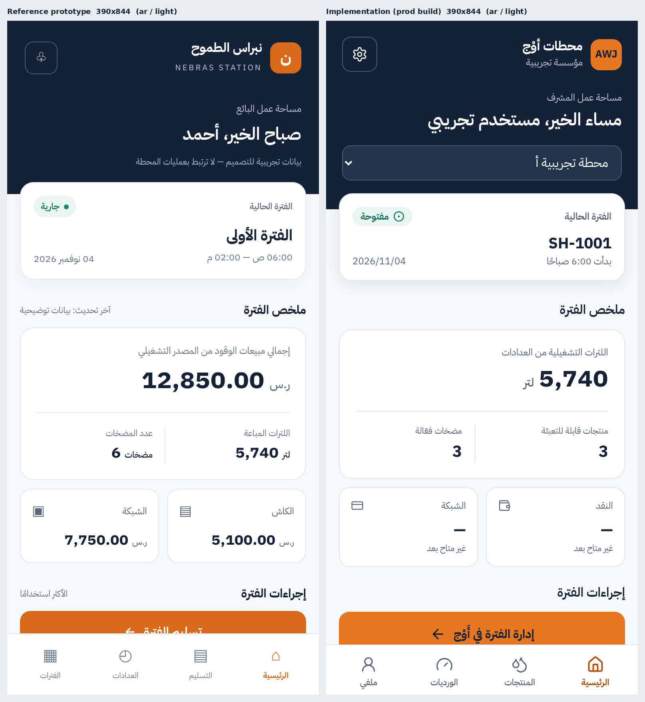
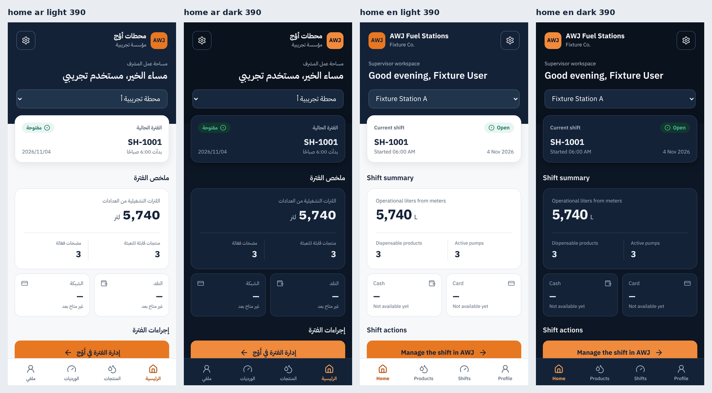

# VISUAL_QA_REPORT — AWJ Fuel Stations UI-0 (Station Operations, mobile)

| | |
|---|---|
| **Status** | **PASS — implementer self-assessment for the implemented UI-0 slice (Chromium, iPhone-size emulation).** Real-iPhone/Safari check: **BLOCKED** (no device/WebKit here). Independent reviewer sign-off: **PENDING** (spec §7: Codex/owner must approve before any merge). |
| **Date** | 2026-11-04 |
| **Task / PR** | #1988 (UI-0) · PR #1993 · contract: PR #1990 (`AWJ_FUEL_STATIONS_FINAL_UI_UX_IMPLEMENTATION_SPEC_V2.md`) |
| **Evidence captured at** | commit `3729087`. Later commits (`e852767` Codex fixes — request branch header + scope invalidation; the merge of `main`) change **no rendered UI**, so the screenshots remain valid. Re-capture is required only if the UI changes again. |
| **Reference** | `NEBRAS_STATION_UI_V2.html` (title «NEBRAS STATION V2 — البائع», supplied by the owner). Byte-identical copy committed read-only at [`../reference/NEBRAS_STATION_UI_V2.reference.html`](../reference/NEBRAS_STATION_UI_V2.reference.html) (sha256 `663d9967…`). Its Nebras name/letter/sample numbers/two shifts/mock logic are **not** treated as requirements (spec §0). |
| **Build under test** | Production build (`next build` + `next start`) — no Next dev widget. API fully intercepted; names are labelled *Fixture*; no tenant data touched. |
| **Reviewer** | Claude Code (implementer). This is **not** the independent approval the spec requires. |

> Passing unit/e2e tests were **not** used as evidence of design success. Every conclusion below rests on screenshots I opened and compared against the reference. A first pass (before this report) was visibly different from the reference — see §5.

## 1. Method
1. Rendered the reference at 320×568, 375×812, 390×844, 414×896, 430×932 and the implementation (production build) at the same viewports, with `isMobile`/touch, light/dark × Arabic/English (`web/e2e/fuel-ops-visual-qa.spec.ts`, `web/playwright.visual-qa.config.ts`).
2. Side-by-side composites (`comparison/`), per-screen sheets, width sheets, scrolled-to-end sheets (bottom-nav clearance), and state sheets (`sheets/`).
3. Automated probes on all 100 matrix cells: horizontal overflow, touch targets < 44px, last-item clearance above the fixed nav, `<select>` font size, dev-overlay presence, `dir`/theme class, console errors ([automated-findings.json](automated-findings.json)).
4. Measured the key dimensions of reference vs implementation at 390px (§4).

## 2. Result by criterion (spec §7 reviewer checklist)

| # | Criterion | Result | Evidence |
|---|---|---|---|
| 1 | V2 semantic tokens, no copied ERP template | **PASS** | Tokens scoped under `[data-fuel-ops]`; contrast test reads the CSS (AA, both themes). Shell/masthead/cards are purpose-built, not the ERP shell. |
| 2 | Reference-like **masthead / raised shift card / metric hierarchy / CTA / nav** | **PASS** | [comparison at 390](comparison/home-ar-light-390x844-reference-vs-implementation.png) and the other four widths (§7.1). Navy masthead → white shift card overlapping its lower edge (17px radius, soft shadow) → 32px primary figure with hairline + two cells → two-up cash/card → orange CTA → bordered shortcuts → fixed bottom tabs. Same order, density and proportions (§4). |
| 3 | Light **and** dark genuinely legible; 0–9 digits | **PASS** | [home-390-variants](sheets/home-390-variants.png), [screens-390-ar-dark](sheets/screens-390-ar-dark.png), [screens-390-en-dark](sheets/screens-390-en-dark.png). Dark uses semantic counterparts (not inverted); card/masthead separated by surface + border. Digits Latin everywhere; numbers use the UI sans in tabular figures like the reference (a first pass used Mono — fixed). |
| 4 | Arabic RTL / English LTR | **PASS** | Brand, back chevron, cells' divider, units, select chevron and nav order all mirror ([AR](sheets/screens-390-ar-light.png) vs [EN](sheets/screens-390-en-light.png)). Logical utilities only (static test). No Arabic reference for English; judged by mirror symmetry. |
| 5 | Real scoped API data only; fixtures isolated and labelled | **PASS** | Production code has no names/prices/stations (static guard). Fixtures are `Fixture …`/«تجريبية» and live only in the QA spec. |
| 6 | Navigation/CTAs work or are explicitly unavailable; no inert buttons | **PASS** | CTA is a real link to the existing AWJ shifts screen (only with `fuel.shift.view`); shortcuts are real routes; cash/card are cards showing «—/غير متاح بعد» (never 0); upcoming operations are inert text with a «قريباً» badge, not buttons (tested). |
| 7 | No station/tenant cross-contamination | **PASS** | Integration tests (station switch incl. slow/late responses, tenant switch, branch switch, access-scope change). Not re-proved visually. |
| 8 | Safe area, scroll, keyboard, **320px** | **PASS** (keyboard: **N/A**) | 100/100 cells: 0px horizontal overflow, min clearance **41px** between last content and the nav when scrolled to the end ([320](sheets/scrolled-bottom-320x568-ar-light.png), [390](sheets/scrolled-bottom-390x844-ar-light.png)). `viewport-fit=cover`, nav padded by `env(safe-area-inset-bottom)`. UI-0 has **no text field**, so "keyboard open" cannot be captured — N/A, not claimed. |
| 9 | Required screenshots + comparison + report + tests | **PASS** | This folder (§7). |
| 10 | No console / test-overlay intrusions | **PASS (production)** | 0 console errors and 0 dev overlays across all 133 runs. The `IntlError INVALID_KEY` (`developer.events` keys) appears **only in dev mode** and on pre-existing pages too; zero in the production build. |
| 11 | Real iPhone / Safari | **BLOCKED** | No device or WebKit in this environment. Sunlight, Dynamic Type, Safari toolbar, native `<select>` sheet and notch behaviour remain unverified. |
| 12 | Independent reviewer sign-off; owner approval before merge/deploy | **PENDING** | Required by spec; not claimed. |

## 3. Coverage vs required captures

| Required | Status |
|---|---|
| Viewports 320×568, 375, 390 (393×852 ≈ 390/414), 414, 430×932 | ✅ all (393×852 not separately captured; 390 and 414 bracket it) |
| Light + dark × AR RTL + EN LTR | ✅ every screen, every viewport |
| Home, Products, Settings, Profile, Shifts (all *implemented* screens) | ✅ |
| Shift Readings/Handover, Supervisor Overview, Receiving | ⏭ **Deferred by design** (UI-1…UI-3, write flows; slice is read-only). Reference pages for handover/meters/shifts are in `reference/` for later slices. |
| Bottom nav with long content | ✅ [scrolled-bottom sheets](sheets/scrolled-bottom-390x844-ar-light.png) |
| Bottom nav with keyboard open | N/A — no input in UI-0 |
| States: active shift, no shift, empty products, missing price, forbidden, loading, server failure, offline, no-permission | ✅ [AR light](sheets/states-ar-light.png), [EN light](sheets/states-en-light.png) (four also dark: [AR](sheets/states-ar-dark.png), [EN](sheets/states-en-dark.png)). Inner screens: [states-inner-screens](sheets/states-inner-screens.png) |
| State: **variance** | N/A — collection/variance data is not part of UI-0 (cards state "not available yet") |

## 4. Measured comparison at 390px (reference → implementation)

| Element | Reference | Implementation | Disposition |
|---|---|---|---|
| Masthead height | 217px | 236px | Accepted: +19px for the mandatory station picker (spec §2) |
| Shift card width / radius | 358 / 17px | 358 / 17px | Match |
| Primary figure | 32px bold tabular | 32px bold tabular | Match |
| Page side padding | 16px | 16px | Match |
| Primary CTA height / radius | 52 / 13px | 56 / 13px | Match (spec 52–56) |
| CTA fill / label | `#D76A19` / white (3.6:1) | `#E87722` / navy `#142238` (5.4:1) | Accepted: spec says `#E87722` is authoritative and white fails AA |
| Bottom nav height | 77px | 63px + safe-area inset | Accepted: slightly tighter; 56px tap targets |

## 5. Delta list and dispositions

**Fixed during this QA (found by looking, not by tests)**
1. First version had a sticky header with three icons, no raised shift card, no big summary, no cash/card cards, no CTA → rebuilt to the contract composition.
2. Numbers rendered in IBM Plex **Mono** (wide commas, Arabic units in mono) → UI sans with tabular figures; unit outside the numeric span.
3. Status pill had no tint (Tailwind opacity on CSS-variable colours doesn't apply) → explicit tint tokens, contrast-tested.
4. Active tab/link colour was brown `#A8470A` → `#B3500A` (closer to brand orange, still AA).
5. Excess gap between section title and card; "closed — awaiting approval" pill wrapped to two lines → tightened; badge now «مغلقة» (the filter keeps «بانتظار الاعتماد»).
6. Repeated "Pump 1" inside the pump card; "1 pumps" grammar → removed / neutral phrasing.
7. Station-scoped `h1` landmark and a single `<main>` per page (a11y) after the restructure.

**Accepted differences (with reason) — visible in the [390 comparison](comparison/home-ar-light-390x844-reference-vs-implementation.png)**
| # | Delta | Reason |
|---|---|---|
| A1 | AWJ mark + tenant name instead of «ن / NEBRAS STATION» | Spec §0/§2: identity dynamic from AWJ, never hard-coded; AWJ-branded fallback |
| A2 | Settings gear instead of notification bell | No notifications feature; one accessible action; language/theme live in Settings |
| A3 | Station picker row in the masthead instead of the "demo data" line | Spec §2/A-03 |
| A4 | Shift card shows shift number + real start time, not "الفترة الأولى 06:00–02:00" | Schedules aren't in the read APIs; no invented values |
| A5 | Big figure = operational **liters from meters**, not SAR sales | Sales/collections are outside the verified read-only API slice; the spec forbids deriving sales from cash/card |
| A6 | Cash/Card cards show «—» + «غير متاح بعد» | "Never show 0 for unknown" (spec §5) |
| A7 | CTA «إدارة الفترة في أَوْج» links to the real AWJ shifts screen, not a fake handover | No inert/fake success; UI-2 will own handover |
| A8 | Tabs: Home / Products / Shifts / Profile (reference: Handover / Meters / Shifts) with Lucide icons, 11px labels | Role nav per spec §2; handover/meters are write flows (later slices) |
| A9 | Active tab colour `#B3500A` vs `#D76A19` | AA contrast |
| A10 | No dark/English reference exists | Judged against V2 semantics and mirror symmetry |

**Open, non-blocking**
- O1 Reference's small helper labels ("آخر تحديث", "الأكثر استخدامًا") are absent; a real *last-updated* freshness label needs fetch-time tracking (spec's `CurrentShiftCard` mentions source freshness).
- O2 Native `<select>` for the station picker: looks right in Chromium; iOS Safari rendering unverified (BLOCKED, item 11).
- O3 Dark masthead (`#0A121E`) vs canvas (`#0D1624`) are close; separation relies on the raised card's surface + border. Legible, but a reviewer may want more contrast.
- O4 The dev-only `INVALID_KEY` console noise is an existing repo-wide issue (not touched).
- O5 Backend gap (not UI): `GET /fuel-stations/prices` is not station-scoped and cannot return the tenant default alone — tracked separately in **#1998**; the UI works around it and shows «could not confirm» rather than a wrong price.

**Blocking defects:** none known for the implemented slice.

## 6. Automated probe summary ([automated-findings.json](automated-findings.json))
100 matrix cells + 32 state captures + reference capture = **133/133 passed**. Horizontal overflow max **0px** · touch targets under 44px **0** · min last-item clearance above nav **41px** · `<select>` font **16px** (no iOS zoom) · dev overlay **0** · console errors (production) **0**.

## 7. Evidence index (click to open; paths are relative to this folder)

### 7.1 Side-by-side vs the approved reference (Arabic, light) — left: reference, right: implementation
| Viewport | Image |
|---|---|
| 390×844 (primary) | [home-ar-light-390x844-reference-vs-implementation.png](comparison/home-ar-light-390x844-reference-vs-implementation.png) |
| 320×568 | [home-ar-light-320x568-reference-vs-implementation.png](comparison/home-ar-light-320x568-reference-vs-implementation.png) |
| 375×812 | [home-ar-light-375x812-reference-vs-implementation.png](comparison/home-ar-light-375x812-reference-vs-implementation.png) |
| 414×896 | [home-ar-light-414x896-reference-vs-implementation.png](comparison/home-ar-light-414x896-reference-vs-implementation.png) |
| 430×932 | [home-ar-light-430x932-reference-vs-implementation.png](comparison/home-ar-light-430x932-reference-vs-implementation.png) |

**What the image shows, delta by delta (maps to §5):** masthead (A1–A3: AWJ mark + tenant name, gear instead of bell, station picker row) · raised shift card (A4: real shift number/start time) · big figure (A5: liters, not SAR) · cash/card (A6: «—/غير متاح بعد») · CTA (A7 and §4: colour & label) · tabs (A8/A9). Everything not listed there matches in order, density, radius (17/14/13px), padding (16px) and figure size (32px).

### 7.2 Variants and screens
- Home at 390 — AR/EN × light/dark: [home-390-variants.png](sheets/home-390-variants.png)
- All five screens at 390 per locale/theme: [AR light](sheets/screens-390-ar-light.png) · [AR dark](sheets/screens-390-ar-dark.png) · [EN light](sheets/screens-390-en-light.png) · [EN dark](sheets/screens-390-en-dark.png)
- Widths (320→430): [home AR light](sheets/widths-home-ar-light.png) · [home AR dark](sheets/widths-home-ar-dark.png) · [home EN light](sheets/widths-home-en-light.png) · [home EN dark](sheets/widths-home-en-dark.png) · [products AR light](sheets/widths-products-ar-light.png) · [products AR dark](sheets/widths-products-ar-dark.png) · [products EN light](sheets/widths-products-en-light.png) · [products EN dark](sheets/widths-products-en-dark.png)
- Scrolled to the end (bottom-nav clearance): [320 AR light](sheets/scrolled-bottom-320x568-ar-light.png) · [320 EN dark](sheets/scrolled-bottom-320x568-en-dark.png) · [390 AR light](sheets/scrolled-bottom-390x844-ar-light.png) · [390 EN dark](sheets/scrolled-bottom-390x844-en-dark.png)
- States: [AR light](sheets/states-ar-light.png) · [EN light](sheets/states-en-light.png) · [AR dark](sheets/states-ar-dark.png) · [EN dark](sheets/states-en-dark.png) · [inner screens](sheets/states-inner-screens.png)
- Reference pages (390px): [home](reference/home-ar-light-390x844.png) · [handover](reference/handover-ar-light-390x844.png) · [meters](reference/meters-ar-light-390x844.png) · [shifts](reference/shifts-ar-light-390x844.png) · source HTML: [`../reference/NEBRAS_STATION_UI_V2.reference.html`](../reference/NEBRAS_STATION_UI_V2.reference.html)
- Machine results: [automated-findings.json](automated-findings.json)

### 7.3 Re-run
`npx next build && npx next start -p 3012` then `VQA_OUT=/tmp/vqa VQA_REFERENCE_HTML=<path> npx playwright test -c playwright.visual-qa.config.ts` (spec: `web/e2e/fuel-ops-visual-qa.spec.ts`). Note: the capture helper that assembles `comparison/` and `sheets/` is not part of the repo; the raw per-cell images are regenerated by the spec.

## 8. PR gates at the time of writing
| Gate | State |
|---|---|
| Merge conflict with `main` | GitHub reported `mergeable_state: dirty`. Cause: `main` advanced (#1991, #1994, #1995) and conflicted **only** in `web/src/messages/{ar,en}.json` (both sides append a block at the end of those files). Resolved by merging `main` and keeping both blocks verbatim; the diff vs `main` in those files is purely additive (+269 lines each — the `stationOps` block). No unrelated file touched. |
| CI / Web CI / CI Gate | Recorded in the PR conversation on the final head — not claimed in this file. |
| Codex review (2 × P2) | Both verified against backend code and fixed in `e852767`; threads answered. |
| Backend prices gap | Filed separately as **#1998** (not fixed in this PR). |
| Independent visual approval | **PENDING** |

## 9. Reviewer decision
Implementer verdict: **PASS for UI-0 as implemented**, with Safari/iPhone **BLOCKED** and independent approval **PENDING**. **Do not merge or deploy** until (1) an independent reviewer repeats the §2 comparison, (2) a real-iPhone pass is done, and (3) the owner approves explicitly.

*Revision note: an earlier revision of this report was lost before it was ever committed (the image-packaging helper wiped the folder). This file is the rewritten, committed version; its content was re-checked against the images in this folder.*
