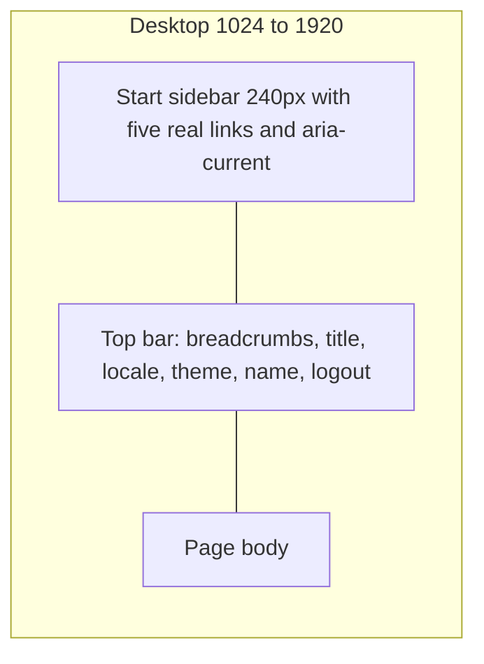
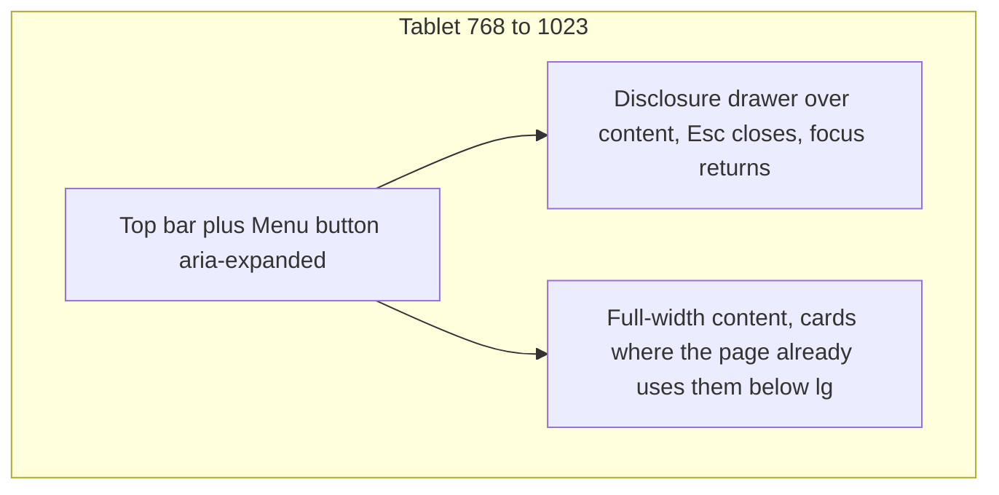
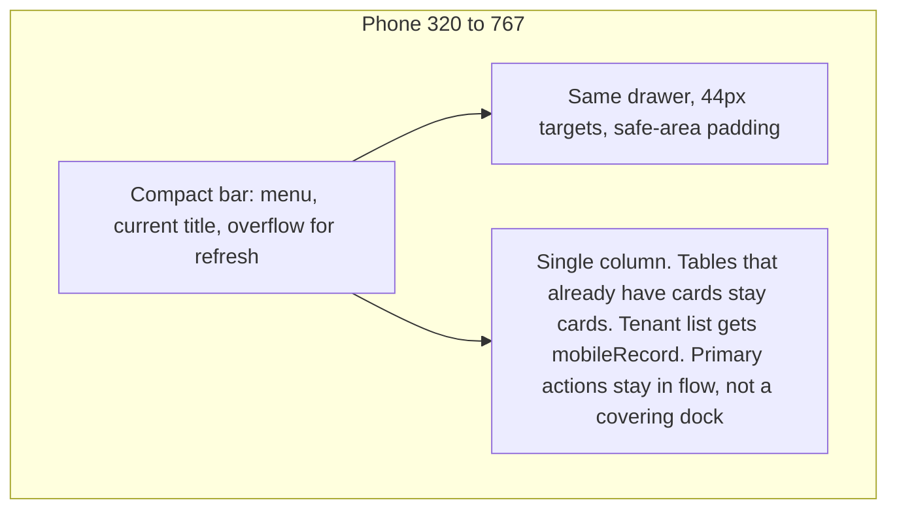

# AWJ-PLATFORM-UX-H1-AUDIT — H1-0

Status: **H1-0 COMPLETE AS EVIDENCE**  
Owner decision 2026-10-11: **option A approved** with three amendments. The detailed spec is [AWJ-PLATFORM-UX-H1-1-UX-SPEC.md](./AWJ-PLATFORM-UX-H1-1-UX-SPEC.md). Shell implementation (H1-2) stays blocked until that spec is explicitly approved. No product UI code in this decision.  
Owner: Safwan | Implementer: Grok | Date: 2026-10-11  
Repository: `safwan5001-source/Nebrax`

## Identity

| Item | Value |
|---|---|
| Phase | H1-0 evidence inventory and UX audit |
| Explicitly not done | Redesign, shell implementation, API/schema changes, merge, deploy, production |
| Main Base SHA | `4d8e1a66673d970b318514664d383a9c4455e999` |
| Branch | `docs/awj-platform-ux-h1-horizon` |
| Documentation parent (horizon spec) | `bda975d0811efae8bf869ec83473c4f440fe8191` |
| Head SHA | The commit that adds this file. It is the PR head after push. Writing the SHA inside this file would change it, so the PR body is the durable record of the final Head SHA. |
| Reference PR | https://github.com/safwan5001-source/Nebrax/pull/1312 |
| Protocol read | `docs/autonomous-engineering/AWJ-HORIZON-SYSTEM.md`, `docs/engineering/AWJ_HORIZON_EXECUTION_PROTOCOL.md` |
| Central state | `CURRENT-STATE.md` and `TASK-QUEUE.md` were not modified |

`main` at audit time is the same commit the horizon spec was based on. Verified with `git ls-remote`.

## Method and limits

Read every file under `web/src/app/platform/**` on `main`, the platform cards in `web/src/components/platform/`, shared `DataTable` / `Button` / `Table`, `platform-auth`, `platform-api`, `routes/api.php` platform group, `EnsurePlatformAdministrator`, and `PlatformTenantController` / `PlatformTenantService`.

**Live application was not booted.** This environment has no platform API, database, or administrator session. Code reading alone is not production responsiveness proof.

A Playwright structural probe (Chromium headless) replicated the shell rules that the class names imply: flex-wrap headers, a non-wrapping detail header with a long Arabic title, a non-wrapping error row, a `min-width: 56rem` table inside `overflow-x: auto`, button heights 32/36/28, and the light/dark danger colors from `web/src/app/globals.css`. Viewports: 320, 375, 390, 430, 768, 1024, 1440, 1920. Directions: `rtl` and `ltr`. Themes: light and dark. This probe is **not** the Next.js DOM, not IBM Plex metrics, and not production data. It is labeled **structural probe** wherever used. It did **not** show page-level horizontal scroll for those replicas.

Contrast ratios below were computed from the token hex values and confirmed for the danger button by `getComputedStyle` in the probe.

## Route matrix

Only these App Router pages exist. There is **no** `web/src/app/platform/layout.tsx`. Authenticated pages each paint their own header. Login uses `AuthShell` and is the only platform surface with language and theme toggles.

| Route | File | Purpose | Client gate | Server gate | Writes | Tests on main |
|---|---|---|---|---|---|---|
| `/platform` | `web/src/app/platform/page.tsx` | KPI overview: tenants, users, subscription counts, contracted MRR/ARR, renewal windows, plan breakdown | `isPlatformAuthenticated()` else `/platform/login` | `GET /platform/overview` requires `platform:read` | None. Logout calls `POST /platform/logout` | None found |
| `/platform/login` | `web/src/app/platform/login/page.tsx` | Separate platform login. Link back to tenant `/login` | Public | `POST /platform/login` throttle 5/min. Token abilities: `platform:read` **and** `platform:manage` | Session only | None found |
| `/platform/tenants` | `web/src/app/platform/tenants/page.tsx` | Tenant list, search, plan/status filters, global application controls | same client gate | `GET /platform/tenants` is `platform:read`. Global summary/apply routes are `platform:manage` | Global grant/revert/show/hide via preview dialog | `tenant-reference-numbers.test.tsx`, `global-application-controls-card.test.tsx` |
| `/platform/tenants/[id]` | `web/src/app/platform/tenants/[id]/page.tsx` | Identity, plan, trial, activate/deactivate, contracts, commercial ops, application overrides | same | `GET` is `platform:read`. `PATCH` and commercial/override/subscription writes are `platform:manage` | Plan, trial, active flag, contracts, commercial assignments, overrides | `tenant-reference-numbers.test.tsx` (detail render), commercial card test |
| `/platform/prices` | `web/src/app/platform/prices/page.tsx` | Versioned plan price create + history | same | **Both** `GET` and `POST /platform/prices` are inside the `platform:manage` group | `POST` new price version. Amount via `riyalToMinor` | None found |
| `/platform/integrations` | `web/src/app/platform/integrations/page.tsx` plus `file-scan-exceptions.tsx`, `ai-form.ts` | Storage, malware scanner, document processing, AI providers, file-scan exceptions | same | `GET /platform/integrations` is `platform:read`. Updates, tests, exceptions are `platform:manage` | Secrets, enablement, exceptions. Current password required on writes | `page.test.tsx`, `ai-form.test.ts`, `ai-provider-actions.test.ts`, `gemini-card.test.tsx`, `gemini-diagnostics.test.ts` |
| `/platform/document-operations` | `web/src/app/platform/document-operations/page.tsx` | Runtime, retention policy, dry-run/apply purge, usage totals, audit CSV | same | Reads are `platform:read`. Policy patch, retention run, audit export are `platform:manage` | Retention policy and purge run. Apply requires a checkbox | None found |

### Backend present, platform UI absent

`routes/api.php` exposes platform `system-updates` (read on `platform:read`, write/publish on `platform:manage`). The only UI found is the tenant surface `web/src/app/(app)/whats-new/page.tsx`. **Do not add a platform nav item** until a real platform page exists. This is not a missing redesign; it is an absent screen.

### Permission fact, not a current split

`PlatformAuthController::issueToken` always creates `platform-console` with both `platform:read` and `platform:manage`. The UI never reads abilities. A future read-only token would still see write controls and fail at the API. That is latent. It is not how the current login behaves.

Tenant principals cannot enter these APIs: `EnsurePlatformAdministrator` requires a `PlatformAdministrator` model. The platform client does not send `X-Branch-Id` (`web/src/lib/platform-api.ts`).

Demo mode (`isDemo()`) short-circuits platform auth. Not exercised here.

## What already works and must be preserved

- Platform login is separated from tenant login, with field labels, `aria-invalid`, `role="alert"`, password show/hide (`h-12`, 48×44px), and `AuthShell` language/theme controls.
- Overview copy distinguishes contracted MRR/ARR from invoicing. Amounts go through `formatRiyal` on API strings. Price entry uses `riyalToMinor` / `isValidRiyal`, not float math in the page.
- `Usage.per_tenant` exists on the document-operations TypeScript type and is **not rendered**. Aggregated cards show only operation/page/token totals. Do not start rendering tenant identity there.
- Prices history already switches to cards below `md`. Contract and commercial cards already switch to cards below `lg`, with the wide table (`min-w-[56rem]`) inside `overflow-x-auto`.
- Global application actions use a preview dialog and a server confirmation token, not an immediate apply.
- Activate/deactivate asks `window.confirm`. Contract cancel/expire ask `window.confirm`.
- Tokens, not hex, style platform screens. Dark mode is real: `ThemeProvider attribute="class"` in `web/src/components/providers.tsx`, and `.dark` overrides in `globals.css`. Platform routes are **outside** `html[data-awj-ui="3"]`. v3 tokens do not apply here. Do not pull the console into the v3 gate as part of a visual refresh.
- Focus-visible outlines exist globally (`globals.css` base layer) and on `Button`.

## Breakpoint evidence

### Structural probe (not the live app)

RTL and LTR, light and dark, widths 320 through 1920:

| Check | Result |
|---|---|
| Document `scrollWidth > clientWidth` | False at every tested width/dir/theme for the replica |
| Overview action cluster (`flex-wrap`, six `h-8` buttons) | No page overflow. Buttons wrap |
| Tenant detail header, long Arabic name, row flex, back button | No page overflow. Title wraps |
| Error row `flex` + long Arabic message | No page overflow. Text wraps |
| Table `min-width: 56rem` inside a scroll wrapper | Local overflow at 768px (`scrollWidth > clientWidth` on the wrapper). Page itself did not overflow. At 320 the replica hid the table the way `hidden md:block` does |
| Dark danger button | Computed `color: rgb(255,255,255)` on `background: rgb(248,113,113)` |
| Light danger button | White on `rgb(185,28,28)` |
| `size=sm` replica | 32×32 |
| Copy control replica | 28×28 |
| Search field replica | height 32 |

### Code-derived responsive map (not pixel-proof)

| Surface | <768 | 768–1023 | ≥1024 |
|---|---|---|---|
| Overview | Single column cards. Header stacks until `lg`, then row | Two-column metrics | Same, max width `72rem` |
| Tenants table | `DataTable` card dump of every visible column. No `mobileRecord` | Desktop table, horizontal scroll inside the table wrapper | Same |
| Prices | Card list | Table | Table. Form becomes 4 columns at `lg` |
| Contracts / commercial | Cards | Cards (hidden table until `lg`) | Table plus contained horizontal scroll |
| Application overrides | Same HTML table, `overflow-x-auto` only. No card fallback | Same | Same |
| Document operations | One column. KPI grid is 2 columns from `md`, 4 from `xl` | Two columns for the main grids only at `xl` | Two columns |
| Integrations | One column until `xl` pairs cards | Still one column until `xl` | Paired cards |

Portrait/landscape was not separately instrumented. The probe only changed width. No safe-area insets exist on these pages (`pb` uses normal padding, not `env(safe-area-inset-*)`).

### Contrast (tokens)

| Pair | Ratio | AA normal text 4.5:1 |
|---|---|---|
| Light muted `#6b7280` on surface `#ffffff` | 4.83 | Pass |
| Light muted on background `#f6f7f9` | 4.51 | Pass, tight |
| Light text on background | 16.60 | Pass |
| Light white on danger `#b91c1c` | 6.47 | Pass |
| Dark muted `#9099a5` on surface `#181b20` | 5.99 | Pass |
| Dark text on surface | 15.69 | Pass |
| Dark white on danger `#f87171` | **2.77** | **Fail** |

## Ranked defects

No P0. Nothing here is a broken authentication boundary or a wrong money calculation in the inspected UI.

### P1

**P1-01 — Tenant list silently stops at the first page.**  
`web/src/app/platform/tenants/page.tsx` requests `per_page=100` and never reads `pagination`. `PlatformTenantController::index` returns `current_page`, `last_page`, `per_page`, `total`. `PlatformTenantService::list` paginates. Plan and status filters then run on that loaded array only. Search is sent to the server, but still only the first page of matches is kept. Operators cannot reach tenant 101, and a plan filter does not mean "all tenants on that plan".

**P1-02 — No shared console shell, and no locale/theme control after login.**  
Authenticated pages duplicate a one-off header and a single back link. From tenants the operator cannot open prices or integrations without returning to the overview. `LangToggle` and `ThemeToggle` exist only in `AuthShell`, which only login uses. Default locale is `ar` (`web/src/i18n/request.ts`). Theme follows `next-themes` once set, including system preference, but a signed-in operator cannot switch it inside the console. This is the main IA defect, not a missing product feature.

**P1-03 — Danger button text fails contrast in dark mode.**  
`web/src/components/ui/button.tsx` sets `danger` to `bg-negative text-white`. Dark `--negative` is `#f87171`. Ratio 2.77:1. Tenant deactivate uses `variant="danger"`. Light mode passes. This is a shared component; fixing it affects every danger button, not only platform.

**P1-04 — Some controls have no dependable accessible name.**  
- Tenants refresh is an icon-only button with no text, `aria-label`, or `title` (`tenants/page.tsx` refresh button).  
- Global application desktop row actions are icon-only ghost buttons. They set `title`, not `aria-label` (`global-application-controls-card.tsx` `renderRowActions`). `title` is not a reliable name and does not show on touch. Mobile uses `Dropdown` with `triggerLabel`.  
- `DataTable` search is an unlabeled input; only `placeholder` is set (`web/src/components/data-table.tsx`). Placeholder is not a label. This component is shared with ERP. Any fix must be additive and tested, not a platform-only fork and not a visual rewrite of every ERP table.

### P2

**P2-01 — Back affordance points opposite ways.**  
Prices, tenants, tenant detail, and integrations use Lucide `ArrowRight` as "back". Document operations uses a literal `←`. No `rtl:` rotation exists under `web/src/app/platform`. In an Arabic-first UI `ArrowRight` matches the back direction; in LTR it points forward. The glyph `←` does the reverse. One logical back icon is required.

**P2-02 — Confirmation patterns disagree.**  
Global overrides: preview dialog and confirmation token. Tenant active flag and contract cancel/expire: `window.confirm` (no focus trap, poor AT). Plan change, trial change, and new price version: no confirm. Price create is additive versioning, so it is less severe than deactivate. Standardize on the existing preview/dialog pattern for destructive actions. Do not invent a new financial rule.

**P2-03 — Application-override table has no small-screen card.**  
`application-override-card.tsx` always renders a table inside `overflow-x-auto`. Commercial, contract, prices, and `DataTable` already have a card path. Horizontal scroll is allowed if actions remain reachable; here the row actions are inside the scrolled table on every width.

**P2-04 — Tenant mobile cards are an unprioritized dump.**  
`DataTable` without `mobileRecord` prints every column as label/value below `md`, including contact name, email, and phone. That data is already on the authorized page. The defect is density and scan order, not a new disclosure. Pass `mobileRecord` on this call site. Do not add tenant names to overview or to document-usage aggregates.

**P2-05 — Document-operations failures are announced as status, and the file is one compressed component.**  
Action `catch` assigns `setNotice`, and the notice node is `role="status"`. Load failures use a separate error path. Loading is a text line, not a skeleton. Success and failure share one visual. The page is also structurally flat (`max-w-7xl`, back control is the character `←`).

**P2-06 — File-scan exceptions skip the message catalog.**  
`file-scan-exceptions.tsx` hardcodes bilingual Arabic/English strings, including tenant names in a management list. That list is an authorized operational surface, not an analytics aggregate. Keep the authorization. Move strings into `next-intl` when that page is touched, so LTR English is not stuck to Arabic sentences.

**P2-07 — 403 is silent or generic.**  
Global controls return `null` on HTTP 403. Other pages show `ApiError.message` in the same slot as network failure. There is no forbidden pattern. Low practical impact while login always grants `platform:manage`, still inconsistent.

**P2-08 — Integrations error row does not wrap its layout.**  
The error container is `flex items-center justify-between` with no `flex-wrap` (`integrations/page.tsx`). The structural probe did not overflow the page when the message wrapped. Treat cramped 320px layout as a code risk, not a measured page overflow.

### P3

**P3-01 — Plan `<option>` labels are the raw codes** `free`, `basic`, `pro`, `enterprise` on prices and tenants.  
**P3-02 — Touch size.** `sm` is 32px and the copy control is 28×28 (`h-7 w-7`). Both meet WCAG 2.2 SC 2.5.8 AA (24 CSS pixels). They are below a 44px touch recommendation. Native checkboxes are user-agent sized; do not count them as an author failure of 2.5.8.  
**P3-03 — No safe-area padding, no breadcrumbs, no current-page indicator.**  
**P3-04 — System-updates has API and a tenant What's New page, and no platform screen.** Out of scope to build one inside a UX refresh.

## Not defects

- Absence of subscription, billing, collections, health-chart, or settings destinations. Those screens are not built. Do not add links to them.
- Tenant names, emails, and phones on tenant management and on file-scan exceptions. Those are existing authorized management surfaces.
- Contracted MRR labels. They already say the number is contractual.
- Contained horizontal scroll of wide tables at tablet widths. The probe kept that scroll off the page.
- v2 tokens on platform pages. That is the current source of truth outside the `(app)` v3 gate.

## External evidence

W3C, not AWJ opinion:

- [Understanding SC 2.5.8 Target Size (Minimum)](https://www.w3.org/WAI/WCAG22/Understanding/target-size-minimum.html), Level AA: target at least 24 by 24 CSS pixels, with an inline exception and a user-agent-control exception (native checkbox size when the author does not change it). 24px is the minimum, not a touch-comfort target.
- [Disclosure pattern](https://www.w3.org/WAI/ARIA/apg/patterns/disclosure/): the control is a button; `aria-expanded` true/false; Enter and Space toggle; `aria-controls` optional.
- [Example disclosure navigation](https://www.w3.org/WAI/ARIA/apg/patterns/disclosure/examples/disclosure-navigation/): "Typical site navigation does not need all the keyboard interactions specified by the menu and menubar pattern." Do not use `role="menu"` for the platform shell.

Shopify Polaris navigation URL was requested and did not return a navigation pattern page. No competitor UI was copied. No claim is made that Dynamics, Salla, or Shopify Admin were visually inspected in this pass.

## AWJ decisions proposed for the design gate

These are proposals. They are not implemented.

1. Add one authenticated shell, distinct from `AuthShell` and from the tenant ERP shell in `web/src/app/(app)/layout.tsx`.
2. Nav destinations, and only these: Overview, Tenants, Prices, Integrations, Document operations. Tenant detail stays a child of Tenants. Contracts, commercial ops, and overrides stay on the detail page.
3. Do not add system-updates, billing, collections, or health charts.
4. Do not render `per_tenant` usage.
5. Keep money formatting on the current helpers. No new charts.
6. Shell navigation is a list of links plus a disclosure drawer, not an ARIA menu.
7. Fix dark danger contrast in the shared button, with the existing button tests, because the defect is global. Do not restyle every ERP button size in the same change.
8. Tenant pagination uses the API fields already returned. No new endpoint.
9. Platform stays on v2 tokens in `globals.css` unless a later explicit decision moves the console onto v3.
10. Phone shell controls in the **new** shell use at least 44×44px. Existing `size="sm"` (32px) stays the ERP default until a separate shared-button decision.

## Rejected

- `role="menu"` / menubar for the shell.
- A persistent icon rail with unlabeled icons.
- Fake KPI sparklines or cash-collection widgets.
- A second design system or hardcoded hex in components.
- Folding platform pages into the tenant sidebar.
- Changing `DataTable` layout for every ERP screen in order to fix the platform tenant list.

## Desktop, tablet, mobile

Login stays a centered `AuthShell` with no sidebar.

Page patterns to keep, not reinvent: KPI group, filterable table, detail sections, versioned price form, destructive confirm, loading, empty, error, and a real 403 state instead of `null` or a generic failure.

## Dependency-ordered queue after approval

| Slice | Depends on | Output | Gate |
|---|---|---|---|
| H1-0 this audit | `main` `4d8e1a66` | This file | Done. No UI code |
| DESIGN_GATE | This audit | Owner accepts, rejects, or amends the ten decisions above | **Stop here** |
| H1-2 shell | Approved decisions | New platform layout only. Existing links, guards, and pages still work. Locale and theme controls. Focused tests | MERGE_GATE. No merge without explicit approval |
| H1-2b danger contrast | Can be the same PR as H1-2 or the PR immediately after, still before page rewrites | `text-white` on dark `--negative` fixed without shrinking other variants. Button tests | MERGE_GATE |
| H1-3 overview | Shell on `main` after post-merge proof, or an explicit note that it is independent | Hierarchy and labels only. Same API fields | MERGE_GATE |
| H1-4a tenants | Shell | Pagination wired to existing metadata. `mobileRecord`. Named refresh button. No new tenant fields | MERGE_GATE |
| H1-4b prices | Shell | Responsive form/table only. Same minor-unit write | MERGE_GATE |
| H1-4c integrations | Shell | Wrap error row, keep secret fields and password checks | MERGE_GATE |
| H1-4d document operations | Shell | Back control, alert vs status, no `per_tenant` rendering | MERGE_GATE |
| H1-4e detail cards | Shell | Dialog instead of `window.confirm` for deactivate/cancel/expire. Override table card or contained scroll with reachable actions | MERGE_GATE |
| H1-5 | Approved slices on `main` | 320/375/390/430/768/1024/1440/1920, both dirs, both themes, keyboard and touch notes | No deploy |

No stacked PRs. Each implementation slice starts from latest `main` after the previous approved merge and post-merge proof. Shared ERP files (`Button`, `DataTable`) are out of a page PR unless the change is additive, tested, and named in that PR.

## DESIGN_GATE packet

**Problem.** The console is five authenticated pages plus login, with duplicated headers, no way to move between siblings, no locale/theme control while signed in, one dark-mode contrast failure, one list that drops pages, and inconsistent confirms.

**Evidence.** Route inventory and findings above. `main` `4d8e1a66673d970b318514664d383a9c4455e999`.

**Alternatives.**  
A. Shell + the ten decisions. Recommended.  
B. Restyle each page in place and keep duplicate headers. Faster, and it leaves P1-02 in place.  
C. Move platform into the tenant ERP shell. Rejected. It mixes principals.

**Recommendation.** Approve A. Do not start H1-2 until that approval is explicit.

**Impact.** Visual structure and navigation of platform pages only. No API, no schema, no money semantics, no tenant isolation change, if the queue above is followed.

**Safe work while waiting.** None that changes product UI. Documentation fixes to this audit are safe.

## Risks

- A shared `Button` contrast fix can touch ERP danger buttons. Scope the color, do not change size globally in that commit.
- An additive `DataTable` search label touches every table. Default it from the existing placeholder and run `data-table.test.tsx`.
- Tenant pagination must not change the search contract or leak extra fields. Use the current payload.
- File-scan and tenant detail show tenant identity on purpose. Overview and document-usage aggregates must not gain it.
- This audit's responsive numbers are a structural probe plus source reading. H1-5 still needs the real app in a browser. Claiming that happened here would be false.
- `window.confirm` removal must keep the same server checks. The dialog is not the authorization.

## Tests and review

**Executed**

- Source inventory against `main` `4d8e1a66673d970b318514664d383a9c4455e999`.
- Contrast arithmetic on `globals.css` tokens.
- Playwright structural probe, 8 widths × 2 directions × 2 themes. Page overflow not reproduced on the replica. Dark danger colors reproduced.

**Not executed, and why**

- `npm` tests, typecheck, and production build. This slice does not change `web/` or `app/`. The audit checkout was a sparse docs tree without `web/node_modules`.
- Live browser of `/platform/**`. No API and no administrator session.
- CI result belongs to the PR head after push. It is not claimed green in this file.

**Implementer self-review.** The diff is two markdown files. No route, token, or API edit. Findings cite files that exist on `main`. P0 was not inflated. Unmeasured overflow was not promoted to a defect. `per_tenant` non-rendering was checked in the document-operations JSX, not assumed.

**Reviewer pass.** The status line in `AWJ-PLATFORM-UX-H1.md` now matches the audit. The parent SHA is the previous docs commit. No `CURRENT-STATE.md` edit.

**AWJ Guardian.** No isolation, accounting, inventory, pricing, or auth behavior changed. Price and MRR code was read and left in place. The design queue forbids new financial visuals and forbids aggregated tenant identity.

## Next

Option A was approved on 2026-10-11 with amendments. Follow [AWJ-PLATFORM-UX-H1-1-UX-SPEC.md](./AWJ-PLATFORM-UX-H1-1-UX-SPEC.md). Do not start H1-2 until that spec is explicitly approved. The first code slices after that approval are the tenant pagination PR and the separate danger-contrast PR, not the shell. Do not merge this PR and do not deploy.
