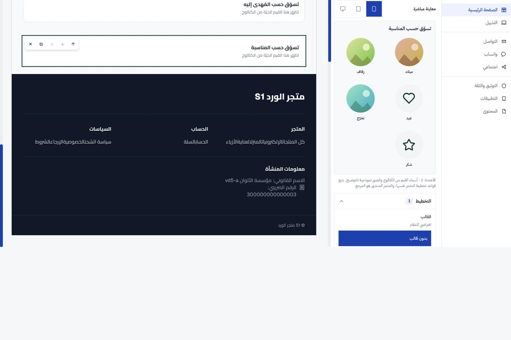
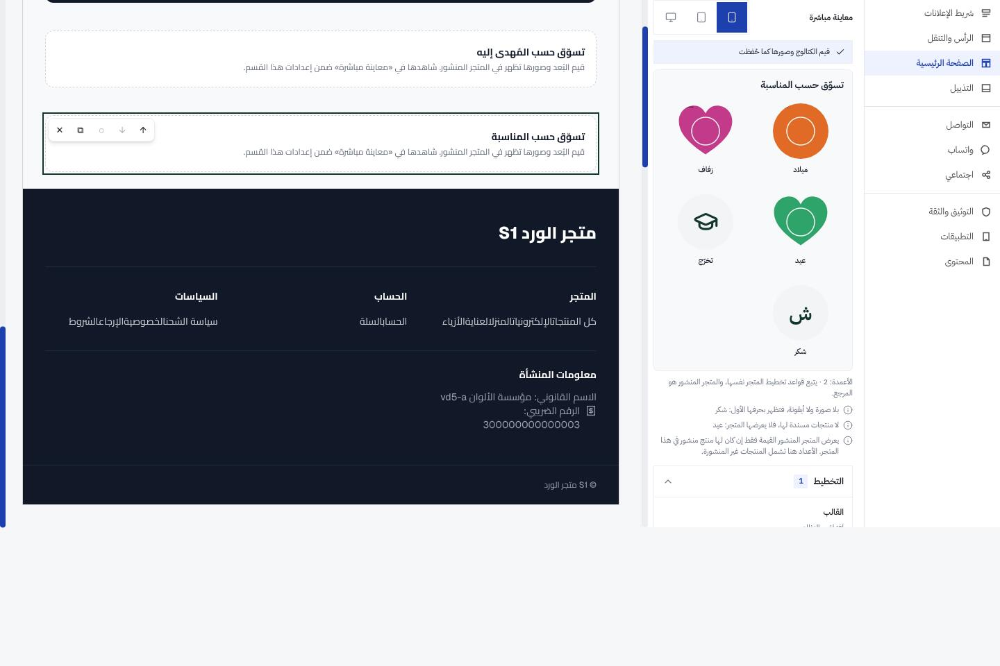
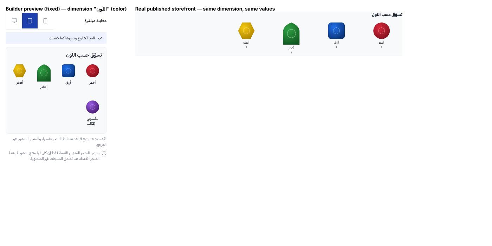

# AWJ-VD-5 — تقرير الجودة النهائي (اختبار المتصفح المتكامل للأبعاد المرئية)

STATUS: **VD-5 منفَّذ — بانتظار بوابة اعتماد VD-6.** لم يُنشر شيء إلى الإنتاج ولم تُغيَّر أي بيئة.
DATE: 2026-10-15
HORIZON: AWJ-COMMERCE-VISUAL-DIMENSIONS-H1 · الشريحة VD-5 (H1-5)
AUTHORITY: تفويض المالك بتاريخ 2026-10-15 («VD-5 — Authorization») + بلاغ المالك عن معاينة الباني («Owner-Reported Visual Dimensions Preview Issue»).
BASE: `main` عند بدء الاختبار = `8b2b42438` (يتضمن VD-1a…VD-4c). الإصلاحات المدموجة لاحقاً مسجَّلة في §5.

## 1. الخلاصة التنفيذية

| البند | النتيجة |
|---|---|
| السلسلة الكاملة تعمل في متصفح حقيقي (المحرر ← API ← `meta.facets` العام ← الـproxy ← المتجر) | **نعم** — على مكدّس محلي حقيقي (Laravel + Postgres + Next + Chromium) |
| فحوص المتجر S-1…S-11 | 10 ناجحة، **1 فاشلة (S-9 لوحة المفاتيح عند 390px)** — أُصلحت (§5) |
| فحوص الإدارة والباني W-1…W-9 | ناجحة مع عيوب مفصّلة؛ W-4 (33/35) وW-6 (30/34) فيهما إخفاقات أُصلحت |
| عزل المستأجرين والقنوات والمسارات الخبيثة | **ناجح** — 114 فحصاً على المتجر + 10 على الإدارة، بلا تسرّب |
| الذاكرة المؤقتة (نافذة 300 ث) | **ناجح** وقيس فعلياً بزمن حقيقي (§4.3) |
| بلاغ المالك (معاينة الباني بصور Placeholder) | **سبب جذري محدَّد وأُصلح** — الباني كان يتجاهل الهوية المرئية المحفوظة (§6) |
| عيوب بلا إصلاح ضمن النطاق | تحتاج قراراً: G1/G2/G3، D-W-3 (backend)، مشكلة لغة المتجر الإنجليزي الأوسع (§7) |
| أي تغيير API/قاعدة بيانات/صلاحيات/أمن | **لا** — لم يُنفَّذ أي منها؛ كل ما يحتاجها سُجِّل كبوابة قرار |

## 2. الـcommit المختبَر والبيئة

| البند | القيمة |
|---|---|
| الكود المختبَر | `main` المحلي `8b2b42438` (+ فروع الإصلاح كلٌّ على حدة قبل دمجه) |
| الـBackend | Laravel 11 من `setup.sh`، PHP 8.3، **PostgreSQL 16 مؤقت** (`vd5_qa`)، `QUEUE_CONNECTION=sync` |
| المتصفح | Chromium 141 (Playwright 1.62، headless) |
| الواجهات | admin `next dev` (:3101)، متجران من نفس المستأجر S1/S2 (:3102/:3103) |
| بيانات | مزروعة **عبر الـAPI العام فقط**: مستأجران، 3 متاجر، 5 مستخدمين بأدوار مختلفة، أبعاد/قيم بصور حقيقية وأشكال وأيقونات، 7 منتجات، أقسام Discovery منشورة. لا بيانات إنتاج |
| الانحرافات عن خطة الجاهزية | Postgres بدل SQLite أساساً (تلف SQLite عند التزامن)؛ **R2 mock** محلي لأن خط الوسائط لا يملك مشغّل قرص محلي |

قيود بيئية موثّقة (لا عيوب منتج): حدّ `store/v1` العام 30 طلباً/دقيقة/IP (ثابت في الكود) فتُصفَّر عدّادات الحدّ بين الصفحات عبر سكربت بيئي؛ وصفحات `next dev` تحت اسم المضيف المُدار لا تُرطَّب (HMR محجوب) فاستُعمل وكيل مضيف محلي؛ الـproxy للصور يتجاهل `AWJ_STOREFRONT_DEV_HOST` (تطوير فقط).

## 3. مصفوفة النتائج

### 3.1 المتجر (S)

| ID | النتيجة | ملخص |
|---|---|---|
| S-1 | PASS (+D-S-1) | 14,864 فحصاً: 4 عروض × عربي/إنجليزي × 16 قسماً، بلا إزاحة تخطيط (CLS 0) |
| S-2 | PASS | الأشكال الـ12 × صورة/أيقونة/نص؛ البكسلات مطابقة لأقنعة مرسومة مستقلاً (IoU ≥ 0.93)؛ سلسلة الاحتياط تحافظ على الشكل |
| S-3 | PASS | 5 أقسام قديمة مطابقة بايتاً ببايت في SSR الحقيقي |
| S-4 | PASS | 48 فحصاً: قواعد الظهور (غير منشور، بلا منتجات، معطّل، قناة أخرى) + 4 أنماط فشل في المتصفح |
| S-5 | PASS | نفس البُعد في 4 أقسام بتصاميم مختلفة: كل قسم مطابق لعرضه منفرداً؛ لا تسرّب ولا معرّفات مكررة |
| S-6 | PASS | 114 فحصاً: عبر المستأجرين والقنوات = 404 على Laravel وNext، مضيف مجهول 404، 24 هجوم مسار، لا `/store/v1` خام في HTML/RSC/JSON |
| S-7 | PASS | تغييرات الإدارة تظهر في التحميل التالي؛ استبدال الصورة يغيّر الرابط؛ مصفوفة ETag/304 صحيحة |
| S-8 | PASS | نافذة الـ300 ثانية بزمن حقيقي (§4.3) |
| S-9 | **FAIL عند 390px** → أُصلح | D-S-2 (الكاروسيل) وD-S-3 (الشريط السفلي) — §5 |
| S-10 | PASS (dev) | 8 تحميلات مرطَّبة × 16 قسماً: لا عدم تطابق ترطيب |
| S-11 | PASS | 8 طلبات صور لكل صفحة (5.8 KB)، thumbnails فقط؛ سلوك الاختناق في D-S-4 |

### 3.2 الإدارة والباني (W)

| ID | النتيجة | ملخص |
|---|---|---|
| W-1 | PASS (المحرر) | 96 لقطة: RTL/LTR، 4 عروض، فاتح/داكن؛ لا تجاوز أفقي، أهداف لمس ≥ 44px؛ حوار منتقي الوسائط على الجوال لا يحقق 44px (D-W-6، مشترك) |
| W-2 | PASS | الأشكال الـ12: القائمة 36/36 والمحرر 36/36 |
| W-3 | PASS 15/15 | كل الإعدادات تبقى بعد الحفظ وإعادة الفتح؛ الاسترجاع يحذف المفتاح؛ افتراضات البُعد تنساب للقيم |
| W-4 | 33/35 | W-4.13 (D-W-2) أُصلح؛ W-4.14 (D-W-3) خلل backend سابق |
| W-5 | PASS 10/10 | التزامن 409/428، لا تحديث ضائع |
| W-6 | 30/34 | Escape مع تعديلات غير محفوظة (D-W-4) وإرجاع التركيز (D-W-8) — أُصلحا |
| W-7 | PASS 21/21 | نفس البُعد في قسمين بتصميمين في الباني الحقيقي: لا تسرّب مفاتيح، المتجر يعرض كلاً بتصميمه، الاسترجاع يحذف المفاتيح، القسم القديم بايتاً مطابق |
| W-8 | الحاويات PASS | 68 مقارنة (معاينة الباني مقابل المتجر الحقيقي): التخطيط والأعمدة والصفوف والفجوة والشكل والتسمية والموضع متطابقة؛ الفروق في §4.4 |
| W-8b | PASS | بلاطة المحرر = بلاطة المتجر لـ8 قيم (باستثناء حجم الإطار D-W-1 الذي أُصلح) |
| W-9 | PASS 10/10 | لا طلب إلا لمعرّفات المستأجر/المتجر النشط؛ تسجيل الخروج يلغي الرمز |

## 4. تفصيل محاور الطلب

### 4.1 العزل (Tenant / Sales Channel)
عزل المستأجر: مضيف مستأجر B مع `visualId/mediaId` لمستأجر A (والعكس) = 404 `no-store` على المسار المحروس وعلى الـproxy؛ قيمة «canary» لمستأجر B بنفس الـslug لا تُظهر صورة A. عزل القناة: صورة قيمة S2 فقط عبر مضيف S1 = 404 وبالعكس؛ مضيف مجهول = 404. مسارات هجوم (traversal، `%2F`، UUID كبير، مقاطع زائدة، query، ملفات خارج القائمة البيضاء الثمانية) = 404. لا معرّف مستأجر/متجر خارج العقد في HTML/JSON. (شواهد: `storefront/index.md`، `network/`.)

### 4.2 التزامن
تعديلان متزامنان من سياقي متصفح: 409 (هوية موجودة) و428 (أول كتابة)، «إعادة التحميل» تتعافى، والحالة النهائية في الـAPI = الفائز. تبويب البيانات بلا فحص إصدار (آخر كاتب يفوز) — تحسين D-W-11.

### 4.3 الذاكرة المؤقتة — خط زمني حقيقي (S-8)
داخل نافذة 300 ث تُخدَم صورة مسحوبة من الأصل من قرص المتصفح خلال 5ms؛ إعادة تحميل عادية وتنقّل يعيدان استخدام الكاش بلا شبكة؛ إعادة تحقق قسرية = 404 `no-store` فوراً؛ عند 312 ث: الصورة المسحوبة → 404 والصورة الشاهدة → 304؛ بلاطة تُطلب لأول مرة بعد النافذة = 404 فتعود إلى الأيقونة محافظةً على الشكل بلا أيقونة صورة مكسورة؛ تحميل SSR جديد يعرض الأيقونات فوراً.

### 4.4 مقارنة المعاينات بالعرض الفعلي
معاينة المحرر = بلاطة المتجر (8 قيم). معاينة الباني = المتجر الحقيقي من حيث الهيكل والأعمدة والصفوف والفجوة والشكل والتسمية والموضع (68 مقارنة). الفروق المسجّلة: D-W-9 (تسميات overlay تنهار في لوحة ضيقة)، D-W-10 (المعاينة كانت بعيّنات — أُصلح في §6)، قيم معروضة في الباني لا تعرضها القناة (موثَّقة الآن في المعاينة نفسها).

## 5. العيوب والإصلاحات

| المعرّف | الخطورة | الوصف | الحالة |
|---|---|---|---|
| D-S-1 | متوسطة | `/sa/en` يعرض أسماء قيم عربية في Discovery (`getLocale()` يرجع `ar`) | **مُصلَح** — #1521 → `6b1d3a2` |
| D-S-2 | متوسطة (a11y) | تركيز Tab على بلاطة كاروسيل مقصوصة جزئياً لا يمرّر الشريط | **مُصلَح** — #1527 → `3f445a9` (كشف عند `:focus-visible` فقط؛ أثبت Chromium أن النقر المطوّل كان سيُضيع النقرة لو كُشف عند أي تركيز) |
| D-S-3 | متوسطة (a11y) | الشريط السفلي الثابت يغطي الروابط المركَّزة على الجوال (WCAG 2.4.11) | **مُصلَح** — #1528 → `de2a13b` (12 محطة مغطاة → 0) |
| D-W-1 | متوسطة | معاينة المحرر تعرض المتوسط والكبير بنفس المقاس (~64.7px) | **مُصلَح** — #1529 → `74cc76f` (56/80/112) |
| D-W-4 | متوسطة (a11y) | Escape مع تعديلات غير محفوظة لا يفعل شيئاً | **مُصلَح** — #1530 → `2f6569b` |
| D-W-8 | منخفضة | التركيز إلى `<body>` بعد إغلاق منتقي الوسائط | **مُصلَح** — #1530 |
| D-W-2 | منخفضة | «تخصيص المظهر» قبل انتهاء إعادة التحميل يغلق كل شيء | **مُصلَح** — #1530 |
| بلاغ المالك | عالية للمالك | معاينة الباني تعرض Placeholder بدل الصور الحقيقية؛ «حسب القالب» يبدو غير قابل للتعديل | **مُصلَح** — #1533 → `ed7f873` (§6) |
| D-W-9 | متوسطة | تسميات overlay تنهار إلى أشرطة رفيعة في معاينة الباني (لوحة ضيقة) | **مفتوح** — شريحة صغيرة لاحقة (نفس ملفات #1533) |
| D-W-3 | متوسطة (سابقة) | `GET storefront-media?q=` يرجع 500 على PostgreSQL (بحث المنتقي) | **خارج النطاق — backend**؛ يحتاج تقريراً وقراراً منفصلاً |
| D-W-5/6/7 | منخفضة | رسالة فشل الفحص تُعرض «غير مفعّل»؛ أهداف لمس 36px في المنتقي المشترك؛ رسالة رفض الرفع عربية في واجهة إنجليزية | مفتوحة (تحسينات) |
| D-W-11 | تحسين | تبويب البيانات بلا فحص إصدار | مفتوح |
| D-S-4 | تحسين/مخاطرة | عند نفاد حدّ الـ30/دقيقة تفقد الصفحة أقسام Discovery والمتجر؛ الصور تتحلل بسلاسة | يحتاج تأكيداً في الإنتاج أن مفتاح الحدّ هو المتسوّق لا IP خادم Next |
| D-S-5…D-S-8 | تحسين/منخفضة | `beside` مع العدّادات؛ `overlay` على إطار 80px؛ أيقونة واحدة لقيم صور مختلفة (بالتصميم)؛ حدّ 30 قسماً في الصفحة الرئيسية بلا 422 | مسجّلة |
| لغة المتجر الإنجليزي (أوسع) | متوسطة | `getLocale()` يرجع `ar` لبقية صفحات `/sa/en` (منتجات، فئات، عروض، توصيل) | **شريحة مستقلة** (تغيّر لغة بيانات كل صفحة إنجليزية) |

## 6. بلاغ المالك — معاينة باني المتجر

**السبب الجذري (مثبت في Chromium على `main` غير المعدَّل):** الصور والأشكال المحفوظة سليمة، والباني يستلمها أصلاً — `GET /commerce/workspace/facets` يرجع لكل قيمة `visual` و`visual_preview` (مصغّر موقَّع 1200 ث، بلا صلاحية مكتبة وسائط). لكن `discovery-preview-model.ts` تجاهلها: أبقى الأسماء والأعداد الحقيقية ودوّر فوقها معرّفات وسائط وهمية وصورة `data:` SVG مدمجة؛ لم تُرسل المعاينة أي طلب صورة. ولم يكن القالب ولا الـAPI ولا حماية الصور هو السبب. (تفاصيل: `awj-vd-5-qa-evidence/owner-issue/REPORT.md`.)

**جدول تدفق البيانات:** القيمة المخزّنة `visual` + `visual_preview` ← `loadFacets` ← `DataSectionFields` ← `DiscoveryDisplayFields` ← `DiscoveryPanelPreview.previewSource` (كانت تُسقط المظهر). اللوحة الرئيسية للباني لا ترسم قيم Discovery أصلاً (نصّها «القيم الحيّة تظهر هنا» مضلّل — صُحّح). قائمة الأبعاد على مستوى المستأجر بلا تصفية قناة و`product_count` يشمل غير المنشور؛ المتجر العام لا يعرض قيمة إلا إن حملها منتج **منشور** على القناة.

**الإصلاح (واجهة الإدارة فقط، بلا API):** تُحلّ كل بلاطة من مظهر القيمة المخزَّن عبر السلسلة المشتركة (قسم ← قيمة ← افتراضات البُعد ← قالب ← نظام) وترسم المصغّر الموقَّع بالأشكال الحقيقية (قلب، دائرة…)؛ الاحتياط أيقونة ثم حرف كالمتجر، مع **سبب ظاهر** (لا صورة، رابط معاينة منتهٍ + زر «إعادة تحميل المعاينة»، لا منتجات، قيمة غير نشطة، وقاعدة «المتجر يعرض القيمة فقط إن حملها منتج منشور»)؛ وضع العيّنات موسوم دائماً ولا يظهر لبُعد حقيقي.

**«حسب القالب»:** هو **وراثة** القالب لا **اختيار** قالب. منتقي القالب قابل للتعديل دائماً والخيار لم يكن معطّلاً؛ المشكلة UX (يبدو كشريحة قالب مختار، إعادة الضغط لا تفعل شيئاً، لا يذكر ما يتبعه). صار «يتبع القالب» مع تلميح باسم القالب والتخطيط، والتخزين كما هو (يُحفظ معرّف القالب فقط، و«اتّبع» يحذف مفتاح التخطيط، والوثائق القديمة بلا تغيير).

**لقطات قبل/بعد (Chromium، صور حقيقية مرفوعة):**

| قبل | بعد |
|---|---|
|  |  |

مقارنة جانبية للمعاينة المُصلَحة مع المتجر المنشور الحقيقي لنفس القيم (نفس الأشكال ونفس الصور): 

اختبارات: 21 اختباراً جديداً (18 يفشل على `main`)، الحزمة الكاملة 628 ملفاً/7176 اختباراً، البناء ناجح.

## 7. بوابات القرار والبنود المفتوحة (تحتاج موافقة منفصلة)

| # | البند | لماذا يتوقف |
|---|---|---|
| G1 | عدد/علم المنتجات المنشورة لكل متجر في قائمة الأبعاد الإدارية، ليقول الباني بدقة «لن تظهر في S1» | تغيير API |
| G2 | مدة صلاحية الرابط الموقّع للمعاينة (1200 ث) — تمديد أو تجديد صامت | قرار أمني/backend (الواجهة تستعمل زر إعادة التحميل) |
| G3 | عرض بلاطات Discovery الحقيقية في اللوحة الرئيسية للباني | يحتاج تحميل الأبعاد هناك وقرار تصميم |
| G4 | D-W-3: بحث مكتبة الوسائط 500 على PostgreSQL (`ESCAPE`) | عيب backend مستقل |
| G5 | لغة المتجر الإنجليزي: نشر لغة الرابط إلى next-intl أو تمريرها في كل fetcher | يغيّر لغة بيانات كل صفحة إنجليزية |
| G6 | BL-001 | تقرير السبب الجذري جاهز (`docs/engineering/backlog/BL-001-ROOT-CAUSE-ANALYSIS.md`، #1534): ترتيب سطور القيد **ليس** متطلباً محاسبياً؛ العلّة اختبارية فقط؛ إصلاح `VatSemanticRoutingTest` يحتاج موافقتك |
| G7 | اختبار Staging حقيقي | موافقة مبدئية منك؛ لا نشر ولا تغيير بيئة قبل إذن منفصل |

## 8. ما لم يُتحقَّق منه

قارئ شاشة حقيقي (فُحصت أشجار ARIA وترتيب التركيز يدوياً فقط؛ axe-core غير متاح دون اتصال)؛ بنية Production وترطيب Next الإنتاجي (فُحص dev فقط)؛ R2 وCDN والنطاقات المخصصة الحقيقية (R2 mock)؛ منطقة iOS الآمنة على جهاز فعلي؛ الوضع الداكن للمتجر (خارج النطاق D-13)؛ حالتا «الوسائط غير جاهزة» و«محذوفة وهي مُشار إليها» في المتصفح (لا يمكن توليدهما عبر الـAPI؛ مغطّاتان باختبارات PHP N-series)؛ Safari وFirefox؛ حدّ الرفع 5MB (حدّ PHP المحلي 2MB)؛ صور المالك المرجعية (غير موجودة في المستودع)؛ شريط الشراء الثابت في صفحة المنتج وزر واتساب (قد يغطيان التركيز، يحتاجان قياساً مستقلاً)؛ الترويسة الثابتة عند Shift+Tab.

## 9. الاختبارات الآلية المُضافة

- `web/e2e/vd5-visual-dimensions.spec.ts` (+ `playwright.vd5.config.ts`) — #1525 → `cf59e46`: رحلة المحرر الكاملة وحفظ كل الإعدادات وإعادة الفتح، سحب الصورة، تعارض 409/428. 3 تشغيلات خضراء متتالية.
- `storefront/e2e/vd5-visual-dimensions.spec.ts` (+ `playwright.vd5.config.ts`) — #1526 → `a86a78b`: رحلة الإدارة ← المتجر وسحب الصورة (404 `no-store` على المسار المحروس وعلى الطلب الشرطي، تراجع إلى الأيقونة بالشكل نفسه). 5 تشغيلات خضراء متتالية.
- كلاهما **يتخطى نفسه ما لم يُحدَّد `VD5_STACK_ENV`** (يحتاجان مكدّساً حياً) ولا يعملان في CI؛ لا أسرار ولا مضيفات في الملفات.

## 9b. CI بعد الدمج على `main`

| PR | SHA | CI (sqlite + pgsql) | Web / Storefront CI |
|---|---|---|---|
| #1521 (D-S-1) | `6b1d3a2` | PASS | Storefront CI PASS |
| #1525 (spec الإدارة) | `cf59e46` | PASS | Web CI PASS |
| #1526 (spec المتجر) | `a86a78b` | PASS | Storefront CI PASS |
| #1528 (D-S-3) | `de2a13b` | PASS | Storefront CI PASS |
| #1527 (D-S-2) | `3f445a9` | PASS | Storefront CI PASS |
| #1530 (D-W-4/8/2) | `2f6569b` | PASS | Web CI PASS |
| #1529 (D-W-1) | `74cc76f` | PASS | Web CI PASS |
| #1533 (بلاغ المالك) | `ed7f873` | PASS | Web CI PASS |
| #1534 (BL-001 توثيق) | `a79b157` | PASS (قبل الدمج) | — |

لم يظهر في أي تشغيل فشل بنمط BL-001، ولم تُعَد أي وظيفة.

## 10. الأدلة

`awj-vd-5-qa-evidence/` (مختارة ومضغوطة؛ الأرشيف الكامل 52MB على المكدّس المحلي المؤقت): `web/index.md` و`storefront/index.md` و`owner-issue/REPORT.md` مع ملفات JSON للنتائج وسجلات الشبكة (method، path، host، status، cache-control) واللقطات. تقارير عمل الوكلاء المستقلين (مراجعات كل PR) مسجّلة في PRs: #1521 #1525 #1526 #1527 #1528 #1529 #1530 #1533.

## 11. التوصية لبوابة VD-6

VD-5 يجتاز معياره: السلسلة الكاملة تعمل في متصفح حقيقي، والعزل سليم، وكل العيوب ضمن نطاق الواجهات أُصلحت أو سُجّلت بقرار. **قبل VD-6** يُنصح بـ: (1) قرارك في G1–G6؛ (2) شريحة صغيرة لـD-W-9 بعد دمج #1533؛ (3) CI ما بعد الدمج الأخضر على `main` لكل الإصلاحات؛ (4) تمرير Staging (G7) بإذن منفصل. لا نشر للإنتاج.
