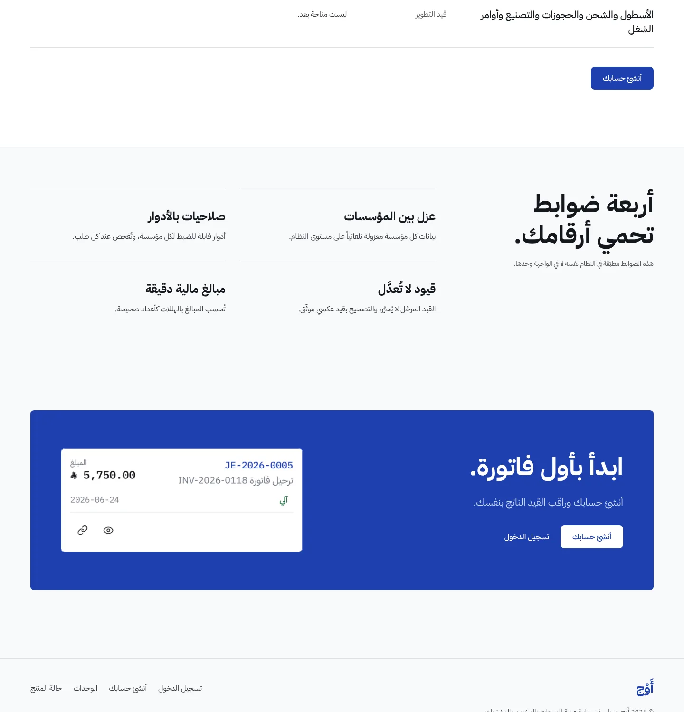
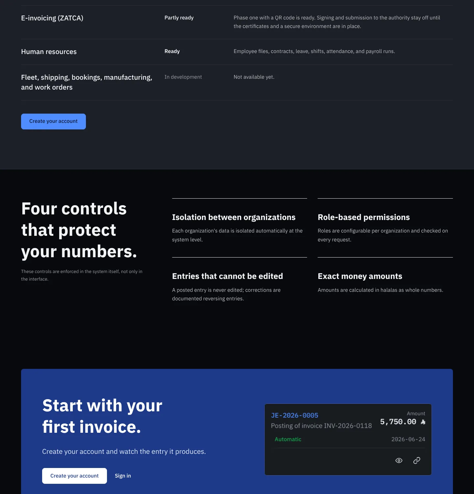
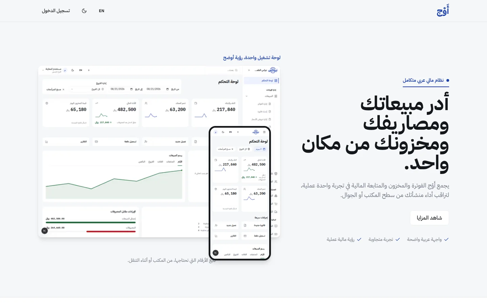
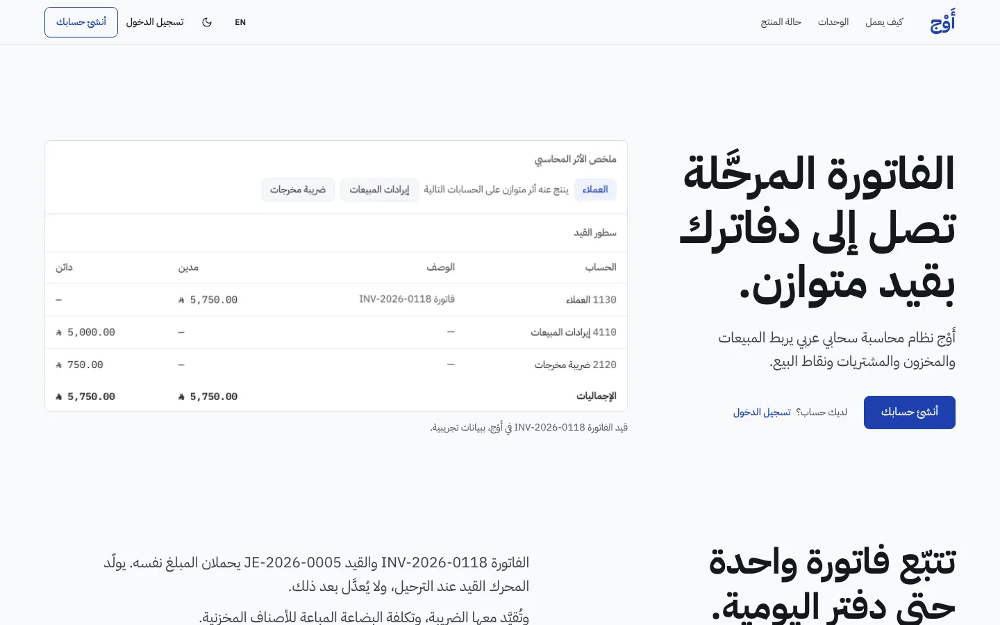

# تقرير: صفحة الهبوط العامة لأَوْج — Hallmark + سمة Core (PR #1759)

> الحالة: **PR #1759 مفتوح، دون دمج ودون نشر، بانتظار موافقتك.**
> النطاق: صفحة `/` ومكوّناتها المباشرة. لا مساس بالمحاسبة ولا API ولا قاعدة البيانات ولا المصادقة ولا ملفات السمات المشتركة.

## 1. ما تغيّر في هذه الجولة (فوق جولتي التنفيذ والتصحيح السابقتين)

| المحور | ما نُفِّذ |
|---|---|
| **سمة Core** | الصفحة العامة تعمل بسمة AWJ Core (أزرق الهوية) في الفاتح والداكن، عبر السمات المشتركة نفسها لا عبر نظام مكرر. التفاصيل في §2. |
| **الهوية التسويقية** | لغة تسويقية فوق الرموز المشتركة (أسطح وكتلة هوية وحركة)، دون نقل كثافة الـERP: كتلة الختام بلون Core وفيها القيد مرة أخرى عند لحظة التسجيل، وزر تسجيل بعد جدول الحالة، ورأس جدول الحالة مكدَّس بدل نمط «رأس وفقرة متقابلان» الموحّد، وأُعيد التقاط لقطات الهيرو والجوال. |
| **مراجعة بصرية مستقلة ثانية** | وكيلان في سياق جديد (سطح مكتب وجوال). حكما `fix`؛ طُبِّقت دفعة إصلاح واحدة (§3). |
| **المحتوى والجاهزية والصور** | أُنجز في الجولة السابقة ولم يُكرَّر: الادعاءات، جدول الحالة، اللقطات المحايدة، حذف الصور القديمة الأربع، وPR #1760 لزر اللغة. |

## 2. سمة Core

**مصدر الرموز (الحقيقة الواحدة):** `design-system/tokens/awj.tokens.json` ← `theme.core.light` / `theme.core.dark` (13 رمزاً) فوق `primitive.brand.*`، وتولّدها `web/scripts/generate-awj-tokens.mjs` في `web/src/app/globals.css` تحت `html[data-awj-ui="3"][data-awj-theme="core"]`. القيم المعتمدة (THEMES.md §6A): القشرة **`#1E40AF`** فاتح و**`#1E3A8A`** داكن، ونص أبيض في الوضعين.

**عقبة بنيوية وجدتُها:** Core يعمل فقط تحت بوابة الإصدار 3 (`data-awj-ui="3"`)، ومسار `/` **مستثنى عمداً** من تلك البوابة (`AWJ_UI_EXCLUDED_PATH_PATTERN`). فرموز Core غير موجودة على الصفحة العامة ما لم تُطبَّق السمتان صراحةً. وتعديل البوابة أو المولّد أو `globals.css` ممنوع بقيدك، ونسخ القيم إلى `landing.css` كان سيخلق نظام ألوان مكرراً بقيم ثابتة. لذلك:

| القرار | التنفيذ |
|---|---|
| تطبيق Core بالبنية الموجودة | `landing-theme-script.ts` (سكربت قبل الرسم، من ثوابت `awj-theme.ts` و`awj-ui-gate.ts`) و`landing-theme.tsx` (يُبقي السمتين طوال عمر الصفحة). السمة الافتراضية للصفحة العامة = Core. |
| لا تغيير لتفضيل المستخدم | لا كتابة في `localStorage`. تُحفظ سمة الزائر وتُعاد عند المغادرة (يعالج StrictMode وسبق السكربت). البوابة (`data-awj-ui`) تملكها مجموعة المسار التي تريدها، فتُزال عند المغادرة ويعيد المقصد (مثل `(app)`) تطبيقها بنفسه. |
| لا ألوان ثابتة | `landing.css` بلا أي hex/rgb/hsl (يحرسه اختبار)؛ كتلة الختام تقرأ `--awj-shell-bg` و`--awj-shell-fg`…، والأسطح من `--awj-surface-band/paper/desk`. البدائل (`var(--primary)`…) رموز قائمة وتعمل فقط إن غابت السمتان. |
| لا خيارات سمات في الصفحة | لا محدِّد ولا استيراد لـ`setAwjTheme`/`AccountPreferencesCard` (يحرسه اختبار). |

**ما تبيّن بالتجربة (وعولج):**
1. بوابة الإصدار 3 تُعيد ربط `--background` على لون «المكتب» البيج `#E9E8E4` في الفاتح؛ فاشتققتُ للصفحة التسويقية سطحاً من رموز مشتركة (`--awj-surface-band` للصفحة و`paper` للوحات في الفاتح، و`desk` و`paper` في الداكن) بدل أن تظهر الصفحة بلون الـERP.
2. حلقة التركيز المشتركة تساوي لون الهوية نفسه، فتختفي (1:1) على كتلة Core؛ كشفها sloplint (`FAIL 26a`). أُصلحت بقاعدة محصورة بالكتلة.

**تعليق Codex (P2) — تعارض دورة حياة البوابة عند التنقل من الـERP إلى الصفحة:** السبب الجذري صحيح ومُثبَت باختبار فاشل قبل الإصلاح. تأثير الرسم (`useLayoutEffect`) في الصفحة يضبط `data-awj-ui="3"` ثم يُشغَّل تنظيف التأثير السلبي في `(app)/layout.tsx` (يحذف البوابة)، فتبقى `core` بلا بوابة وتظهر الألوان القديمة. وهناك عيب ثانٍ وجدتُه: كانت الصفحة تلتقط `ui=3` القادم من الـERP «حالةً سابقة» وتعيدها عند مغادرتها إلى `/login`، فتسرّب البوابة إلى صفحة مستثناة. **الإصلاح (مكوّن واحد، دون لمس النظام المشترك):** تأثير سلبي إضافي يعيد التطبيق (تنظيفات التأثيرات السلبية لشجرة الخروج تعمل دائماً قبل تأثيرات شجرة الدخول)، وعند المغادرة تُزال البوابة وتُعاد سمة الزائر فقط. اختبارات جديدة (4): استبدال مسار عمل بالصفحة، العودة للمسار، المغادرة إلى صفحة غير محكومة، StrictMode؛ وفشل اثنان منها على الشيفرة القديمة.

**تحقق فعلي في متصفح حقيقي** (الإنتاج المبني): بلا تفضيل مخزّن، ومع `awj:theme=ink`، تكون `/` على `ui=3, theme=core`؛ و`/login` تحميلاً مباشراً أو بالانتقال من الصفحة تعود إلى حالتها (`null/null` أو `ink`)، و`localStorage` لم يتغيّر. **تنقل Client-side عبر `router.push/back`** (الإنتاج المبني): `/dashboard` (`ui=3`, `ink`) ← الصفحة: `ui=3, core` ← رجوع: `ui=3, ink` ← الصفحة ← `/login`: `ui=null, ink`؛ وفي ملف تعريف نظيف (بلا بوابة): `null/null` ← `3/core` ← `null/null` ← `/login` بلا سمات. **Default وInk لم أفحصهما تفصيلياً** (كما طلبت)؛ تأكدتُ فقط أن الملفات المشتركة بلا تعديل: `git diff` على `globals.css` و`awj-theme.ts` و`awj-ui-gate.ts` و`design-system/` و`web/scripts/` و`tailwind.config.ts` فارغ.

| Core فاتح — الختام | Core داكن (إنجليزي) — الختام |
|---|---|
|  |  |

| قبل (1440×900) | بعد (1440×900) |
|---|---|
|  |  |

## 3. المراجعة البصرية المستقلة الثانية

الحكم الأول لكل منهما: **fix**. التقييم بعد الإصلاح مني وحدي (لم أجرِ جولة ثالثة).

| الملاحظة | الحال |
|---|---|
| قائمة الفواتير تظهر ثلاث مرات (تدفق، تبويب المبيعات) | **جزئي**: تبويب «نقطة البيع» صار الأول. تبويب «المبيعات» ما زال يشبه قائمة قسم التدفق إن فُتح. |
| قسم الجوال يبدو مكسوراً (رأس سفلي، قصّ وسط رسم) | **حُلّ**: الرأس في الأعلى، واللقطة تنتهي عند حدّ بطاقة، والنص يطابق الصور («لوحة التحكم وفواتير المشتريات»). |
| لقطة الهيرو ناعمة، فراغ بين البطاقتين، نص ثانوي شاحب، المدين أحمر | **حُلّ** (إعادة التقاط: مبالغ بلون الحبر، لا فراغ، نص أغمق). لم ألتقط بدقة أعلى؛ الملف كما هو (≈2x). |
| نفس التكوين في كل الأقسام | **جزئي**: رأس جدول الحالة مكدَّس. قسما التدفق والوحدات على نمطهما. |
| لغة «ملاحظات داخلية» (تكرار «ببيانات تجريبية»، «لا عملاء نعرضهم بعد») | **حُلّ**: سطر إفصاح واحد في الهيرو وواحد في جدول الحالة؛ ملاحظة الأمان صارت «هذه الضوابط مطبّقة في النظام نفسه لا في الواجهة وحدها»؛ «أرقام بلا كسور عائمة» صارت «مبالغ مالية دقيقة». |
| نص قسم الوحدات صغير وضعيف | **حُلّ** (حجم المقدمة). |
| عنوان الهيرو الإنجليزي خمسة أسطر | **حُلّ** (ثلاثة أسطر، عمود أوسع). |
| لا زر تسجيل على الجوال بعد الهيرو | **حُلّ** بزر بعد جدول الحالة (لا زر في شريط الجوال: لا يتسع). |
| كتلة الختام نصفها فارغ | **حُلّ**: القيد `JE-2026-0005` على الكتلة في الشاشات ≥ 960px، ومخفي على الجوال لتجنّب التكرار. |
| تكرار «فاتورة ← قيد» على الجوال | **جزئي**: رأس قسم التدفق صار «تتبّع فاتورة واحدة حتى دفتر اليومية»، لكن الهيرو وبطاقتي القسم تعرض البيانات نفسها. |
| لا مؤشر لتمرير لقطات الوحدات على الجوال | **حُلّ جزئياً**: سطر «مرّر أفقياً…»؛ صف التبويبات نفسه بلا تدرّج. |
| «جاهزة» بلون الروابط | **حُلّ**. |
| لا رابط لمعاينة المنتج | **غير منفَّذ**: لا مسار معاينة عام مؤكد، ولم أخترع واحداً. |

## 4. الملفات المتغيّرة (قياساً على `origin/main`)

| الملف | التغيير |
|---|---|
| `web/src/app/page.tsx` | Server Component؛ سكربت Core + `LandingTheme`؛ كتلة الختام بالقيد؛ زر بعد جدول الحالة؛ ترتيب الوحدات |
| `web/src/app/landing.css` | أنماط `.lp`؛ رموز Core والأسطح التسويقية؛ حركة دخول واحدة (transform/opacity) |
| `web/src/components/landing/landing-theme.tsx` | **جديد**: دورة حياة سمة Core |
| `web/src/components/landing/landing-theme-script.ts` | **جديد**: سكربت ما قبل الرسم |
| `web/src/components/landing/landing-nav.tsx`, `landing-shot.tsx`, `module-tabs.tsx` | شريط، لقطات (جدول الأبعاد مُولَّد من الملفات)، مبدّل الوحدات |
| `web/src/messages/ar.json`, `en.json` | كتلة `landing` فقط |
| `web/src/app/landing-messages.test.ts`, `landing-theme.test.tsx` | اختبارات الرسائل (7) والسمة (8) |
| `web/public/landing/*.webp` | 56 لقطة؛ أُعيد التقاط الهيرو والجوال (12) في هذه الجولة |
| `web/public/landing/dashboard-*.png` | **حُذفت الأربع** (تأكد أنها غير مستعملة) |
| `docs/reports/...` | هذا التقرير وصوره |

لم يُعدَّل ملف مشترك. زر اللغة في PR منفصل #1760.

## 5. نتائج الفحوص (على الحالة النهائية للشيفرة)

| الفحص | النتيجة |
|---|---|
| TypeScript | صفر أخطاء في ملفات الصفحة (55 خطأ قائماً على `main` في اختبارات أخرى، لم أمسّها) |
| Lint | **لم يُنفَّذ**: لا ESLint مهيَّأ في المستودع |
| الاختبارات ذات الصلة | **319 اختباراً في 24 ملفاً ناجحة**: رسائل الصفحة، سمة الصفحة، `erp-ux-h1-7f` و`brand-migration-guard`، `i18n`، `components/layout`، `awj-theme` و`awj-ui-gate`، `design/` (يشمل `core-theme.test.ts`). لم أشغّل المجموعة الكاملة |
| Build | ناجح؛ `/` = 6.1 kB، First Load JS 141 kB |
| Hallmark `sloplint --render` | **0 FAIL، 0 REFLEX، 0 WARN** (بعد إصلاح FAIL 26a وREFLEX 79/44c أثناء الجولة). `--kept` غير متاح (فُقد سجل `before`) |
| axe (فاتح/داكن × ar/en، 1440 و375) | إنجليزي: **صفر**. عربي: مخالفة واحدة على `LangToggle` المشترك — **تبقى حتى دمج #1760** |
| أداء مخبري محلي | CLS = 0؛ LCP 152–280 ms (ليست مقاييس ميدانية) |
| فيضان أفقي / لوحة المفاتيح | لا فيضان (320–1920)؛ تبويبات RTL، القائمة، رابط التخطي تعمل |
| سمة Core | فاتح وداكن عبر ar/en على 1440 و375 (لقطات)؛ دورة الحياة في متصفح حقيقي |
| CI على PR | قيد التشغيل وقت كتابة هذا التقرير (اختبارات PHP على sqlite وpgsql، و`web build`، و`CI Gate`)؛ النتيجة تُذكر في وصف الـPR |

## 6. المخاطر والقيود

1. **قرار معماري يستحق مراجعتك:** Core صُمِّمت سمة قشرة لتطبيق الـERP تحت بوابة v3، والصفحة العامة مستثناة منها. تطبيقها هنا يغيّر سمتين على `<html>` طوال عمر الصفحة (وتُعاد عند المغادرة). بدائل رفضتُها: تعديل البوابة (ممنوع)، أو نسخ القيم (نظام مكرر). إن فضّلتَ سمة تسويقية رسمية داخل المولّد فهي شريحة منفصلة.
2. **كل قواعد v3 تعمل على الصفحة** (ربط `--primary` وحلقة التركيز…)، وقد وجدتُ تصادماً واحداً (الحلقة) وعالجتُه؛ أي قاعدة v3 تُضاف لاحقاً قد تصطدم. اختبارات الصفحة لا تغطي المظهر البصري آلياً.
3. **لقطات المنتج** من وضع المعاينة بنصوص محايدة مستبدَلة وقت الالتقاط (نص فقط، والأرقام والتخطيط كما هي). نصوص اللقطات صغيرة نسبياً على الجوال (≈10–11px)، وإعادة الالتقاط بعرض أضيق لم تُنفَّذ.
4. **أسماء المراجع على الجوال:** `JE-2026-0005` قد تنكسر عند الواصلة في سطر ضيق.
5. **حالة الموارد البشرية «جاهزة»** استناداً للقوائم والمسارات، بينما كتالوج التطبيقات يعدّ الرواتب والحضور والطلبات `coming_soon`. قرارك.
6. **ادعاءان حُذفا من الصفحة في الجولة السابقة:** «أكثر من 60 مجالاً» و«اختُبر في شركة حقيقية»؛ أعدهما فقط بدليل.
7. حجم HTML ≈ 880 KB بسبب تمرير كتالوج الترجمة كاملاً من `layout.tsx` (قائم قبل هذا العمل، خارج النطاق).
8. لا رابط لمعاينة المنتج لأن لا مسار عاماً مؤكداً؛ ولا قسم «قطاعات» لعدم وجود ما يثبته.
9. الاختبارات الآلية للمظهر غير موجودة؛ التحقق البصري يدوي.

## 7. Branch وPR وSHA

| البند | القيمة |
|---|---|
| Branch | `feat/landing-hallmark-redesign` |
| PR | #1759 — https://github.com/safwan5001-source/Nebrax/pull/1759 |
| Base | `main` |
| Merge-base | `585691b97a0bd65b848ee0cf12d1e2430b28a8c7` |
| `origin/main` وقت الكتابة | `3f331dd49e46b94f8a415bca3b3ea5881e62247b` |
| Head SHA (الشيفرة) | `02c1ddf5801d2f3bb505c52018a44bdb5fb98f74` |
| Head SHA (بعد هذا التقرير) | يُذكر في وصف الـPR ورسالة التسليم |
| PR المرافق | #1760 (زر اللغة، فرع `fix/lang-toggle-label-in-name`) |

## 8. الخطوة التالية

1. قرارك في §6 (البند 1 خاصة) والبنود 5–6.
2. موافقتك على دمج #1760 أولاً ثم #1759؛ لا دمج ولا نشر قبلها.
3. بعد الدمج: قياس ميداني لـCore Web Vitals ونقر «أنشئ حسابك».
