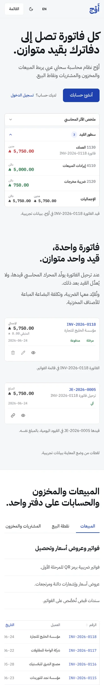

# تقرير: إعادة تصميم صفحة الهبوط العامة لأَوْج بمهارة Hallmark

> الحالة: **PR #1759 مفتوح وجاهز للمراجعة، دون دمج ودون نشر.**
> النطاق: صفحة `/` ومكوّناتها المباشرة فقط. لا مساس بالمحاسبة ولا API ولا قاعدة البيانات ولا المصادقة.

## 1. ملخص التطوير

**الفكرة.** الصفحة القديمة كانت «لوحة تحكم + ست بطاقات + شرائح» تصلح لأي منتج. الصفحة الجديدة تبدأ بالدليل الذي لا يملكه إلا نظام قيد مزدوج: فاتورة حقيقية والقيد المتوازن الذي ولّدته، ملتقَطين من المنتج نفسه.

| ما تغيّر | التفصيل |
|---|---|
| الهيرو | عنوان «كل فاتورة تصل إلى دفاترك بقيد متوازن.» وسطر واحد وزر «أنشئ حسابك» (لم يكن في الصفحة القديمة أي زر تسجيل). الصورة قيد `JE-2026-0005` الحقيقي: مدين العملاء 5,750.00، ودائن المبيعات 5,000.00 والضريبة 750.00، والإجماليان متساويان. |
| فاتورة ← قيد | شريطان حقيقيان (قائمة الفواتير وقائمة القيود) والصفّان المتطابقان `INV-2026-0118` و`JE-2026-0005` مُبرَزان بإطار. على الجوال تُعرض بطاقتان حقيقيتان بدل الشريطين. |
| الوحدات | مبدّل من خمس وحدات (المبيعات، نقطة البيع، المشتريات والمخزون، الحسابات، التقارير) بلقطة حقيقية مقصوصة على المنطقة التي تسميها. لوحة المفاتيح مدعومة، وعلى الجوال تُمرَّر اللقطة أفقياً لتبقى مقروءة. |
| الجوال | لقطات جوال حقيقية لا تكرر ما في الأقسام الأخرى (لوحة التحكم وبطاقتا مشتريات). |
| الوضوح والثقة | جدول **«ما يعمل اليوم، وما لم يكتمل»** من ست صفوف بحالات جاهزة / جاهزة جزئياً / قيد التطوير، وسطر «لا عملاء نعرضهم بعد»، وأربعة ضوابط حقيقية (عزل المؤسسات، الأدوار، قيود لا تُعدَّل، مبالغ بالهللات) مع جملة «لا نذكر شهادات لم نحصل عليها». |
| الختام | كتلة بلون الهوية بزر «أنشئ حسابك» ورابط الدخول. |
| التنقل | شريط علوي بحافتين (الشعار ثم ثلاثة روابط، وعند الطرف اللغة والسمة والدخول و«أنشئ حسابك»)، وقائمة منسدلة تحت 960px. |

**تصحيحات صدق المحتوى** (مهمة، تستحق قرارك):

1. الصفحة القديمة قالت «فواتير ضريبية متوافقة مع المرحلتين». في الكود التوقيع والإرسال لهيئة الزكاة **معطَّلان** بانتظار الشهادات والبيئة الآمنة. كُتبت الحالة كما هي في الجدول: المرحلة الأولى (QR) جاهزة، والتوقيع والإرسال معطَّلان.
2. قسم «القطاعات» وعد بالأسطول والحجوزات والتصنيع وأوامر الشغل، وكلها `coming_soon` في `ApplicationCatalog`. حُذف القسم، وهذه الوحدات مدرجة الآن في صف «ليست متاحة بعد».
3. نص «جرّب ببيانات تجريبية» وُجد دون أي رابط يوصل إليه، وزر الدخول التجريبي لا يظهر إلا في بناء `NEXT_PUBLIC_DEMO_PREVIEW=true`. استُبدل بزر تسجيل حقيقي (`/register`) دون وعد بتجربة مجانية أو أسعار.

## 2. مقارنة قبل وبعد

| المقياس | قبل | بعد |
|---|---|---|
| Hallmark (أرضية `FAIL`) | 2 | **0** |
| Hallmark (`REFLEX`) | 5 (3، 26b، 59، 77، 78) | **0** |
| Hallmark (`WARN`) | 3 (29، F19، F26) | **0** |
| زر تسجيل حساب | لا يوجد | الشريط والهيرو والختام |
| صور المنتج | لقطتان قديمتان تحملان اسم العلامة السابقة داخل الواجهة، يتداخل معهما الشرح | 56 لقطة WebP حديثة (ar/en × فاتح/داكن)، شرحها مفصول عنها |
| الكلمات المرئية | 533 | 316 |
| ارتفاع الصفحة على الجوال (375px) | 7,687px | 6,647px |
| عناوين الأقسام (1440) | 30px تحت عنوان 58px | 52px تحت عنوان ≈ 65px |
| صفحة العميل (client JS) | `'use client'` كاملة مع `useTheme` وحالة `themeReady` | Server Component، والتبديل بين الفاتح/الداكن بـ CSS فقط |
| ترتيب التحميل | يعرض هيكلاً نابضاً حتى hydration | لا هيكل ولا إزاحة (CLS = 0) |

الصور (الملفات في `docs/reports/assets/landing-hallmark/`):

| قبل (1440×900) | بعد (1440×900) |
|---|---|
|  |  |

| قبل (375px، أول ثلاث شاشات) | بعد (375px، أول ثلاث شاشات) |
|---|---|
|  |  |

### أبرز الأسطر المتغيّرة

| الموضع | قبل | بعد |
|---|---|---|
| عنوان الهيرو | أدر مبيعاتك ومصاريفك ومخزونك من مكان واحد. | كل فاتورة تصل إلى دفاترك بقيد متوازن. |
| سطر الهيرو | يجمع أَوْج الفوترة والمخزون والمتابعة المالية في تجربة واحدة عملية، لتراقب أداء منشأتك من سطح المكتب أو الجوال. | أَوْج نظام محاسبة سحابي عربي يربط المبيعات والمخزون والمشتريات ونقاط البيع. |
| الإجراء الرئيسي | «شاهد المزايا» (رابط داخلي) | «أنشئ حسابك» ← `/register` |
| ZATCA | فواتير ضريبية متوافقة مع المرحلتين، ورمز QR، وسلسلة هاش PIH. | المرحلة الأولى برمز QR جاهزة. التوقيع والإرسال إلى الهيئة معطَّلان حتى تتوفر الشهادات والبيئة الآمنة. |
| تذييل الصفحة | © 2026 أَوْج — منصة سحابية متكاملة لإدارة المؤسسات. | © 2026 أَوْج. منصة سحابية متكاملة لإدارة المؤسسات. (الشرطة الطويلة ممنوعة في بوابة النسخ 19) |

المحذوف عن عمد (مسجَّل في ترويسة `landing.css`): أقسام `industries` و`journey` و`about` و`start`، وبطاقات الميزات الست، وشريط «واجهة عربية واضحة / تجربة متجاوبة / رؤية مالية عملية»، وبطاقات قصة الشركة والرؤية، ومعالج النقر على رابط التخطي (يتولى المتصفح نقل التركيز إلى `main[tabindex=-1]` بالقفز إلى المعرّف). النصوص الأصلية محفوظة في تاريخ git.

## 3. الملفات المتغيّرة

| الملف | التغيير |
|---|---|
| `web/src/app/page.tsx` | إعادة كتابة كاملة: Server Component، `generateMetadata` (وصف مترجم) |
| `web/src/app/landing.css` | جديد: أنماط الصفحة بنطاق `.lp`، رموز، ترويسة Hallmark |
| `web/src/components/landing/landing-nav.tsx` | جديد: شريط علوي وقائمة الجوال (Esc يعيد التركيز للزر) |
| `web/src/components/landing/landing-shot.tsx` | جديد: لقطتان لكل سمة، الأبعاد من جدول واحد |
| `web/src/components/landing/module-tabs.tsx` | جديد: مبدّل الوحدات (أسهم تراعي RTL وHome/End) |
| `web/src/messages/ar.json` و`en.json` | استبدال كتلة `landing` فقط (98 مفتاحاً متطابقاً) |
| `web/src/app/landing-messages.test.ts` | جديد: تكافؤ ar/en ووجود كل مفتاح تستعمله الصفحة |
| `web/public/landing/*.webp` | 56 لقطة جديدة (≈ 2 MB) |
| `docs/reports/...` | هذا التقرير وصوره |

لم يُحذف أي ملف ولم يُعدَّل أي اختبار قائم. الصور القديمة الأربع `web/public/landing/dashboard-*.png` **باقية دون استعمال** (انظر القيود).

## 4. نتائج الفحوص

| الفحص | النتيجة |
|---|---|
| TypeScript (`tsc --noEmit`) | صفر أخطاء في ملفات الصفحة. المشروع يحمل 55 خطأ **موجوداً على `main`** في ملفات اختبار أخرى (مثل `pos/settings/configuration/page.test.tsx`)، لم أمسّها. |
| Lint (`next lint`) | **لم يُنفَّذ**: المستودع بلا ESLint ولا إعداد له (الأمر يطلب تهيئة تفاعلية)؛ لم أضف تهيئة لأنها خارج النطاق. |
| Build (`npm run build`) | ناجح. المسار `/`: 5.38 kB، First Load JS 140 kB (المشترك 103 kB). |
| الاختبارات | 19 ملفاً / 99 اختباراً ناجحاً، منها حارس الشعار `erp-ux-h1-7f` (فئات شريط الدعوة) و`brand-migration-guard` والاختبار الجديد. لم أشغّل المجموعة الكاملة (ضخمة ولا تمس الصفحة). |
| Hallmark `sloplint --render --kept` | **0 FAIL، 0 REFLEX، 0 WARN**. سجل المحتوى: الروابط 4/4، العناوين الثلاثون الساقطة مسجّلة بأسبابها. |
| axe (WCAG 2.2 AA + best-practice) | إنجليزي (فاتح وداكن، مكتب وجوال): **صفر**. عربي: مخالفة واحدة (`label-content-name-mismatch`) على زر اللغة المشترك (`LangToggle`: الاسم «تبديل اللغة» والنص المرئي «EN»). المكوّن مشترك بين التطبيق كله فلم أغيّره. |
| الأداء (إنتاج محلي بلا تقييد) | CLS = 0 في الحالات الثلاث المقيسة. LCP 172–232 ms. هذه أرقام مختبر محلي وليست Core Web Vitals ميدانية. |
| الفيضان الأفقي | لا فيضان عند 320 و375 و414 و768 و1024 و1280 و1440 و1920 (عربي وإنجليزي). |
| لوحة المفاتيح | تبويبات الوحدات (RTL: السهم الأيسر للتالي، End للأخير)، القائمة (تُفتح وEsc يغلقها ويعيد التركيز للزر)، رابط التخطي ينقل التركيز إلى `main`. |
| تقليل الحركة | لا حركة سوى انتقال لون 120ms، ويُعطَّل تحت `prefers-reduced-motion`. |
| الصور | فاتحة أو داكنة فقط تُحمَّل (الأخرى `display:none` فلا تُجلب)، وأبعاد كل ملف محجوزة، وجدول الأبعاد في `landing-shot.tsx` مُولَّد من الملفات الـ56 نفسها (لا اختلاف). |

## 5. المراجعة البصرية

- **ما شاهدتُه فعلاً** (لقطات حقيقية من النسخة المبنية): الهيرو عند 1440 و1280 و768 و375 بالعربية الفاتحة والداكنة والإنجليزية الفاتحة والداكنة، وأقسام الصفحة كلها عند 1440، وعند 375 الهيرو والتدفق والوحدات والجوال والحالة والختام، وعرض 768 للوحدات. لم أعاين الأقسام كلها في كل تركيبة لغة وسمة؛ فحص axe والفيضان غطّيا التركيبات.
- **مراجعتان في سياق مستقل (وكيلان فرعيان):** مراجعة الهيرو ومراجعة الإنهاء. كلتاهما حكمت `fix`.
  - الهيرو (5 ملاحظات): حُلّت أربع (الصورة صارت القيد نفسه، قصّ نظيف دون أشرطة التطبيق، العنوان حتى 68px (≈ 65px عند 1440)، هيرو الجوال صار القيد)، و**جزئية واحدة**: صورة الهيرو ≈ 840×410 عند 1440 (≈ 46% من ارتفاع الشاشة، دون عتبة 60% الإرشادية) لأن قص بطاقتي الملخص والسطور بنسبة عريضة.
  - الإنهاء (8 ملاحظات): حُلّت التكرارات (هيرو الجوال والأقسام لقطات مختلفة)، وقصاصات الوحدات مقروءة قرابة 1:1، وصفّا الفاتورة والقيد مُبرَزان، وزر «أنشئ حسابك» في الشريط، والنص الصغير أُغمق (`--lp-ink-3`)، وعناوين الوحدات والضوابط أُعيدت صياغتها، وأُضيف صف الموارد البشرية. **جزئياً:** كتلة الختام نصفها فارغ، وإيقاع الأقسام (حاو/نطاق متناوب) ما زال منتظماً، وحالة ZATCA في الجدول لا في الهيرو.
  - لم أُجرِ جولة تقييم ثانية بوكيل مستقل؛ التقييم بعد الإصلاح مني أنا، ومثبَّت بنتائج sloplint وaxe والقياسات أعلاه.
- **ما فعلته الصفحة القديمة أفضل:** قسم «القطاعات» يجيب «هل هذا لنشاطي؟» (حُذف لأن وعوده غير مبنية)، وكانت تُظهر اتساع المنتج في أول شاشة (لوحة التحكم + الجوال) بينما الهيرو الآن يركّز على القيد وحده.

## 6. المخاطر والقيود المتبقية

1. **اللقطات من وضع المعاينة** (بيانات تجريبية) وكلها معلَنة بتعليق «ببيانات تجريبية». تظهر فيها شركة العرض `نبراس الطموح` وأسماء عملاء تجريبية بالعربية حتى في النسخة الإنجليزية. تأكد أن ذلك مقبول تجارياً.
2. **اللقطات ثابتة**: أي تغيير لاحق في واجهات المنتج يتطلب إعادة الالتقاط. سكربت الالتقاط استُعمل من مجلد مؤقت ولم يدخل المستودع؛ أوصي بتحويله إلى أمر موثّق.
3. **زر اللغة** (`LangToggle`) يخالف WCAG 2.5.3 في العربية (اسمه لا يحوي نصه المرئي). الإصلاح في المكوّن المشترك ويحتاج قراراً لأنه يمس رأس التطبيق كله.
4. **حجم المستند**: HTML الصفحة ≈ 882 KB (≈ 200 KB مضغوطاً) لأن `layout.tsx` يمرّر **كتالوج الترجمة كاملاً** إلى كل صفحة. موجود قبل هذا العمل وخارج النطاق؛ تقليصه يفيد LCP على الجوال البطيء أكثر من أي تعديل في الصفحة.
5. **ادعاءات من المالك أُبقيت كما وجدتها**: «أكثر من 60 مجالاً» (جملة واحدة في جدول الحالة، دون رقم كبير) و«اختُبر في تشغيل شركة حقيقية قبل أن يصل إلى أي عميل». تحقق منهما.
6. **سلاسل وبنية**: صف الموارد البشرية كُتب «جاهزة جزئياً: ملفات الموظفين والورديات والأدوار» اعتماداً على كتالوج التطبيقات (`hr.employees` مبنية والبقية `coming_soon`) رغم أن شاشة HR تحوي تبويبات للحضور والرواتب. حدّث الصف متى حسمتَ نضج الرواتب والحضور.
7. **ما أُبقي ولم يُحذف**: ملفات `web/public/landing/dashboard-*.png` القديمة (تحمل علامة قديمة داخل الواجهة) باقية دون استعمال؛ الحذف يحتاج موافقتك.
8. **مشكلة منتج لاحظتُها** ولم أعرضها: معاينة مستند الفاتورة تكتب «ريال» نصاً بعد المبالغ، بينما `DESIGN_SYSTEM.md` يفرض الرمز `𞸁`. لذلك لم ألتقط شاشة المستند.
9. **مهارة Hallmark** غير مدمجة في `main` (فرع `chore/add-hallmark-skill`)؛ لذلك لم تدخل ملفاتها هذا الـPR ولا مجلد `.hallmark`.
10. قصاصة «المبيعات» مقطوعة عند حافتها: جدول الفواتير أعرض من القصاصة (826px) فيظهر آخر عمود («السداد») ناقصاً عند الحافة. غير مؤثر على المحتوى لكنه ملحوظ بصرياً.
11. لا اختبارات واجهة آلية للمظهر (لا Playwright لهذه الصفحة)؛ التحقق البصري يدوي كما وُصف.

## 7. Branch وPR وSHA

| البند | القيمة |
|---|---|
| Branch | `feat/landing-hallmark-redesign` |
| PR | #1759 — https://github.com/safwan5001-source/Nebrax/pull/1759 |
| Base | `main` |
| Base SHA (وقت الإنشاء) | `585691b97a0bd65b848ee0cf12d1e2430b28a8c7` |
| Head SHA (الشيفرة) | `c6dc3bee23d3f549522531570f3a79dc1f6cb9cc` |
| Head SHA (بعد إضافة هذا التقرير) | يُذكر في رسالة التسليم وفي هذا الـPR (التقرير وحده يضيف التزاماً) |
| حالة الدمج | `main` تقدّم إلى `c7d8ccf` بتعديلات على ملفي الرسائل في أقسام أخرى؛ الدمج المحاكى **نظيف**. |

## 8. الخطوة التالية المقترحة

1. مراجعتك للصفحة (سطح مكتب وجوال، عربي وإنجليزي) والقرار في البنود 1 و3 و5 و6 و7.
2. بعد الموافقة: دمج الـPR. النشر قرار منفصل.
3. بعد الدمج بأسبوع: قياس Core Web Vitals الميدانية (Vercel Analytics) ومعدل الضغط على «أنشئ حسابك».
4. شريحة لاحقة: تقليص كتالوج الترجمة المرسل إلى الصفحات العامة، وإصلاح `LangToggle`، وإضافة قسم «القطاعات» من جديد بما هو مبني فعلاً (التجزئة، الخدمات) حين يتوفر دليل.
