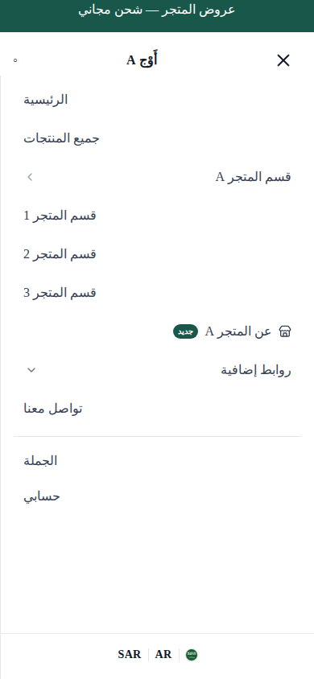
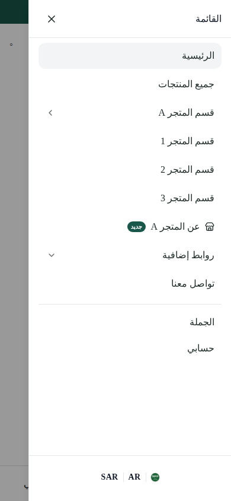
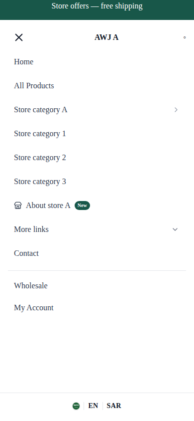
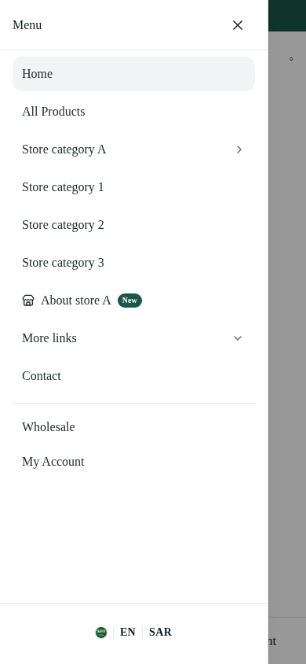

# AWJ — Global Mobile Navigation: الأدلة

**النتيجة:** 1,288 فحص متصفح عبر 40 حالة؛ 0 إخفاقات. [القياسات النهائية](after/results.json).

> هذه صور المكوّن الإنتاجي مع CSS وترجمات وسياق متجر حقيقيين، لكن ببيانات tenants اصطناعية وإطار شرائط محاكى. ليست صور متاجر منشورة. Before التُقط قبل تعديل المصدر على Base `3f6215fbdca6568bfe417ae8487303d5ec5ccf9d`.

## Before / After — المتجر A، جوال 390px

| الاتجاه | Before | After |
| --- | --- | --- |
| العربية RTL |  |  |
| الإنجليزية LTR |  |  |

## الجهاز اللوحي 768px

| الاتجاه | Before | After |
| --- | --- | --- |
| RTL | [الصورة](before/a-ar-768-short.png) | [الصورة](after/a-ar-768-short.png) |
| LTR | [الصورة](before/a-en-768-short.png) | [الصورة](after/a-en-768-short.png) |

## المتجر B — تخصيص وعملة مختلفان بعد الإصلاح

- [RTL — 390px](after/b-ar-390-short.png)
- [LTR — 390px](after/b-en-390-short.png)
- [RTL — 768px](after/b-ar-768-short.png)
- [LTR — 768px](after/b-en-768-short.png)

## السبب والإصلاح

- البنية مشتركة: `(storefront)/layout.tsx` → `HeaderMobileMenu` → `MobileMenu` → `SheetContent`/Radix. روابط التاجر المشتركة مع Desktop لم تتغيّر.
- على الهاتف كانت ترويسة القائمة مخفية وزر الإغلاق الداخلي غير متاح، مع drawer بعرض الشاشة وخلفية شفافة وoffset مشتق من تقدير ارتفاعات الترويسة بدل ارتفاعها الفعلي.
- `text-left` وألوان الأبيض/الرمادي الصريحة داخل القائمة تنازع RTL وتجاوز بعض ألوان tenant. جهة `side` كانت صحيحة مسبقًا؛ حُفظت وأضيف `dir` صريح ومحاذاة وتحريك منطقيان.
- الصفوف أصبحت غير قابلة للتقلص، بحد أدنى 44px، مع scroll مستقل وfooter ثابت آمن في كل مستويات التصنيفات.
- القائمة الآن modal بطول `dvh` وبعرض أقصى 384px، مع مساحة خارجية لا تقل عن 48px على الجوال. تغطي طبقة scrim الشرائط وتمنع التفاعل معها، دون تغيير تصميمها أو إعداداتها.
- إصلاح اختيار اللوحة النشطة أثناء Back يزيل فجوة انتقال الـ300ms الموجودة في خط الأساس. كل مسارات الإغلاق تلغي callbacks وتعيد القائمة الرئيسية.

## الفحوص

- الوحدة المركزة النهائية: **31 ناجحًا** (منها 15 لـMobileMenu).
- المجموعة الشاملة المحلية قبل التعديل الأخير لحركة Back: **2,687 ناجحًا، 15 متجاوزًا** في 219 ملفًا؛ بعد إصلاح Back أُعيدت الفحوص المركزة وTypeScript وBuild. نتيجة CI للرأس النهائي تُراجع في PR.
- TypeScript النهائي وlint واللغات: ناجحة. ملاحظات lint غير حاجبة موجودة في ملفات غير معدلة.
- Build النهائي: exit 0، تجميع و77 صفحة static ناجحة. ظهر تحذير fetch في sitemap بسبب توجيه Store APIs إلى عنوان محلي غير فعال عمدًا؛ لا اتصال بمتاجر الإنتاج.
- المتصفح: AR/EN × متجرين × 320/390/430/768/1023 × قصيرة/طويلة، مع Safe Area محاكاة وتقليل الحركة ودوران الشاشة وحصر التركيز واختبارات الإغلاق وطبقات الشرائط والنافذة المتداخلة.

## حدود التنفيذ

لا Backend أو DB أو طلبات أو دفع أو routes جديدة أو تغييرات إعدادات tenants. لا دمج أو نشر. عزل العرض والعملات والروابط وأعلام المزايا مثبت ببيانات اختبار متعارضة؛ عزل الخلفية لم يتغيّر ولم يُدّعَ اختباره حيًّا.

**المتبقي قبل الإصدار:** Safari/VoiceOver وiPhone فعلي، والتحقق القراءة فقط من tenants حقيقية بإعداداتها المنشورة. ثم مراجعة PR وموافقة صريحة قبل أي دمج أو نشر.

[طريقة إعادة تشغيل الإثبات](../../../storefront/scripts/mobile-menu-proof/README.md)
